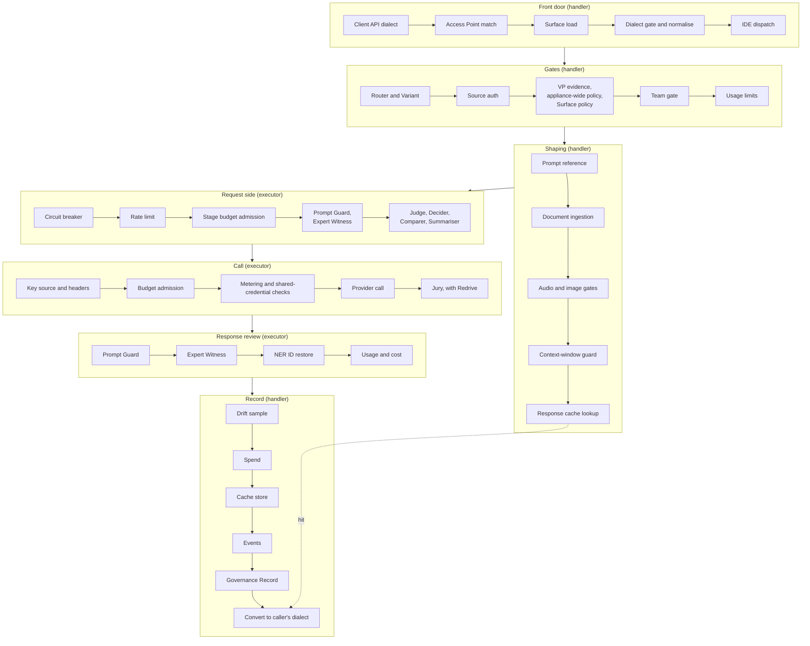
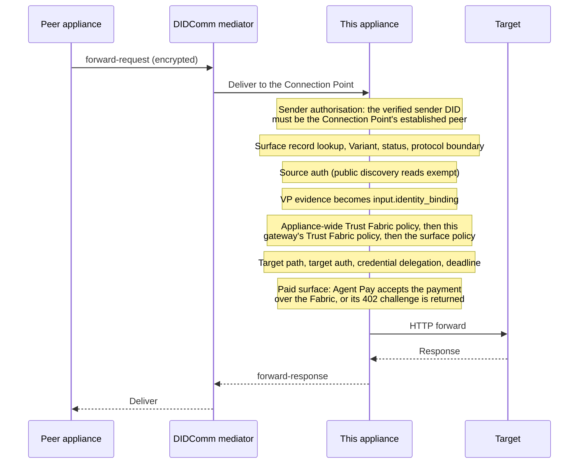

# Architecture

How Agent Stream is put together, and where in `src/` each part lives.

This page is for contributors changing the code. For what the product does and how to
operate it, use the hosted [architecture concepts](https://docs.affinidi.com/products/affinidi-trust-fabric/agent-stream/concepts/architecture/).
For the meaning of a term, use [`CONTEXT.md`](CONTEXT.md). For the rules a change must
follow, use [`AGENTS.md`](AGENTS.md) and [`CONTRIBUTING.md`](CONTRIBUTING.md).

## System shape

Agent Stream is one Rust binary, `agent-stream`, built from [`src/`](src/). A React
dashboard, built from [`www/default/`](www/default/), is served by the same process.
There is no required database and no sidecar.

The process serves three things.

| Plane | What it serves | Where it binds |
| --- | --- | --- |
| Management plane | The management REST API under `/api/v1/…` ([`src/identity/router.rs`](src/identity/router.rs), plus the vault router in [`src/secrets/router.rs`](src/secrets/router.rs) and the credential-delegation router in [`src/delegation_vault/router.rs`](src/delegation_vault/router.rs), omitted only if its stores fail to initialise), DID documents, and the dashboard as a static single-page app | Merged into the first inbound HTTP and the first inbound HTTPS listener in `agent-stream.json` |
| Data plane | Surfaces: for each prefix in `pipe_paths` (the example configuration uses `/llm` and `/models`), `{prefix}/{route}/…` and `{prefix}/{route}${variant}/…` ([`src/proxy/server.rs`](src/proxy/server.rs)) | Every inbound listener in `agent-stream.json` |
| Fabric | DIDComm Connection Points to peer appliances, as outbound WebSocket connections to mediators | No local port |

Every listener binds `0.0.0.0` on its configured port, one Axum task per port. Listeners of
type `outbound` are not served. In a local `make run-debug`, the binary serves the built
dashboard and a development server on port 3002 proxies to it as well.

A **Surface** is the unit the data plane is organised around. In code it is `PipeConfig`
([`src/pipes/config.rs`](src/pipes/config.rs)), served by [`src/pipes/`](src/pipes/).
Read it before changing anything on the request path; almost all behaviour hangs off it.
A separate internal record, `AgentSurface`
([`src/config/agent_surface.rs`](src/config/agent_surface.rs)), is what a peer appliance
reaches over the [Fabric path](#fabric-path).

## State and storage

| Layer | Behaviour |
| --- | --- |
| Runtime | DashMap caches are authoritative ([`src/storage/filesystem.rs`](src/storage/filesystem.rs)). |
| Disk | JSON files under `_storage/`, written immediately on change. Every path comes from `[storage_paths]` in `config.toml`, relative to that file. |
| External edits | Edits to Surfaces and the other refreshed stores are picked up within `cache_refresh_interval_secs` when it is greater than 0 (default 0, off); otherwise restart. Members, Teams, Prompts, policy definitions, and the other stores loaded at startup need a restart. See [`docs/CONFIGURATION_RELOAD.md`](docs/CONFIGURATION_RELOAD.md). `POST /api/v1/config/reload` rebuilds only the internal surface records, not Surfaces, Members, or Teams. |
| Time series | An embedded round-robin store ([`src/timeseries/`](src/timeseries/)) behind usage telemetry, operational metrics, and drift. Flushed on shutdown. |
| Governance | Signed, hash-chained records with one writer task per Surface ([`src/governance/`](src/governance/)). |
| Media | A content-addressed multimedia store, encrypted when encryption at rest is enabled. |
| Secrets | The filesystem. `secrets_backend = "aws"` is accepted but not implemented; see [`docs/CONFIGURATION_REFERENCE.md`](docs/CONFIGURATION_REFERENCE.md). |
| Encryption at rest | A required choice in `[encryption]`: enabled with a key source, or explicitly opted out with `allow_unencrypted`; startup refuses a configuration that makes neither choice, or both. Initialised before any store opens ([`src/encryption/`](src/encryption/)). See [`docs/ENCRYPTION_AT_REST.md`](docs/ENCRYPTION_AT_REST.md). |

Everything in `config.toml` is read once at startup.

## Startup

[`src/main.rs`](src/main.rs) prepares configuration and hands over to
[`server::run_axum_proxy`](src/server/orchestrator.rs), which builds every store and
router and binds the listeners.

1. Parse arguments; the default bootstrap file is `config.toml`. Some flags (`--generate-bootstrap`, `--decrypt-export`, `--export-storage`) run and exit.
2. Read the bootstrap TOML. It names every other file under `[config_files]` and sets `server_mode` and `cache_refresh_interval_secs`.
3. Refuse to start without an explicit encryption-at-rest choice, then check for a pending backup restore, so a restore never writes storage first. Completing one exits the process. Then validate the rest of the bootstrap file.
4. Load `agent-stream.json` (required), Prompt Guard definitions, logging and OpenTelemetry, and resource limits.
5. Initialise encryption at rest and run its fail-closed preflight.
6. Load the internal surface records, validate configuration, and hand over to the orchestrator.
7. Open the settings, identity, secrets, and policy-definition stores, and the authentication mode (passkey, SAML or OIDC).
8. Open the gateway, mediator, credential, model catalog, media, and governance stores.
9. Open the Surface store, compile every Surface and appliance-wide policy, and start the enabled Surfaces.
10. Compile Trust Fabric policies; a compile failure exits the process.
11. Open the budget, response-cache, Member, Prompt, and Team stores, seeding default Members and Teams.
12. Open the telemetry and drift stores and start the governance retention sweep, drift evaluator, and drift scheduler.
13. Create the connection-point listener manager and start activation in the background. Activation reloads Surfaces and the Surface, Member and Team spend counters, migrates inline integration credentials to the secrets store and pins integration destinations, marks the process ready, then validates integrations and starts the Connection Points in the background.
14. Build source authentication, the management router, the vault router, and the DID router. A route-prefix collision with the dashboard exits the process.
15. Bind one server per configured port, then start the periodic metrics and session-cleanup tasks.

`/api/v1/health` returns 200 once activation has marked the process ready and it is
Active; `/api/v1/alive` always returns 200. `server_mode` selects `active` or `standby`
at startup; `SIGUSR1` promotes and `SIGUSR2` demotes ([`src/server/mode.rs`](src/server/mode.rs)).
Demotion stops the Connection Points; HTTP listeners stay up. See
[`docs/CONFIGURATION_RELOAD.md#server-mode`](docs/CONFIGURATION_RELOAD.md#server-mode).

`SIGTERM` or Ctrl-C stops the process: `main.rs` flushes the system metrics, usage
telemetry, operational metrics and drift stores to disk, shuts down OpenTelemetry, and exits,
allowing each step 10 seconds. In-flight requests are not drained.

## Request path

Caller → Access Point → Surface → provider. A chat request enters
`handle_chat_completions` in
[`src/pipes/handlers/http_handlers.rs`](src/pipes/handlers/http_handlers.rs); the handler
runs the front door and the gates, then hands the request to the executor in
[`src/pipes/executor.rs`](src/pipes/executor.rs).

The diagram groups the stages; the tables and the [full order](#full-order) below list
each one.

### Front door and gates

All of these live in [`src/pipes/handlers/http_handlers.rs`](src/pipes/handlers/http_handlers.rs)
unless the table says otherwise.

| Stage | Owns | Refuses with |
| --- | --- | --- |
| Client API dialect | Detects OpenAI Chat, Anthropic Messages, or OpenAI Responses from the path ([`src/pipes/ingress.rs`](src/pipes/ingress.rs)) | — |
| Stage streaming | `x-agent-stream-emit-stages: true` wraps the run in an event stream; see [`docs/OBSERVABILITY.md`](docs/OBSERVABILITY.md) | — |
| Access Point match | Longest-prefix route match for the listener, and the `$alias` | 404 |
| Surface load | The cached Surface with appliance-wide defaults applied; a disabled Surface is unavailable | 404 |
| Dialect gate | `accepted_ingress_schemas`, normalisation to OpenAI Chat, reasoning-budget cap | 404 `ingress_format_not_accepted` |
| IDE dispatch | IDE Surfaces only; see [IDE Surface dispatch](#ide-surface-dispatch) | 400, 403, 404, 429 |
| Router and Variant | `$alias`, then a routing rule, then a canary split, then base (`resolve_route_decision`; Variants in [`src/pipes/pipe_variants.rs`](src/pipes/pipe_variants.rs)) | 404, 503, 500 |
| Source auth | The resolved Variant's API key, JWT, or mTLS check ([`src/source_auth/`](src/source_auth/)) | 401, or 503 if the middleware is unavailable |
| Inbound policy | VP evidence, then the appliance-wide policy for the Surface type, then the Surface policy; deny-overrides, fail-closed (`enforce_inbound_policy`; engines in [`src/pipes/policy_manager.rs`](src/pipes/policy_manager.rs)) | 403 |
| Team gate | Member and Team resolution, access, model allow-list, per-Member rate and token caps; sets the call budget but does not check it ([`src/teams/gate.rs`](src/teams/gate.rs)) | 403, 429, 503 |
| Usage limits | Surface-level monthly spend (catalog cost) and token caps | 429 |
| Prompt reference | Expands a stored Prompt ([`src/prompts/`](src/prompts/)) | 400 |
| Document ingestion, audio and image gates | Allow-lists, capability, format, and size | 400 |
| Context-window guard | Middle-out compression to fit the model | — |
| Response cache lookup | An exact or semantic hit returns the stored answer, skipping every stage below | — |

Files and speech-to-text uploads, and `GET` passthrough for files and batches, leave the
main pipeline early and run only source auth, inbound policy, and the team gate. Text to
speech runs every gate, then the request-side guards, and returns audio.

### Executor

All of these live in [`src/pipes/executor.rs`](src/pipes/executor.rs) unless the table
says otherwise. Retry, failover, and load balancing run `execute_once` again for each
attempt, so every request-side stage below re-runs per attempt; so does each server-tool
turn.

| Stage | Owns | Refuses with |
| --- | --- | --- |
| Server-tool loop | Web Search and Web Fetch turns around the model call | — |
| Circuit breaker | An open primary fails over or fails | 503 |
| Rate limit | Surface requests and tokens per minute | 429 |
| Stage budget admission | Checks platform-key spend for Judge, Jurors, Decider, PII models, and Witnesses against the caller's budget | 429 |
| Request routing | `models[]` and `provider{}` narrow or reorder the Surface's own pool | 502 |
| Prompt Guard (request) | Pattern and model-backed detection, NER IDs ([`src/pipes/prompt_guard/`](src/pipes/prompt_guard/)) | Configured, default 403 |
| Expert Witness (request) | External classifiers on the masked request | Configured, default 403; 502 if unavailable and not fail-open |
| Judge, Decider | Judge and Decider in parallel; for Comparer and Summariser, Judge then fan-out to every Candidate ([`src/pipes/judge_jury/`](src/pipes/judge_jury/)) | Configured, default 403; 502 if every Candidate fails |
| Request preparation | Parameter rules and the wire transform to the provider's format | — |
| Key source and headers | `resolve_provider_headers`: same-origin check, caller's key or operator secret ([`src/pipes/executor.rs`](src/pipes/executor.rs); key sources in [`src/pipes/key_source.rs`](src/pipes/key_source.rs)) | 502 |
| Budget admission | `admit_call` for the upstream, before it is sent | 429 `team_quota_exceeded` |
| Metering and shared-credential checks | Unmeterable platform spend and stored-object calls on a key the tenant does not own ([`src/pipes/metering.rs`](src/pipes/metering.rs), [`src/pipes/shared_credential.rs`](src/pipes/shared_credential.rs)) | 403 |
| Provider call | SSRF-guarded send and response transform | Upstream 401/403 passed through for a caller's key; 504; 502 |
| Jury | Votes on the response; Redrive re-runs the call up to `max_retries` | Configured, default 403 |
| Prompt Guard and Expert Witness (response) | Mask or block the answer | Configured |
| NER ID restore | Puts the real values back | — |
| Usage and cost | Token usage, structured-output validation, stage costs | 502 if a chat response has no usage |

After a success, the handler records drift, spend, the cache entry, time series, the
`pipe.executed` event, breach alerts, metrics, and the Governance Record, then converts
the body back to the caller's dialect.

### Streaming

A request streams only when no response-side stage is configured: no Jury, no Comparer or
Summariser, no response Prompt Guard rules or Witnesses, no active server tools, a
provider schema of `openai`, `anthropic` or `copilot` (for a Route Decider, on every
candidate too), and `streaming.enabled` not set to `false` (`passthrough_eligible` in [`src/pipes/streaming.rs`](src/pipes/streaming.rs)). The
streaming executor runs the same request-side guards, key and budget checks, with Judge
and Decider in sequence. It does not apply request routing, retry, failover, or load
balancing, restores NER IDs in-stream, and records a Governance Record only when
`include_streaming` is set.

### IDE Surface dispatch

A request to an IDE Surface runs its own front door, then becomes a request to one
Catalogue member LLM Surface:

1. IDE source auth, then the appliance-wide policy for IDE Surfaces, then the IDE Surface policy.
2. The IDE Surface's rate limit.
3. Find the Catalogue member LLM Surface exposing the requested model, and check it is enabled.
4. Evaluate that model's Model Policy.
5. Continue as a request to the Catalogue member LLM Surface, from the Router and Variant stage on. The Catalogue member's source auth is skipped; the identity authenticated at the IDE Surface is carried in.

`GET /v1/models` on an IDE Surface returns, after IDE source auth and the IDE Surface's own
policy, the Catalogue members whose LLM Surface policy and team gate the caller's identity
passes. Model Policies are evaluated only at dispatch.

### Realtime voice

A WebSocket upgrade to `{route}/v1/realtime` is handled in
[`src/pipes/realtime.rs`](src/pipes/realtime.rs): resolve the Surface and its realtime
Variant, check that realtime is enabled and the model supports it, source auth, policy
at session open, the team gate, and the budget check for the session's platform key. The
upstream dial resolves the provider host, refuses loopback, unspecified, link-local and cloud
metadata addresses, connects only to a checked address, and is bounded as a whole by
`REALTIME_DIAL_TIMEOUT`. The relay then applies per-turn Jury safety ([`src/pipes/realtime_safety.rs`](src/pipes/realtime_safety.rs)).
Refusals complete the handshake and close with a reason. See
[`docs/MODALITIES.md`](docs/MODALITIES.md).

## Full order

Buffered chat request:

dialect detection → [stage-stream wrap] → Access Point match → Surface load → dialect
gate and normalise → [IDE dispatch] → Router and Variant → source auth → VP evidence →
appliance-wide policy → Surface policy → team gate → usage limits → model allow-list →
Prompt reference → document ingestion → audio and image gates → context-window guard →
response cache lookup (a hit returns here) → streaming split → [server-tool loop] →
circuit breaker → rate limit → stage budget admission → request routing, load balancing,
retry, failover → { Prompt Guard → Expert Witness → Judge and Decider (or Judge, then
Comparer or Summariser fan-out) → request preparation → key source and headers → budget
admission → metering check → shared-credential check → provider call → Jury, with
Redrive → response Prompt Guard → response Expert Witness → NER ID restore → usage and
cost } → drift sample → spend → cache store → time series → `pipe.executed` → breach
alerts → metrics → Governance Record → conversion back to the caller's dialect.

This page is the authority on pipeline ordering. When it disagrees with a summary
elsewhere, the source is the arbiter and this page is corrected.

## Fabric path

Appliances connect through Connection Points over DIDComm, usually set up from an
out-of-band invitation and relayed by a mediator. A peer can send a `forward-request` to
an internal surface record (`AgentSurface`), which this appliance forwards over HTTP to the
record's target.

| Direction | Entry point |
| --- | --- |
| Receive | [`src/gateways/connection_points/ws_listener.rs`](src/gateways/connection_points/ws_listener.rs) (`process_messages`), then [`src/gateways/connection_points/message_processor.rs`](src/gateways/connection_points/message_processor.rs) (`process_forward_request`) |
| Dispatch | [`src/messages/dispatcher.rs`](src/messages/dispatcher.rs) |
| Connection setup | [`src/gateways/connection_points/handlers.rs`](src/gateways/connection_points/handlers.rs), [`src/gateways/approve.rs`](src/gateways/approve.rs) |

LLM Surface traffic does not cross the Fabric. This tree has no sender for surface
traffic. Its `forward-request` sender (`fabric_marketplace.rs`) carries marketplace calls,
which the documentation does not cover, and the payment check a paid surface record makes
with Agent Pay (see [`FABRIC.md`](docs/FABRIC.md#paid-surfaces)).

## Invariants

Breaking one of these is a correctness bug, not a style question.

| Invariant | Consequence if broken |
| --- | --- |
| The appliance-wide policy runs before the Surface policy on every path that reaches a provider, deny-overrides and fail-closed. | A Surface owner could opt out of appliance policy. |
| A missing, broken, or wrong-package policy denies. | A malformed policy would silently allow traffic. |
| The Variant is resolved before source auth, and a Variant can carry its own source auth, policy, and guards. | Each enabled Variant is a separately reachable entry point; a Variant with weaker settings is weaker in fact. |
| A Surface that declares source authentication is never served unauthenticated on its own Access Point, apart from the read-only `health`, `v1/models` and `.well-known/agent-stream` GETs listed in [`docs/SOURCE_AUTH.md`](docs/SOURCE_AUTH.md); when it is dispatched from an IDE Surface, the IDE Surface's source authentication applies instead. If the middleware failed to start, the request is refused with 503. | Callers would reach providers on the operator's credentials. |
| The front-door caller credential is never forwarded upstream. | The caller's credential would leak to a provider or target. |
| Request-side guards run before any model sees the prompt: Prompt Guard, then Expert Witness, then Judge and Decider, then the provider. | Raw sensitive data would reach third-party classifiers or models. |
| Streaming is used only when no response-side stage is configured. | Jury and response guard verdicts would be bypassed on streamed answers. |
| The response cache is read before the executor and written after the response guards and NER ID restore. | An unreviewed answer could be cached or served. |
| Every platform-key call is admitted against the budget just before it is sent, and only the default upstream's main call is offered the caller's key. | Spend could exceed budget, or a caller's key could reach the wrong upstream. |
| Upstream headers go only to the upstream and origin they were configured for, and a secret a Surface references is sent only after its tenancy check passes. | Credentials could reach another origin or another tenant's secret could be spent. |
| DashMap is authoritative at runtime; disk is written immediately. | Reads and writes would disagree after a reload. |
| Governance Records never embed raw media bytes, only digests. | Recorded media would bypass the multimedia store and its encryption at rest. |
| An outbound client that checks addresses at connect time follows no redirects and ignores `HTTP_PROXY` and `HTTPS_PROXY` ([`src/http_client.rs`](src/http_client.rs)). | A redirect or a proxy that resolves the host itself would bypass the address check. |

## Module map

Every top-level entry in [`src/`](src/), what it owns, and where to read about it. Where
no document exists, the Document column says **Source only** and names the file to start
from.

### Request handling

| Module | Owns | Document |
| --- | --- | --- |
| [`pipes/`](src/pipes/) | Surfaces: the handler, executor, route manager, client dialects, streaming, routing, guards, metering | [Request path](#request-path), [`ROUTING.md`](docs/ROUTING.md), [`INFERENCE_CONTROLS.md`](docs/INFERENCE_CONTROLS.md), [`RESILIENCE_AND_CACHING.md`](docs/RESILIENCE_AND_CACHING.md), [`CLIENT_API_DIALECTS.md`](docs/CLIENT_API_DIALECTS.md), [`MODALITIES.md`](docs/MODALITIES.md) |
| [`proxy/`](src/proxy/) | Port listeners and route mounting, the internal surface-record lifecycle and reload, path joining, credential delegation | Source only: [`src/proxy/server.rs`](src/proxy/server.rs) |
| [`server/`](src/server/) | Startup orchestration, TLS, the dashboard WebSocket, Active and Standby | [Startup](#startup), [`CONFIGURATION_RELOAD.md`](docs/CONFIGURATION_RELOAD.md) |
| [`protocols/`](src/protocols/) | Protocol-agnostic extension inspection and metadata injection | Source only: [`src/protocols/mod.rs`](src/protocols/mod.rs) |
| [`surface_context/`](src/surface_context/) | The `PolicyInput` contract handed to Rego | [`POLICY.md`](docs/POLICY.md) |
| [`http_client.rs`](src/http_client.rs) | Shared outbound HTTP clients: timeout, redirect policy, connect-time address check, proxy use | Source only: [`src/http_client.rs`](src/http_client.rs) |
| [`env_compat.rs`](src/env_compat.rs) | Reads operator environment variables under their `AS_*` name or their deprecated `AGENT_STREAM_*` name | [`CONFIGURATION_REFERENCE.md`](docs/CONFIGURATION_REFERENCE.md#environment-variables) |
| [`outbound_fetch.rs`](src/outbound_fetch.rs) | Bounded, SSRF-guarded fetches | Source only: [`src/outbound_fetch.rs`](src/outbound_fetch.rs) |
| [`url_validation.rs`](src/url_validation.rs) | SSRF checks on configured URLs and log-safe URLs | Source only: [`src/url_validation.rs`](src/url_validation.rs) |

### Surfaces, providers, and routing

| Module | Owns | Document |
| --- | --- | --- |
| [`config/`](src/config/) | Bootstrap and configuration loading, listeners, limits, the internal surface record | [`CONFIGURATION_REFERENCE.md`](docs/CONFIGURATION_REFERENCE.md), [`CONFIGURATION_RELOAD.md`](docs/CONFIGURATION_RELOAD.md) |
| [`surfaces/`](src/surfaces/) | Storage for internal surface records | Source only: [`src/surfaces/filesystem.rs`](src/surfaces/filesystem.rs) |
| [`llm_catalog/`](src/llm_catalog/) | The editable model catalog | [`PROVIDERS_AND_CREDENTIALS.md`](docs/PROVIDERS_AND_CREDENTIALS.md) |
| [`pipe_templates/`](src/pipe_templates/) | Built-in and user Surface templates | [Templates README](config/examples/surface_templates/README.md) |
| [`prompts/`](src/prompts/) | Versioned Prompts | [`PROMPTS.md`](docs/PROMPTS.md) |
| [`entity_status.rs`](src/entity_status.rs) | Shared enabled, disabled, and deleted lifecycle | Source only: [`src/entity_status.rs`](src/entity_status.rs) |

### Guardrails

| Module | Owns | Document |
| --- | --- | --- |
| [`pipes/prompt_guard/`](src/pipes/prompt_guard/), [`pipes/judge_jury/`](src/pipes/judge_jury/) | Prompt Guard and Expert Witnesses; Judge, Jury, and Decider | [`GUARDRAILS.md`](docs/GUARDRAILS.md), [`PROMPT_GUARD.md`](docs/PROMPT_GUARD.md) |
| [`rejection_taxonomy.rs`](src/rejection_taxonomy.rs) | Rejection categories | [`GUARDRAILS.md`](docs/GUARDRAILS.md) |

### Identity and trust

| Module | Owns | Document |
| --- | --- | --- |
| [`source_auth/`](src/source_auth/) | JWT, API key, and mTLS source authentication | [`SOURCE_AUTH.md`](docs/SOURCE_AUTH.md) |
| [`jwt_bearer/`](src/jwt_bearer/) | JWT verification strategies and JWKS | [`SOURCE_AUTH.md`](docs/SOURCE_AUTH.md) |
| [`api_keys/`](src/api_keys/) | Data-plane API keys | [`SOURCE_AUTH.md`](docs/SOURCE_AUTH.md) |
| [`certificates/`](src/certificates/) | TLS and mTLS certificate records | [`SOURCE_AUTH.md`](docs/SOURCE_AUTH.md) |
| [`identity/`](src/identity/) | The appliance DID (`did:webvh`), `did:webvh` identity management, credential issuance and its revocation status list, VP challenges, and the management API router | [`FABRIC.md`](docs/FABRIC.md) for the appliance DID and identity management; the management router: [`src/identity/router.rs`](src/identity/router.rs) |
| [`vault_identity/`](src/vault_identity/) | `did:web` identities for API keys and certificates | Source only: [`src/vault_identity/mod.rs`](src/vault_identity/mod.rs) |
| [`oauth_identifiers/`](src/oauth_identifiers/) | Public OAuth sign-in profiles | [`IDE_SURFACES.md`](docs/IDE_SURFACES.md) |
| [`credential_providers/`](src/credential_providers/), [`delegation_vault/`](src/delegation_vault/) | OAuth credential providers; delegated tokens and consent | [`FABRIC.md`](docs/FABRIC.md) for credential delegation on forwards. Source: [`src/delegation_vault/mod.rs`](src/delegation_vault/mod.rs) |
| [`secrets/`](src/secrets/) | The secret store and the vault router | [`PROVIDERS_AND_CREDENTIALS.md`](docs/PROVIDERS_AND_CREDENTIALS.md) |

### Policy

| Module | Owns | Document |
| --- | --- | --- |
| [`policies/`](src/policies/) | The Regorus engine, Trust Fabric and surface policy managers, policy definitions | [`POLICY.md`](docs/POLICY.md) |

LLM and IDE Surface policies, and the appliance-wide sets, are held by
[`src/pipes/policy_manager.rs`](src/pipes/policy_manager.rs).

### Governance and monitoring

| Module | Owns | Document |
| --- | --- | --- |
| [`governance/`](src/governance/) | Governance Records, hash chain, retention, multimedia store | [`GOVERNANCE_RECORDS.md`](docs/GOVERNANCE_RECORDS.md) |
| [`drift/`](src/drift/) | LLM drift dimensions, baselines, evaluation, scheduling | [`LLM_DRIFT.md`](docs/LLM_DRIFT.md) |
| [`observability/`](src/observability/) | OpenTelemetry, payload capture, policy audit, stage streaming, log redaction | [`OBSERVABILITY.md`](docs/OBSERVABILITY.md) |
| [`metrics/`](src/metrics/) | Connection, throughput, and operational metrics | [`OBSERVABILITY.md`](docs/OBSERVABILITY.md) |
| [`telemetry/`](src/telemetry/), [`timeseries/`](src/timeseries/) | Usage time series and the embedded time-series store | [`OBSERVABILITY.md`](docs/OBSERVABILITY.md) |
| [`integrations/`](src/integrations/) | Event triggers and publishers: webhook, Slack, email, streams | [`INTEGRATIONS.md`](docs/INTEGRATIONS.md) |

### Teams and cost

| Module | Owns | Document |
| --- | --- | --- |
| [`teams/`](src/teams/) | Teams, the team gate, attribution, call budgets, rate limits, usage | [`USAGE_LIMITS_AND_ATTRIBUTION.md`](docs/USAGE_LIMITS_AND_ATTRIBUTION.md) |
| [`members/`](src/members/) | Members, provisioning, budget periods | [`USAGE_LIMITS_AND_ATTRIBUTION.md`](docs/USAGE_LIMITS_AND_ATTRIBUTION.md) |

Cost, key sources, and metering live in `pipes/`; see
[`PROVIDERS_AND_CREDENTIALS.md`](docs/PROVIDERS_AND_CREDENTIALS.md).

### Fabric

| Module | Owns | Document |
| --- | --- | --- |
| [`gateways/`](src/gateways/) | Gateway records, approval, pending connections, Connection Points, forward receive | [Fabric path](#fabric-path), [`FABRIC.md`](docs/FABRIC.md) |
| [`mediators/`](src/mediators/) | Mediator records and transport | [`FABRIC.md`](docs/FABRIC.md) |
| [`comm/`](src/comm/) | The DIDComm client and connection health | [`FABRIC.md`](docs/FABRIC.md) |
| [`messages/`](src/messages/) | DIDComm message types and dispatch | [`FABRIC.md`](docs/FABRIC.md) |
| [`embedded_marketplace.rs`](src/embedded_marketplace.rs), [`fabric_marketplace.rs`](src/fabric_marketplace.rs), [`marketplace_models/`](src/marketplace_models/) | Marketplace support; not covered by the documentation | Source only |

### Management plane

| Module | Owns | Document |
| --- | --- | --- |
| [`auth/`](src/auth/) | Dashboard sign-in (passkey, SAML, OIDC) and sessions | [`DASHBOARD_SIGN_IN.md`](docs/DASHBOARD_SIGN_IN.md) |
| [`auth_manager/`](src/auth_manager/) | The management session and PAT middleware, permissions, resource scope | [`SOURCE_AUTH.md`](docs/SOURCE_AUTH.md), [`ACCESS_TOKENS.md`](docs/ACCESS_TOKENS.md), [`RBAC.md`](docs/RBAC.md) |
| [`access_tokens/`](src/access_tokens/) | Management PATs | [`ACCESS_TOKENS.md`](docs/ACCESS_TOKENS.md) |
| [`tenancy/`](src/tenancy/) | Tenant context and record ownership | [`ACCESS_TOKENS.md`](docs/ACCESS_TOKENS.md) |
| [`rbac/`](src/rbac/) | Management roles and permissions | [`RBAC.md`](docs/RBAC.md) |
| [`terms/`](src/terms/) | Terms versions and acceptance | [`TERMS_AND_CONSENT.md`](docs/TERMS_AND_CONSENT.md) |
| [`uploads/`](src/uploads/) | Image uploads | [`DASHBOARD_SIGN_IN.md`](docs/DASHBOARD_SIGN_IN.md) |

### Platform

| Module | Owns | Document |
| --- | --- | --- |
| [`storage/`](src/storage/) | Store traits, the filesystem store and cache, settings | [`CONFIGURATION_RELOAD.md`](docs/CONFIGURATION_RELOAD.md); source: [`src/storage/mod.rs`](src/storage/mod.rs) |
| [`encryption/`](src/encryption/) | Encryption at rest and key sources | [`ENCRYPTION_AT_REST.md`](docs/ENCRYPTION_AT_REST.md) |
| [`backup_restore/`](src/backup_restore/) | Storage backup and restore | [`ENCRYPTION_AT_REST.md`](docs/ENCRYPTION_AT_REST.md) |
| [`export/`](src/export/) | Redacted, encrypted storage export | [`DEVELOPMENT.md`](docs/development/DEVELOPMENT.md#storage-export-and-backup) |
| [`component_tests/`](src/component_tests/) | Cross-module tests that need no Docker | [`TESTING.md`](docs/development/TESTING.md) |
| [`main.rs`](src/main.rs) | Entry point and module declarations | [Startup](#startup) |

`src/apikeys/` and `src/notifications/` are not declared in `main.rs` and are not
compiled; `src/lib.rs` is empty.

## Where to look

| Question | Start here |
| --- | --- |
| How does a chat request reach the provider? | `handle_chat_completions` in [`src/pipes/handlers/http_handlers.rs`](src/pipes/handlers/http_handlers.rs), then [`src/pipes/executor.rs`](src/pipes/executor.rs) |
| Why was my request refused? | [`src/pipes/handlers/http_handlers.rs`](src/pipes/handlers/http_handlers.rs) (`enforce_inbound_policy`), [`src/pipes/policy_manager.rs`](src/pipes/policy_manager.rs), [`src/rejection_taxonomy.rs`](src/rejection_taxonomy.rs) |
| What does a policy see in `input`? | [`src/surface_context/mod.rs`](src/surface_context/mod.rs) |
| Where is a Surface persisted? | [`src/pipes/filesystem.rs`](src/pipes/filesystem.rs) and `[storage_paths]` in the bootstrap TOML |
| How is a Surface reloaded? | [`src/pipes/route_manager.rs`](src/pipes/route_manager.rs) (`sync_pipe`), driven from [`src/server/orchestrator.rs`](src/server/orchestrator.rs) |
| How does the dashboard talk to the backend? | [`src/identity/router.rs`](src/identity/router.rs) (`create_identity_api_router`), mounted by [`src/server/orchestrator.rs`](src/server/orchestrator.rs); live updates over `/api/ws` in [`src/server/websocket.rs`](src/server/websocket.rs) |
| What starts at boot, and in what order? | [`src/server/orchestrator.rs`](src/server/orchestrator.rs) (`run_axum_proxy`) |
| Where is cost computed? | `calculate_cost` in [`src/pipes/types/llm.rs`](src/pipes/types/llm.rs), `billed_cost` in [`src/pipes/key_source.rs`](src/pipes/key_source.rs), [`src/pipes/budget_tracker.rs`](src/pipes/budget_tracker.rs) |
| How does a peer appliance reach this one? | [`src/gateways/connection_points/ws_listener.rs`](src/gateways/connection_points/ws_listener.rs), then [`src/gateways/connection_points/message_processor.rs`](src/gateways/connection_points/message_processor.rs) |

## Related

- [`docs/README.md`](docs/README.md): index of the implementation references.
- [`CONTEXT.md`](CONTEXT.md): the project glossary.
