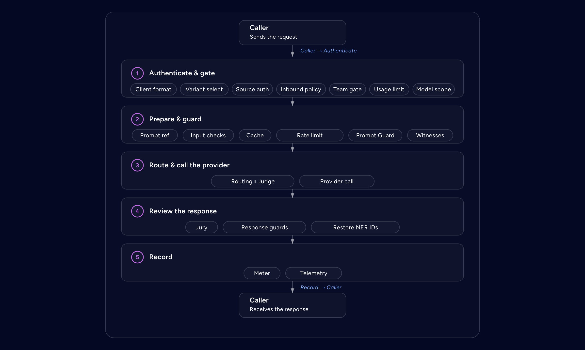

# Agent Stream

Agent Stream sits between agents and the model providers they call. It routes each model
call, applies guardrails, policy, and budgets to it, and records what happened. Also
referred to as the **Affinidi Agent Stream**.

This document is the project glossary — the ubiquitous language, not a spec. Keep it
durable and implementation-agnostic. Prefer stable domain terms over file paths, code
identifiers, enum spellings, or wire-format details. A term is spelled the way the
dashboard shows it; where the code uses a different name, the entry records it so the
term can be found in `src/`.

## Surfaces and routing

| Term | Meaning |
| --- | --- |
| **Surface** | The configuration and runtime unit for one governed connection to models. It defines how callers reach it, which upstream it calls, and which controls apply. Called a _pipe_ in code. _Avoid: pipe, channel, route, Agent Surface._ |
| **LLM Surface** | A Surface that fronts one model provider, with the full guardrail, routing, resilience, cost, and governance pipeline. |
| **IDE Surface** | A Surface that offers editors and agents one governed, per-caller model menu, the **Catalogue**, made of LLM Surfaces. Each dispatch runs the chosen LLM Surface's own pipeline. |
| **Catalogue member** | One LLM Surface (optionally a Variant) listed in an IDE Surface's Catalogue. Distinct from a Member. |
| **Bootstrap** | The public discovery document an IDE Surface serves so an editor can configure itself and sign in. |
| **Access Point** | Where callers reach a Surface: its URL on a Listener. Owns caller authentication. _Avoid: ingress, entry point, endpoint._ |
| **Listener** | A configured network endpoint that serves Access Points. One Listener may serve many. _Avoid: port, socket, server._ |
| **Upstream** | The provider endpoint a Surface sends model calls to, with its credentials. _Avoid: target, backend._ |
| **Variant** (_Surface Variant_) | A named variation on a Surface, selected per request, without creating a separate Surface. The unmodified Surface is the **base** Variant. _Avoid: clone, environment, copy._ |
| **Canary split** | A percentage split of traffic between Variants, used to roll out a change and roll it back. |
| **Surface template** | A reusable Surface configuration from which new Surfaces are created. Some are built in. |
| **Surface owner** | The user who created a Surface. Only the owner, an administrator, or an access token of the Surface's tenant can change or delete it. A Surface created while authentication was off has no owner and only an administrator can change it. Distinct from the Member that usage is attributed to. |
| **Caller** | The application, agent, or editor that sends a request to an Access Point. _Avoid: client, requester._ |
| **Response** | The answer returned to the Caller after all response-side stages have run. |

## Providers and models

| Term | Meaning |
| --- | --- |
| **Provider** | The vendor adapter behind an LLM Surface, such as OpenAI, Anthropic, Google Gemini, AWS Bedrock, Azure OpenAI, Microsoft 365 Copilot, or any OpenAI-compatible endpoint. |
| **Model catalog** | The editable list of providers, models, and prices Agent Stream uses for routing and cost. Shown on the Models page. Spelled _catalog_, as the dashboard shows it; _Catalogue_ is the IDE Surface menu. |
| **Client API dialect** | The request format a Caller uses: OpenAI Chat Completions, Anthropic Messages, or OpenAI Responses. Any dialect can reach any provider. Called a _skin_ in code. |
| **Key source** | Where the credential sent on one model call came from: the Caller's own key (`client`), a secret stored by the Surface's tenant (`customer`), or the operator's key (`platform`). Client and customer keys are _owned_ keys. |
| **Billed cost** | The part of a call's catalog-priced cost charged to the account: nothing on an owned key, all of it on a platform key. |
| **Upstream header** | An operator-configured header sent to the Upstream, used to reach a gated provider endpoint. |
| **Prompt** | A versioned, reusable prompt template that a request can reference instead of sending the text. |

## Pipeline stages

A request passes through ordered stages on the way to the provider and back. Any stage
can refuse it.

| Term | Meaning |
| --- | --- |
| **Prompt Guard** | A stage that inspects text for sensitive data, on the request, the response, or both, and redacts, pseudonymises, or rejects it. Detection is by regular expression or by an AI model; AI-model detection runs on the request only. |
| **NER ID** | A stable placeholder Prompt Guard substitutes for each distinct sensitive value, so relationships survive while the value is hidden. Can be restored in the Response. |
| **Expert Witness** | An external guardrail service consulted beside a Prompt Guard, on the request or the response. |
| **Judge** | A stage that checks a request against rules before the model runs, using an LLM or a moderation endpoint. A rule that matches, or that cannot be evaluated, rejects the request. |
| **Jury** | An LLM-based stage that reviews a response, made of one or more **Jurors** that vote. |
| **Redrive** | Sending a request back to the model after the Jury rejects its answer, as the Surface's redrive policy allows. |
| **Decider** | A stage that sends a request to the best-suited **Candidate** model. |
| **Comparer** | A mode that sends a request to every Candidate and returns all answers. Called _mirror_ in code. |
| **Summariser** | A mode that sends a request to every Candidate and merges the answers into one. Called _mirror_ in code. |
| **Router** | Rules that pick a Variant or an inline Upstream from attributes of the request, such as a header or the type of attached media, before source authentication. No model is called. |
| **Failover** | Retrying a failed call against the next Upstream in a configured order. |
| **Load balancing** | Spreading calls across Upstreams by weight, latency, or cost. |
| **Response cache** | Serving a repeated request from a stored answer without a provider call, by exact or semantic match. |
| **Server tool** | A tool Agent Stream runs itself on the model's behalf under policy: **Web Search** and **Web Fetch**. |
| **Rejection category** | The canonical reason a guardrail stage's rejection is counted under for reporting, per Surface, stage, Team, and Member. |

## Teams and cost

| Term | Meaning |
| --- | --- |
| **Member** | A registered Caller identity that usage, limits, and spend are attributed to. |
| **Team** | A group of Members with shared limits and attribution across Surfaces. |
| **Team gate** | The stage that resolves the Member and enforces its access, model allow-list, per-minute rate limits, and monthly token caps. It sets the budget that each platform-key call is then checked against. |
| **Model allow-list** | The models a Member may call. |
| **Budget** | A spending cap over a period for a Member or a Team, counting billed cost only. A Surface can also set a cost budget, which counts catalog cost and raises alerts without refusing calls. |
| **Usage limit** | A monthly cap on a Surface's catalog spend or tokens, overall, per stage, or per Juror. |

## Policy

An appliance-wide policy for each Surface type runs before a Surface's own policy, and its
deny is final. On traffic from peer appliances, Trust Fabric policy runs first.

| Term | Meaning |
| --- | --- |
| **OPA policy** | A Rego policy evaluated by the embedded engine to allow or deny a request. |
| **Policy definition** | Stored, versioned Rego that many Surfaces or Gateway records can reference. Versions are immutable. |
| **Trust Fabric policy** | Policy that governs traffic between appliances. |
| **Model Policy** | An OPA policy on one IDE Surface Catalogue model, evaluated when that model is dispatched. |
| **Global policy** | A policy enforced appliance-wide for one policy type, in addition to each Surface's own. |
| **Monitor-only** | A Global policy assignment that is evaluated and recorded but never blocks. A Surface's own policy cannot be monitor-only. |
| **Dry run** | Evaluating draft Rego against a sample input without affecting traffic. |

## Identity and authentication

| Term | Meaning |
| --- | --- |
| **Source authentication** (_source auth_) | Verifying that the Caller is who it claims to be, by API key, JWT bearer token, or mTLS. Configured per Surface. _Avoid: client auth, except for TLS client authentication._ |
| **Authenticated identity** | The result of source authentication for one request: the principal and its metadata. |
| **Verifiable Presentation evidence** (_VP evidence_) | A Verifiable Presentation a Caller sends, verified and made available to policy as identity binding. |
| **VP challenge** | A single-use value a presentation must carry so that it is accepted once and only while fresh: one a Surface issued to the Caller, or on the Fabric the id of the envelope that carries the presentation. |
| **Appliance DID** | The decentralised identifier of one Agent Stream instance. It signs Governance Records and the appliance's presentations; a peer trusts it by listing it as a trusted issuer. It is not used on the wire, where each Connection Point has its own DID. |
| **API key** | A key a Caller presents for source authentication on a Surface. Distinct from a Management PAT. |
| **JWT verification strategy** | Stored issuer, key and claim rules that source authentication uses to verify a JWT bearer token. |
| **OAuth Identifier** | A stored, public set of OAuth 2.0 / OIDC sign-in identifiers that a Surface references by id, for example to publish an IDE Surface's sign-in. |
| **Credential Provider** | A stored OAuth configuration Agent Stream uses to obtain a delegated token for a user. Tokens obtained this way are kept in the delegation vault and shown as Credential Tokens. |

## Governance and monitoring

| Term | Meaning |
| --- | --- |
| **Governance Record** | A signed, tamper-evident record of one model interaction: prompt, stage outcomes, completion, and metrics, issued as a W3C Verifiable Credential signed by the Appliance DID. |
| **Hash chain** | The per-Surface chain linking each Governance Record to the one before it, so deleting or reordering a record is detectable. |
| **Chain verification** | Checking the signatures and links of a Surface's Governance Records. |
| **Multimedia store** | Storage for media attached to recorded interactions, encrypted when encryption at rest is enabled. |
| **LLM drift** | A change over time in how a model behaves on a Surface, measured against a **Baseline** across **drift dimensions**. |
| **Drift Harness** | The Surface element that captures traffic and replays it to evaluate drift. |
| **Integration** | A configured destination for events and exports, such as a webhook, Slack, email, or a stream. |
| **Event** | Something that happened, such as a Surface execution or a budget breach, carrying runtime values that Integrations deliver. Distinct from an in-dashboard notification. |
| **Runtime variable** | A named value carried by an Event, such as `SURFACE_ID`, that an Integration template can insert. |

## Trust fabric

| Term | Meaning |
| --- | --- |
| **Appliance** | One running Agent Stream instance, with its own Appliance DID. _Avoid: server, node._ |
| **Fabric** | The set of appliances connected through Connection Points over DIDComm, with Mediators relaying messages. LLM Surface traffic does not cross it. _Avoid: mesh, federation, cluster._ |
| **Connection Point** | A DIDComm endpoint, with its own DID and keys, through which this appliance exchanges messages with a peer via a Mediator. Created on both sides when two appliances pair from an out-of-band invitation. Distinct from an Access Point. |
| **Mediator** | A DIDComm relay that delivers messages between appliances. |
| **Gateway record** | A stored record of one appliance in the Fabric: this appliance (the **self gateway**) or a peer (a **remote gateway**). Listed on the Gateways tab of the Connections page. |

## Terms and consent

| Term | Meaning |
| --- | --- |
| **Terms version** | An immutable release of either Affinidi Terms or Customer Terms, including its externally hosted content, that a human user may be required to accept. |
| **Terms version ID** | The opaque, immutable identity used for acceptance and stale-version checks. Distinct from the Terms version label. |
| **Terms version label** | Human-readable version metadata shown to operators and users; it does not establish version identity. |
| **Customer Terms draft** | The single mutable candidate Customer Terms version. It has no effect until published. |
| **Current Terms version** | The published version of one Terms document used to evaluate new acceptance requirements. A document has at most one current version. |
| **Affinidi Terms metadata** | The current global Affinidi Terms version, title, document URL, and re-consent setting, published by Affinidi. |
| **Last-known-good metadata** | The latest valid Affinidi Terms metadata persisted locally and used without expiry when it cannot be refreshed. |
| **Acceptance Record** | Immutable evidence that one human user accepted one exact Terms version at a server-recorded time. _Avoid: consent registry, accepted-terms user field._ |
| **Consent-pending session** | An authenticated session whose product access stays restricted until all applicable Terms versions have been accepted. |
| **Re-consent** | Explicit acceptance of a replacement Terms version by a user who accepted an older version of the same Terms type. |

## Management

| Term | Meaning |
| --- | --- |
| **Management API** | The HTTP API the dashboard and automation use to manage stored configuration. Distinct from Surface traffic. _Avoid: admin API in new text._ |
| **Management PAT** (_personal access token_) | A long-lived bearer credential bound to a dashboard user and used by automation on the Management API. Its authority never exceeds the user's role, and its scopes can narrow it further. Distinct from a Surface API key. |
| **Tenant** | A management ownership namespace that limits which records a tenant-scoped PAT may manage. It does not create a separate runtime. |
| **Role** | A dashboard user's permission level, enforced on every Management API call. |
| **Secret** | A stored credential, such as a provider key, referenced by configuration instead of embedded in it. |
| **Deployment operator** | The party that controls deployment-time appliance configuration. In a self-hosted deployment this is the deployer. |
| **Appliance administrator** | A human user authorised to configure the appliance through the dashboard or the Management API. Distinct from the Deployment operator. |

## Storage and lifecycle

| Term | Meaning |
| --- | --- |
| **Storage backend** | The persistence boundary for one record kind. |
| **Cached storage** | A storage wrapper that combines persisted state with an in-memory authoritative layer. |
| **Encryption at rest** | Encryption of stored records before they are written, decrypted on read. Every appliance must either enable it or explicitly opt out; an appliance that does neither does not start. |
| **Hot reload** | Picking up supported configuration changes without a restart. |
| **Startup-only config** | Configuration read only at process start; changing it needs a restart. |
| **Active / Standby** | The two server modes. Only an Active appliance reports ready and runs Connection Points; a Standby keeps its HTTP listeners up but reports not ready, so a load balancer sends traffic elsewhere. |

## Legacy and code-only terms

These appear in source or stored configuration. Do not use them in the dashboard, in
documentation for readers, or in Gherkin.

| Term | Status and guidance |
| --- | --- |
| **Pipe** | The code name for a Surface (`PipeConfig`, `/v1/pipes`). Write **Surface**. |
| **Mirror** | The code name for the Comparer and Summariser modes. |
| **Skin** | The code name for a Client API dialect. |
| **`AgentSurface`** | An internal routing record used for appliance-to-appliance traffic. It is not a product concept; never write "Agent Surface" in the dashboard or documentation. |
| **Channel** | Legacy name for that internal record. It survives in some identifiers, such as `ChannelProtocol`, the channel-shaped accessors on `AgentSurface`, and the `channels` key in `agent-stream.json`. |
| **Trust Gateway, ATG, TGW** | A former product name that survives in some identifiers, such as these still-accepted legacy forms: the `atgpat_` access-token secret and `atgat_` token record id prefixes, the `atgk_` API key id and `atgs_` API key secret prefixes, the `.tgwbak` backup file extension, the `TGWENC` encryption trailer, and the `ATGX` magic bytes at the start of a storage export. It also survives in the `atg-export-v1` export key label, the `AffinidiFabricTrustGatewayChannel` DID service type and the `https://affinidi.com/atg/errors/consent-required` problem type. Never use it in new text. |
