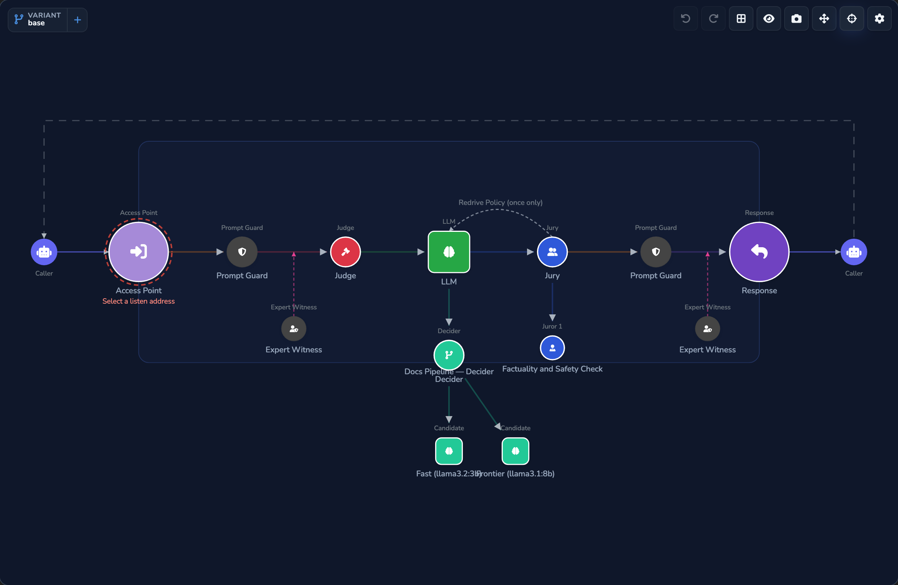
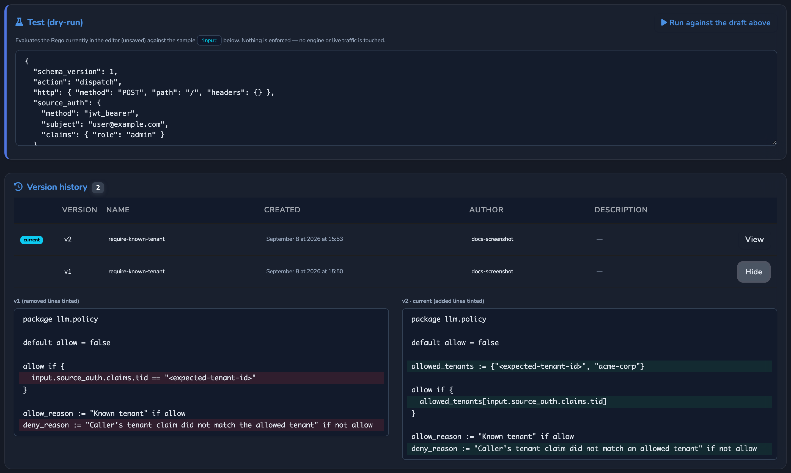

# Capabilities

What Agent Stream can do, described from the point of view of someone deciding whether
it fits their problem.

This page is here so you can understand the product without leaving the repository. The
hosted [documentation](https://docs.affinidi.com/products/affinidi-trust-fabric/agent-stream/)
covers the same capabilities as procedures for a deployed appliance. For how each one is
built, see [`ARCHITECTURE.md`](../ARCHITECTURE.md).

## What it solves

Agents and LLM-backed features call models constantly, and each call carries cost, risk,
and data. A pilot that called one provider with one key becomes hard to govern once many
teams, applications, and providers are involved: spend is hard to attribute, sensitive
data reaches third-party providers, an outage at one provider takes a feature down, and
each team rebuilds its own retries, filters, and logging.

Calling providers directly leaves these questions open:

- Who is calling this model, and which team or member should the spend be attributed to?
- Which policies, guardrails, and budgets apply to the request and to the response?
- What happens when a provider is down, rate-limited, or degraded?
- Where are provider credentials held, and who may use them?
- What evidence shows what was asked, what was answered, and why a request was refused?

Agent Stream answers them in one place, between the callers and the providers. A caller
points at a Surface instead of the provider and keeps its request format; the controls are
configuration on the Surface, not code in each application.

## Client APIs

A Surface answers three request formats, and the format a caller uses is independent of
the provider behind the Surface. An Anthropic SDK application can call a Surface backed by
an OpenAI model, and the reverse.

| Client API dialect | Path | Typical callers |
| --- | --- | --- |
| OpenAI Chat Completions | `/v1/chat/completions` | OpenAI SDKs and most frameworks |
| Anthropic Messages | `/v1/messages` | The Anthropic SDK and Claude clients |
| OpenAI Responses | `/v1/responses` | OpenAI Responses and Agents clients |

Each dialect gets text, tool calling, buffered and streamed answers, and success and
error bodies in its own native shape. The stock Anthropic SDK's `x-api-key` header is
accepted as it is. Every request is normalised to one internal form before any stage
runs, so guardrails, routing, budgets, and records behave the same whichever dialect was
used, and the answer is converted back to the caller's dialect at the end.

Every Surface accepts all three by default. The **Client API formats** control restricts a
Surface to the dialects you choose; a request in any other format is answered as if the
path did not exist.

`GET /v1/models` on an LLM Surface is answered by the appliance itself, with the
Surface's models, without a call to the provider. On an OpenAI-compatible provider, other
OpenAI paths, such as embeddings, moderations, image generation, text to speech, files,
and batches, are served by the same Surface.

See [`CLIENT_API_DIALECTS.md`](CLIENT_API_DIALECTS.md).

## Surfaces

A **Surface** is the unit everything else hangs off: how callers reach it, which provider
it calls, and which controls apply. One appliance hosts many Surfaces, and most changes
to a Surface take effect without a restart. Callers reach a Surface at its **Access
Point**, a URL on one of the appliance's Listeners.

| Surface type | What it does |
| --- | --- |
| LLM Surface | Fronts one model provider, with the full pipeline of guardrails, routing, resilience, cost, and governance |
| IDE Surface | Offers editors and agents one model menu, the Catalogue, made of LLM Surfaces behind one OpenAI-compatible endpoint |

Surfaces are built on a canvas in the dashboard: the Access Point, Prompt Guard, Judge,
the LLM, Jury, and the Response appear as elements in the order a request meets them,
with Expert Witnesses attached to the request and response sides. The same Surface can be
written as JSON through the Management API.

### Variants

A **Variant** is a named variation on a Surface, reachable at `{route}$alias`, that
overrides behaviour such as the provider and model, guardrails, Judge and Jury, limits,
policy, timeouts, or the cache, without a separate Surface. The unmodified Surface is
the **base** Variant. Variants are the basis for routing rules and canary splits, which
are described under [Routing and resilience](#routing-and-resilience). A Variant can
carry its own source authentication, policy, and guards, so each enabled Variant is an
entry point in its own right.

### Templates

New Surfaces start from templates: complete starters, such as a blank LLM Surface, an
OpenAI or Anthropic Surface, a multi-provider Surface, or a governed IDE Surface, and
partial templates that add one capability, such as a guardrails pack. Built-in templates
ship with the appliance, and operators can save their own. See the
[templates README](../config/examples/surface_templates/README.md).

### IDE Surfaces

An **IDE Surface** gives an editor, or any client that speaks OpenAI `GET /v1/models` and
`POST /v1/chat/completions`, one Access Point URL from which to discover and call the
models an organisation has approved. Each entry in its Catalogue is an LLM Surface, and a
call to that model runs that LLM Surface's own pipeline, with the identity authenticated
at the IDE Surface carried in.

- The IDE Surface has its own source authentication, policy, and rate limit, applied
  before dispatch. A **Model Policy** on a Catalogue entry is evaluated when that model
  is dispatched.
- `GET /v1/models` lists the Catalogue entries whose LLM Surface policy and team gate
  the caller's identity passes.
- A public `GET {route}/.well-known/agent-stream` document carries the OAuth sign-in
  identifiers and the discovery and dispatch paths, so a client can configure its sign-in
  from the Access Point URL alone. It holds public identifiers only, never secrets.
  Sign-in profiles for Microsoft Entra ID, Okta, or a generic OIDC issuer are stored once
  as OAuth Identifiers and referenced by id.
- Usage, cost, and failures of a dispatched call are recorded against the IDE Surface as
  well as the LLM Surface, so the IDE Surface has its own monitoring.

The repository includes a [VS Code extension](../clients/vscode-agent-stream/README.md)
that uses this contract. See [`IDE_SURFACES.md`](IDE_SURFACES.md).

### Microsoft 365 Copilot

An LLM Surface can front Microsoft 365 Copilot. A caller sends an ordinary OpenAI chat
request; the Surface turns it into a Copilot call made as the signed-in user, by
forwarding the caller's delegated Entra token. Copilot grounds the answer on that user's
own Microsoft 365 content under their permissions. Retrieval happens inside Microsoft
365: Copilot returns an answer, not the source files, and Agent Stream does not fetch or
store document contents. The call still passes source
authentication, policy, rate limits, attribution, and request-side guardrails.

When this model sits behind an IDE Surface, the front-door identity and the Graph token
for Copilot can be different tokens; the client sends the second in
`X-Agent-Stream-Upstream-Authorization`. See
[`M365_COPILOT.md`](M365_COPILOT.md).

## Providers and models

| Kind | Providers |
| --- | --- |
| Native | OpenAI, Anthropic, Google Gemini, AWS Bedrock, Azure OpenAI, Cohere, Mistral, Together AI, Replicate, Hugging Face, Ollama, Microsoft 365 Copilot |
| OpenAI-compatible presets | Groq, xAI, OpenRouter, Fireworks, Cerebras, DeepSeek, Moonshot, SambaNova, Hyperbolic, NVIDIA NIM, Nebius |
| Custom | Any OpenAI-compatible endpoint |

Request bodies are adapted to each model: parameters are renamed or dropped where a model
does not accept them, and Anthropic, Claude on Bedrock, and Gemini requests are converted
to their native wire formats.

The **Model catalog** is the editable list of providers, models, capabilities, and prices
used for routing and cost. It is shown on the Models page and reloads without a restart,
so a new model is added by configuration.

### Where the provider key comes from

Every model call records its **key source**:

| Key source | Meaning |
| --- | --- |
| `platform` | The operator's key, held in the secrets store |
| `customer` | A secret owned by the Surface's tenant |
| `client` | The caller's own provider key, sent with the request |

Operator keys are resolved from the secrets store at request time and are never returned
to callers. A Surface decides whether a caller may send its own key: never, as a fallback when
the request carries one and the Surface would otherwise use its stored key, or as the
only key. Only the main call to the Surface's default
provider is offered the caller's key; the Judge, Jury, Decider, and other supporting
calls use their own configured keys. Operator-configured upstream headers, such as an
ingress key for a gated endpoint, are sent only to the upstream they were configured for.

**Billed cost** is the part of a call's catalog-priced cost charged to the account:
nothing on a `client` or `customer` key, all of it on a `platform` key. See
[`PROVIDERS_AND_CREDENTIALS.md`](PROVIDERS_AND_CREDENTIALS.md).

## Routing and resilience

### Choosing the model

| Mode | What it does |
| --- | --- |
| LLM Direct | Sends each request to the one configured model. The default. |
| Decider | A router model reads each request and sends it to the best-suited **Candidate**, with a default Candidate as fallback. Only the chosen model runs. |
| Comparer | Sends the request to every Candidate and returns all the answers, each with its model, tokens, and cost, for a person to compare. |
| Summariser | Sends the request to every Candidate, then a separately configured model merges the answers into one, which continues through the Jury and response guards. |

Comparer and Summariser are capped at 10 Candidates, wait for every Candidate, and bill
each call at its own provider's price.

### Steering traffic

| Control | Behaviour |
| --- | --- |
| Router | Ordered routing rules that match a request header, a top-level body field, or the type of attached media, and send the request to a Variant or an inline provider target. First match wins. |
| Canary split | A percentage split across the base and Variants, for a staged rollout. Disabling it keeps the stored split for later. |
| Per-request routing | A request can name `models[]` and `provider{}` preferences to narrow or reorder the Surface's own pool. It can never widen it. |

An explicit `$alias` wins, then a routing rule, then the canary split. See
[`ROUTING.md`](ROUTING.md).

### Staying up

| Control | Behaviour |
| --- | --- |
| Failover | Retries a failed call against ordered backup providers, of another vendor or model. |
| Load balancing | Spreads calls across a pool of providers by weight, lowest observed latency, or lowest catalog price. |
| Retry | Exponential backoff on retriable failures. |
| Circuit breaker | An open breaker on the primary fails over, or fails fast. |
| Rate limit | Requests and tokens per minute for the Surface. |
| Context-window guard | Compresses an over-long conversation by dropping its middle, keeping the system prompt and the latest turns, per Surface or per request (`transforms: ["middle-out"]`). |
| Response cache | Serves a repeated request from a stored answer with no provider call, matched exactly or by semantic similarity. Entries are kept per Surface, Variant, and provider target, and expire by age and count. |

A request refused by a guardrail or by the appliance's own rate limit is not retried
against another provider. The response cache is read before any provider call and written
only after the response guards have run, so it never serves an unreviewed answer.

See [`RESILIENCE_AND_CACHING.md`](RESILIENCE_AND_CACHING.md).

## Inference controls

Each of these is a standard request field, normalised once and shaped per provider, so it
works in any dialect against any provider.

| Control | Behaviour |
| --- | --- |
| Reasoning | OpenAI `reasoning_effort`, the `reasoning` object, or Anthropic `thinking` are accepted and translated to each provider's form. A per-Surface **Max reasoning tokens** setting caps the budget, and reasoning tokens are reported. |
| Structured outputs | `response_format` with `json_schema` works on any Surface: natively where the provider supports it, otherwise by instruction and JSON mode. The answer is validated against the schema and the result reported. |
| Prompt caching | A caller's `cache_control` breakpoints reach an Anthropic upstream, and cache read and write tokens are reported and priced. |
| Web Search, Web Fetch | **Server tools** the appliance runs on the model's behalf during the request: search through Tavily, Brave, or Google, and page fetch, bounded by the Surface's policy, a domain allow and deny list, and an SSRF guard. Off by default. Each call is recorded and metered. |

The requested reasoning effort, models, providers, and document types are available to
policy. See [`INFERENCE_CONTROLS.md`](INFERENCE_CONTROLS.md).

## Inputs and modalities

| Input | Behaviour |
| --- | --- |
| Images | Images attached inline or by URL, accepted only on a Surface that enables image input. Inline images are checked against the Surface's allowed formats and size; remote URLs are forwarded unchecked. |
| Audio | Inline audio to audio-capable models, speech to text uploads, and text to speech. Audio sent to a model that cannot take it is refused rather than dropped. |
| Documents | A document attached to a message is extracted to prompt text before the model runs, so any model can read it and it passes through the same masking and guardrails as other text. By default the allowed types are text, Markdown, CSV, JSON, and DOCX, with a size cap and an extracted-length cap. Modes are Auto, which forwards what it cannot parse, Extract, and Passthrough to a document-native model. Off by default. |
| Realtime voice | A WebSocket session at `{route}/v1/realtime` relays bidirectional audio to an OpenAI or Gemini realtime model. Source authentication, policy, the team gate, and the budget are checked when the session opens. Off by default and enabled per Surface; per-turn voice safety, where the Jury reviews each turn, is a separate opt-in. |

A request may be up to 32 MiB, which leaves room for encoded attachments. Media attached
to recorded interactions is kept in a content-addressed store, encrypted when encryption
at rest is enabled, and Governance Records refer to it by digest. See
[`MODALITIES.md`](MODALITIES.md).

## Guardrails

Guardrails sit on two seams: the request, before any model sees it, and the response,
before the caller sees it. On the request seam they run in a fixed order: Prompt Guard,
then Expert Witnesses, then the Judge, then the provider.

| Stage | What it does |
| --- | --- |
| Prompt Guard | Finds sensitive data in the request, the response, or both, and rejects, redacts, or replaces it with NER IDs. Detection is by regular expression or by a model. |
| Expert Witness | Consults an external guardrail service on the request, the response, or both. Built-in profiles cover EnkryptAI, Lakera Guard, Azure Prompt Shields, Azure Content Safety, and a generic shape for classifiers that return a top-level `flagged` or `blocked` verdict. Several can run on one Surface. |
| Judge | Checks the request before the main model runs, with an LLM or the OpenAI Moderations API. It runs in parallel with the Decider. A Judge call that fails, or a rule that cannot be evaluated, refuses the request; an unevaluable rule returns `502` `judge_indeterminate`. |
| Jury | One or more **Jurors** vote on the response. A rejected answer can be sent back to the model under the Surface's **Redrive** policy, up to a set number of retries. |

An Expert Witness that cannot be reached fails closed unless it is set to fail open.
Every refusal is classified into a **rejection category**, such as prompt injection,
jailbreak, toxicity, PII, secrets, or policy violation, so the dashboard can show why
requests were refused per Surface, team, member, and stage. The mapping from provider
reasons to categories is an editable file.

A request streams only when the Surface has no response-side stage. Where a Jury,
Comparer, Summariser, response guard, or server tool is configured, the answer is
returned whole, so no response check is bypassed.

See [`GUARDRAILS.md`](GUARDRAILS.md).

### Sensitive data and NER IDs

Prompt Guard combines two kinds of detection. Pattern matching finds well-shaped values,
such as email addresses, card numbers, and phone numbers, from built-in or custom
patterns. Model-backed matching sends the request text to an OpenAI-compatible model you
choose, ideally self-hosted, to find free-form entities such as names, addresses,
organisations, and custom types you define. It runs on the request side.

With **NER IDs**, each distinct sensitive value is replaced with a stable placeholder,
and the same value gets the same placeholder throughout the request:

> `[PERSON_NER_001]` lives at `[ADDRESS_NER_001]`. `[PERSON_NER_001]`'s email is `[EMAIL_NER_001]`.

The model, the Judge, the Jury, and Expert Witnesses see only the placeholders, and the
relationships between entities survive. With restore turned on, the real values are put
back into the answer before it reaches the caller. The mapping lives only for the
request and is never written to disk. You choose what happens if the detection model is
unavailable: reject the call, or fall back to pattern masking.

See [`PROMPT_GUARD.md`](PROMPT_GUARD.md).

## Access and policy

### Source authentication

Each Surface authenticates its callers by API key, JWT bearer token, or mTLS. mTLS
accepts pinned certificates or CA-validated chains, and can take the caller's identity
from the certificate fingerprint, subject, or subject alternative names. A Surface that
declares source authentication is never served unauthenticated on its own Access Point,
apart from the read-only `health`, `v1/models` and `.well-known/agent-stream` GETs listed in
[`SOURCE_AUTH.md`](SOURCE_AUTH.md);
when it is dispatched from an IDE Surface, the IDE Surface's source authentication applies
instead. The caller's credential is never forwarded to the provider. See [`SOURCE_AUTH.md`](SOURCE_AUTH.md).

### Policy

Policies are Rego, evaluated by an embedded OPA-compatible engine with no sidecar. They
see the caller's authenticated identity, the request, and request attributes such as
the requested models, reasoning effort, and attached document types.

| Layer | Applies to |
| --- | --- |
| Global policy | Every LLM Surface, or every IDE Surface dispatch, in addition to each Surface's own |
| Surface policy | One Surface, or one Variant |
| Model Policy | One Catalogue model on an IDE Surface, when it is dispatched |
| Trust Fabric policy | Traffic from peer appliances |

A request proceeds only if every applicable policy allows it. The combination is
deny-overrides and fail-closed: any deny, any evaluation error, and any enabled policy
that is missing or broken refuses the request, and a Surface policy cannot override a
global deny.

- **Versioned definitions.** Policies are stored as definitions that many Surfaces can
  reference. Every save creates a new, immutable version, and every decision records the
  version and a hash of its content.
- **Monitor-only.** A global policy can record what it would have decided without
  enforcing it, for an observed rollout.
- **Dry run.** Draft Rego can be run against a sample input, including unsaved edits,
  without touching live traffic.
- **Change control.** The dashboard shows how many Surfaces reference a policy before you
  delete it or make it global, and keeps each version's author, time, and a side-by-side
  comparison. Making a policy global is a separate permission from editing it.
- **VP evidence.** A Surface can ask callers for a Verifiable Presentation, verify it,
  and hand its holder, issuer, and claims to policy, for rules such as "allow only callers
  holding a credential from this issuer". A strict mode refuses requests without one.
  Each presentation carries a short-lived, single-use challenge the Surface issues, so a
  captured presentation cannot be replayed. Off by default.

See [`POLICY.md`](POLICY.md).

## Teams and cost

A **Member** is a registered caller identity that usage, limits, and spend are attributed
to; a **Team** groups Members. A Surface chooses how a caller is matched to a Member: a
header, a JWT claim, a body field, an mTLS attribute, or the API key name. A Member can
be recognised under several identifiers and can be created automatically the first time
a verified identity is seen. Built-in anonymous and sandbox Members keep unmatched and
test traffic attributable; disabling the anonymous Member admits recognised callers only.

On a Surface that enables attribution, the **team gate** runs after policy and checks, in
order:

| Check | Refusal |
| --- | --- |
| The Member and Team are enabled, and the Surface admits the Team | 403 |
| The model is on the Member's **model allow-list** | 403 |
| Per-Member requests and tokens per minute, across every Surface | 429 |
| Monthly token caps for the Member and its Teams | 429 |

The per-minute limits and token caps apply when the Surface enforces them.

The diagram's "Monthly ceiling" is the token-cap check; spend is admitted per
platform-key call, as the Budgets row below describes.

| Capability | Behaviour |
| --- | --- |
| Budgets | A monthly spending cap for a Member or a Team, counting billed cost only. A Member's month can start on a chosen anchor date. A Surface can also set a cost budget, which counts catalog cost and raises alerts without refusing calls. The team gate sets the budget for the request, and every operator-key call, including the Judge, Jurors, Decider, and witnesses, is admitted against it just before it is sent, refused with 429 when no credit is left. |
| Usage limits | Monthly spend (catalog cost) and token caps at Surface level, per stage, or per Juror. |
| Per-stage cost | Tokens, cost, and latency are counted separately for the main call, Judge, Jury, and Decider, so a supporting model's spend is not booked to the main model. |
| Alerts | Notifications on a cost or token threshold, a rolling error rate, a cost spike, and budget thresholds, sent to Integrations. |
| Reports | A Team's current usage, and a spend report over any date range by Team, Member, or Surface, as JSON or CSV. |

Where a Member budget is enforced, a call on the operator's key runs only on endpoints
whose spend the appliance can meter, so spend cannot escape the budget. See
[`USAGE_LIMITS_AND_ATTRIBUTION.md`](USAGE_LIMITS_AND_ATTRIBUTION.md).

## Prompts

A **Prompt** is a versioned, reusable template: chat messages with `{{variable}}`
placeholders and an optional default version. A request can reference a Prompt by id,
version, and variables instead of sending the text; the appliance renders it before the
pipeline runs and the reference never reaches the provider. A playground previews the
rendered messages. Prompts change without an application release. See
[`PROMPTS.md`](PROMPTS.md).

## Governance Records

A **Governance Record** is a signed, tamper-evident record of one model interaction: the
prompt, every stage that inspected or changed it with its verdict, the completion, and
tokens, cost, latency, provider, and model. It is issued as a W3C Verifiable Credential
signed by the Appliance DID.

![Each recorded call's prompt, stage verdicts, completion, and cost, tokens, and latency are signed as a W3C Verifiable Credential with the appliance DID key, stored with a hashed caller identity and encrypted when encryption at rest is enabled, and linked into a hash chain in which each record carries the previous record's hash; verifying the chain gives pass or fail, deleting or reordering a record breaks it, and records can be exported for auditors, security, and finance through OpenTelemetry, SIEM, or webhook](assets/diagrams/governance-record-flow.png)

- **Hash chain.** Each record carries the hash of the previous record on the same
  Surface, so a deleted or reordered record is detectable, not only an altered one.
  Chain verification checks every hash, signature, and link and returns pass or fail.
- **Coverage.** Successful, blocked, and failed interactions, buffered and streamed, and
  sandbox tests under their own identity. A blocked record shows what the refusing stage
  evaluated and its verdict, including policy denials with the deciding version.
- **Control.** Off by default; enabled per Surface, or for every Surface through the
  appliance-wide default. You choose which interactions to
  record, which keep full bodies (all, blocked only, or none; the rest keep digests
  only), and how many days to keep them.
- **Protection.** Records store the caller as a keyed (peppered) hash and hold media only as
  digests, and are encrypted at rest when encryption at rest is enabled. Reading them requires a dedicated permission,
  administrator-only by default.
- **Export.** Records can be exported over OpenTelemetry and to Integrations.

See [`GOVERNANCE_RECORDS.md`](GOVERNANCE_RECORDS.md).

## LLM drift

A provider can change a model under the same name, and a prompt or configuration change
can degrade answers slowly. **LLM drift** detection measures how a Surface behaves over
time against a pinned **Baseline**, on nine dimensions charted separately:

| Dimension | Measures |
| --- | --- |
| Quality | How often a replayed answer stays close to the captured one |
| Refusal rate | The share of answers that are refusals |
| Safety-flag rate | The share of answers the Jury rejected and a Redrive recovered |
| Response length | Mean answer length in characters |
| Output tokens | Mean answer length in tokens |
| Cost | Mean spend per interaction |
| Latency | Mean end-to-end latency |
| Schema validity | The share of structured outputs that match their schema |
| Semantic distance | Mean embedding distance between a replayed answer and the captured one |

The **Drift Harness** element turns it on for a Surface. It samples live traffic, can
replay captured real interactions on demand or on a schedule, and sets warn and drift
thresholds. Entering drift raises an alert to the chosen Integrations, and a Surface can
refuse saves while it is drifting past its Baseline. Off by default. See
[`LLM_DRIFT.md`](LLM_DRIFT.md).

## Observability

| Capability | Behaviour |
| --- | --- |
| Usage telemetry | Spend, billed cost, tokens, and requests over time, from 30-second to yearly resolution, per Surface, stage, Member, and Team, in an embedded time-series store. |
| Operational metrics | Connection volume, error rate, throughput, and latency percentiles. |
| Response headers | `x-agent-stream-*` headers carry the trace id, provider, model, tokens, cost, billed cost, key source, and cache result, so a caller can read usage without parsing the body. |
| Stage streaming | A caller that sends `x-agent-stream-emit-stages: true` receives each stage's events as the request runs. |
| Export | Prometheus metrics, OpenTelemetry traces, metrics, and logs, and a Langfuse connector for traces and generations. Prompt and completion content is exported only where the Surface opts in. |
| Policy audit | Each policy decision can be logged with the policy and version that decided. |

See [`OBSERVABILITY.md`](OBSERVABILITY.md).

## Integrations and events

An **Integration** is a destination for **Events**: a webhook, Slack, email, Kafka,
Kinesis, Pulsar, Redis Streams, or Langfuse. Events cover Surface executions and errors,
Surface changes, budget thresholds, usage alerts and cost spikes, drift, and lifecycle
changes to users, connections, and other records. Execution events carry the Member,
Teams, and tenant, and refusal events carry the stage and rejection category. See
[`INTEGRATIONS.md`](INTEGRATIONS.md).

## Management

Everything is managed from a web dashboard, signed into with a passkey, or with SAML or OpenID
Connect single sign-on (OIDC roles come from a claim mapping, refreshed at every sign-in), and
from the same **Management API** the dashboard uses.

| Capability | Behaviour |
| --- | --- |
| Sign-in protection | Each client (one address, or one IPv6 /64) may send 10 sign-in requests a minute (registration, passkey sign-in, SAML or OIDC sign-in and its response) and 120 sign-in status checks a minute; over that it gets `429` with `Retry-After`, except that a status check from a signed-in dashboard is always answered, so a busy shared address does not sign users out. 10 failed sign-ins (a passkey, SAML response or OIDC callback that does not verify) lock that client out of signing in for 15 minutes after the last failure; a malformed request or an unknown or expired challenge does not count. The address is the connection's own, except behind a reverse proxy listed in `tls.client_auth.trusted_proxies`, where it is the rightmost `X-Forwarded-For` hop that is not a listed proxy; from any other peer the header is ignored. A passkey challenge must be completed within 5 minutes, and at most 10,000 are outstanding at once. |
| Roles | Administrator, power user, and user, checked on every Management API call. Permissions such as viewing attributed metrics, reading Governance Records, and making a policy global are separate from the broader view and edit permissions. |
| Management PATs | Long-lived bearer tokens for automation, bound to a user. A token never has more authority than the user's role. |
| Resource scope and tenants | A PAT can be narrowed to a resource pattern and a validated tenant header, so it manages its own tenant's records and can reach only appliance-global ones besides. Tenants divide management, not traffic. |
| Secrets | Provider keys and other credentials live in the secrets store on disk, and configuration refers to them by id. New integration credentials, URLs included, are references too, and only the webhook signing secret may still be stored inline; inline credentials saved before references are migrated to the secrets store automatically on every switch to Active, each referenced destination is pinned at save, and the API never returns a stored credential. |
| Terms and consent | The appliance can require dashboard users to accept Affinidi Terms, Customer Terms, or both, and keeps an immutable record of each acceptance. Off by default. |

See [`RBAC.md`](RBAC.md), [`DASHBOARD_SIGN_IN.md`](DASHBOARD_SIGN_IN.md),
[`ACCESS_TOKENS.md`](ACCESS_TOKENS.md) and [`TERMS_AND_CONSENT.md`](TERMS_AND_CONSENT.md).

## Trust fabric

Each Agent Stream instance is an **appliance** with its own decentralised identifier, the
**Appliance DID**, which signs Governance Records. Appliances connect through
**Connection Points**: DIDComm endpoints, usually set up from an out-of-band invitation
and relayed by a **Mediator**. A message from a peer is accepted only from the connected
peer's verified DID, and **Trust Fabric policy** decides what each peer may reach; a
Verifiable Presentation the peer carries is verified and handed to that policy. LLM
Surface traffic does not cross the Fabric. A Connection Point's invitation secret is returned
only when the point is created. See [`FABRIC.md`](FABRIC.md) and
[`../ARCHITECTURE.md`](../ARCHITECTURE.md#fabric-path).

## Deployment

Agent Stream is one Rust binary that also serves the dashboard. It needs no database,
message broker, or sidecar: configuration is held in memory and written immediately to
local JSON files. From this repository it builds and runs locally; see
[`development/GETTING_STARTED.md`](development/GETTING_STARTED.md).

| Concern | Behaviour |
| --- | --- |
| Encryption at rest | A required choice. Stored records are encrypted with a master key from the environment, a file, or AWS KMS. An appliance does not start until `[encryption]` either enables it or explicitly opts out with `allow_unencrypted = true`; the quickstart and the generated configuration enable it. See [`ENCRYPTION_AT_REST.md`](ENCRYPTION_AT_REST.md). |
| Backup | A full backup of the appliance's storage, encrypted with AES-256-GCM under a separate backup key, restorable on another node. |
| Export | A redacted export of the appliance's JSON records, with credentials, key material, personal data and captured content redacted, and sensitive directories, logs and binary files left out, encrypted to a recipient's public key, for sharing a configuration safely. See [`DEVELOPMENT.md`](development/DEVELOPMENT.md#create-a-redacted-export). |
| Active and Standby | An instance starts in active or standby mode. Only an active instance reports ready. `SIGUSR1` promotes and `SIGUSR2` demotes; an external controller keeps at most one instance active. See [`CONFIGURATION_RELOAD.md#server-mode`](CONFIGURATION_RELOAD.md#server-mode). |

## Related

- [`../README.md`](../README.md): the short introduction.
- [`../ARCHITECTURE.md`](../ARCHITECTURE.md): how each capability is built, and where.
- [`../CONTEXT.md`](../CONTEXT.md): the meaning of each term on this page.
- [`README.md`](README.md): every document in this repository.
