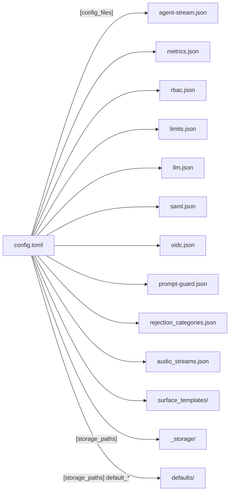

# Configuration Files

What each configuration file Agent Stream reads controls, when it is read, and what changes
when you set a field.

Use the hosted [Agent Stream configuration reference](https://docs.affinidi.com/products/affinidi-trust-fabric/agent-stream/reference/configuration/)
for the supported operator-facing fields of the deployed product. This page describes the
files as this source revision reads them, including fields that are parsed but have no
effect.

For what changes at runtime without a restart, see
[`CONFIGURATION_RELOAD.md`](CONFIGURATION_RELOAD.md). For a worked copy of every file, see
[`config/examples/`](../config/examples/README.md).

## Configuration files

The bootstrap TOML is the entry point. It names every other file.

| File | Controls | Required | Read |
| --- | --- | --- | --- |
| `config.toml` | Bootstrap: file and storage locations, TLS, encryption at rest, server mode, appliance-wide defaults | Yes | Startup |
| `agent-stream.json` | Listeners, route mounting, LLM route prefixes, DID domain, WebAuthn, CORS, Terms, integration types, secret read-back, catalog refresh, drift runner | Yes | Startup; a full reload re-reads its listener and route sections |
| `metrics.json` | OpenTelemetry, CloudWatch, retention, host metrics | No; OpenTelemetry stays off without it | Startup; `PUT /api/v1/metrics/config` rewrites it and applies OpenTelemetry live |
| `rbac.json` | The minimum role each management permission requires | No; built-in defaults apply | Startup |
| `limits.json` | Ceilings on how many records of each kind may exist | No; every dimension is unconstrained | Startup |
| `llm.json` | Seed for the Model catalog | No; the catalog starts empty | First start only |
| `saml.json` | SAML identity provider | Only when `auth_mode = "saml"` | Startup |
| `oidc.json` | OpenID provider, client and role mapping | Only when `auth_mode = "oidc"` | Startup |
| `prompt-guard.json` | Built-in Prompt Guard pattern definitions | No; built-in patterns are unavailable | Startup |
| `rejection_categories.json` | Rejection-reason taxonomy | No; a compiled-in copy is used | On change (mtime-gated) |
| `audio_streams.json` | Catalog of voice filler clips for the realtime relay | No; no filler clips | Startup |
| `surface_templates/` | Built-in Surface templates seeded into the template store | No | Startup |
| `defaults/default_members/`, `defaults/default_teams/` | Seed records for the built-in `anonymous` and `sandbox` Member and Team | No | Startup |

`marketplace-models.json` (`[config_files] marketplace_models`) and the top-level
`marketplace_cache_ttl` configure marketplace support, which this documentation does not
cover.

## Locating the files

The binary reads `config.toml` from the path given by `--config` (default `config.toml`,
relative to the working directory). For a local source run, `make run-debug` prepares
`envs/local/config/`: it generates `config.toml` with `--generate-bootstrap` and copies the
examples beside it (see [`scripts/_prepare.sh`](../scripts/_prepare.sh)).

For Docker, `make config-docker` prepares `envs/docker/` on the host, and
[`docker-compose.yml`](../docker-compose.yml) and `make docker-run` mount it into the container:

| Host path | Container path | Holds |
| --- | --- | --- |
| `envs/docker/config/` | `/app/config` (read-only under Compose) | `config.toml`, generated by the image with `--generate-bootstrap --base-folder /app`, so its paths are container paths; `agent-stream.json` and the other configuration files |
| `envs/docker/certs/` | `/app/certs` (read-only under Compose) | The TLS certificate and key |
| `envs/docker/_storage/` | `/app/_storage` | All persisted records. On a fresh `envs/docker` it is seeded with a sample LLM Surface |
| `envs/docker/_backup_restore/` | `/app/_backup_restore` | Where a dashboard restore stages `backup.asbak` |

The container runs as uid/gid `10001`. Under Compose,
`AS_BACKUP_ENCRYPTION_KEY` must be exported before any `docker compose` command;
Compose passes it to the container, where the generated `config.toml` reads it through
`backup_encryption_key`. `make config-certs` writes a key to `envs/backup_encryption_key`.
`AS_MASTER_KEY` must be exported the same way: the generated `config.toml` enables
encryption at rest with `key_source = "environment"`, and `make config-certs` writes the key to
`envs/master_key`. With
`/app/config` read-only, saving metrics settings from the dashboard cannot rewrite
`metrics.json`; edit it on the host and restart. See
[`development/DEVELOPMENT.md`](development/DEVELOPMENT.md#docker).

`config.toml` names the other files in `[config_files]`. A relative path resolves against
the directory holding `config.toml`; an absolute path is used as given
([`BootstrapConfig::from_file`](../src/config/bootstrap.rs)).

```toml
[config_files]
agent_stream = "agent-stream.json"
metrics = "metrics.json"
rbac = "rbac.json"
limits = "limits.json"
llm = "llm.json"
saml = "saml.json"
oidc = "oidc.json"
prompt_guard = "prompt-guard.json"
rejection_taxonomy = "rejection_categories.json"
audio_streams = "audio_streams.json"
surface_templates_dir = "surface_templates"
```



Every `[storage_paths]` key, `[did_cache] storage_path`, `[logging] log_directory` and the
`[tls]` paths resolve the same way, against the directory holding `config.toml`. The defaults
place storage at `../_storage/<kind>`, a sibling of the configuration directory. One
exception resolves elsewhere:

- A `static` route's `path` in `agent-stream.json` is served relative to the working
  directory, not the configuration directory.

When a `[config_files]` or `[storage_paths]` key is omitted and its default location does not
exist, but an older default location does (`config/<file>` under the configuration directory,
`_volatile/…` for `team_usage`, `telemetry`, `ops_telemetry` and `drift`, or the working
directory for `governance`, `global_policies`, `prompts`, `member_provisioning` and the drift
stores), Agent Stream uses the existing one and prints a `WARN` asking you to set the key
explicitly ([`keep_legacy_locations`](../src/config/bootstrap.rs)). Set every path explicitly
in a deployment.

## Settings with non-obvious effects

| Setting | Behaviour |
| --- | --- |
| Top-level keys in `config.toml` | `server_mode`, `cache_refresh_interval_secs`, `backup_encryption_key` and the other top-level keys must appear before the first `[table]` header. Placed after one, TOML nests them under that table and they are silently ignored. |
| Unknown keys | Ignored, not rejected, in every file except Surface records. A misspelled key takes no effect and produces no error. |
| `backup_encryption_key` | Required. Startup fails unless it resolves to exactly 64 hex characters, whether or not a backup is ever taken. |
| `[encryption] enabled`, `allow_unencrypted` | A required choice. Startup fails unless exactly one is `true`: `enabled = true` with a `key_source`, or `allow_unencrypted = true` to store data unencrypted. A config with neither, including one that only says `enabled = false`, does not start. See [`ENCRYPTION_AT_REST.md`](ENCRYPTION_AT_REST.md#choosing-encryption-or-plaintext). |
| `[tls] cert_path`, `key_path` | Both files must exist even if no listener uses `https`. Validation runs before `--cert`/`--key` (or `AS_CERT`/`AS_KEY`) override them, so the override does not remove the need for the configured files. |
| `listeners[].bind_address` | Ignored for binding. Every listener binds `0.0.0.0:<port>` ([`run_port_server`](../src/proxy/server.rs)). Validation accepts the same port on two different bind addresses, but the second bind then fails. The address is still used to match a Surface's listener scope. |
| `listeners[].protocol` | `https` serves TLS with the `[tls]` certificate; anything else serves plain HTTP. The management API, DID routes and vault routes are mounted only on the first inbound `http` listener and the first inbound `https` listener, in array order. |
| `channel_config_source = "file"` | Passes validation but fails at load with `Unsupported configuration source: file`. Use `local` (the default). |
| `llm.json` | Read once, to seed `<storage_paths.llm_configuration>/llm.json` when that file is absent. Editing the configuration copy afterwards has no effect; the storage copy is authoritative. |
| `limits.example.json` | Sets small ceilings (for example 5 LLM Surfaces, 3 Teams, 1 gateway). Copying it unchanged caps a deployment at those numbers. Omit the file for no limits. |
| `prompt-guard.json` | Read before logging starts. A missing or invalid file leaves built-in Prompt Guard patterns unavailable, and the warning is not written to the log. |
| `metrics.json` | `opentelemetry` and `cloudwatch` and their nested required fields have no defaults. A file missing any of them fails to parse and OpenTelemetry stays off, with the error on stderr only. |
| `saml.json` role mapping | Each SAML sign-in sets the user's role again from the identity provider, except the primary administrator's, which is `administrator` at every sign-in. Only a `role_mapping` entry grants a role, and its key must equal the identity provider's value exactly, case and spaces included: a value with no entry is `user` whatever it reads, including `admin` or `Administrator`. The target is read without regard to case, and a target other than `administrator`, `poweruser` or `user` is `user` and logs a warning. An identity provider that sends `Admin` needs `"Admin": "administrator"`, with one entry per spelling it sends. A value with no entry that earlier versions granted by name (`admin`, `administrator`, `poweruser`, `power_user` or `power-user`, in any case) logs a warning naming the entry to add. |
| `oidc.json` `role_mapping` and `required_claims` | Each OIDC sign-in sets the user's role again from the ID token, in both directions, and there is no primary administrator: a mapping that sends a value to `administrator` grants full management access to every account the provider gives that value. A value matches only exactly, case included. Leave `unmapped` at `deny` unless every account at the provider should get a role, and set `required_claims` to bind the deployment to your tenant at the provider: without it, every account the provider signs in can reach the dashboard (startup logs a warning). |
| `llm_catalog.refresh_url` | Validated when `agent-stream.json` loads, so an unacceptable URL fails startup. An empty or blank value counts as unset: the dashboard does not offer the refresh action. |
| `secrets.reveal_values` | `true` by default. `false` makes `GET /api/v1/secrets/{id}` answer the record without its value and removes the dashboard's control to show it; values can still be set and replaced. It also refuses any integration create, update or test that would send a stored secret to a new destination, unless every secret it references is the URL its type delivers to (`url_secret_id` for a webhook, `webhook_url_secret_id` for Slack, `redis_url_secret_id` for a stream with `platform: redis`) and nothing else secret or routing goes with it; see [`INTEGRATIONS.md`](INTEGRATIONS.md#secrets-in-integration-configuration). |
| `did_cache.allow_private_hosts` | Off by default, which refuses `did:web` and `did:webvh` resolution on loopback, private-network and link-local hosts. A local stack whose mediator runs on `localhost` needs it on; `make run-debug` turns it on in `envs/local/config/config.toml`. On also lets attacker-supplied DIDs reach internal addresses, cloud metadata included. |
| `websocket_require_auth` | `false` lets an unauthenticated client open the dashboard event stream (`/api/ws`, `/api/ws/dashboard`); such a client receives only refresh notices, since it has no permissions to check. |
| `encryption.key_source = "environment"` | Reads the master key from the variable named by `key_env_var`, which defaults to `AS_MASTER_KEY`. See [`ENCRYPTION_AT_REST.md`](ENCRYPTION_AT_REST.md). |
| `metrics.json` `traces.target_crates` | Spans are exported only when their tracing target equals, or starts with, a listed name. The HTTP request and task spans use the target `agent-stream`, which the shipped value lists; spans whose target is a module path (`agent_stream::…`) are dropped unless `agent_stream` is added. Fixed at startup. |

## Secret references

Agent Stream does not substitute placeholders. A `$NAME` or `YOUR_DOMAIN` token in an
example file is literal text until you replace it. Secret-bearing settings accept these
forms:

| Setting | Accepted forms |
| --- | --- |
| `backup_encryption_key`, `legacy_backup_encryption_keys` | `env://NAME`, `file://PATH`, or a literal value. `aws_secrets://` and `aws_parameter_store://` are refused at startup ([`backup_restore/encryption.rs`](../src/backup_restore/encryption.rs)). |
| `AS_IDENTITY_HASH_PEPPER`, `AS_PRINCIPAL_KEY_SECRET` (environment variables) | Raw hex, or a loader reference resolved through [`src/config/loaders/`](../src/config/loaders/): `env://NAME`, `file://PATH`, `aws_secrets://NAME` (AWS Secrets Manager), `aws_parameter_store://NAME` (AWS Systems Manager, decrypted), `string://VALUE`. Anything else is taken literally. |
| `encryption` master key | An environment variable, a key file, or AWS KMS, chosen by `key_source`. See [`ENCRYPTION_AT_REST.md`](ENCRYPTION_AT_REST.md). |
| `metrics.json` `opentelemetry.auth.secret_id` | The id of a secret in the secrets vault. The header value is read from the vault at startup and on each metrics-config save. `GET /api/v1/metrics/config` never returns it, and a save that leaves it out keeps the stored one. |
| `saml.json` `graph_api.client_secret` | Literal only. The value sits in the file in plain text. |
| `oidc.json` `client_secret` | `env://NAME`, `file://PATH`, `aws_secrets://NAME` or `aws_parameter_store://NAME`, resolved at startup; leading and trailing whitespace is dropped. A literal value or `string://` is refused, so the file never holds the secret. |

Provider API keys and other runtime credentials live in the secrets vault, not in a
configuration file. See [`PROVIDERS_AND_CREDENTIALS.md`](PROVIDERS_AND_CREDENTIALS.md).

## Environment variables

| Variable | Used for | Required |
| --- | --- | --- |
| `AS_CERT`, `AS_KEY` | Override the `[tls]` certificate and key paths, like `--cert` and `--key`. | No |
| Variable named by `encryption.key_env_var` (default `AS_MASTER_KEY`) | Master key for encryption at rest when `key_source = "environment"`. | When encryption at rest uses the environment source |
| Variable named by `backup_encryption_key = "env://…"` (the example uses `AS_BACKUP_ENCRYPTION_KEY`) | The backup encryption key. Not read unless `backup_encryption_key` names it. | Yes, when the key is referenced this way |
| Variable named by `legacy_backup_encryption_keys` (the example uses `AS_LEGACY_BACKUP_KEYS`) | Up to four comma-separated previous backup keys, tried after the current one. | No |
| `AS_IDENTITY_HASH_PEPPER` | HMAC pepper for identity hashes (at least 32 bytes of hex, or a loader reference). Unset, Agent Stream uses the pepper stored in the secrets vault as `identity-hash-pepper`, generating it on first start; deleting that secret changes every caller hash. Set but invalid, startup fails. | No |
| `AS_PRINCIPAL_KEY_SECRET` | Secret shared with Agent Gateway for the `principal_key` caller hash, which lets one person be matched across both appliances. Unset or shorter than 32 bytes, no `principal_key` is computed. | No |
| `AFFINIDI_TERMS_REFRESH_INTERVAL_SECONDS` | How often Affinidi Terms metadata is refreshed. Clamped to 60–3600 seconds in release builds. See [`TERMS_AND_CONSENT.md`](TERMS_AND_CONSENT.md). | No; defaults to a random point between 55 and 60 minutes |
| `AS_ALLOW_INSECURE_LOCAL_MEDIATOR_TRANSPORT` | `true` permits plaintext mediator endpoints on an exact loopback host. When `HTTP_PROXY`, `HTTPS_PROXY` or `ALL_PROXY` is set, `NO_PROXY` must cover that host. Development only. | No |
| `AS_MEDIATOR_DISCOVERY_PRIVATE_HOST_ALLOWLIST` | Comma-separated exact host names whose private addresses mediator discovery may contact over HTTPS. | No |
| `HOSTNAME` | Fallback for the OpenTelemetry `service.instance.id` when `opentelemetry.instance_id` is unset. | No |

Each `AS_*` variable in this table except `AS_IDENTITY_HASH_PEPPER` and `AS_PRINCIPAL_KEY_SECRET`
was previously named `AGENT_STREAM_*`. When the `AS_*` name is unset, Agent Stream reads the
`AGENT_STREAM_*` name instead and logs a deprecation warning once. `AS_MASTER_KEY` also falls back
to `TRUST_GATEWAY_MASTER_KEY`, the variable read when `key_env_var` was left unset before the rename.
The reverse also holds, so a configuration that still names `AGENT_STREAM_MASTER_KEY`,
`TRUST_GATEWAY_MASTER_KEY` or `env://AGENT_STREAM_BACKUP_ENCRYPTION_KEY` finds the `AS_*` variable.
`docker-compose.yml` accepts `AS_MASTER_KEY` or `AGENT_STREAM_MASTER_KEY`.

`AS_TEST_MODE` and `AS_TEST_SERVICE_ENDPOINT_ALLOWLIST` exist for the test suites and have
no role in a deployment. Only debug builds read them: a release build ignores both, so neither
can enable the test-auth login or relax service-endpoint SSRF validation
([`url_validation.rs`](../src/url_validation.rs)).

## `config.toml`

The bootstrap file, read once at startup. Fields and defaults are in
[`src/config/types.rs`](../src/config/types.rs) (`BootstrapConfig`);
[`config.example.toml`](../config/examples/config.example.toml) documents most of them inline.

| Section | Controls |
| --- | --- |
| top level | `channel_config_source`, `dynamodb_table`, `aws_region`, `aws_profile`, `secrets_backend`, `auth_mode`, `session_timeout_minutes`, `websocket_require_auth`, `websocket_broadcast_buffer`, `metrics_cache_ttl_seconds`, `backup_encryption_key`, `legacy_backup_encryption_keys`, `server_mode`, `cache_refresh_interval_secs` |
| `[config_files]` | Where the other configuration files are |
| `[storage_paths]` | Where each record kind is persisted, plus the `default_members` and `default_teams` seed directories |
| `[encryption]` | Encryption at rest. See [`ENCRYPTION_AT_REST.md`](ENCRYPTION_AT_REST.md). |
| `[tls]` | Certificate and key paths, `verify_upstream`, and `client_auth` (direct mTLS and forwarded client certificates). See [`SOURCE_AUTH.md`](SOURCE_AUTH.md). `client_auth.trusted_proxies` also names the reverse proxies whose `X-Forwarded-For` the dashboard sign-in limits read; empty, they key each client by its connecting address (see [`CAPABILITIES.md`](CAPABILITIES.md#management)). |
| `[surface_defaults]` | Appliance-wide governance recording and integration defaults for LLM Surfaces |
| `[tenancy.trusted_tenant_header]` | Declares that an authenticated edge writes the tenant header. See [`ACCESS_TOKENS.md`](ACCESS_TOKENS.md). |
| `[did_cache]` | DID document cache TTL, size, staleness threshold, storage path, and the private-host policy |
| `[reconnect_policy]` | Backoff for connection-point DIDComm links |
| `[oob_connection]` | How long an out-of-band pairing invitation stays pending (`pending_expiry_hours`, default 1) |
| `[a2a]` | Fabric dispatch concurrency and inbound cache sizing, and the forwarding HTTP client timeout |
| `[drift]` | Default drift alert cadence |
| `[logging]` | Level, JSON output, log directory (stderr only when unset), and whether identity-binding VP injections are audited |
| `[extension_inspection]` | Values reported to the dashboard; no request-path effect |

### Fields worth understanding before a deployment

| Field | Default | Effect |
| --- | --- | --- |
| `channel_config_source` | `"local"` | `local` loads internal surface records from `storage_paths.agent_surfaces`. `dynamodb` loads them from `dynamodb_table` (using `aws_region` and `aws_profile`), falling back to the last snapshot in `storage_paths.config_cache` when DynamoDB is unreachable. Surfaces, Members and Teams always come from `_storage/`. |
| `secrets_backend` | `"filesystem"` | `filesystem` keeps secrets under `storage_paths.secrets`. It is the only supported value; any other value stops startup with an error. |
| `auth_mode` | `"passkey"` | `passkey` uses WebAuthn with `agent-stream.json` `webauthn`. `saml` requires `saml.json`; startup fails if it cannot be read. `oidc` requires `oidc.json`; startup fails if it cannot be read or a setting is refused. |
| `session_timeout_minutes` | `20` | Dashboard session lifetime, for passkey and SAML alike. |
| `server_mode` | `"active"` | `active` or `standby`. See [Server mode](CONFIGURATION_RELOAD.md#server-mode). |
| `cache_refresh_interval_secs` | `0` | Above 0, cached stores reconcile with disk on this interval and Surface changes written by another node are mounted. See [`CONFIGURATION_RELOAD.md`](CONFIGURATION_RELOAD.md). |
| `[a2a] max_inflight_dispatches` | `256` | Fabric requests one connection-point listener dispatches concurrently. Must be greater than 0. |
| `[a2a] sdk_inbound_cache_count`, `sdk_inbound_cache_bytes` | `1024`, 100 MiB | Unprocessed DIDComm messages held before the listener stops draining the mediator socket. Both must be greater than 0. |
| `[a2a] timeout_seconds` | `30` | Timeout of the HTTP client that forwards internal surface traffic. |
| `[a2a] message_expires_seconds`, `fabric_gateway_timeout_ms` | `90`, `60000` | Validated only: startup fails unless `message_expires_seconds × 1000` exceeds `fabric_gateway_timeout_ms`. Neither value is otherwise used. |
| `[reconnect_policy]` | 30 s initial, ×2, 1800 s cap | A failed mediator connection retries with exponential backoff up to the cap, then at the cap. `initial_backoff_seconds` must be greater than 0 and `max_backoff_seconds` at least that. |
| `[drift] re_alert_interval_mins`, `max_alerts` | `60`, `5` | How often a `drift.detected` alert re-fires while a Surface stays drifting, and the most alerts per baseline (`0` is unlimited). A Surface's Drift Harness can override both. See [`LLM_DRIFT.md`](LLM_DRIFT.md). |
| `[logging] audit_identity_binding_vp` | `false` | Writes a `vp_injected` row to the VP audit log (under `log_directory`) each time an identity-binding VP is injected into a request. Credential-delegation events are recorded either way. Read from `config.toml`, not from `agent-stream.json`. |

### `[surface_defaults]`

Appliance-wide defaults applied in memory to every LLM Surface when it is loaded for the
data plane ([`src/pipes/surface_defaults.rs`](../src/pipes/surface_defaults.rs)). The saved
Surface is never rewritten, so the Surface editor still shows only the Surface's own settings.

| Field | Default | Effect |
| --- | --- | --- |
| `governance_recording` | `false` | Turns on governance recording for Surfaces with no `governance_recording` block. A Surface with its own block, even `enabled = false`, keeps its choice. |
| `capture_bodies`, `record_outcomes`, `include_streaming`, `retention_days` | `true`, `"all"`, `true`, `0` | Recording settings for Surfaces recorded by default. |
| `governance_export` | none | OpenTelemetry and integration targets merged into every recording Surface's own export. |
| `pipe_integrations` | none | `pipe` event integrations merged into every LLM Surface's own mappings; an integration the Surface already maps gains any missing event types. |

See [`GOVERNANCE_RECORDS.md`](GOVERNANCE_RECORDS.md) and [`INTEGRATIONS.md`](INTEGRATIONS.md).

## `agent-stream.json`

Network topology, route mounting and appliance identity. Required: startup fails if it is
missing or invalid. The type is [`NetworkConfig`](../src/config/network.rs).

| Key | Controls |
| --- | --- |
| `listeners` | One entry per port: `id`, `name`, `bind_address`, `port`, `protocol` (`http` or `https`), `external_urls`, and `listener_type` (`inbound`, the default, or `outbound`; an `outbound` listener's port is not bound). Duplicate `id`s and duplicate `bind_address:port` pairs fail startup. `external_urls` are the public URLs that map to the listener when a Surface or internal record names its listen address. |
| `routes` | Named route categories mounted on every port. `type` is `identity_api` (the management API at `prefix`, normally `/api`; a path under a prefix other than `/` that no route matches answers `404` with `{"error": "Not found"}`, not the SPA), `connection_point` (connection-point DID documents), `static` (files from `path`; `fallback: true` makes it the SPA fallback), or `redirect` (`target`). `onboarding` is accepted and skipped. |
| `pipe_paths` | Route prefixes for LLM and IDE Surfaces (the example uses `/llm` and `/models`). A Surface's route is served under these prefixes. |
| `channels` | Route prefixes offered for internal surface records. Optional. |
| `did` | `domain`, used to build the appliance's `did:web` and `did:webvh` identifiers and the credential-delegation callback base URL. `trusted_issuers` lists the DIDs, besides the appliance's own, whose credentials a presentation may embed (see [`POLICY.md`](POLICY.md#vp-evidence)); read at startup only. |
| `webauthn` | `rp_id` (the passkey relying-party id, a host name) and `external_origin` (the browser origin passkeys are registered from). |
| `cors` | Origins allowed to call the management API and open the dashboard WebSocket. Empty by default. |
| `terms`, `affinidi_terms_url` | Whether Terms acceptance is enforced and where its metadata is fetched. `terms: true` requires an absolute HTTPS URL without credentials (loopback HTTP is allowed in debug builds). See [`TERMS_AND_CONSENT.md`](TERMS_AND_CONSENT.md). |
| `integration` | The `variable_pattern` and `custom_variable_prefix` used in integration templates, and the integration `types` and `categories` the dashboard offers. Startup fails if `variable_pattern` is not a valid regex. See [`INTEGRATIONS.md`](INTEGRATIONS.md). |
| `oauth_callback_route` | Where credential-provider OAuth redirects land (default `/v1/identity/oauth/callback`). |
| `llm_catalog.refresh_url` | Source of the published master `llm.json` for the dashboard's built-in catalog refresh. It must be an absolute `https` URL on a public host, without credentials ([`LlmCatalogConfig`](../src/config/network.rs)). The download re-checks every resolved address at connection time (no loopback, private, link-local or cloud metadata address), ignores `HTTP_PROXY`/`HTTPS_PROXY`, follows no redirects, times out after 30 s, and stops at 8 MiB ([`src/llm_catalog/handlers.rs`](../src/llm_catalog/handlers.rs)). The document is then schema-validated and swapped into storage, keeping the previous file as `llm.json.bak`. |
| `llm_catalog.allow_insecure_source` | `false` by default. `true` accepts a plain `http` URL or a host on a private network, for an internal mirror; the download then skips the connect-time address check and uses the ambient proxy settings, still without following redirects. A loopback, link-local or cloud metadata host is refused either way: at startup when the URL names one, and at refresh when the host resolves to one. |
| `secrets` | `secret_types`, the kinds the dashboard offers when a secret is created, and `reveal_values` (default `true`), whether one secret's stored value can be read back through `GET /api/v1/secrets/{id}`. Both are read at startup, and the dashboard reads them through `GET /api/v1/secrets/settings`, which needs `secrets.edit`. |
| `drift` | Replay-evaluation runner limits: `eval_max_consecutive_failures` (3), `eval_session_timeout_secs` (30), `eval_max_run_cost_usd` (5.0; `null` for no appliance ceiling), `max_runs_per_surface` (50), `max_sessions_per_surface` (200), `max_run_age_days`, `max_session_age_days`. See [`LLM_DRIFT.md`](LLM_DRIFT.md). |
| `logging.redaction` | Log redaction rules, applied to every log sink and to exported spans. Only `redaction` is read from this file; level, JSON output, directory and `audit_identity_binding_vp` come from `config.toml`. |

The example also carries `oob_connection` and `_note_*` keys, which nothing reads.
`NetworkConfig` parses an `encryption` block but never uses it: encryption at rest is set only
by `[encryption]` in `config.toml`.

Two management reads expose this configuration to any signed-in caller, with no
permission:

| Route (under `/api`) | Returns |
| --- | --- |
| `GET /v1/config/surface-routing` | `available_listen_addresses` (every listener's `external_urls`), `available_outbound_listen_addresses` (those of `outbound` listeners), `channel_path_prefix` (`channels`), `pipe_path_prefix` (`pipe_paths`) and `oauth_callback_route`, read from the file on each call |
| `GET /v1/config/networking` | `client_auth`, the inbound mTLS settings (`[tls] client_auth` in `config.toml`) loaded at startup |

## `metrics.json`

Telemetry export, parsed by [`src/config/metrics_config.rs`](../src/config/metrics_config.rs).

| Key | Controls |
| --- | --- |
| `opentelemetry` | `enabled`, `endpoint`, `protocol` (`grpc` default), optional `auth` (`header_name`, `secret_id`, `header_format`), `service_name`, `environment`, `instance_id`, and the `traces` (`sample_rate`, `target_crates`), `metrics` (export interval and batch sizes) and `logs` (`targets`) blocks |
| `cloudwatch` | `enabled`, `region`, `namespace` (required; the example uses `AgentStream`), `dimensions` |
| `retention` | Accepted and shown in the dashboard; not used |
| `advanced` | Accepted and shown in the dashboard; not used. The exporter uses fixed batch settings and a 10-second export timeout |

`logs.targets` defaults to `policy_audit`, `governance_record` and `credential_delegation`,
so only audit records are exported as OpenTelemetry logs; `"*"` exports everything.
`PUT /api/v1/metrics/config` rewrites the file and rebuilds the OpenTelemetry trace, log and
metric pipelines without a restart; editing the file by hand takes effect on restart. See
[`OBSERVABILITY.md`](OBSERVABILITY.md).

Dashboard metric retention is not set here or by `metrics_retention_minutes` in
`config.toml`: it is the value in `_storage/settings/settings.json`, set from the dashboard
(default 360 minutes).

## `rbac.json`

`{"permissions": {"<feature>": "<role>"}}`. Entries are merged over the built-in defaults, so
an unlisted permission keeps its default role and a missing or unreadable file leaves every
default in place. See [`RBAC.md`](RBAC.md).

## `limits.json`

`{"limits": {"<dimension>": {"name", "description", "limit"}}}`, with dot-notation dimensions
such as `surfaces.llm`, `secrets.apikeys`, `teams` or `connections.gateways`
([`src/config/limits_config.rs`](../src/config/limits_config.rs)). A dimension that is not
listed, or a missing or malformed file, allows up to 1,000,000. Reaching a limit refuses the
next create with `Appliance limit reached for '<dimension>'`. The dashboard's limits view and
`GET /api/v1/limits` show the configured values and current counts.

## `llm.json`

The seed for the Model catalog: a `providers` array, each provider with its endpoints, models,
parameters and capability metadata ([`src/llm_catalog/`](../src/llm_catalog/)). On first start
it is copied to `<storage_paths.llm_configuration>/llm.json`, which is authoritative from then
on and is never overwritten by the seed. User-defined providers live in `custom_llm.json` in
the same directory and are merged over it. Both storage files are re-read when their
modification time changes. See [`PROVIDERS_AND_CREDENTIALS.md`](PROVIDERS_AND_CREDENTIALS.md).

## `saml.json`

Read only when `auth_mode = "saml"`
([`SamlConfig`](../src/auth/auth_config.rs)).

| Area | Fields |
| --- | --- |
| Identity provider | `idp_entity_id`, `idp_sso_url`, `idp_slo_url`, `idp_cert_path` |
| Service provider | `sp_entity_id`, `sp_acs_url`, `sign_requests`, `sp_key_path`, `sp_cert_path`, `require_encrypted_assertions` |
| Claims | `attribute_mapping` from SAML claim URI to user field (`user_id`, `username`, `email`, `first_name`, `last_name`, `role`, `department`, `job_title`) |
| Roles | `role_mapping` from identity-provider role value to `administrator`, `poweruser` or `user` |
| Directory | `graph_api` (`tenant_id`, `client_id`, `client_secret`, `fetch_avatar`) for Microsoft Graph avatar lookup at sign-in. The token and photo requests use the shared external client ([`src/auth/saml/graph_api.rs`](../src/auth/saml/graph_api.rs)): a 30 s timeout, no redirect following, and the ambient `HTTP_PROXY`/`HTTPS_PROXY` settings |

The first user to sign in is created as the primary administrator and stays `administrator`
at every later sign-in. Every other user's sign-in sets the role from the identity provider
through `role_mapping` alone (see [Settings with non-obvious effects](#settings-with-non-obvious-effects)),
so `role_mapping` decides what each user may do. A returning user is recognised by the
`attribute_mapping.user_id` claim, or by the `NameID` when an assertion lacks that claim, so
whoever the identity provider later gives the primary administrator's value signs in as that
administrator. Map `user_id` to a claim the identity
provider never reassigns, such as Entra ID's
`http://schemas.microsoft.com/identity/claims/objectidentifier`, rather than a user principal
name. Users created by SAML are approved
automatically and count against the `users` limit. `idp_metadata_url` in the example is not
read.

## `oidc.json`

Read only when `auth_mode = "oidc"` ([`OidcConfig`](../src/auth/oidc/config.rs)); see
[`DASHBOARD_SIGN_IN.md`](DASHBOARD_SIGN_IN.md#oidc-sign-in) for the sign-in it drives and
[`oidc.example.json`](../config/examples/oidc.example.json) for an example. A field the file
does not define stops startup, so a misspelt `required_claims` cannot pass unnoticed.

| Field | Default | Meaning |
| --- | --- | --- |
| `label` | `"SSO"` | The provider name on the sign-in button: "Sign in with {label}". |
| `issuer` | Required | The provider's issuer, exactly as its discovery document gives it. `https`, with no query or fragment. |
| `client_id` | Required | The client registered at the provider. It is not secret, so it may be written as is, or given as a secret reference (`env://`, `file://`, `aws_secrets://`, `aws_parameter_store://`) to keep it beside the client secret. |
| `client_secret` | Required | A secret reference (see [Secret references](#secret-references)). |
| `token_endpoint_auth_method` | `"client_secret_basic"` | `client_secret_basic` or `client_secret_post`. |
| `redirect_uri` | Required | The callback URL registered at the provider, verbatim: the dashboard's public origin and the API prefix, for example `https://stream.example.com/api/oidc/callback`. `https`, and never derived from a request. |
| `scopes` | `["openid", "profile", "email"]` | Must include `openid`. Add any scope the provider needs before it puts the role and tenant claims in the ID token. |
| `id_token_signing_algs` | `["ES256"]` | The algorithms an ID token may be signed with: any of `ES256`, `ES384`, `RS256`, `RS384`, `RS512`, `PS256`, `PS384`, `PS512` and `EdDSA`. `none` and `HS*` are refused. |
| `claims` | `preferred_username`, `email`, `given_name`, `family_name` | Which claim fills `username`, `email`, `first_name` and `last_name`. Display data only. |
| `required_claims` | `{}` | Claim name to the values allowed, each a string, a boolean, or a `regex:` pattern: the token passes when each named claim is present and matches one of its values (the claim itself, or any element when it is an array). Types must match, so `true` does not match the string `"true"`; list both for a provider that sends the string. For example `{"org_id": ["org_123"], "email_verified": [true]}`. Any other value type stops startup. |
| `role_mapping.claim` | Required | The top-level claim carrying the role values (a string or an array of strings). |
| `role_mapping.values` | Required, at least one | Claim value, or `regex:` pattern, to `administrator`, `poweruser` or `user`; any other role name stops startup. An exact entry for a value wins over every pattern it matches, so it can raise or lower one person; otherwise the highest role among the matching patterns applies. |
| `role_mapping.unmapped` | `"deny"` | What an account with no mapped value gets: `deny`, or a role name. |

A value written as `regex:<pattern>` in `required_claims` or `role_mapping.values` is a regular
expression ([Rust `regex` syntax](https://docs.rs/regex/latest/regex/#syntax)) that must match
the whole claim value: `"regex:.*@affinidi\\.com"` matches every address at that domain and
not `x@affinidi.com.example`. Any other value is matched exactly, so the dots and `+` in an
email address are literal. In JSON a regex backslash is written twice (`\\.`). Matching is
case-sensitive; start the pattern with `(?i)` to ignore case. A pattern that does not compile
stops startup. For example, every address at one domain as a power user, with one
administrator:

```json
"required_claims": { "email_verified": [true] },
"role_mapping": {
  "claim": "email",
  "values": { "regex:(?i).*@affinidi\\.com": "poweruser", "adam.l@affinidi.com": "administrator" },
  "unmapped": "deny"
}
```

Match on an email address only when the provider is authoritative for that domain (it hosts the
domain's accounts). A provider that merely verified the address once, as Google does for an
address it does not host, still vouches for it after the person has left the organisation.

A debug build also accepts plain `http` for `issuer`, `redirect_uri` and the provider's
endpoints when the host is `localhost` or a loopback address, for a provider running on the
same machine. A release build refuses it.

## `prompt-guard.json`

`{"defined_patterns": [{"key", "label", "icon", "description", "regex"}]}`: the built-in PII
patterns a Prompt Guard block can select by `key`
([`src/pipes/prompt_guard/definitions.rs`](../src/pipes/prompt_guard/definitions.rs)). An
invalid regex is skipped. See [`PROMPT_GUARD.md`](PROMPT_GUARD.md).

## `rejection_categories.json`

Maps provider, Judge and Jury rejection reason tokens to canonical categories used in
rejection telemetry and `pipe.error` events
([`src/rejection_taxonomy.rs`](../src/rejection_taxonomy.rs)). It holds `categories`
(`id`, `label`), `default_category`, and mapping rules that match a token by `exact` value,
regex `patterns`, or `sources` alone. The file is read through a modification-time cache, so
edits apply without a restart. When it is absent or invalid, the copy compiled into the
binary from [`rejection_categories.example.json`](../config/examples/rejection_categories.example.json)
is used. See [`GUARDRAILS.md`](GUARDRAILS.md).

## `audio_streams.json`

`{"clips": [{"id", "file", "text", "label", "tags"}]}`: short voice clips the realtime relay
plays to a caller while a Gated voice-safety check holds a reply
([`src/pipes/audio_streams.rs`](../src/pipes/audio_streams.rs)). `file` names a WAV under
`storage_paths.audio_streams`; each must be PCM16, 24 kHz, mono. A missing catalog disables
filler clips. See [`MODALITIES.md`](MODALITIES.md).

## `surface_templates/`

Every `*.json` file in the directory is seeded into `storage_paths.surface_templates` at
startup and marked `builtin: true`, which makes it read-only through the template API. On a
later start a built-in template is rewritten when its content differs and the stored copy still
has `builtin: true`; set `builtin: false` on the stored copy to keep your edits. With encryption
at rest enabled, a built-in already in the store is not rewritten; delete its stored file to
re-seed it. Loading rules
and the file shape are in
[`config/examples/surface_templates/README.md`](../config/examples/surface_templates/README.md).

## `defaults/default_members/` and `defaults/default_teams/`

Named by `storage_paths.default_members` and `storage_paths.default_teams`, resolved against
the configuration directory. At startup every `*.json` record here is created in the Member or
Team store if absent; an existing record is left alone. The shipped records are the
`anonymous` Member and Team (the fallback for callers that match no Member) and the `sandbox`
Member and Team (dashboard test executions). See
[`USAGE_LIMITS_AND_ATTRIBUTION.md`](USAGE_LIMITS_AND_ATTRIBUTION.md).

## Configuration with no effect

These are parsed without error and change nothing.

| Setting | Notes |
| --- | --- |
| `[mcp]` (all fields) | Not used. |
| `[a2a] default_version`, `validate_messages`, `max_body_size` | Not used. `message_expires_seconds` and `fabric_gateway_timeout_ms` are only validated. |
| `fabric_gateway_timeout_ms`, `message_expires_seconds`, `max_inflight_dispatches`, `sdk_inbound_cache_count`, `sdk_inbound_cache_bytes` below `[tls]` in `config.example.toml` | They follow the `[tls]` header, so TOML reads them as `tls.*` keys, which are ignored. To change them, set them under `[a2a]`. |
| `[rbac]` in `config.toml` | Ignored. Roles come from `rbac.json`. |
| `metrics_retention_minutes` | Ignored. Retention comes from `_storage/settings/settings.json`. |
| `metrics_cache_ttl_seconds_legacy` | Ignored. |
| `[extension_inspection]` | Reported to the dashboard only. |
| `metrics.json` `retention`, `advanced` (including `host_metrics`) | Validated on save and shown in the dashboard; not used. |
| `[failover]`, `storage_paths.failover` | Not read; a warning is logged. `[failover]` with `enabled = true` refuses startup, because ignoring it would start every instance Active. Use `server_mode` and signals ([Server mode](CONFIGURATION_RELOAD.md#server-mode)). |
| `encryption.store_raw_files`, `encryption.prefer_raw_if_modified` | Ignored. |
| `agent-stream.json` `encryption`, `oob_connection`, `_note_*` | Ignored. |
| `agent-stream.json` `logging.level`, `json`, `log_directory`, `audit_identity_binding_vp` | Ignored; only `logging.redaction` is read from this file. |
| `agent-stream.json` routes of `type: "onboarding"` | Skipped at mount. |
| `saml.json` `idp_metadata_url`, `graph_api.note` | Ignored. |
| `--cors-origins` | Accepted by `--generate-bootstrap` and ignored. CORS comes from `agent-stream.json` `cors`. |

## Known limitations

- Configuration files are not validated against a schema. Unknown keys, and keys placed under
  the wrong TOML table, are ignored silently.
- `listeners[].bind_address` cannot restrict a listener to one interface; every port binds
  `0.0.0.0`.

## Related

- [`CONFIGURATION_RELOAD.md`](CONFIGURATION_RELOAD.md): what applies at runtime, reload, and server mode.
- [`config/examples/README.md`](../config/examples/README.md): the example files and where each is copied.
- [`ENCRYPTION_AT_REST.md`](ENCRYPTION_AT_REST.md): the `[encryption]` table.
- [`RBAC.md`](RBAC.md): permissions and roles in `rbac.json`.
- [`OBSERVABILITY.md`](OBSERVABILITY.md): metrics, traces and logs.
- [`development/GETTING_STARTED.md`](development/GETTING_STARTED.md): running Agent Stream locally.
- [`../ARCHITECTURE.md`](../ARCHITECTURE.md): startup order and where configuration is applied.
