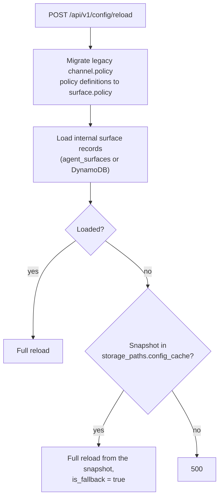

# Configuration Reload

What Agent Stream applies at runtime without a restart, what an explicit reload rebuilds, and
how Active and Standby modes work. Use the hosted
[Agent Stream configuration reference](https://docs.affinidi.com/products/affinidi-trust-fabric/agent-stream/reference/configuration/)
for supported operator guidance.

For what each configuration file controls, see
[`CONFIGURATION_REFERENCE.md`](CONFIGURATION_REFERENCE.md).

## At a glance

| Change | When it applies |
| --- | --- |
| A Surface created, edited or deleted through the management API on this node | Immediately |
| A Surface written by another node on shared storage | Within `cache_refresh_interval_secs`, when it is above 0; otherwise on promotion or restart |
| Records of the other cached kinds written by another node, or edited by hand under `_storage/` | Within `cache_refresh_interval_secs`, when it is above 0; otherwise on restart |
| Members, Teams, Prompts, sessions, policy definitions, global policies, drift state, dashboard settings edited outside this process | Restart |
| `metrics.json` saved through `PUT /api/v1/metrics/config` | Immediately for OpenTelemetry |
| The stored Model catalog (`llm.json`, `custom_llm.json` under `storage_paths.llm_configuration`) | On the next read after the file changes |
| `rejection_categories.json` | On the next read after the file changes |
| `agent-stream.json` listener and route sections | On `POST /api/v1/config/reload`, or restart |
| `config.toml` and every other configuration file | Restart |

## Surfaces

A Surface (an LLM or IDE Surface, a _pipe_ in code) is served through a route table that
maps each listener and route to a Surface id
([`src/pipes/route_manager.rs`](../src/pipes/route_manager.rs)).

When this node's management API saves a Surface, it registers, re-registers or removes that
Surface's route at once and drops the Surface's cached configuration, so the next request
reads the new version.

A Surface written by another node arrives through the Surface store's cache refresh. Each
refresh that finds a changed or removed Surface emits a `RemoteWrite` event, and the
subscription started in [`src/server/orchestrator.rs`](../src/server/orchestrator.rs)
(`init_pipe_storage_subscription`) applies it:

| Event | Effect |
| --- | --- |
| Upsert | `sync_pipe` drops every route the Surface owned and registers its current route when it is enabled and routable. The cached configuration and executor are dropped, and its policy is recompiled. |
| Delete | `remove_pipe_by_id` removes its routes; its cached configuration and compiled policy are dropped. |

`sync_pipe` refuses a route that another Surface already owns on an overlapping listener. The
Surface then keeps its previous routes and the conflict is logged as a warning. Neither path
rebuilds the whole route table or restarts a listener.

The subscription runs only when `cache_refresh_interval_secs` is above 0. With the default of
0, a Surface written outside this process is picked up on promotion (which reloads every
Surface from disk) or restart.

### Surfaces that are not loaded

Surfaces are LLM or IDE Surfaces (the code also keeps a Webhook type). A stored Surface
whose type is `api` or `mcp`, or that has a variant overriding its type to one of them, is skipped whenever the Surface store loads or
refreshes ([`PipeConfig::migrate_raw_json`](../src/pipes/config.rs)). Only that record is
skipped and its file stays on disk. A `WARN` naming the file, the type and any variant id is
logged the first time per file in a process; later refreshes log it at `DEBUG`
([`src/storage/filesystem.rs`](../src/storage/filesystem.rs)). The message never includes the
record's content.

A skipped Surface is invisible to the management API and the dashboard, so it cannot be
deleted there. Remove its `<id>.json` or `<id>.json.enc` file from the Surface storage
directory (`storage_paths.surfaces`), or create an LLM Surface with the same id, which
replaces it. The API rejects a create or update that uses either type.

## Cache refresh

`cache_refresh_interval_secs` (top-level in `config.toml`, default `0`) starts a refresh loop
for each DashMap-backed store ([`src/storage/filesystem.rs`](../src/storage/filesystem.rs)).
On each tick the store reads its directory, replaces changed records in memory, removes
records whose files are gone, and emits a `RemoteWrite` event for each difference. `0`
disables every loop.

| Store kind | Behaviour |
| --- | --- |
| Refreshed on the interval | Surfaces, Surface templates, internal surface records, API keys, certificates, identities, dashboard users, gateways and pending gateway connections, mediators, Connection Points, credential providers, OAuth Identifiers, JWT verification strategies, integration mappings (Surface, user, gateway and identity), notifications, Terms |
| Read from disk on every access | Secrets, delegation-vault tokens, integration definitions |
| Loaded once at startup | Members, Teams, Prompts, sessions, policy definitions, global policies, drift baselines, runs, sessions and evaluation state, the revocation status list, dashboard settings |

A refresh updates the in-memory record. Only Surfaces and internal surface records also
rebuild routing from the events; other kinds are read from the cache on their next use.
A refreshed CA certificate is used for forwarded client certificates when a Surface's CA trust
lists it, but not for direct TLS
handshakes, whose trust is fixed at startup (see
[Startup-only configuration](#startup-only-configuration)).

## Internal surface records

Internal surface records (`AgentSurface` in code) route appliance-to-appliance traffic. They
live in `storage_paths.agent_surfaces`, or in DynamoDB when
`channel_config_source = "dynamodb"`. With cache refresh on, a `RemoteWrite` event for one of
them is applied by the single-record path
([`apply_surface_change`](../src/server/orchestrator.rs)): an upsert is swapped into the
running configuration without restarting a listener, and a delete removes it. If that fails,
Agent Stream falls back to a full reload. The record's policy is recompiled after an upsert.

## `POST /api/v1/config/reload`

The explicit reload, gated by the `config.reload` permission
([`src/identity/handlers/config.rs`](../src/identity/handlers/config.rs)). It rebuilds the
internal surface records only. It does not re-read Surfaces, Members or Teams from disk, and
it does not re-read `config.toml`.



A full reload ([`reload_channels`](../src/proxy/surface_manager.rs)) is disruptive to the
listeners:

1. Abort every port listener task and clear the task monitor, then wait 200 ms for sockets to
   be released.
2. Swap in the new configuration and save it as the snapshot in `storage_paths.config_cache`.
3. Re-read `agent-stream.json`, then bind every listed port again. `outbound` listeners are
   skipped. Each port re-registers routes for the Surfaces already held in memory.
4. Reconcile connection-point transit listeners.

Requests in flight on a listener while it is rebound can be interrupted. Because step 3
re-reads `agent-stream.json`, changes to `listeners`, `routes` and `pipe_paths` take effect.
Settings consumed when the management API was built at startup (`cors`, `webauthn`, `did`,
`terms`, `integration`, `llm_catalog`, `drift`, `secrets`, `oauth_callback_route`, and log
redaction) keep their startup values. After a reload, the management, DID and vault routes are
mounted on every listener of the matching protocol, not only on the first `http` and first
`https` listener as at startup. The route-prefix collision check against the dashboard, which
exits the process at startup, is not repeated on reload.

The response is `{ "channels_count", "surfaces_count", "is_fallback", "warning"? }`;
`surfaces_count` is always `0`. `POST /api/v1/config/reload/{config_id}` rebuilds a single
internal surface record through the single-record path.

## Other runtime changes

| Source | Mechanism |
| --- | --- |
| `PUT /api/v1/metrics/config` | Validates and writes `metrics.json`, then rebuilds the OpenTelemetry trace, log and metric pipelines in place. A rebuild failure keeps the saved file and reports that a restart may be needed. `traces.target_crates`, CloudWatch, retention and host metrics stay at their startup values. |
| Model catalog | `llm.json` and `custom_llm.json` in `storage_paths.llm_configuration` are cached by modification time and re-read after they change ([`src/llm_catalog/store.rs`](../src/llm_catalog/store.rs)). |
| Rejection taxonomy | `rejection_categories.json` is cached by modification time; an absent or invalid file falls back to the compiled-in copy. |
| Affinidi Terms | Metadata is refreshed in the background on the interval set by `AFFINIDI_TERMS_REFRESH_INTERVAL_SECONDS`. |
| Secret update or delete (`PUT` or `DELETE /api/v1/secrets/{id}`) | Removes the secret from the source-auth secrets cache, which the secrets API shares with the source-authentication middleware, and drops every cached Surface executor ([`invalidate_executors`](../src/pipes/cache.rs)). An executor holds the upstream secrets it resolved (provider keys, Judge and Jury keys, upstream header secrets, search engine keys), so the next request to any Surface rebuilds its executor against the stored values. Both caches are per process. On another node, a source-auth cache entry lasts up to its 60 s lifetime ([`src/secrets/cache.rs`](../src/secrets/cache.rs)), and an executor keeps the old value until that Surface changes or the node restarts ([`src/secrets/handlers.rs`](../src/secrets/handlers.rs)). |

## Startup-only configuration

Read once and held for the life of the process:

- All of `config.toml`, including `server_mode`, `cache_refresh_interval_secs`, `[encryption]`,
  `[tls]`, `[surface_defaults]`, `[tenancy]`, `[did_cache]` and every path.
- `rbac.json`, `limits.json`, `saml.json`, `prompt-guard.json` and `audio_streams.json`.
- `llm.json` in the configuration directory, which only seeds the stored catalog.
- `surface_templates/` and `defaults/`, which are seeded at startup.
- The `agent-stream.json` settings listed under [`POST /api/v1/config/reload`](#post-apiv1configreload).
- The CA certificates the TLS listener trusts for direct client authentication
  (`tls.client_auth.direct`), read from the certificate store. See
  [`SOURCE_AUTH.md`](SOURCE_AUTH.md#mtls).

## Server mode

Agent Stream supports active-passive deployments: one instance serves traffic and one or more
warm standbys wait to take over. It does not elect a leader. An external controller that you
operate decides which instance is Active and tells each process by Unix signal
([`src/server/mode.rs`](../src/server/mode.rs)). Any system that can signal a process can
drive failover.

| Input | Effect |
| --- | --- |
| `server_mode = "active"` (default) | The process starts Active. |
| `server_mode = "standby"` | The process starts Standby: connection-point listeners stay stopped and readiness reports unavailable. |
| `SIGUSR1` | Promote to Active. |
| `SIGUSR2` | Demote to Standby. |

`server_mode` is read once at startup and must be a top-level key, above every `[table]`
header; placed after one it is ignored and the instance starts Active. Signals work on Unix
only; elsewhere the process stays in its configured mode. A `[failover]` block with
`enabled = true` refuses startup; see
[Configuration with no effect](CONFIGURATION_REFERENCE.md#configuration-with-no-effect).

### Readiness and liveness

| Endpoint | Meaning |
| --- | --- |
| `GET /api/v1/health` | Readiness. `200` once the instance is Active, has finished reloading Surfaces and the spend counters from storage, and has migrated inline integration credentials and pinned integration destinations. A failed Surface reload, migration or pin is logged as a warning and does not hold readiness back. A spend counter read that fails with a storage error holds readiness at `503` and is retried until it succeeds. `503` while starting, activating, or Standby. Readiness does not wait for connection-point listeners or any other external dependency. |
| `GET /api/v1/alive` | Liveness. `200` whenever the process is running, in either mode. |

Route client traffic on `/api/v1/health`. Restart a process only on `/api/v1/alive` failures;
a Standby is healthy even though it is not ready.

### What promotion does

On `SIGUSR1` the instance reports `503` at once, then:

1. re-reads Surfaces from storage and rebuilds the Surface route table,
2. reloads the Surface, Member and Team spend counters from `storage_paths.surface_usage`
   and `storage_paths.team_usage`, so spend recorded by the previous Active still counts
   ([USAGE_LIMITS_AND_ATTRIBUTION.md](USAGE_LIMITS_AND_ATTRIBUTION.md#persistence-across-restart-and-promotion)).
   A read that fails with a storage error is logged and retried, with a backoff of up to
   30 seconds, until it succeeds or the instance is demoted,
3. migrates the credentials integrations still store inline to the secrets store, then pins
   the destination of each integration whose references have no pin yet
   ([INTEGRATIONS.md](INTEGRATIONS.md#secrets-in-integration-configuration)). A failure here is
   logged and never holds readiness back, and a demotion stops it before the next integration,
4. reports ready (`200`), and
5. in the background, validates the active integrations, re-reads Connection Points from
   storage and starts the
   connection-point listeners.

HTTP traffic is served as soon as the instance is ready. DIDComm consumption resumes as each
listener reconnects to its mediator, which can take longer or, while a mediator is
unreachable, not happen at all. A ready instance does not imply that Fabric traffic is
flowing.

A `SIGUSR1` sent to an instance that is already Active runs activation again, so readiness
reports `503` until it completes. Send the signal only when the instance should change mode.

Each mode change carries a generation number. If a newer signal arrives while an activation
is still running, the older activation is superseded: it skips its reload if it has not
started it, and it cannot mark the instance ready or start listeners. Each transition is
logged (`Promotion requested`, `Demotion requested`, `Activation for generation N complete`
or `… was superseded`).

### What demotion does

On `SIGUSR2` the instance reports `503` at once, then stops every connection-point listener.
Listener tasks still starting are fenced and cannot register or reconnect afterwards. This
holds while a promotion is still reloading: the demotion does not wait for it, and the
interrupted promotion neither reports ready nor starts listeners.

Demotion stops Connection Points only. The HTTP listeners, the management API and the data
plane stay up; readiness routing is what keeps client traffic away. Readiness turns `503`
slightly before the listeners have finished stopping, so if duplicate DIDComm consumption
matters, allow a short grace period before promoting another instance.

### Controller responsibilities

The controller owns every guarantee a built-in election would otherwise provide. It must:

- **Keep at most one instance Active.** Agent Stream does not detect or prevent two Active
  instances. Demote the old Active, or confirm it is gone, before promoting another.
- **Fence a lost Active.** If the controller loses contact with the Active instance, it must
  make sure that instance can no longer serve (stop the process, isolate it from the network,
  or remove it from the load balancer) before promoting a standby.
- **Wait for readiness.** Treat a promotion as complete once `/api/v1/health` returns `200`.
  Readiness covers HTTP traffic; monitor connection-point status separately if Fabric traffic
  matters.
- **Not flap.** Send one signal per decision and wait for the previous transition to settle.
  Up to 16 pending mode changes are buffered; after a larger burst the instance skips the
  intermediate changes, applies the mode set by the last signal and logs how many it missed.
  Opposite signals sent close together can be applied in either order, so check readiness
  before acting on the result.

### Shared storage

Instances in an Active/Standby group must read the same storage tree (for example a shared
volume), so that a promoted standby sees what the previous Active wrote.

Promotion re-reads Surfaces, Connection Points and the spend counters only. The other cached stores follow
[Cache refresh](#cache-refresh): set `cache_refresh_interval_secs` on every instance of the
group, otherwise a promoted standby serves records cached at its own startup. Both keys are
top-level, above every `[table]` header.

```toml
server_mode = "standby"
cache_refresh_interval_secs = 5
```

The stores loaded once at startup (Members, Teams, Prompts, sessions, policy definitions,
global policies, drift state, dashboard settings) are not refreshed by the
timer. Restart a standby after any of them changes, before promoting it.

Pending credential-delegation consent flows, outstanding passkey challenges, VP challenges,
the Fabric envelope ids presentations have claimed, and the dashboard sign-in rate-limit and
lockout counters live only in each process's memory and are not carried over on promotion or
restart: consent in progress has to be started again, a caller asks for a new VP challenge,
and the sign-in limits start fresh on the promoted instance. A VP challenge is redeemable only
on the instance that issued it, so two Active instances behind one load balancer refuse each
other's challenges. After a restart, a Fabric envelope received before it is accepted again,
with its presentation's identity, until that presentation expires (at most 6 minutes), as a
redelivery of it is; see [`FABRIC.md`](FABRIC.md#presentation-binding).

A Standby still runs its HTTP server and management API. Some background jobs run in every
mode: the governance and drift retention sweeps, the drift evaluator and scheduler (which can
call upstream LLMs and raise drift alerts), and the startup cleanup of pending gateway
handshakes in shared storage. Readiness routing keeps client traffic away from a Standby but
not these jobs, so do not expose a Standby's ports directly to clients.

### Example controllers

These snippets show the shape of an integration. They are illustrative, not supported
deployment recipes.

**systemd**: promote or demote a local unit.

```bash
systemctl kill --signal=SIGUSR1 agent-stream   # promote
systemctl kill --signal=SIGUSR2 agent-stream   # demote
```

**keepalived**: follow the VRRP state of the node.

```bash
# notify script referenced from keepalived.conf
case "$3" in
  MASTER)       systemctl kill --signal=SIGUSR1 agent-stream ;;
  BACKUP|FAULT) systemctl kill --signal=SIGUSR2 agent-stream ;;
esac
```

**Kubernetes**: a sidecar or operator holding a `coordination.k8s.io/v1` Lease signals the
Agent Stream process when it acquires or loses the Lease (the containers must share a process
namespace, or Agent Stream must be PID 1 for `kill -USR1 1` through `kubectl exec`). A Service
selecting on the readiness probe `/api/v1/health` then routes traffic only to the Active pod.

### Troubleshooting

| Symptom | Likely cause |
| --- | --- |
| Active instance stays `503` | The Surface reload is still running, or the activation was superseded by a newer signal; look for `Activation for generation` in the log. |
| Ready instance receives no Fabric traffic | Connection-point listeners are still reconnecting, or a mediator is unreachable. |
| Promoted instance serves outdated records | `cache_refresh_interval_secs` is `0`, the record kind is loaded once at startup (see [Shared storage](#shared-storage)), or the instances do not share storage. |
| Signals have no effect | Non-Unix platform, the signal reached a wrapper process instead of `agent-stream`, or the handlers could not be registered (look for `Active/Standby signal handlers unavailable` on stderr). |

## Known limitations

- A full reload aborts and rebinds every listener, so in-flight requests on those ports can
  fail.
- A full reload leaves the management API's startup settings in place; changing `cors`,
  `webauthn`, `did`, `terms` or `integration` needs a restart.
- Records loaded once at startup are not shared between nodes until each restarts.

## Related

- [`CONFIGURATION_REFERENCE.md`](CONFIGURATION_REFERENCE.md): what each configuration file and field controls.
- [`config/examples/README.md`](../config/examples/README.md): the example files.
- [`FABRIC.md`](FABRIC.md): Connection Points and appliance-to-appliance traffic.
- [`OBSERVABILITY.md`](OBSERVABILITY.md): metrics, traces and logs, including the live OpenTelemetry reload.
- [`RBAC.md`](RBAC.md): the `config.reload` permission.
- [`../ARCHITECTURE.md`](../ARCHITECTURE.md): startup order and state.
