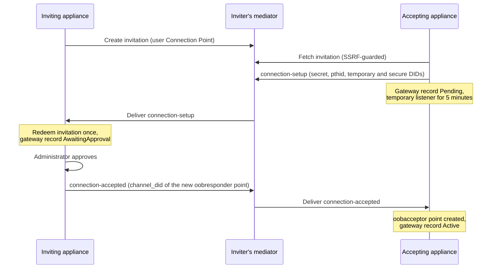

# Fabric

How an Agent Stream appliance joins the Fabric: its DID, Connection Points, Mediators,
pairing with another appliance, how it handles a `forward-request` it receives, and the
`did:webvh` identity management API. For
the product view, see the hosted
[Trust Fabric integration concepts](https://docs.affinidi.com/products/affinidi-trust-fabric/agent-stream/concepts/trust-fabric-integration/).

The Fabric is the set of appliances connected through Connection Points over DIDComm v2,
with Mediators relaying the messages. Agent Stream receives Fabric forwards and serves
them from its internal surface records (`AgentSurface`). LLM Surface traffic does not cross
the Fabric: this tree has no sender for surface traffic, and the only `forward-request`
sender belongs to marketplace support, which this documentation does not cover.

## Appliance DID

Each appliance has one DID, held by the VC issuer
([`src/identity/vc_issuer.rs`](../src/identity/vc_issuer.rs)) and built from `did.domain`
in `agent-stream.json`. The `didwebvh` Cargo feature is on by default; with it, the first
boot creates the DID as `did:webvh` and a later boot migrates a stored `did:web` to
`did:webvh`, rewriting the DIDComm key ids. A `did.domain` without a dot is accepted with a
startup warning, because `did:webvh` requires a fully qualified domain and outside
resolution of such a DID fails.

The DID document lists an Ed25519 verification key, X25519 and P-256 key-agreement keys,
and a `DIDCommMessaging` service at `https://{did.domain}/didcomm`. The DID router
([`src/identity/router.rs`](../src/identity/router.rs), `create_did_router`) serves it at
the root of the listener, outside the `/api` prefix:

| Path | Serves |
| --- | --- |
| `/.well-known/did/did.jsonl` | The `did:webvh` log at its spec path |
| `/.well-known/did.jsonl` | The same log at its earlier path |
| `/.well-known/did.json` | The DID document |
| `/surface/{surface_id}/did.json`, `/surface/{surface_id}/did.jsonl` | The DID document and log of a surface record's agent identity (`did:webvh:{scid}:{did.domain}:surface:{id}`, or the `did:web` form for an identity created before `did:webvh`) |
| `/credentials/status/revocation` | The revocation status list for the credentials the appliance issues (see [`POLICY.md`](POLICY.md#revoking-an-agent-identity)) |

The DIDComm endpoints `POST /didcomm` and `GET /didcomm/ws` are on the management router.
`GET /api/v1/identity/did-document` returns the appliance DID document to any signed-in
caller, with no permission: the `did:webvh` document once the DID has migrated, otherwise the
`did:web` one.

The gateway store keeps a **self gateway** record for this appliance
([`src/gateways/filesystem.rs`](../src/gateways/filesystem.rs)). It is created on first
boot with the appliance DID, and its DID is updated at startup when the appliance DID
changes. Every other gateway record is a remote appliance.

## Connection Points

A Connection Point ([`src/gateways/connection_points/types.rs`](../src/gateways/connection_points/types.rs),
`GatewayConnectionPoint`) is one DIDComm endpoint, with its own DID and keys. The appliance
DID is never used on the wire; each Connection Point has a separate identity, so one
appliance can hold many concurrent mediator sessions.

| `cp_type` | Created by | Purpose |
| --- | --- | --- |
| `user` | An administrator | An out-of-band invitation another appliance redeems |
| `oobresponder` | Approval on the inviting side | The permanent point that receives from the accepting appliance |
| `oobacceptor` | Pairing on the accepting side | The permanent point that receives from the inviting appliance |
| `oobinviter` | Reserved | Permanent inviter-side point type, not created by the current flow |
| `system` | Pairing on the accepting side | The temporary point that waits for `connection-accepted` |

### Identity

`did_method` selects the Connection Point DID method: `web` (the default), `webvh`, or
`peer`. Each identity has an Ed25519 key (`#key-1`), an X25519 key (`#key-2`) and a P-256
key (`#key-3`), and a DIDComm service routed through the point's Mediator. That service, and
an invitation's URL (`<endpoint>/oob?_oobid=…`), use the Mediator's HTTPS DIDComm endpoint as
its validated DID document publishes it, path included. A listener connects by the Mediator's
DID alone, so it starts even when that document cannot be fetched; the endpoint is resolved
only where an invitation or an identity is built, from the stored Mediator's document when
there is one. Its DID document
and log are served under the `connection_point` route prefix (`/connection-points` in the
example configuration) at `/{cp_id}/did.json` and `/{cp_id}/did.jsonl`, outside `/api`, so a
`did:web` or `did:webvh` DID resolves to them ([`src/proxy/server.rs`](../src/proxy/server.rs)).
The management router serves the same documents under `/api` as well, at
`/connection-points/{cp_id}/did.json` and `/connection-points/{cp_id}/did.jsonl`, and at
`/.well-known/connection-points/{cp_id}/did.json` and `.../did.jsonl`. All of them are public
`GET`s.

### Listener

[`ConnectionPointListenerManager`](../src/gateways/connection_points/ws_listener.rs) runs
one WebSocket listener per enabled Connection Point. Each listener authenticates to its
Mediator, applies the point's Mediator access list, and receives messages through the
message-pickup live stream.

| Point state | Mediator access list |
| --- | --- |
| `user`, not yet redeemed | Open, so any appliance holding the invitation can send `connection-setup` |
| `user`, redeemed | Only the accepting appliance's temporary DID |
| `oobresponder`, `oobacceptor` | Only the recorded peer DID |
| Temporary `system` point | Only the inviting appliance's temporary DID |
| Peer DID missing | Deny all |

A message is deleted from the Mediator only after it has been processed, so an in-flight
request stays queued at the Mediator until it is answered. Dispatches run concurrently, up
to `[a2a] max_inflight_dispatches` in `config.toml` (default 256) per listener. The DIDComm
SDK's inbound cache is bounded by `[a2a] sdk_inbound_cache_count` (default 1024) and
`sdk_inbound_cache_bytes` (default 100 MiB).

A dropped connection is retried with backoff from `[reconnect_policy]`:
`initial_backoff_seconds` (default 30), `max_backoff_seconds` (default 1800) and
`backoff_multiplier` (default 2.0). Each Connection Point records its health in
`runtime_status` ([`src/comm/connection_health/mod.rs`](../src/comm/connection_health/mod.rs)):
a state (`connected`, `reconnecting`, `failed`) and a stable error code such as
`MEDIATOR_UNREACHABLE`, `MEDIATOR_DID_RESOLUTION_FAILED`, `AUTHENTICATION_FAILED` or
`PEER_GATEWAY_UNAVAILABLE`. When a probe finds that the Mediator has lost a point's
account, the listener is restarted in the background so it authenticates and applies its
access list again.

### Inbox

Messages a Connection Point receives are decrypted and stored in its inbox
(`connection_point_inbox_routes` in [`src/identity/router.rs`](../src/identity/router.rs)).
Because the bodies are decrypted DIDComm messages, the inbox is gated on
`connection_points.edit` rather than `connection_points.view`, which every user holds:

| Method and path | Purpose | Permission |
| --- | --- | --- |
| `GET /v1/connection-points/{id}/messages` | List messages | `connection_points.edit` |
| `GET /v1/connection-points/{id}/messages/{message_id}` | Read one message | `connection_points.edit` |
| `GET /v1/connection-points/{id}/messages/unread-count` | Unread count | `connection_points.edit` |
| `POST /v1/connection-points/{id}/messages/{message_id}/read` | Mark a message read | `connection_points.edit` |
| `DELETE /v1/connection-points/{id}/messages/{message_id}` | Delete a message | `connection_points.delete` |
| `POST /v1/connection-points/{id}/use` | Record a use of the point | `connection_points.edit` |

Both are power user by default. An access token is still limited to its own tenant's
Connection Points (`load_accessible_connection_point`); a signed-in session has no tenant.

### Status and reconnect

| Route (under `/api`) | Purpose | Permission |
| --- | --- | --- |
| `GET /v1/connection-points/{id}/metrics` | The point's listener metrics; with no running listener, metrics built from its persisted `runtime_status` | `connection_points.view` |
| `POST /v1/connection-points/{id}/reconnect` | Reset the reconnect backoff, persist it, and restart the listener now. The restart takes effect only on an Active instance; a Standby picks up the reset when promoted | `connection_points.edit` |
| `GET /v1/gateways/{gateway_id}/connection-points` | The administrator-created (`user`) points of one gateway, without their `secret` | `connection_points.view` |

Each is limited to the caller's tenant and token scope.

### Lifecycle, expiry and cleanup

An invitation point expires after `expiry_seconds` from its creation request (default 86400,
one day). Once expired, its listener refuses every message, before shutdown.

A maintenance task ([`start_cache_maintenance_task`](../src/gateways/connection_points/ws_listener.rs))
runs every five minutes. While the appliance is Active, it:

- stops the listener of a Connection Point that has been deleted, is disabled, has expired,
  or belongs to a gateway whose status is `disabled` (`reconcile_listeners`). An expired
  point's Mediator access list is first set to deny all, and an expired temporary `system`
  point is deleted with its keys;
- removes expired pending-connection records and expired approvals
  (`PendingConnectionStore::cleanup_expired`).

At startup, gateway records left in `Pending` by a pairing that the previous process did not
finish are deleted, because that handshake cannot resume. Deleting a gateway stops its
Connection Points' listeners and deletes its system-created points; points an administrator
created are kept. Deleting a Mediator stops the listeners of every point that uses it.

## Pairing

Two appliances pair through an out-of-band (OOB) invitation. The inviter creates a `user`
Connection Point; the acceptor redeems its invitation URL.

Pairing does not make a peer a trusted credential issuer. For a peer's caller identity to
verify, each appliance must list the other's appliance DID in `did.trusted_issuers` in
`agent-stream.json`, which is read at startup only. List the DID in its current form, the
`id` the peer serves at `/.well-known/did.json`: after a peer migrates from `did:web` to
`did:webvh` its `did:web` no longer matches. Without the entry, the peer's presentations are
recorded as unverified (see [`POLICY.md`](POLICY.md#vp-evidence)).



### Inviter

`POST /api/v1/connection-points` creates the invitation
([`src/gateways/connection_points/handlers.rs`](../src/gateways/connection_points/handlers.rs),
`create_connection_point`). It is refused unless:

- the gateway is the self gateway (`400`);
- the secret is 32 to 256 bytes (`400` "Connection secret must contain 32-256 bytes");
- the Mediator exists and the caller may reference it (`404`, `400`);
- the appliance's `connections.connectionpoints` limit is not reached (`403`).

After the Mediator stores the invitation, the inviter reads it back and records the
invitation message's `id`. The acceptor names that `id` as the `pthid` of its
`connection-setup`.

The secret is a bearer capability: whoever holds it and the invitation can redeem the point.
The create response is the only one that returns it. Every other response that carries the
record (`GET /api/v1/connection-points`, `GET /api/v1/connection-points/{id}`,
`GET /api/v1/gateways/{id}/connection-points`, and the update, exposure, use and reconnect
responses) omits the `secret` field, so a lost secret means creating a new point. Reading
Connection Points and their metrics (`GET /api/v1/connection-points/{id}/metrics`) needs
`connection_points.view` (`connection_point_read_routes` in
[`src/identity/router.rs`](../src/identity/router.rs)), so an access token narrowed to other
scopes is refused with `403`.

Earlier versions returned the secret on every read to any signed-in user or access token, and
a secret read then still redeems its invitation. After upgrading from such a version, delete
or disable each `user` Connection Point that has not been redeemed (`use_count` 0), since
redemption needs an enabled point, and create it again to issue a new secret.

When `connection-setup` arrives, the listener first throttles setup attempts to five per
minute per point, and requires a parent thread id (`pthid`) and a non-empty secret of at most
256 bytes. It then redeems the invitation
([`consume_invitation`](../src/gateways/connection_points/filesystem.rs)), which succeeds
only when the point is an enabled `user` point that has not expired and has not been
redeemed, the `pthid` names the invitation, and the secret matches in constant time. A
successful redemption increments `use_count`, so a second setup on the same invitation is
refused. Any refusal drops the message without a reply.

The inviter then enforces its `connections.gateways` limit (a refusal sends
`connection-rejected`), creates a gateway record with status `AwaitingApproval`, stores the
pending approval, and raises a dashboard notification. The approval must happen within
`[oob_connection] pending_expiry_hours` (default 1).

### Human approval

`POST /api/v1/gateways/{id}/approve` ([`src/gateways/approve.rs`](../src/gateways/approve.rs))
takes a `name` and `description` and completes the handshake. It refuses:

| Status | When |
| --- | --- |
| `404` | The gateway or its pending approval is not found |
| `403` | The gateway is outside the caller's tenant or token scope, or `connections.connectionpoints` is at its limit |
| `400` | The gateway status is not `AwaitingApproval`, or its Mediator is not referenceable |
| `410` | The pending approval has expired |

On approval the gateway becomes `Active`, an `oobresponder` Connection Point is created on
the invitation's Mediator, its listener is started and authenticated, and only then is
`connection-accepted` sent, carrying the new point's DID as `channel_did`. The invitation
point is kept, because the acceptor resolves its DID to read the reply.

### Acceptor

`POST /api/v1/gateways/connect-via-oob` takes `oob_url`, `secret`, `name`, `description`,
and optional `did_method` and `tenant_id` ([`src/gateways/handlers.rs`](../src/gateways/handlers.rs),
`connect_via_oob`). It enforces `connections.gateways`, fetches the invitation through the
SSRF-guarded fetch, refuses an invitation whose `expires_time` has passed, creates a
temporary DID and a secure DID, and sends `connection-setup` through the inviter's Mediator.
The new gateway record has status `Pending`. A temporary `system` Connection Point, which
expires after `[oob_connection] pending_expiry_hours`, receives the reply; its first
listener waits up to five minutes for `connection-accepted`. On its arrival the acceptor creates an `oobacceptor`
Connection Point that accepts only the inviter's `channel_did`, and the gateway becomes
`Active` once that point's listener has started, whether or not the start succeeded. Once `connection-accepted` has been deleted from the Mediator, the temporary point,
its listener and its keys are removed, so later traffic to the inviter uses the
`oobacceptor` point. `connection-rejected` ends the attempt.

### Gateway status

`GatewayStatus` ([`src/gateways/types.rs`](../src/gateways/types.rs)) is `active`,
`pending`, `awaiting-approval`, `disabled` or `failed`. `pending`, `awaiting-approval` and
`disabled` are workflow states and are reported as stored. For any other remote gateway, the
list and get APIs report `active` when a listener for it is running or a Connection Point's
persisted `runtime_status` is `connected`, `failed` when a point has an unhealthy runtime
status, and `pending` when none has a status yet.

## Mediators

A Mediator record ([`src/mediators/types.rs`](../src/mediators/types.rs)) holds the
Mediator's DID and resolved DID document, a `status` (`active` or `disabled`), an optional
`tenant_id`, and the appliance's own account on it: `our_did`, a `did:peer` generated when
the record is created, and its secrets.

| Route (under `/api`) | Purpose |
| --- | --- |
| `GET`, `POST /v1/mediators` | List, or create from `name`, `description`, `did` and an optional `did_document` (limit `connections.mediators`) |
| `GET`, `PUT`, `DELETE /v1/mediators/{id}` | Read, update (`name`, `description`, `did`, `status`), or delete |
| `POST /v1/mediators/{id}/trust-ping` | Send a DIDComm trust ping and wait up to 5 seconds |
| `POST /v1/mediators/check-auth` | Check that a DID document is usable for authentication |
| `GET /v1/mediators/compatible` | Mediators the caller may use |

### Transport validation

Mediator DID resolution supports `did:web`, `did:webvh`, `did:peer` and `did:key`
([`src/mediators/transport.rs`](../src/mediators/transport.rs)). The document's `id` must be
the configured DID, its message socket endpoint must use `wss` and its authentication
endpoint `https`, and endpoint DIDs it references are resolved and checked the same way, to
a depth of four. The check runs again before authentication, trust ping, and listener start
or restart.

For local development only, `AS_ALLOW_INSECURE_LOCAL_MEDIATOR_TRANSPORT=true`
admits `ws` and `http` endpoints on an exact loopback host, and only when configured HTTP
proxies are bypassed for that host through `NO_PROXY`.

The messaging SDK accepts only authcrypt envelopes, optionally signed or wrapped in an
anoncrypt layer, and deletes anoncrypt-only, signed-only and plaintext messages at pickup.
It manages each point's Mediator account and access list with the
`messaging/account/update` and `messaging/access-list/update` Trust Tasks, signed with the
point's Ed25519 key.

### Discovery

OOB invitations, Mediator DID documents, `did:webvh` logs and witness files are fetched by
[`fetch_public_bounded`](../src/outbound_fetch.rs):

- HTTPS only; plaintext only under the loopback development opt-in above;
- no user information or fragment in the URL;
- DNS resolved once and the request pinned to the approved addresses, with proxies disabled;
- addresses the [strict outbound policy](INTEGRATIONS.md#strict-outbound-policy) refuses
  are refused, unless the exact host is listed in
  `AS_MEDIATOR_DISCOVERY_PRIVATE_HOST_ALLOWLIST` (comma-separated), which still
  refuses the addresses `is_blocked_resolved_ip` lists (loopback, unspecified, link-local
  and cloud metadata);
- at most 3 redirects, each validated again, never from HTTPS to HTTP;
- 256 KiB response limit, 5-second connect and 10-second total timeout.

### Local Mediator

`make mediator-up` ([`scripts/mediator/mediator-start.sh`](../scripts/mediator/mediator-start.sh))
runs a DIDComm Mediator in Docker under `envs/mediator/` and prints its DID;
`make mediator-down` stops it. Pairing two appliances through it has these requirements:

- The Mediator refuses `did:web` DIDs on a `localhost` host, which is what an appliance
  reached at `localhost:<port>` gives its Connection Points by default. Pair local
  appliances with `did_method: "peer"`, set on both the invitation
  (`POST /api/v1/connection-points`) and `connect-via-oob`, or run the appliances and the
  Mediator behind public hostnames.
- Register the Mediator with the `did:webvh` DID that `make mediator-up` prints. Its
  `did:web` form is refused.
- A Mediator on `localhost` serves plaintext endpoints, which the appliance accepts only
  under `AS_ALLOW_INSECURE_LOCAL_MEDIATOR_TRANSPORT` (see
  [Transport validation](#transport-validation)), and DIDComm resolution of its DID needs
  `[did_cache] allow_private_hosts` (see [DID cache](#did-cache)).

## Receiving a forward-request

A peer sends `https://affinidi.com/atm/client-actions/forward-request` to one of this
appliance's Connection Points. The listener
([`process_messages`](../src/gateways/connection_points/ws_listener.rs)) authorises the
sender, [`src/messages/dispatcher.rs`](../src/messages/dispatcher.rs) dispatches the message,
and [`process_forward_request`](../src/gateways/connection_points/message_processor.rs) serves
it. The body carries `channel_id` (a wire name; it holds the target surface record's
`config_id`), `method`, `path`, `headers`, `body`, an optional Variant alias
(`virtual_channel_alias` or `active_variant_alias`), an optional `deadline_ms`, and optional
`trace_id` and `otel_context`, which the `fabric.forward_request` span continues.

The checks run in this order. Every refusal is answered with a `forward-response` whose body
is `{status, body}` with a generic message: no target host, URL or upstream error reaches the
peer ([`forward_errors.rs`](../src/gateways/connection_points/forward_errors.rs)). For a
surface whose protocol is JSON-RPC, the message is a JSON-RPC error carrying the request id.

| Step | Check | Refusal |
| --- | --- | --- |
| 1. Sender authorisation | The Connection Point has not expired. An invitation point accepts only `connection-setup`. Otherwise the message must be authcrypt or signed, its `from` must match the DID of the verified sender key, and that DID must be the point's established peer | Dropped without a reply |
| 2. Surface record | `channel_id` names a surface record exposed to the receiving Connection Point (see [Surface exposure](#surface-exposure)) | `404` "Requested target was not found", also for a record that exists but is not exposed; `502` when the records or the exposure cannot be read |
| 3. Variant | The requested Variant is resolved. A disabled Variant is refused; an unknown alias falls back to the default | `503` "Requested variant is not active" |
| 4. Status | The resolved record is `Enabled` | `503` "Target is not active" |
| 5. Protocol boundary | A JSON-RPC body's protocol family matches the surface's; the target scheme is `http` or `https`; the method is `GET`, `POST`, `PUT`, `DELETE`, `PATCH`, `HEAD` or `OPTIONS` | `422`, `502`, `405` |
| 6. Source auth | The surface's source authentication, using the forwarded headers. A public discovery read is exempt | `403` "Source authentication failed"; `503` when the middleware is not running |
| 7. VP evidence | A verified presentation in the body becomes `input.identity_binding`. Its credentials verify only when their issuer, the peer appliance's DID, is listed in `did.trusted_issuers` (see [Pairing](#pairing) and [`POLICY.md`](POLICY.md#vp-evidence)), and it must be bound to this envelope (see [Presentation binding](#presentation-binding)) | None at this step; a presentation that does not verify sets no `identity_binding`, and the caller's DID is recorded as unverified |
| 8. Appliance-wide Trust Fabric policy | The global policy of type `appliance`, when one is assigned | `403` "Request blocked by gateway policy" |
| 9. Gateway Trust Fabric policy | The self gateway's own policy, when enforced | `403` "Request blocked by gateway policy" |
| 10. Surface policy | The surface's compiled OPA policy, when the surface enables OPA | `403` "Agent trust policy denied the request"; `403` "Agent trust policy could not be evaluated" when no policy compiled |
| 11. Forward preparation | The target URL, target auth, credential delegation and the caller's deadline (see [The HTTP forward](#the-http-forward)) | `400`, `502`, `401` consent required, `504` |
| 12. Payment | On a paid surface, Agent Pay accepts the payment (see [Paid surfaces](#paid-surfaces)) | Agent Pay's `402` challenge; `502` or `503` "Payment could not be verified"; `504` when the deadline has passed |
| 13. HTTP forward | Sent to the target | See below |

A public discovery read is a `GET` or `HEAD` whose path ends with a discovery document
(`/.well-known/agent-card.json`, `/.well-known/agent.json`, `/agent-card.json`,
`/agent.json`, `/.well-known/ucp` or `/.well-known/agent-card`) and holds no `%`, `;`, `\`,
control character, or `.` or `..` segment ([`src/proxy/paths.rs`](../src/proxy/paths.rs)). It skips steps 6,
9 and 10, and step 12 only when it reads the surface's own discovery document (see
[Paid surfaces](#paid-surfaces)). Step 8 still runs and sees `request.purpose` `"discovery"` with no
`source_auth`. Its body is dropped before source authentication, so no caller identity is
extracted from it or stored, and method-override headers are not forwarded, so it stays a
read.

Both Trust Fabric policy layers are deny-overrides and fail closed: an evaluation error
denies. Their input is a `PolicyInput` with direction `inbound`, the sender DID, the
filtered request headers and the source-auth identity. The surface policy's input
also carries the extension identity and the agent context. See [`POLICY.md`](POLICY.md).

### Paid surfaces

A surface record whose target sets `payment_policy` is paid. Agent Pay, a surface on a peer
appliance, verifies and settles the payment; this appliance enforces it, so no unpaid request
reaches the target
([`payment_gate.rs`](../src/gateways/connection_points/payment_gate.rs)).

```json
"payment_policy": {
  "provider": "agent_pay",
  "payment_gateway_id": "<peer gateway id>",
  "payment_surface_id": "<Agent Pay surface id>"
}
```

A request is charged only once nothing on this appliance can still refuse it: after the
policies, the target path check, target auth, credential delegation consent and the deadline
check, just before it is sent to the target. It is then sent as a `forward-request` to
`fabric://{payment_gateway_id}/{payment_surface_id}` with the caller's method, path and
body, and only its payment headers: `PAYMENT-SIGNATURE`, `X-PAYMENT`, `Content-Type`,
`Accept`, and `Authorization` when it carries a `Payment` credential. Every other header,
such as a cookie or a credential meant for the target, stays on this appliance. On an MCP
surface that sets `strip_raw_meta`, the body Agent Pay gets has the raw identity removed
from `_meta`, as the target's does. Agent Pay's answer decides:

- **`2xx`**: paid. The request is forwarded to the target. Every `PAYMENT-RESPONSE`,
  `X-PAYMENT-RESPONSE`, `Payment-Receipt`, `X-Payment-Receipt` and `X-Settlement-Tx` header
  the target set is removed, and Agent Pay's headers of those names and its `Cache-Control`
  are added, so only Agent Pay can supply a receipt. The receipt headers are also on the
  `502` or `504` returned when the target cannot be reached or the deadline passes after
  payment, so the caller can prove it paid.
- **`402`**: Agent Pay's challenge is returned as it is, with only its `Content-Type`,
  `PAYMENT-REQUIRED`, `X-PAYMENT-REQUIRED`, `PAYMENT-RESPONSE`, `X-PAYMENT-RESPONSE`,
  `WWW-Authenticate`, `Retry-After` and `Cache-Control` headers. The target is not
  contacted.
- **Anything else** fails closed: any other status, no answer in time, or an empty id or an
  id holding `/` in `payment_policy` is answered with `502` (also when no Connection Point
  to that gateway is connected), and with `503` when this appliance's Fabric is not set up.
  The detail is logged, not returned.

Agent Pay is given what is left of the caller's `deadline_ms`, at most 30 seconds (30
seconds without one). A deadline already past is answered with `504` without asking Agent
Pay.

A read of the surface's own discovery document is not charged: a public discovery read whose
path is exactly one of the discovery documents above (a route that only ends like one, such
as `/files/agent.json`, is charged), or any public discovery read when the surface serves its
agent card from a configured location, since every such read fetches that card. A Variant's target overrides can replace the policy
but not remove it: the peer names the Variant, so a Variant that leaves `payment_policy` out,
complete or not, uses the base surface's policy. A stored `payment_policy` without `"provider": "agent_pay"`, from a release where
this appliance settled payments itself, is removed on load and the surface is disabled, so
it is not served unpaid; review it before enabling it again.

### Presentation binding

A presentation the peer sends is bound to the `forward-request` that carries it and to the
Connection Point it was sent to, so it cannot be detached and replayed
(`accept_vp_challenge` in
[`src/identity/vc_issuer.rs`](../src/identity/vc_issuer.rs)). A peer that sends a
presentation signs it with these proof options (Agent Stream sends none with the
`forward-request`s it sends):

- `challenge`: the DIDComm message `id` of the `forward-request` it is about to send;
- `domain`: the DID of the Connection Point the `forward-request` is addressed to, which the
  sender always knows;
- `expires`: no more than 5 minutes ahead. Up to 6 minutes is accepted, for clock skew.

On receipt the `domain` must name the Connection Point that received the envelope and the
`challenge` must equal the envelope `id`. The first presentation that carries that id then
claims it for its sender (the envelope's authenticated `from`) until the presentation expires,
before the presentation is verified, so a concurrent copy is refused without a signature
check. Ids are kept per sender, so
two peers never collide and one peer cannot use up another's. A redelivery of the same
envelope, carrying the same presentation, keeps its verified identity; a different
presentation carrying a claimed id is refused. A presentation without a challenge, for
another domain, or that has expired does not verify, and the caller's DID is recorded as
unverified, as for any presentation that does not verify. A peer that does not bind its
presentations this way therefore has its callers recorded as unverified. Claimed ids are held
in memory, at most 100,000 per sender at once; while a sender holds that many live claims,
its further presentations are refused. A restart or a standby promotion forgets them, so
afterwards an envelope seen before is accepted again within its presentation's lifetime,
exactly as a redelivery of it is; the claims never stopped that. What a restart adds is that
the sender could sign a second presentation for an id it already used, which needs the
sender's own keys. Agent Stream does not detect a replayed envelope as such.

A presentation this appliance puts in a `forward-response` (the backend agent's identity) is
bound the same way, the other way round: its `challenge` is the `id` of the
`forward-request` it answers, which is also the response's `thid`, and its `domain` is the
DID of the requester's Connection Point, so a requester that verifies it can check both
against its own request. Agent Stream itself verifies no response presentations: the
`forward-request`s it sends are marketplace calls and payment checks
(`fabric_marketplace.rs`), whose responses carry none.

### The HTTP forward

The target URL is the record's target endpoint joined with the request path; the path can
never change the target host. A path whose URL would leave the target endpoint (another
host, port or user info, or a path outside the endpoint's path), or that holds a `..` step
the target could still decode (percent-encoded, also twice, with `\`, or with a `;`
parameter such as `..;`), is answered with `400` "Request path is not allowed" before any
credential is attached (`evaluate_forward_target` in
[`src/gateways/connection_points/forward_errors.rs`](../src/gateways/connection_points/forward_errors.rs)).
The forward follows no redirects. Forwarded headers are the caller's, minus `content-length`,
`host`, and the source-auth credential header, which is consumed here and never forwarded.

- **Target auth.** When the record configures `target_auth`, its credential is resolved and
  injected. If resolution fails, `fallback` decides: `reject` (the default) answers `502`
  "Target authentication configuration error"; `passthrough` forwards without it.
- **Credential delegation.** When the record has outbound credential bindings, delegated
  tokens are resolved for the caller and injected as headers. The delegation vault is keyed
  by the holder DID of a VP that verified (`identity_binding.verified`), else by the hash of
  the source-auth principal; with neither, delegation is skipped. A caller DID read from the
  body without a verified VP (the credential-extension `did`, MCP `_meta` `did`, or a raw
  identity extension) is kept for telemetry, policy input and the DID cache only, and never
  keys the vault. A binding that needs consent is answered with `401` and the
  authorisation URLs, and the request is not forwarded. Each authorisation URL's `state`
  is a random value; the consent flow's context, including the PKCE verifier, stays on the
  appliance. The OAuth callback accepts a `state` only once, within 10 minutes of issue,
  and only if this process issued it, so a restart or a standby promotion cancels consent
  flows in progress. One flow is pending per agent, user and credential provider: a
  repeated consent prompt gets the same `state`. At most 10,000 flows wait at once; past
  that, the oldest is dropped.
- **Who gets upstream credentials.** On a surface that declares source authentication,
  target auth and credential delegation apply only to a caller source authentication
  identified (`may_send_upstream_credentials`). A public discovery read skips source
  authentication, so there it reaches the target with neither, whatever identity its
  body claims. A target that needs its credential to serve its agent card answers such a
  read itself, usually with `401`; serve the card without authentication at the target to
  keep it discoverable over the Fabric.
- **Deadline.** `deadline_ms` (epoch milliseconds) becomes the request timeout. A deadline
  already past is answered with `504` without contacting the target.

The target's status, body, and headers other than hop-by-hop headers and `content-length`
are returned in the `forward-response`, with a paid surface's payment receipt headers. A forwarded request also broadcasts a
`payload_captured` event to the dashboard WebSocket (see
[`OBSERVABILITY.md`](OBSERVABILITY.md#payload-capture)).

### Credential providers and the delegation vault

Credential providers ([`src/credential_providers/`](../src/credential_providers/)) hold the
OAuth configuration a binding uses; the delegation vault
([`src/delegation_vault/`](../src/delegation_vault/)) holds the tokens consent produces.
The management routes answer token metadata only, never an access or refresh token.

| Route | Purpose | Permission |
| --- | --- | --- |
| `GET /api/v1/credential-providers` | List providers | `credential_providers.view` |
| `POST /api/v1/credential-providers` | Create a provider | `credential_providers.edit` |
| `GET /api/v1/credential-providers/{id}` | Read one | `credential_providers.view` |
| `PUT /api/v1/credential-providers/{id}` | Update one | `credential_providers.edit` |
| `DELETE /api/v1/credential-providers/{id}` | Delete one | `credential_providers.delete` |
| `POST /api/v1/credential-providers/validate` | Check that `token_endpoint` is an allowed service URL and reachable | `credential_providers.edit` |
| `GET /api/v1/delegation-vault` | List delegated tokens | `delegation_vault.view` |
| `GET /api/v1/delegation-vault/{id}` | Read one token's metadata | `delegation_vault.view` |
| `DELETE /api/v1/delegation-vault/{id}` | Revoke one token | `delegation_vault.delete` |
| `DELETE /api/v1/delegation-vault/by-user/{user_hash}` | Revoke every token of one user | `delegation_vault.delete` |
| `GET /api/v1/delegation-audit` | Credential-delegation audit events | `audit.view` |
| `GET {oauth_callback_route}/{provider_id}` | The OAuth redirect target that completes a consent flow | Public |

The callback path comes from `oauth_callback_route` in `agent-stream.json` (default
`/v1/identity/oauth/callback`, see
[`CONFIGURATION_REFERENCE.md`](CONFIGURATION_REFERENCE.md#agent-streamjson)) and is served at
the root of the listener. It is public because the provider redirects the user's browser
there with no session.

A provider's `token_endpoint` must be an allowed service URL: it may be on a private
network, but not loopback, unspecified, link-local or a cloud metadata address. The
reachability check on `POST /api/v1/credential-providers/validate`, the code exchange, the
token refresh and the client-credentials fetch each check every address the host resolves
to again at connect time, so a name cannot rebind to a blocked address before the request
(and the client secret) is sent. These calls ignore `HTTP_PROXY` and `HTTPS_PROXY`. Revocations are recorded in the delegation audit log (see
[`OBSERVABILITY.md`](OBSERVABILITY.md)).

### Other DIDComm messages

The dispatcher also handles trust ping, `gateway-ping` and `gateway-pong`
(`POST /api/v1/gateways/{id}/ping`), and `get-surfaces`, which returns the enabled surface
records exposed to the receiving Connection Point.

`GET /api/v1/gateways/{id}/surfaces` sends `get-surfaces` to a connected peer and returns its
answer, cached for five minutes unless `force_refresh` is set. It needs a signed-in session
and no permission, and answers `404` for a gateway outside the caller's tenant or token
scope. `POST /api/v1/gateways/refresh-surfaces` (`gateways.edit`) refreshes that cache for
every connected gateway in the caller's tenant and token scope, at most once every five
seconds.

### Surface exposure

A peer can only list and forward to the surface records exposed to the Connection Point the
message arrived on. A record is exposed when all of these hold:

- the Connection Point's `exposed_channels` lists it, or is empty
  (`PUT /api/v1/connection-points/{id}/exposed-surfaces`);
- the peer's gateway record's `exposed_channels` lists it, or is empty
  (`PUT /api/v1/gateways/{id}/exposed-surfaces`);
- the gateway's tenant may reference it: a tenanted gateway reaches its own tenant's records
  and untenanted ones, an untenanted gateway reaches only untenanted records.

The exposure is read for each message, so a change to either list applies to the next one. It
fails closed. If the Connection Point or its gateway record cannot be read, a `get-surfaces`
query returns no records and a `forward-request` is refused with `502`.

## Trust Fabric policy

Two policy layers govern traffic between appliances, and both run before the surface's own
policy:

| Layer | Configured by | Applies to |
| --- | --- | --- |
| Appliance-wide | A global policy assignment of type `appliance` | Every received forward, whatever the gateway configuration |
| Per gateway | `opa_policy_config` on the self gateway record, set with `PUT /api/v1/gateways/{id}/policy` | Received forwards, while the policy is enabled |

`opa_policy_config` references reusable policy definitions (`policy_definition_id`, and
`policy_definition_ids` evaluated together, deny-overrides) or carries inline Rego in
`policy`. Trust Fabric policies are compiled at startup, and a compile failure stops the
process. Each decision is recorded through the policy audit with flow `fabric` (see
[`OBSERVABILITY.md`](OBSERVABILITY.md#policy-decision-audit)). Authoring and the policy
input are in [`POLICY.md`](POLICY.md).

## DID cache

[`DIDCache`](../src/gateways/did_cache.rs) is a persistent cache of resolved DID documents,
configured by `[did_cache]` in `config.toml`:

| Key | Default | Meaning |
| --- | --- | --- |
| `ttl_seconds` | 86400 | Lifetime of an entry |
| `max_entries` | 1000 | Size bound; the oldest entry is evicted to make room |
| `stale_threshold_percent` | 80 | Share of the TTL after which an entry is refreshed on use |
| `storage_path` | `../_storage/cache/did` | Where entries persist |
| `allow_private_hosts` | `false` | Startup-only. Lets `did:web` and `did:webvh` resolution reach loopback, private, link-local and metadata hosts |

The cache is pre-warmed at startup with the DIDs of active gateways and Connection Points.
A stale entry is refreshed from the network, and when resolution fails an expired entry is
served instead. The maintenance task evicts expired entries every five minutes.

All DID resolution, the shared resolver and each DIDComm client's own resolver, refuses
`did:web` and `did:webvh` hosts that are or resolve to loopback, private-network,
carrier-grade NAT or link-local addresses, unless `allow_private_hosts` is set. Startup
logs a warning when it is. Keep it off wherever a cloud metadata service is reachable.

`GET /v1/identity/resolve-did` and `GET /v1/identity/resolve-did-document` resolve any DID
for a signed-in caller; they are not on the session gate's public list. A `did:webvh` DID
found in this appliance's local stores is answered from them. Any other DID, a `did:web`
this appliance serves included, goes through `ExternalDidLookups`
([`credentials.rs`](../src/identity/handlers/credentials.rs)): each user may start 30 such
lookups a minute (`429` after that), a DID that just failed is answered from memory for
60 seconds without going out again, and every failure gets the same answer ("Could not
resolve this DID") while the reason, with the user, goes to the log. The resolver's own
bounds (no redirects, a 1 MiB cap for `did:web` and 200 KB for `did:webvh`) live in
`affinidi-did-web` and `didwebvh-rs`, so recheck them when the resolver SDK is bumped.

## Identity management

With the `didwebvh` Cargo feature (on by default), the appliance manages `did:webvh`
identities through `/v1/identities` (`didwebvh_routes` in
[`src/identity/router.rs`](../src/identity/router.rs); handlers in
[`src/identity/didwebvh/handlers.rs`](../src/identity/didwebvh/handlers.rs)).

| Method and path | Purpose | Access |
| --- | --- | --- |
| `POST`, `GET /v1/identities` | Create an identity; list the caller's | `identities.manage` |
| `GET`, `DELETE /v1/identities/{id}` | Read or delete one | `identities.manage` |
| `POST /v1/identities/{id}/update` | Update one | `identities.manage` |
| `POST /v1/identities/{id}/rotate-keys` | Rotate its keys | `identities.manage` |
| `POST /v1/identities/{id}/transfer` | Transfer it to a new controller | `identities.manage` |
| `GET /v1/identities/{id}/history` | Its log history | `identities.manage` |
| `GET`, `PUT /v1/identities/{id}/policy` | Its policy configuration | `identities.manage` |
| `GET /v1/identities/integrations` | Identity integration settings | `identities.manage` |
| `PUT /v1/identities/integrations` | Change them | `integrations.edit` |
| `GET /v1/resolve` | Resolve a DID | Public |
| `GET /v1/identity/resolve-did`, `GET /v1/identity/resolve-did-document` | Resolve any DID, limited per user ([DID cache](#did-cache)) | Session, no permission |
| `GET /dids/{path}` | Serve a DID log (`…/did.jsonl`) and `…/whois` | Public |
| `POST /v1/verify/{did}` | Verify an identity | Session, no permission |

`identities.manage` is administrator-only by default and separate from `identity.issue`,
which gates credential issuance (see [`RBAC.md`](RBAC.md)). `/v1/resolve` and `/dids/` are
session-gate public prefixes because they serve the published DID document and log.

**Ownership.** An identity created through `POST /v1/identities` records the session user
as `owner_user_id`. Identities the appliance creates itself (for Connection Points) and
records written before ownership existed have no owner. Every by-id route loads through
`load_managed_identity`, which admits the owner, or any `identities.manage` holder for an
identity without an owner, and answers `404` to anyone else; `GET /v1/identities` lists the
same set.

**Connection Point identities are read-only here.** Update, delete, rotate-keys, transfer
and policy update answer `409` for an identity carrying `metadata.connection_point_id`
(`load_mutable_identity`), because its keys also live in the Connection Point's key files.
`POST /v1/identities` refuses that reserved metadata key with `400`.

**Key material.** `GET /v1/identities/{id}` answers `DidWebVhIdentityResponse`: the public
key as a JWK and its key type, never the stored private key.

**Transfer.** `current_owner_authorization` must be a compact JWS
([`src/identity/didwebvh/transfer_auth.rs`](../src/identity/didwebvh/transfer_auth.rs))
with `alg` `EdDSA` and a `kid` naming a verification method of the identity's own DID
(`<did>#…`), signed over:

```json
{ "challenge": "transfer-ownership:<did>:<latest versionId>:<new_controller>", "iat": 1760000000 }
```

`iat` (Unix seconds) must be at most 300 seconds old and at most 120 seconds ahead. Any
other value is refused with `401`. Because the challenge binds the latest `versionId`, a
used proof stops verifying once the log moves on and cannot be replayed.

**Log parameters.** Log entries after the first carry only the parameters that changed;
`method`, `scid` and `updateKeys` default when absent. `types::current_parameters` carries
each value forward from the last entry that set it (`scid` and `portable` from the first
entry), and `/dids/{path}/whois` and the `/v1/identity/resolve-did-document` metadata
report those values. `/dids/{path}/did.jsonl` serves the stored log lines byte for byte
(`load_all_raw`), since entry hashes and proofs cover the exact JSON.

## Active and Standby

Connection Points run only on the Active instance. Demotion (`SIGUSR2`) disarms the listener
manager and stops every listener; HTTP listeners stay up. Promotion (`SIGUSR1`) reloads
surface records, marks the instance ready, then starts the listeners in the background, so
readiness does not wait for Mediators. Listener generations are fenced, so a task from an
earlier promotion can neither register nor remove a newer listener. The maintenance task
reconciles listeners only while Active. See [`../ARCHITECTURE.md`](../ARCHITECTURE.md#startup).

## Known limitations

- An `oobinviter` Connection Point type exists in the data model but the pairing flow does
  not create one.
- `pending_expiry_hours` is read only from `[oob_connection]` in `config.toml`. The example
  `agent-stream.json` also carries an `oob_connection` block, which is not read.

## Related

- [`POLICY.md`](POLICY.md): Trust Fabric policy authoring and the policy input.
- [`RBAC.md`](RBAC.md): `identities.manage` and the other permission keys.
- [`SOURCE_AUTH.md`](SOURCE_AUTH.md): source authentication on surface records.
- [`OBSERVABILITY.md`](OBSERVABILITY.md): payload capture, policy audit, trace propagation.
- [`INTEGRATIONS.md`](INTEGRATIONS.md): gateway and Connection Point events.
- [`CONFIGURATION_REFERENCE.md`](CONFIGURATION_REFERENCE.md): `[a2a]`, `[oob_connection]`, `[reconnect_policy]`, `[did_cache]`.
- [`ENCRYPTION_AT_REST.md`](ENCRYPTION_AT_REST.md): encrypted Connection Point fields.
- [`../ARCHITECTURE.md`](../ARCHITECTURE.md#fabric-path): the Fabric path in the overall architecture.
- [`../CONTEXT.md`](../CONTEXT.md): Fabric terminology.
