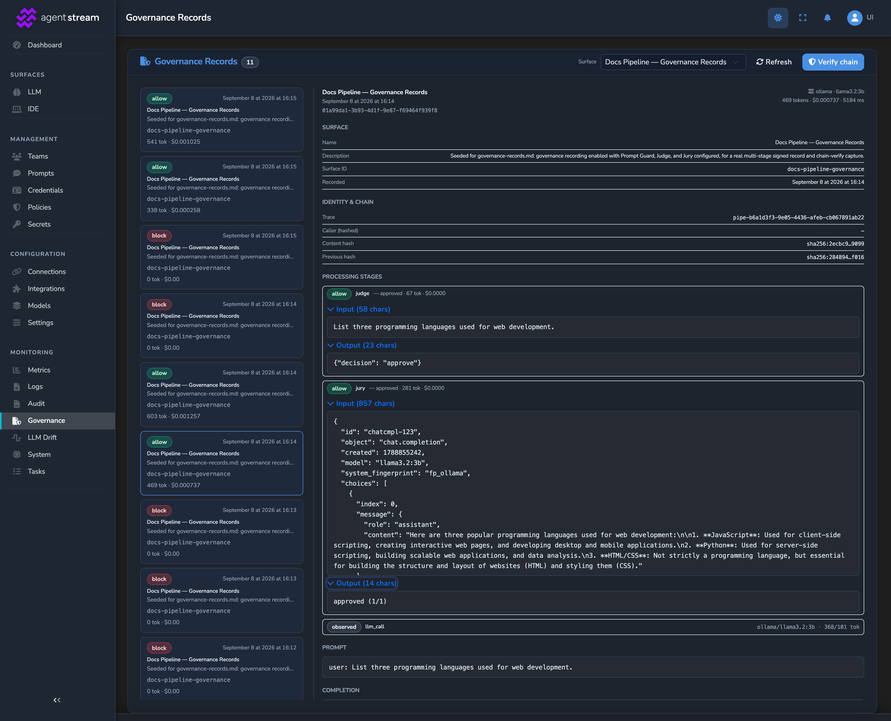
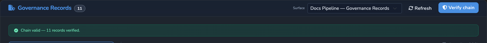

# Governance Records

Signed, tamper-evident records of the interactions on an LLM Surface: what the
caller sent, how each stage processed it, and what left, attested by the appliance's
own DID. This page covers the record schema, signing, the per-Surface hash chain,
verification, retention, storage, export, configuration, and the read API. Hosted
documentation:
[Governance Records reference](https://docs.affinidi.com/products/affinidi-trust-fabric/agent-stream/reference/governance/governance-records/).

## Overview

A Governance Record answers: "prove exactly what data entered the appliance, how it
was processed, and what left, and prove the appliance vouched for that record and
that none were dropped." Recording is per Surface and off until a Surface carries a
`governance_recording` block or the appliance-wide default turns it on.

| Property | Behaviour |
| --- | --- |
| Form | A W3C Verifiable Credential (VC Data Model v2), type `AIGovernanceRecordCredential`, signed with the appliance's Ed25519 key (EdDSA Data Integrity, `eddsa-jcs-2022`). |
| Granularity | One signed VC per interaction; the whole transcript is one attestation. |
| Completeness | A per-record signature and a per-Surface hash chain: each record embeds the previous record's content hash, so deleting or reordering a record is detectable. |
| Streaming | SSE deltas are teed and reassembled server-side, so a streamed interaction gets the same complete record as a buffered one. The caller's stream is never held up. |
| Bodies | Full prompt and completion by default, configurable to blocked records only or digests only. |
| Retention | A local append-only store with rotation, encrypted when encryption at rest is enabled, plus optional export to OpenTelemetry and integrations. |


Scope: LLM Surfaces. The source is under [`src/governance/`](../src/governance/).

## What is recorded

A `GovernanceRecord` ([`src/governance/record.rs`](../src/governance/record.rs)) is
the transcript of one interaction.



### Identity and correlation

- `record_id`, `trace_id`, `surface_id`, `surface_name`, `timestamp`.
- `trace_id` is the request's single trace id, shared with its policy decisions,
  `pipe.executed`, and `pipe.error`. When Agent Gateway forwarded the request it is
  Agent Gateway's `X-Gateway-Trace-Id` (reused only when it is a UUID); otherwise
  Agent Stream mints one. Blocked, denied, failed, and streamed records carry it too,
  and responses return it in `x-agent-stream-trace-id`.
- `caller_identity_hash` is a peppered HMAC-SHA256, never the raw identifier. It is
  computed over one canonical key on every path: the Member the caller resolves to
  through the Surface's team attribution (looked up the same way the team gate does,
  so a policy denial before the gate names the same Member), else the authenticated
  principal. The built-in anonymous Member never identifies a caller.
  `caller_identity_kind` says which key was used: `member`, `subject` (JWT `sub`),
  `api_key` (key name), or `mtls` (certificate principal).
- `principal_key` is a keyed hash of the authenticated caller that Agent Gateway
  computes the same way, for matching one person across both appliances: lowercase
  hex `HMAC-SHA256(AS_PRINCIPAL_KEY_SECRET, input)`, where `input` is
  `jwt:<subject>`, `api-key:<key name>`, or `mtls:<principal>`. Present only when
  `AS_PRINCIPAL_KEY_SECRET` (at least 32 bytes hex, or a loader reference such as
  `aws_secrets://name`) is set, to the same value as Agent Gateway's.
- `member_id`, `team_ids`, and `team_names`: the Member and Teams the team gate
  attributed the request to. `tenant_id`: the tenant that owns the Surface. Sandbox
  runs are attributed to the built-in sandbox Member and Team.

These fields come from the request context
([`src/observability/request_context.rs`](../src/observability/request_context.rs)).
Every live chat request, Sandbox run, and realtime session runs inside one
(`run_in_request_context` in
[`src/pipes/handlers/http_handlers.rs`](../src/pipes/handlers/http_handlers.rs)),
which carries the trace id (also scoped as `REQUEST_TRACE_ID` for policy decisions),
the Surface's tenant, the authenticated caller and, once the team gate has run, the
Member and Teams. `governance::capture_with_id` stamps every record from it, and a
stream's completion re-enters the same context, so a streamed record is attributed
like a buffered one. The same attribution is flattened into `pipe.executed`.

### Chain

`prev_record_hash` is the content hash of the previous record on this Surface's chain
(`null` for the first), and `content_hash` is this record's own hash.

### Stages

An ordered list of stage entries. Each names its stage, for example `inbound`,
`policy`, `team_gate`, `usage_limit`, `metering`, `rate_limit`, `circuit_breaker`,
`prompt_guard_model_pii`, `expert_witness_request`, `decider`, `judge`,
`mirror_candidate`, `llm_call`, `web_search`, `web_fetch`, `jury`,
`expert_witness_response`, `execution`, or `stream`, and carries evidence for it:

- Decisions and verdicts (allow, deny, flag, block), with the policy id and version.
  A policy block also carries `policy_name` (the policy definition's name, else its
  Rego query). A content block names the rejecting stage by its rejection label
  (`regex_request`, `regex_response`, `witness_request`, `witness_response`, `judge`,
  `jury`) and carries `categories`, its canonical rejection-category ids (see
  [GUARDRAILS.md](GUARDRAILS.md#rejection-categories)). A Judge rule that could not
  be evaluated is recorded with the `judge_indeterminate` category.
- Blocks before the pipeline. A request the team gate refuses is recorded with a
  `team_gate` block, and one a Surface usage limit refuses with a `usage_limit`
  block; the stage `reason` is the error returned to the caller, including its
  `code`. A platform-key call that a spent Member or Team budget refuses is a
  `team_gate` block (`team_quota_exceeded`). One refused because its spend is not
  metered while a budget is enforced is a `metering` block (`batch_not_metered`,
  `endpoint_not_metered`, `model_not_metered`, `tool_not_metered`,
  `modality_not_metered`, `context_not_metered`, `stored_context_not_metered`), so a
  readout tells the two apart.
- For `llm_call`: `provider`, `model`, `retry_index`, and digests of the request and
  response bodies. Retry attempts appear as repeated `llm_call` entries.
- Per-stage usage (tokens and cost) where applicable.
- Per-stage input and output bodies for the Judge, Jury, Decider, and Expert
  Witnesses (what was sent to the stage's model or provider and the verdict it
  returned), gated by body capture (digests only when off).
- A Jury rejection that a Redrive recovered appears as a flag stage, so the record
  shows what was caught and retried.

### Bodies

The full `prompt` (caller input) and `completion` (model output). With NER ID
restore on, the prompt is the caller's original request and the completion is the
restored answer; the provider received only NER IDs (see
[PROMPT_GUARD.md](PROMPT_GUARD.md#ner-ids)).

### Metrics

- The grand `ExecutionMetrics` summary (tokens, cost, latency, provider, model), the
  `currency` of every cost (`USD`), and `usage_by_stage`: one entry per stage that
  called a model (`llm`, `judge`, `jury`, `decider`) with its own `provider`,
  `model`, `input_tokens`, `output_tokens`, and `cost`. A Jury whose Jurors use
  different models reports `null` provider and model. The grand totals book every
  stage to the main call's provider and model; `usage_by_stage` is the per-model
  split.
- A blocked or failed record carries the tokens and cost spent before the stop (a
  Judge, Jury, response guard, or response witness block, or a failure after the
  Judge, Decider, Comparer or Summariser Candidates, main call, or Jury ran, including earlier
  retries and failover targets), not zeros.
- `cost` is the spend at the catalog price, whoever's key served it. `billed_cost`
  is the part billed to the account, zero for calls on the caller's or the
  customer's own key. A realtime voice turn on a platform key omits `billed_cost`
  (realtime audio is not priced) rather than stating zero.
- `key_source` names the source of the key the main call sent (`client`, `customer`,
  or `platform`), and `key_sources` counts every metered model call by key source.
  Each `usage_by_stage` entry carries its own `billed_cost` and `key_sources`, and a
  stage that called a model or provider (Judge, Jury, Decider, Comparer or Summariser Candidate,
  Expert Witness, model PII detector) carries its `key_source`. Only the label is
  recorded, never the key. A stage's recorded input never carries a request body's
  `api_key`.
- `usage_estimated` is `true` when a stream on a key that bills reported no usage
  and its tokens and cost are an estimate.

Optional fields (`currency`, `usage_by_stage`, `billed_cost`, `key_source`,
`key_sources`, `usage_estimated`, `caller_identity_kind`, `principal_key`,
`member_id`, `team_ids`, `team_names`, `tenant_id`, and the stages' `policy_name`,
`categories`, and `key_source`) are omitted when absent, so records written without
them keep their content hash.

## Signing and encryption

A record is:

1. built in plaintext;
2. signed as a VC, with the EdDSA proof over the plaintext canonical form;
3. when encryption at rest is enabled, encrypted: the whole signed VC line is encrypted
   with the appliance's encryption-at-rest service (AES-256-GCM, local MEK or AWS KMS
   envelope).

Verification path: decrypt (when encrypted), obtain the signed VC, verify the EdDSA proof against the
appliance DID, recompute `content_hash`, and walk the `prev_record_hash` links.

| Concern | Component |
| --- | --- |
| Appliance identity | The appliance DID (`did:webvh:...`) and Ed25519 key, `VCIssuer` ([`src/identity/vc_issuer.rs`](../src/identity/vc_issuer.rs)), published at `/.well-known/did.json`. |
| Signing | `VcSigner::sign_jcs` ([`src/identity/ssi/vc_issuer.rs`](../src/identity/ssi/vc_issuer.rs)): an `eddsa-jcs-2022` proof over RFC 8785 canonical JSON ([`src/identity/ssi/jcs.rs`](../src/identity/ssi/jcs.rs)). A verifier needs only an Ed25519 library and the DID document (`verificationMethod` `<issuer DID>#key-2`, listed under `assertionMethod`), not JSON-LD processing. |
| Content hash and chain | SHA-256 over canonical JSON (object keys sorted recursively), written `sha256:{hex}`. |
| Caller hash | The pepper is `AS_IDENTITY_HASH_PEPPER` when set, else one Agent Stream generates on first start and keeps in the secrets vault (secret id `identity-hash-pepper`), so hashes survive restarts. An invalid `AS_IDENTITY_HASH_PEPPER`, or a vault that cannot supply a pepper, fails startup. |
| Encryption at rest | `EncryptionService` ([`src/encryption/`](../src/encryption/)); see [ENCRYPTION_AT_REST.md](ENCRYPTION_AT_REST.md). |
| Durable append log | One worker task per Surface appending JSONL, each line synced to disk before the chain head names it, fed by a queue. |

The record credential carries an inline `@vocab` namespace
([`src/governance/credential.rs`](../src/governance/credential.rs)) so its type and
fields expand as JSON-LD for consumers that process it as such; the `eddsa-jcs-2022`
proof does not depend on it.

### Source layout

| File | Holds |
| --- | --- |
| [`record.rs`](../src/governance/record.rs) | Record schema, canonical hashing, the per-Surface hash chain. |
| [`credential.rs`](../src/governance/credential.rs) | The VC envelope and `GovernanceSigner`. |
| [`attribution.rs`](../src/governance/attribution.rs) | The canonical caller key, Member, Teams, and tenant. |
| [`store.rs`](../src/governance/store.rs) | The append-only per-Surface store and its workers (`list_surfaces`, `query`, `get`, `latest_record`, `verify_chain`, `prune`). |
| [`index.rs`](../src/governance/index.rs) | The plaintext fixed-width record index. |
| [`anchor.rs`](../src/governance/anchor.rs) | The signed retention anchor. |
| [`retention.rs`](../src/governance/retention.rs) | The hourly retention sweep. |
| [`multimedia_store.rs`](../src/governance/multimedia_store.rs) | Content-addressed store for binary attachments a record references. |
| [`capture.rs`](../src/governance/capture.rs) | The global store and the `capture` / `capture_with_id` entry points. |
| [`sink.rs`](../src/governance/sink.rs) | Export to OpenTelemetry and integrations. |
| [`config.rs`](../src/governance/config.rs) | The `governance_recording` block and its `CapturePolicy`. |

The read and verify API is in
[`src/identity/handlers/governance.rs`](../src/identity/handlers/governance.rs).

## Hash chain

Per Surface, the store keeps the current chain head. Each new record:

1. sets `prev_record_hash` to the head;
2. computes `content_hash = sha256(canonical(record_without_proof))`;
3. is signed into a VC;
4. is appended (encrypted when encryption at rest is enabled) and becomes the new head.

Chains are per Surface to avoid a global serialisation point. Each Surface has its
own worker, started on its first job, which owns that Surface's files and serialises
its appends, reconciliation, and prunes, so slow work on one Surface never holds up
another.

Each record has a sequence number, `seq`: its position on the chain, `1` for the
first record ever written. It is not part of the record or its proof; the read API
reports it and the index stores it.

### Verification

`GET /v1/governance/verify?surface_id=...` has the Surface reconciled first, then
replays the log against one consistent snapshot (the index and log measured
together, `chain-head.json` read before the log is measured) and checks:

- every line is stored as the store writes it: when encryption at rest is configured,
  a line that is not encrypted is refused (reads skip and log it; verify fails,
  naming the record);
- each record's `content_hash` recomputes, and its `prev_record_hash` equals the prior
  record's `content_hash` (the first record links to genesis, to the retention anchor,
  or to that anchor's `prev_anchor`; genesis only while the anchor has no
  `prev_anchor`);
- each record's signed VC states the record (`content_hash`, `record_id`,
  `timestamp`, `surface_id`, `prev_record_hash`) and its proof verifies with the
  appliance key or a key from the key history. Records signed with `eddsa-rdfc-2022`
  are checked as such. A record without a proof fails;
- every index entry describes its record, and the index holds no entry past the log;
- the retention anchor names the Surface and its proof verifies, and the record at
  the anchor's `seq` (when still in the log) carries the anchor's hash;
- the log reaches the chain head `chain-head.json` recorded.

The verdict is `{surface_id, valid, count, error?, problem?, previous_key_records?, first_seq?,
last_seq?, anchor?}`. `problem` says what failed:



| `problem` | Meaning |
| --- | --- |
| `broken` | A record, link, proof, line, or the anchor does not hold. |
| `unknown_key` | A proof verifies with no known key and names a `verificationMethod` that is neither the appliance's nor in the key history, as after the governance directory moves to another appliance or the history is lost. |
| `truncated` | The newest records are missing. |
| `index_mismatch` | The index disagreed with the log; it has been rebuilt. |

A valid verdict reports `previous_key_records` when some proofs verified only with a
key from the history.

Not detected: removing the newest records together with `chain-head.json` (a signed
head exported off the appliance would be needed), and records forged by someone who
holds the appliance signing key. Someone who holds the data encryption key can add a
key to the history; records it signs then verify and are counted in
`previous_key_records`.

### Retention and the chain anchor

`retention_days` (per Surface, `0` keeps everything) removes a Surface's oldest
records. Pruning removes a prefix of the chain, so the first kept record's
`prev_record_hash` names a record that is gone. Before the records go, the store
writes `anchor.json`: an `AIGovernanceChainAnchorCredential` VC, signed with the
appliance key like a record, whose subject is:

```jsonc
{
  "surface_id": "...",
  "seq": 1234,                    // the last pruned record's seq
  "content_hash": "sha256:...",   // its content_hash
  "timestamp": "...",             // its timestamp
  "pruned_at": "...",
  "retention_days": 30,
  "prev_anchor": {                // the anchor the log continued from before
    "seq": 1100,                  // this prune; absent when it continued
    "content_hash": "sha256:..."  // from genesis
  }
}
```

Verification then starts from the anchor: the first kept record must link to the
anchor's `content_hash` and is numbered `seq + 1`, and the anchor must name the
Surface and verify against the appliance key. Because every record's own proof is
checked too, dropping records without a signed anchor, editing the anchor,
substituting another Surface's anchor, or replacing the kept records is detected.
Each prune replaces the anchor.

Pruning runs on write and from a sweep (on the Active instance only, as soon as it is ready
and then hourly), once a
Surface's oldest record is
more than an hour past the window; it removes the leading records older than the
window, so a record goes within about two hours of leaving it. The kept log, its
rebased index, and the new anchor are written beside the live files and renamed in,
the anchor first, with the directory synced after the anchor and again after the log
and index. An interrupted prune leaves the new anchor beside a log that still
continues from the anchor it replaced, which the new anchor names in `prev_anchor`;
that state verifies, and the next prune completes it. A log that continues from
neither genesis, its anchor, nor that anchor's `prev_anchor` is never pruned, so no
anchor is signed over a chain that does not verify. Binary attachments in the
multimedia store are content-addressed and shared, and are not removed with the
records.

Each Surface keeps its retention window in `retention.json` whenever a record or a
prune names a different one, and the sweep walks every governance log on disk: a
Surface that still exists is pruned by its own effective window, and the log of a
deleted Surface by the window it last kept.

### Deleted Surfaces

Deleting a Surface (soft or hard) archives its governance directory as
`<surface_id>.deleted-<YYYYMMDDTHHMMSSmmm>Z` (UTC). No Surface id can take that name,
so a Surface created later with the same id starts a new chain from genesis. The
archive keeps its records, anchor, chain head, and retention window; it is listed by
`GET /v1/governance/surfaces` and can be read and verified by name, by appliance
callers only (no tenant owns it).

## Storage layout

```text
_storage/governance/
  signing-keys.jsonl     # every key records were signed with, one per line
  <surface_id>/
    records.jsonl        # append-only, one signed VC + envelope per line (ENC[…] when encryption at rest is enabled)
    index.jsonl          # one 256-byte plaintext line per record
    chain-head.json      # {"content_hash": "...", "count": N}
    retention.json       # {"retention_days": N}, the Surface's last window
    anchor.json          # signed retention anchor, once records are pruned
  <surface_id>.deleted-<UTC time>/   # a deleted Surface's archived directory
```

The **index** lets a read find records without decrypting the log (under an AWS KMS
key every decrypted line is a KMS call). Each entry holds only what a read filters on
and where the record lies: `seq`, byte `off` and `len` in `records.jsonl`, `ts` (unix
ms), `outcome` (`ok`, `blocked`, `failed`), the deciding `stage` label, and the record
`id`; never prompt, completion, or attribution. It is plain text, so it does show,
per interaction, when it happened, whether it was blocked, and by which stage. Entries
are fixed width, so entry `n` is at byte `n * 256` and a cursor is a seek.

The index is derived data and is not trusted. A record's line and its entry are
appended together. Every read checks the record it answers against its entry (id,
timestamp, outcome, stage) and that the entries it scans are in order; on a mismatch
the store logs it, rebuilds the index from the log, and reads again. On a Surface's
first use in a process the worker cuts a torn entry, rebuilds an index that cannot
describe the log, and indexes records appended after its last entry.

An entry's `outcome` and `stage` are derived from the record's stages, never stored in
the record: any `Block` stage makes the record `blocked`, else any `Error` stage makes
it `failed`, else it is `ok`; the deciding stage is the last `Block` stage, else the
last `Error` stage. `verify` compares every entry with its record. An index edit that
keeps its shape (a blocked record marked `ok`) can hide that record from filtered
reads until the next verify finds it.

The chain head is taken from the last record of the log (or the anchor once every
record is pruned), not from `chain-head.json`. A log that ends before the head
`chain-head.json` recorded has lost its newest records: the store logs an error,
keeps the head it once reached in `chain-head.json` (`missing_from`), and `verify`
reports the Surface as truncated from then on.

`signing-keys.jsonl` is the appliance's key history: the worker adds a key (its
`verificationMethod` and Multikey public key) the first time it signs with it,
encrypted line by line when the store encrypts (a plaintext line is then ignored), so
records signed before a key change still verify.

## Export targets

Each signed record can also be exported, in addition to the local store
([`src/governance/sink.rs`](../src/governance/sink.rs)):

- **OpenTelemetry**: a `governance_record` tracing event (record id, Surface, content
  hash, previous hash, and the signed VC) that reaches the OpenTelemetry log exporter.
- **Integrations**: any number of integrations named by id and resolved from the
  integration store, so a record can fan out to a webhook, Slack, email, a Kafka,
  Kinesis, Pulsar, or Redis stream, or Langfuse. The integration's template can use
  the governance runtime variables `RECORD_ID`, `SURFACE_ID`, `SURFACE_NAME`,
  `CONTENT_HASH`, `PREV_RECORD_HASH`, `CREDENTIAL`, `RECORD`, `TIMESTAMP`, `NEW_STATE`
  (the signed VC), and `EVENT_TYPE` (`governance.record`); the signed VC is passed as the
  message body. The **LLM Governance** integration
  category offers these variables.

Export is best-effort and asynchronous; the local store is the source of truth. A
delivery failure is logged and never blocks the request or drops the local record.

### Governance audit forwarding

Separately from Governance Records, every record written to the VP Audit Log (policy
decisions, audit-control changes, VP injections, and credential delegation events) is
forwarded to every active, appliance-global integration in the `audit` category,
whatever its type ([`src/integrations/audit_integration_triggers.rs`](../src/integrations/audit_integration_triggers.rs)).
Each record is one delivery, with event type `audit.<category>` (for example
`audit.policy_decision`). Each integration has its own bounded queue, so a slow sink
never stalls the audit writer; a full queue drops the record for that sink (the VP
Audit Log still holds it) and counts it in
`agent_stream_audit_forward_total{result="dropped"}`. A tenant-owned integration
receives no audit records, and an `audit` integration cannot be linked to a gateway,
Connection Point, user, or identity. See [OBSERVABILITY.md](OBSERVABILITY.md) and
[INTEGRATIONS.md](INTEGRATIONS.md).

## Configuration

Per Surface, on the Surface config
([`src/governance/config.rs`](../src/governance/config.rs)):

```jsonc
"governance_recording": {
  "enabled": true,            // default true when the block is present
  "capture_bodies": true,     // true (all, default), false (none, digests only), or "blocked"
  "record_outcomes": "all",   // "all" (default), "blocked", or "blocked_and_failed"
  "include_streaming": true,  // default true: buffer and sign streamed interactions
  "retention_days": 90,       // default 0: keep everything
  "export": {                 // optional
    "otel": true,
    "integrations": ["wh-1"]
  }
}
```

Changes apply on the next request, like other Surface config. A Variant cannot
override `governance_recording`; every Variant of a Surface records under the base
Surface's block.

An interaction's outcome is read off its stages: `blocked` when any stage blocked it
(a guard, Judge, Jury, policy, rate limit, team gate, usage limit, or voice-safety
block), else `failed` when any stage failed (a transport error, an aborted stream, a
policy evaluation error), else `ok`. `record_outcomes` skips the others entirely.
`capture_bodies: "blocked"` keeps the prompt, completion, stage bodies, and attachment
bytes of blocked records only, and digests for the rest; `true` and `false` are
written back as booleans. Realtime voice turns follow the same options (the relay
buffers a turn's audio when any outcome keeps bodies).

The outcome is classified before the record is built, so nothing the scope excludes
is assembled. `pipe.executed` names a governance `record_id` only when a record is
written under it; for a stream the id is minted before the stream starts, so the
`pipe.executed` sent when the stream ends can name it.

### Appliance-wide defaults

One `config.toml` block applies the same recording and export to every LLM Surface,
so a Surface added later is not silently left out
([`src/pipes/surface_defaults.rs`](../src/pipes/surface_defaults.rs)):

```toml
[surface_defaults]
governance_recording = true   # record LLM Surfaces that have no governance_recording block
capture_bodies = true         # options for Surfaces recorded by default
record_outcomes = "all"
include_streaming = true
retention_days = 0
[surface_defaults.governance_export]   # merged into every recording Surface's own export
otel = false
integrations = ["observer-stream"]
[[surface_defaults.pipe_integrations]] # pipe events sent to every LLM Surface, merged with its own
integration_id = "observer-stream"
event_types = ["pipe.executed", "pipe.error", "pipe.usage_alert", "pipe.cost_spike",
               "pipe.budget.threshold_reached", "pipe.budget.exceeded", "drift.detected",
               "drift.resolved"]
```

A Surface with its own `governance_recording` block keeps its choice, including
`enabled = false`. Export targets are the union of the Surface's and the default's,
and a Surface that already maps a default integration gains any missing event types.
Defaults apply to the live copy of the Surface only (`PipeConfig::with_surface_defaults`):
the saved Surface shows only what the Surface itself says.

## Read API

All routes require the `governance.view` permission (default: administrator), since
records carry raw prompts and completions. An access token with an explicit scope list
needs `governance.view` in that list too: a token narrowed to other scopes gets `403`
even when its user is an administrator.

| Route | Returns |
| --- | --- |
| `GET /v1/governance/surfaces` | Surfaces with a log, each `{surface_id, surface_name}`; the name comes from the latest record, so it survives deletion. |
| `GET /v1/governance/records?surface_id=...` | A JSON array of `{record, signed_vc, seq}`. |
| `GET /v1/governance/records/{id}?surface_id=...` | One record; `404` when the Surface has no record with that id. |
| `GET /v1/governance/verify?surface_id=...` | The chain verdict; see [Verification](#verification). |
| `GET /v1/governance/coverage` | Every LLM Surface with `governance_recording`, `governance_export`, and `pipe_events` as effectively configured; `?gaps_only=true` lists only Surfaces whose recording or export is off. |

Records query parameters, all optional beside `surface_id`:

| Parameter | Meaning |
| --- | --- |
| `limit` | Most records answered (all when absent). Oldest first without a cursor, it keeps the most recent `limit`. |
| `order` | `asc` (oldest first, default) or `desc` (newest first). |
| `outcome` | Comma list of `ok`, `blocked`, `failed`. |
| `stage` | Comma list of labels of the stage that blocked or failed the interaction (`judge`, `jury`, `policy`, `regex_request`, ...). |
| `since` / `until` | RFC 3339 or unix seconds; `since` inclusive, `until` exclusive. |
| `cursor` | A record's `seq`: `desc` continues with older records, `asc` with newer ones (`cursor=0` reads from the start). |

When another matching record exists beyond the page, the `x-next-cursor` response
header carries the cursor for the next page. Only the index is scanned and only the
answered records are read and decrypted. A `since`/`until` scan runs one hour past
the bound before stopping, because a record's timestamp is taken before it queues
for the Surface's worker, so the log is only roughly in timestamp order.

Surface ids are validated against path traversal. A tenant-bound or resource-scoped
token is confined to its own Surfaces (`404` otherwise), and of their records reads
only those whose `tenant_id` is its tenant, or that name no tenant and were written
since the Surface was created. Archived logs of deleted Surfaces are readable by
appliance callers only. See [RBAC.md](RBAC.md) and [ACCESS_TOKENS.md](ACCESS_TOKENS.md).

## What is captured

Records are written for buffered and streamed chat interactions, on success, block,
and failure, on both the live data-plane routes (`handle_chat_completions`,
`stream_chat_completion`) and the Sandbox execute paths (`execute_pipe`,
`execute_pipe_stream` in [`src/pipes/api.rs`](../src/pipes/api.rs)). Sandbox runs are
attributed to the built-in sandbox Member and Team, so test traffic stays separable
in the chain.

- Blocked and failed interactions (Prompt Guard, Expert Witness, Judge, or Jury
  rejection, rate limit, circuit breaker, execution error) are recorded with a
  `Block` or `Error` stage and no completion. A content block also carries the
  rejecting stage's own input and verdict on the `Block` stage, gated by body
  capture.
- Buffered records carry the executor's stage transcript (Expert Witness, Decider,
  Judge, Jury, and Redrive-recovered rejections), each with its own input and output
  body, ahead of the `llm_call`.
- A streamed record carries the reassembled completion (`CompletionAccumulator` in
  [`src/pipes/streaming.rs`](../src/pipes/streaming.rs), across the OpenAI,
  Anthropic, and Microsoft 365 Copilot formats) and no response-side stages (a
  streaming Surface has none). An aborted stream records its partial completion with
  a `stream` error stage. Streams are recorded only when `include_streaming` is set.

## Performance

Capture assembles the record on the request path from data already in hand, then
signs, encrypts, persists, and exports in the background worker, so caller latency is
unaffected beyond in-memory copies. The streaming tee accumulates deltas in memory,
bounded by the completion size.

## Known limitations

- Binary endpoints (opaque non-JSON responses) are not recorded.
- Removing the newest records together with `chain-head.json` is not detected without
  a signed head held off the appliance.
- The plaintext index reveals, per interaction, its time, outcome, and deciding stage.
- `governance_recording` cannot be set per Variant.

## Related

- [GUARDRAILS.md](GUARDRAILS.md): the stages a record describes and rejection categories.
- [PROMPT_GUARD.md](PROMPT_GUARD.md): NER IDs and the `prompt_guard_model_pii` stage.
- [ENCRYPTION_AT_REST.md](ENCRYPTION_AT_REST.md): the encryption service records use.
- [USAGE_LIMITS_AND_ATTRIBUTION.md](USAGE_LIMITS_AND_ATTRIBUTION.md): Member and Team attribution.
- [OBSERVABILITY.md](OBSERVABILITY.md): events, trace ids, and audit forwarding.
- [INTEGRATIONS.md](INTEGRATIONS.md): export and audit integrations.
- [RBAC.md](RBAC.md): `governance.view`.
- [CONFIGURATION_REFERENCE.md](CONFIGURATION_REFERENCE.md): `[surface_defaults]`.
