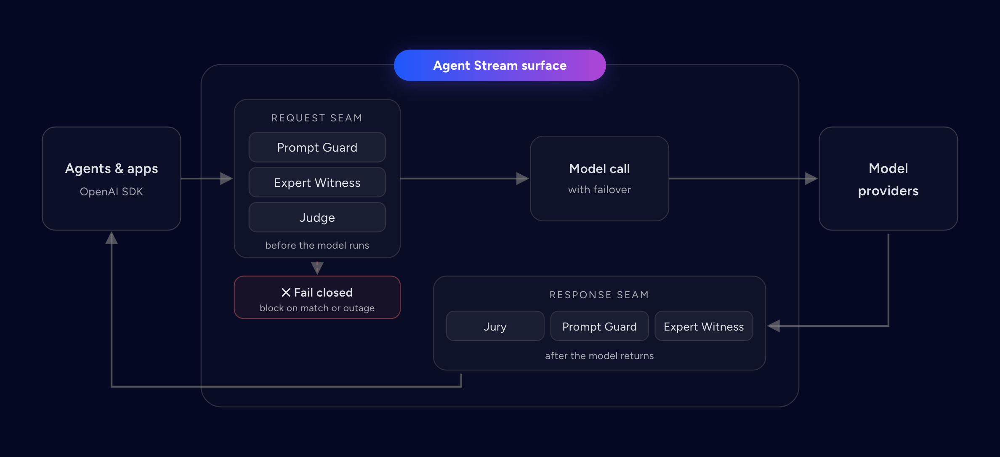
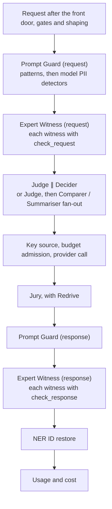
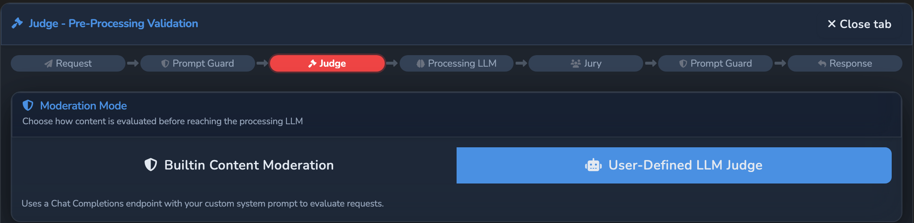
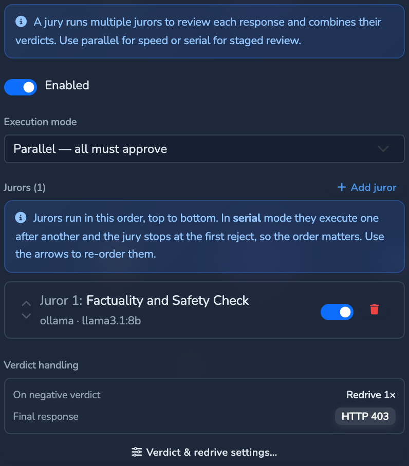
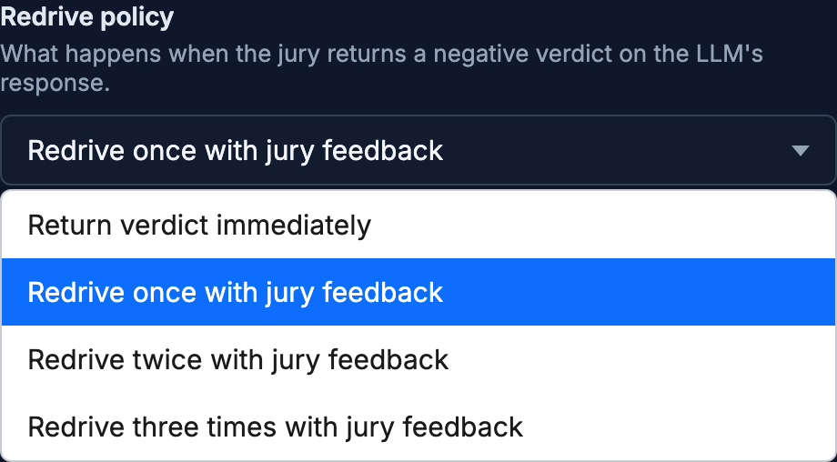

# Guardrails

The safety stages of an LLM Surface: Prompt Guard, Expert Witness, Judge, and Jury
with Redrive, where each runs in the pipeline, how their verdicts are read, and how
rejections are classified for reporting. Prompt Guard detection and NER IDs have
their own page, [PROMPT_GUARD.md](PROMPT_GUARD.md). Hosted documentation:
[Guardrails reference](https://docs.affinidi.com/products/affinidi-trust-fabric/agent-stream/reference/surfaces/guardrails/).

## The safety stages

A Surface can run four independent safety stages. They differ in mechanism, in who
owns the policy, and in cost, and they compose rather than overlap.

| Stage | Config key | Mechanism | Policy owner | Runs on | Can mask |
| --- | --- | --- | --- | --- | --- |
| Prompt Guard | `prompt_guard` | Local patterns, plus optional model-backed PII detection | You (patterns, entity types) | Request and response | Yes |
| Expert Witness | `expert_witnesses[]` | HTTP call to a purpose-trained safety classifier | The provider's trained model | Request, response, or both | No |
| Judge | `judge` | One LLM or moderation call with your rules | You (prompt and rules) | Request | No |
| Jury | `jury` | One or more Juror LLMs voting, with Redrive | You (Juror prompts) | Response | No |

An Expert Witness is a classifier you consume: it returns a structured verdict from a
fixed API. A Judge or Juror is a general model you instruct: it reasons over your
prompt. Use a witness for "is this a known jailbreak or harm category", and a Judge
or Jury for "does this satisfy my rules".

Every stage blocks through the same rejection path
(`PipeError::PromptGuardRejected` in [`src/pipes/executor.rs`](../src/pipes/executor.rs)),
so every block carries a configurable status, body, and content type, and is
classified into a [rejection category](#rejection-categories).



Fail closed is the default; an Expert Witness with `fail_open: true` lets a request
through when its provider is unavailable (see [Fail-open and fail-closed](#fail-open-and-fail-closed)).

## Pipeline order

[ARCHITECTURE.md](../ARCHITECTURE.md#full-order) is the authority on order. The
safety stages sit inside the executor's per-attempt block:



The facts that matter:

- **Masking runs first.** Request witnesses run after the request Prompt Guard, so a
  provider sees text that is already masked or pseudonymised. A blocked prompt never
  reaches the Decider, the Judge, or the model.
- **Judge and Decider run in parallel** on a routed Surface. For a Comparer or
  Summariser, the Judge runs first, then the fan-out to every Candidate.
- **Response witnesses are the last gate** before the answer leaves, after the Jury
  and the response Prompt Guard. NER ID restore comes after every model-facing stage,
  so the provider, Judge, Jurors, and witnesses only ever see NER IDs.
- **Retries and failover re-run the whole request side.** Retry, failover, and load
  balancing call `execute_once` again per attempt, so Prompt Guard, the request
  witnesses, and the Judge re-run for each attempt.
- **Only the Jury can Redrive.** A Jury rejection with retries left sends the request
  back to the model ([Redrive](#redrive)). A Judge, witness, or Prompt Guard rejection
  is final.
- **Streaming happens only when no response-side stage is configured**: no Jury, no
  Comparer or Summariser, no response Prompt Guard rules or response witnesses, and
  no active server tools (`passthrough_eligible` in
  [`src/pipes/streaming.rs`](../src/pipes/streaming.rs)). A streamed request runs the
  request Prompt Guard, request witnesses, and Judge, with Judge and Decider in
  sequence.

Before any of these, stage budget admission checks every safety or decision stage
that runs on a platform key (Judge, Jurors, Decider, model PII detectors, witnesses)
against the caller's budget, so a spent budget refuses the request before anything
is spent. See [USAGE_LIMITS_AND_ATTRIBUTION.md](USAGE_LIMITS_AND_ATTRIBUTION.md).

## Choosing a stage

| You want to | Use |
| --- | --- |
| Redact or pseudonymise emails, keys, names before they reach the model | Prompt Guard (the only stage that masks) |
| Block known jailbreaks or prompt injection with a maintained classifier | Expert Witness with `check_request` (Lakera, Azure Prompt Shields, EnkryptAI) |
| Block harmful generated content by category or severity | Expert Witness with `check_response` (Azure Content Safety, EnkryptAI) |
| Enforce your own rules on the request with model reasoning | Judge |
| Enforce your quality or safety bar on the answer, with voting and regeneration | Jury |
| Defence in depth | Several, in the order above |

A hardened Surface typically runs: Prompt Guard mask → request witness → Judge →
model → Jury → response Prompt Guard → response witness → NER ID restore.

## Expert Witness

An Expert Witness is an external safety classifier. A Surface carries a list,
`expert_witnesses`, a sibling of `judge` and `jury` on the Surface config
([`src/pipes/config.rs`](../src/pipes/config.rs)). Each entry is an
`ExpertWitnessConfig`: a stable `id` and `name` plus the flattened connector config
`ExternalGuardrailConfig`
([`src/pipes/prompt_guard/config.rs`](../src/pipes/prompt_guard/config.rs)).

```jsonc
"expert_witnesses": [
  {
    "id": "prompt-shields",
    "name": "Azure Prompt Shields",
    "provider": "azure_prompt_shields",
    "endpoint_url": "https://<resource>.cognitiveservices.azure.com/contentsafety/text:shieldPrompt?api-version=2024-09-01",
    "api_key_secret": "azure-content-safety",
    "check_request": true,
    "check_response": false
  },
  {
    "id": "content-safety",
    "name": "Azure Content Safety",
    "provider": "azure_content_safety",
    "endpoint_url": "https://<resource>.cognitiveservices.azure.com/contentsafety/text:analyze?api-version=2024-09-01",
    "api_key_secret": "azure-content-safety",
    "check_request": false,
    "check_response": true
  }
]
```

### Fields

| Field | Type | Default | Meaning |
| --- | --- | --- | --- |
| `id`, `name` | string | `""` | Stable identifier and display label. |
| `enabled` | bool | `true` | Turns this witness on or off. |
| `provider` | enum | `enkryptai` | Built-in wire format; see [Provider profiles](#provider-profiles). |
| `endpoint_url` | string | required | Absolute URL of the provider's detection endpoint. SSRF-checked when saved and before every call. |
| `api_key_secret` | string | none | Secret id holding the provider key, resolved from the secrets store. Never inline. Without it no auth header is sent. |
| `timeout_secs` | int | `10` | Per-call timeout; must be greater than zero. |
| `fail_open` | bool | `false` | On a provider error, timeout, non-2xx, or unreadable verdict: `false` blocks, `true` allows. |
| `check_request` | bool | `true` | Inspect the request before the model. |
| `check_response` | bool | `true` | Inspect the answer before the client. |
| `headers` | map | none | Static headers sent on every call. `{key}` in a value is replaced with the resolved key. Used for routing headers such as `X-Enkrypt-Guardrail` or `X-Enkrypt-Deployment`. |
| `model` | string | none | Injected as `model` in the request body; required by `enkryptai_ai_proxy`. |
| `detectors` | object | profile default | Detector config passed through verbatim (EnkryptAI detect API). |
| `rejection` | object | 403 prompt-guard body | Response returned when the witness flags content. |
| `profile` | object | built-in profile | Inline override of the wire format; see [Overriding the built-in profile](#overriding-the-built-in-profile). |

A witness consults only the seams whose switch is set, so different providers can
sit on different seams of the same Surface. Witnesses are evaluated in list order on
each seam, and the first flagged verdict blocks; the rest are not called.

### What a witness inspects

On the request seam the inspected text is every `messages[].content`, as a string or
the `text` parts of a content array, joined with newlines. On the response seam it is
each `choices[].message.content` (or `choices[].text`). When there is no inspectable
text, no call is made and the seam allows. Witnesses are detect-and-block only; they
never rewrite content.

### Provider profiles

Each `provider` value selects a built-in profile (`builtin_profile` in
[`src/pipes/prompt_guard/external.rs`](../src/pipes/prompt_guard/external.rs)): the
auth header, request template, default detectors, and verdict rule.

| `provider` | Auth header | Request body | Verdict rule | Natural seam |
| --- | --- | --- | --- | --- |
| `enkryptai` | `apikey: {key}` | `{"text", "detectors"}` | `detector_map` at `summary`, `detectors`, `details` | Both |
| `enkryptai_guardrail` | `apikey: {key}` | `{"text"}` | `detector_map` at `summary`, `detectors`, `details` | Both |
| `enkryptai_ai_proxy` | `apikey: {key}` | `{"messages": [{"role": "user", "content"}], "model"}` | `detector_map` at `enkrypt_policy_detections.input_guardrails.summary`, `enkrypt_policy_detections.output_guardrails.summary` | Both |
| `enkryptai_policy_detect` | `apikey: {key}` | `{"text"}` | `detector_map` at `summary`, `detectors`, `details` | Both |
| `lakera` | `Authorization: Bearer {key}` | `{"messages": [{"role": "user", "content"}]}` | `flag` at `flagged` | Both |
| `azure_prompt_shields` | `Ocp-Apim-Subscription-Key: {key}` | `{"userPrompt"}` | `flag` at `userPromptAnalysis.attackDetected` | Request |
| `azure_content_safety` | `Ocp-Apim-Subscription-Key: {key}` | `{"text", "categories": ["Hate","Sexual","SelfHarm","Violence"], "outputType": "FourSeverityLevels"}` | `severity_list` at `categoriesAnalysis`, threshold `4` | Response |
| `generic` | `Authorization: Bearer {key}` | `{"input"}`, detectors merged into the root | `flag` at `flagged` or `blocked`, or `action == "block"`; categories from `violations`, `categories`, `flagged_categories` | Both |

Provider notes:

- **EnkryptAI detect API** (`enkryptai`, `https://api.enkryptai.com/guardrails/detect`).
  With no `detectors` set, the default set is sent:
  `{"injection_attack": {"enabled": true}, "toxicity": {"enabled": true}, "nsfw": {"enabled": true}, "pii": {"enabled": true}}`.
  In the `summary`, `injection_attack`, `nsfw`, and `pii` are counts and are hits
  when greater than zero; `toxicity` is reported as an array, which the
  `detector_map` rule does not count as a hit.
- **EnkryptAI saved guardrail** (`enkryptai_guardrail`, `/guardrails/guardrail/detect`).
  The guardrail is selected with an `X-Enkrypt-Guardrail` entry in `headers`. The
  required `X-Enkrypt-Mode` header is set from the seam (`prompt` on the request,
  `response` on the response) and replaces any configured value.
- **EnkryptAI AI Proxy** (`enkryptai_ai_proxy`, `/ai-proxy/chat/completions`). The
  deployment in the `X-Enkrypt-Deployment` header binds the policy and the model, and
  `model` carries the model's saved name. The proxy runs its own completion, so each
  check is an extra model call.
- **EnkryptAI saved policy** (`enkryptai_policy_detect`, `/guardrails/policy/detect`).
  EnkryptAI has deprecated this endpoint in favour of the saved-guardrail one. The
  policy is selected with an `X-Enkrypt-Policy` header.
- **Lakera Guard** (`lakera`, `POST https://api.lakera.ai/v2/guard`; region hosts such
  as `eu-west-1.api.lakera.ai` also work). To pin a Lakera project, override the
  profile with a `request_template` that adds a literal `"project_id"`.
- **Azure AI Content Safety**. Both Azure presets share the resource host
  `https://<resource>.cognitiveservices.azure.com`, the resource key (no `Bearer`),
  and an `api-version` query string on `endpoint_url`. `azure_prompt_shields`
  (`text:shieldPrompt`) detects injection and jailbreak attacks in the user prompt.
  `azure_content_safety` (`text:analyze`) scores Hate, Sexual, SelfHarm, and Violence
  on the `FourSeverityLevels` scale (`0` safe, `2` low, `4` medium, `6` high) and
  blocks at `>= 4`. The older preview `text:detectJailbreak` API is reachable with an
  inline profile (`request_template` `{"text": "{text}"}`, `flag_paths`
  `["jailbreakAnalysis.detected"]`).
- **Generic flat moderation** (`generic`). For a self-hosted moderation model or any
  classifier that answers with a top-level `flagged` or `blocked` boolean or an
  `action` field. The stock OpenAI `/v1/moderations` response is not directly
  compatible: its verdict is at `results[0].flagged`, and verdict paths address object
  keys only, not array indices. Put a proxy in front that lifts `results[0]` to the
  top level.

### Verdict rules

The verdict rule (`VerdictRule`) reads the provider's JSON. Paths are dot-separated
object keys.

| `kind` | Fields | Blocks when |
| --- | --- | --- |
| `detector_map` | `paths` | The first path that resolves to an object has an entry that is `true`, a number greater than zero, or an object with `"detected": true`. The triggered keys form the reason. |
| `flag` | `flag_paths`, `action_path`, `category_paths` | Any boolean at `flag_paths` is `true`, or the string at `action_path` equals `block` (case-insensitive). Categories are read from the string arrays at `category_paths`. |
| `severity_list` | `items_path`, `category_field` (default `category`), `severity_field` (default `severity`), `threshold` | Any element of the array at `items_path` has a numeric `severity_field` at or above `threshold`. |

A flagged verdict blocks with the witness's `rejection`, or the default 403 body
`{"error":{"message":"Request rejected: content violates prompt guard policy","type":"prompt_guard_violation","code":"content_policy_violation"}}`.
The reason recorded for the activity log and the Governance Record reads
`External guardrail (<provider>) flagged: <detectors>`.

A response with none of the shape the rule expects yields no verdict, which is
treated as a provider error, not an allow. A `200` with an unexpected body cannot
silently disable the witness.

### Fail-open and fail-closed

When the provider errors, times out, returns a non-2xx, or returns no recognisable
verdict:

- `fail_open: false` (default) blocks with `502` and
  `{"error":{"message":"Guardrail provider unavailable","type":"guardrail_unavailable","code":"guardrail_provider_error"}}`.
  This shape does not use the witness's `rejection`, which applies only to flagged
  content.
- `fail_open: true` allows the request through.

Outages are logged with `failing closed` or `failing open` and the detail. A
non-2xx detail includes up to 500 characters of the provider's error body. Every
witness call also logs a `[STAGE:expert_witness_request]` or
`[STAGE:expert_witness_response]` line with the witness id, outcome, detail, and
duration.

A witness with a stored key whose call the caller's budget refuses refuses the
request, whatever `fail_open` says. A keyless witness is never refused for budget.

### Overriding the built-in profile

Set `profile` to change the request shape, auth header, or verdict location without
a code change. The built-in EnkryptAI profile, as an example:

```jsonc
"profile": {
  "auth_header": "apikey",
  "auth_value_template": "{key}",
  "request_template": { "text": "{text}", "detectors": "{detectors}" },
  "spread_detectors": false,
  "default_detectors": {
    "injection_attack": { "enabled": true },
    "toxicity": { "enabled": true },
    "nsfw": { "enabled": true },
    "pii": { "enabled": true }
  },
  "verdict": { "kind": "detector_map", "paths": ["summary", "detectors", "details"] }
}
```

- `request_template` is any JSON. A string equal to `"{text}"` becomes the inspected
  text, a string equal to `"{detectors}"` becomes the detector value, and `{text}`
  inside a longer string is substituted.
- `spread_detectors: true` merges the detector object's keys into the body root.
- `auth_value_template` replaces `{key}` with the resolved secret (for example
  `"Bearer {key}"`). Default `{key}`.
- `default_detectors` is used when the witness sets no `detectors`.

To block Azure harm categories from low severity up, keep the Azure request template
and set `"verdict": {"kind": "severity_list", "items_path": "categoriesAnalysis", "threshold": 2}`.

Validation rejects an empty `auth_header`, a `detector_map` with no `paths`, a `flag`
rule with neither `flag_paths` nor `action_path`, and a `severity_list` with a blank
`items_path` or `severity_field` or a threshold that is not a positive number.

### Legacy `prompt_guard.external`

A Surface that still carries a single `prompt_guard.external` block is migrated at
runtime into one witness with id `migrated-external-guardrail` by
`PipeConfig::normalize_guardrails`, called when the executor is built and when a
Variant is resolved. The migration is idempotent and does nothing once any witness
exists.

## Judge

The Judge checks a request before the model runs. It is configured as `judge`
(`JudgeConfig` in [`src/pipes/judge_jury/config.rs`](../src/pipes/judge_jury/config.rs)).

| Field | Default | Meaning |
| --- | --- | --- |
| `enabled` | `false` | Runs the Judge. |
| `mode` | `llm` | `llm` (a chat model with your prompt) or `moderation` (an OpenAI-moderation-shaped endpoint). |
| `llm` | required | The target: `provider_type`, `model`, `endpoint_url` (`{model}` is substituted), `api_key_secret`, `timeout_secs` (default `30`), `api_schema` (default `openai`), `parameters`, `headers`, `pricing`. |
| `system_prompt` | `""` | The Judge's instructions (`llm` mode). |
| `rules` | `[]` | Evaluated in order; the first that matches, or cannot be evaluated, rejects. |
| `confidence_threshold` | none | Dashboard setting that asks the Judge model for a `confidence` (`llm` mode). It never changes the verdict: a matched rule always rejects. |
| `disable_thinking` | none | Asks a reasoning model not to think. |



The Judge sees only the string content of the caller's `user` messages, not the Surface's
own system prompt. When there is none (for example, every user message uses content
parts), it sees a top-level `input` or `prompt` field, or else the whole request body
without any `api_key`, in both modes.

Rule conditions (`condition.type`):

| Mode | Type | Fields | Matches when |
| --- | --- | --- | --- |
| `moderation` | `flagged` | none | `results[0].flagged` is true |
| `moderation` | `category_flagged` | `category` | That category is flagged |
| `moderation` | `category_score` | `category`, `operator`, `threshold` | That category's score compares true |
| `llm` | `json_field_equals` | `field`, `value` | The JSON field equals the value |
| `llm` | `json_field_not_equals` | `field`, `value` | The JSON field differs from the value |
| `llm` | `regex_match` | `pattern` | The response matches the pattern |

A matching rule rejects with its own `status_code` (default `403`), `body` (default
empty), and `content_type` (default `application/json`). JSON fields are read from
the first JSON object in the response, including one inside a Markdown code block,
and common aliases such as `approval` for `decision` are accepted.

The Judge does not fail open. A Judge call that fails fails the request, and so does
a rule that cannot be evaluated: a condition type that does not belong to the Judge's
`mode`, a `category_flagged` or `category_score` rule without a `category` and, in
`llm` mode, a JSON rule whose field is missing or whose response is not JSON, or a
`regex_match` whose pattern does not compile. The caller then receives `502` and
`{"error":{"message":"The Judge could not evaluate the request","type":"guardrail_unavailable","code":"judge_indeterminate"}}`
instead of the rule's own response, so a request the Judge could not decide is told
apart from one it rejected. The interaction is recorded as blocked by the Judge with
the raw reason `judge_verdict_indeterminate`, which the shipped taxonomy classifies as
`judge_indeterminate`.

The response's `confidence` never overrides a rule, so a low `confidence` cannot turn
a rejection into an approval.

Saving a Surface with an enabled Judge, on the Surface or on a Variant, is refused when
a rule's condition type does not belong to the Judge's `mode`, a `category_flagged` or
`category_score` rule has no `category`, a `json_field_equals` or
`json_field_not_equals` rule has no `field`, or a `regex_match` pattern is empty or
does not compile.

### Endpoint checks

Judge calls (both modes), Juror calls and the Decider's Router call check the target
`endpoint_url` before each call (`validate_service_endpoint_url`) and send through
`http_client::with_service_endpoint_resolver`
([`src/pipes/judge_jury/executor.rs`](../src/pipes/judge_jury/executor.rs)). That client
checks every address the hostname resolves to at connect time: private addresses are
allowed, so a same-VPC model works, while loopback, unspecified, link-local
(169.254/16 and fe80::/10, which covers the EKS Pod Identity agent) and cloud metadata
addresses are refused, so a hostname cannot be re-pointed at them after the Surface is
saved. It does not follow redirects and ignores `HTTP_PROXY`, `HTTPS_PROXY` and
`NO_PROXY`, because a proxy would resolve the host itself; behind a mandatory egress
proxy, allow direct egress to these endpoints.

## Jury

The Jury reviews the model's answer after the call. It is configured as `jury`.

| Field | Default | Meaning |
| --- | --- | --- |
| `enabled` | `false` | Runs the Jury. |
| `mode` | `parallel` | How Jurors vote; see below. |
| `jurors` | `[]` | The Jurors. With none enabled, the Jury is a no-op. |
| `max_retries` | `0` | Redrives allowed after a rejection. |
| `retry_prompt` | built-in text | Feedback sent back to the model on Redrive; `{reason}` is replaced with the rejection reason. |
| `rejection` | 403 Judge/Jury body | Returned when the Jury's final verdict rejects. |

The default rejection body is
`{"error":{"message":"Request rejected by Judge/Jury evaluation","type":"judge_jury_violation","code":"content_policy_violation"}}`.

| `mode` | Verdict |
| --- | --- |
| `parallel` | Every Juror runs at once; all must approve. |
| `serial` | Jurors run in order, each receiving the answer plus the previous Juror's raw response; stops at the first rejection. |
| `majority` | Every Juror runs at once; more than half must approve. |



### Juror

Each Juror (`JurorConfig`) has `enabled` (default `true`), `name`, `llm`,
`system_prompt`, `decision`, `confidence_threshold`, and `disable_thinking`. A
disabled Juror keeps its configuration but does not vote. Each Juror sees the
model's response JSON, before response masking.

`decision` reads the Juror's verdict:

- `{"mode": "json", "field": "decision", "approve_value": "approve"}` (the default):
  approve when the field equals the value, case-insensitive. The reason is read from
  `details`, `reason`, or `explanation`. A missing field or non-JSON response rejects.
- `{"mode": "regex", "approve_pattern": "...", "reject_pattern": "..."}`: the reject
  pattern is checked first. A `reject_pattern` that does not compile rejects, and
  saving a Surface or Variant with an enabled Juror whose patterns do not compile is
  refused.

A Juror's `confidence_threshold` only asks the model for a `confidence`; a low
`confidence` never turns a rejection into an approval. A Juror call that fails fails the
request.

Usage limits can cap a single Juror: a stage-scoped limit on `jury` with a
`juror_index` meters that Juror under `stage:juror:{index}`.

### Redrive

When the Jury rejects and `max_retries` allows another attempt, the executor:

1. Appends the rejected answer as an `assistant` message and the `retry_prompt` (with
   `{reason}` substituted) as a `user` message.
2. Calls the model again on the same key. A Redrive on a platform key asks the
   caller's budget again before it is sent.
3. Runs the Jury on the new answer.

In the dashboard, the Redrive policy sets `max_retries`:



The rejected answers were billed, so their tokens are added to the LLM stage's usage.
A rejection that a Redrive recovers is recorded as a flag stage in the Governance
Record and counted under the `redrive` rejection category, not under its content
category. When retries run out, the Jury's `rejection` is returned and the reason is
classified normally.

On realtime voice, the Jury runs per turn ([`src/pipes/realtime_safety.rs`](../src/pipes/realtime_safety.rs));
see [MODALITIES.md](MODALITIES.md).

## Variant overrides

A Variant can override `prompt_guard`, `judge`, `jury`, and `expert_witnesses`
([`src/pipes/pipe_variants.rs`](../src/pipes/pipe_variants.rs)). For
`expert_witnesses`, `null` inherits the base list, a list replaces it, and an empty
list clears it. See [ROUTING.md](ROUTING.md).

## Rejection categories

Every content rejection carries the rejecting stage, a source, and raw reason tokens
(`RejectionMeta` in [`src/pipes/executor.rs`](../src/pipes/executor.rs)). The
classifier in [`src/rejection_taxonomy.rs`](../src/rejection_taxonomy.rs) maps those
tokens to canonical categories so rejections can be counted per Surface, stage, Team,
and Member.

| Stage label | Source | Raw reasons |
| --- | --- | --- |
| `regex_request`, `regex_response` | `regex`, or `model_pii` for a model PII detector | The guard's reason |
| `witness_request`, `witness_response` | The provider id, such as `enkryptai` or `azure_prompt_shields` | The triggered detectors or categories |
| `judge` | `judge` | The matched rule's name and its category in `moderation` mode, or `judge_verdict_indeterminate` alone when a rule could not be evaluated |
| `jury` | `jury` | The Jury's free-text reason |

### The taxonomy file

The mapping lives in `rejection_categories.json`, named by `rejection_taxonomy` under
`[config_files]` in `config.toml` and resolved relative to the config directory. The
shipped file is
[`config/examples/rejection_categories.example.json`](../config/examples/rejection_categories.example.json),
which is also compiled in as the fallback.

```jsonc
{
  "version": 1,
  "default_category": "uncategorized",
  "categories": [ { "id": "prompt_injection", "label": "Prompt Injection" } ],
  "mappings": [
    { "category": "prompt_injection", "exact": ["injection_attack"], "patterns": ["(?i)inject"] },
    { "category": "prompt_injection", "sources": ["azure_prompt_shields"] }
  ]
}
```

- A token matches a mapping when the mapping's `sources` allow the source (empty means
  any) and the token equals an `exact` entry (case-insensitive) or matches a regex in
  `patterns`. Mappings are tried in order; the first match wins.
- A mapping with `sources` but no `exact` or `patterns` is source-only: any block from
  those sources maps to its category. This covers providers that flag without naming
  a category.
- A token that matches nothing gets `default_category`. A block with no tokens is
  still classified once.
- Every category a mapping or `default_category` names must be declared in
  `categories`. A file that fails this check or is not valid JSON is ignored with a
  warning and the built-in taxonomy is used. An invalid regex is skipped with a
  warning.
- The file is re-read when its modification time changes, so edits apply without a
  restart.

The shipped categories are `prompt_injection`, `jailbreak`, `toxicity`, `hate`,
`violence`, `sexual_nsfw`, `self_harm`, `pii`, `secrets`, `bias`, `policy_violation`,
`banned_keyword`, `relevancy`, `copyright_ip`, `system_prompt_leak`, `sponge_dos`,
`hallucination`, `judge_indeterminate`, `redrive`, and `uncategorized`.

### Counts

Each rejection is counted once per distinct category, plus once under the reserved
`_total`, in the time-series store under `rejection:all:{category}`,
`rejection:surface:{id}:{category}`, `rejection:surface:{id}:stage:{stage}:{category}`,
`rejection:team:{id}:{category}`, and, when the caller resolved to a Member,
`rejection:member:{id}:{category}` ([`src/telemetry/mod.rs`](../src/telemetry/mod.rs)).

`GET /v1/telemetry/rejections?scope=&from=&to=` returns `{scope, from, to, total,
categories: [{category, label, count}]}` with zero-count categories omitted. `scope`
is `rejection:all`, `rejection:surface:{id}`, `rejection:surface:{id}:stage:{stage}`,
`rejection:team:{id}`, or `rejection:member:{id}`. It requires `metrics.view`; team
and member scopes also require `metrics.view_attributed`. A tenant-bound caller can
read only `rejection:surface:{id}` for a Surface it owns. A Governance Record's
content block carries the same category ids in `categories`.

## Known limitations

- Witness verdict paths address object keys only, not array indices.
- The EnkryptAI `detector_map` rule does not count an array value (such as
  `toxicity`) as a hit.
- The Judge cannot Redrive; only the Jury can.
- A Judge or Juror call that fails fails the request; neither has a fail-open option.
- Response-side stages force the buffered path, so a Surface with a Jury, response
  rules, or response witnesses never streams.

## Related

- [PROMPT_GUARD.md](PROMPT_GUARD.md): pattern and model-backed detection, NER IDs.
- [../ARCHITECTURE.md](../ARCHITECTURE.md): the full pipeline order.
- [GOVERNANCE_RECORDS.md](GOVERNANCE_RECORDS.md): how stage verdicts are recorded.
- [USAGE_LIMITS_AND_ATTRIBUTION.md](USAGE_LIMITS_AND_ATTRIBUTION.md): stage budgets and per-Juror limits.
- [PROVIDERS_AND_CREDENTIALS.md](PROVIDERS_AND_CREDENTIALS.md): secrets and key sources for stage calls.
- [ROUTING.md](ROUTING.md): the Decider, Comparer, Summariser, and Variants.
- [OBSERVABILITY.md](OBSERVABILITY.md): stage logs, events, and telemetry.
- [CONFIGURATION_REFERENCE.md](CONFIGURATION_REFERENCE.md): `config.toml` keys.
