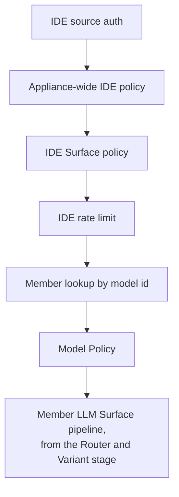

# IDE Surfaces

How an IDE Surface publishes one governed model menu, the Catalogue, to editors
and OpenAI-compatible agents; how it dispatches each request to a member LLM
Surface; the public `.well-known/agent-stream` bootstrap that lets a client
configure itself from the Access Point URL; OAuth Identifiers; and the bundled
VS Code extension.

For the product concepts, see the hosted
[Surfaces](https://docs.affinidi.com/products/affinidi-trust-fabric/agent-stream/concepts/surfaces/)
page. This page documents the implementation, mainly in
[`src/pipes/catalog.rs`](../src/pipes/catalog.rs) (the stored and published
types),
[`src/pipes/handlers/http_handlers.rs`](../src/pipes/handlers/http_handlers.rs)
(dispatch, discovery and the bootstrap),
[`src/identity/handlers/pipes.rs`](../src/identity/handlers/pipes.rs) (save
validation and previews) and
[`src/oauth_identifiers/`](../src/oauth_identifiers/).

## Moving parts

| Part | What it is |
| --- | --- |
| IDE Surface | A `PipeConfig` whose `pipe_type` is `ide_catalog` (`PipeType::IDECatalog`). It has no upstream of its own. |
| Catalogue | The ordered `members` list: each member names one LLM Surface, optionally pinned to a Variant. |
| Front door | The IDE Surface's own `source_auth`, `opa_policy` and `rate_limit`, evaluated before any member is chosen. |
| Model Policy | An optional OPA policy on one Catalogue member, evaluated when that model is dispatched. |
| Bootstrap | The public `GET {route}/.well-known/agent-stream` document carrying sign-in identifiers and paths. |
| OAuth Identifier | A stored, public set of OAuth 2.0 / OIDC sign-in identifiers that a Surface references by id. |
| Upstream slot | A second sign-in a member needs for its upstream token, published in the bootstrap and sent in `X-Agent-Stream-Upstream-Authorization`. |


## Configuration

An IDE Surface is managed through the same Surface API, storage and `pipes.*`
RBAC features as an LLM Surface; there are no separate IDE permissions. Its
type-specific block is `IdeCatalogConfig`:

```json
{
  "id": "ide",
  "name": "Engineering IDE",
  "route": "/llm/ide",
  "pipe_type": {
    "type": "ide_catalog",
    "config": {
      "members": [
        { "pipe_id": "gpt4o", "mnemonic": "gpt-4o", "display_name": "GPT-4o", "order": 1, "default": true },
        { "pipe_id": "claude", "variant_alias": "fast", "mnemonic": "claude-fast", "order": 2,
          "opa_policy_id": "premium-models" },
        { "pipe_id": "copilot", "mnemonic": "m365", "display_name": "Microsoft 365 Copilot",
          "upstream_oauth_identifier_id": "graph-copilot" }
      ],
      "client_auth": { "oauth_identifier_id": "ide-front-door" }
    }
  },
  "source_auth": { "type": "jwt_bearer", "jwt_verification_strategy_id": "entra", "audiences": ["api://agent-stream"] },
  "rate_limit": { "enabled": true, "requests_per_minute": 600 }
}
```

### Catalogue members

`IdeCatalogMember`:

| Field | Meaning |
| --- | --- |
| `pipe_id` | The member LLM Surface. Required. |
| `variant_alias` | A Variant of that Surface to expose; absent exposes the base. |
| `mnemonic` | The client-facing model id. Absent or blank, the id is `{pipe_id}` or `{pipe_id}${alias}` (`model_id()`). |
| `display_name` | Picker label; falls back to the mnemonic, the member's model, then the model id. |
| `group`, `order`, `default` | Curation: the menu sorts by `order`, then display name. |
| `expose` | Default `true`. `false` keeps the member in the Catalogue but withholds it from discovery and dispatch. |
| `metadata` | Optional `description`, `max_input_tokens`, `max_output_tokens`, `capabilities` and `sunset_at`, copied to the published entry. |
| `upstream_oauth_identifier_id` | An OAuth Identifier for this member's upstream token; see [Upstream slots](#upstreams-upstream-slots). |
| `opa_policy_id` | The member's Model Policy: a policy definition of the IDE type (`package ide.policy`). |
| `node_id` | Dashboard canvas identity only; the server never reads it. |

In the dashboard, each Catalogue member is edited in its own panel: the LLM Surface, the
display name and mnemonic, upstream sign-in, the Model Policy, the advertised context
window, and whether the member is published.


### Save-time validation

Every create and update runs `IdeCatalogConfig::validate` and
`validate_ide_catalog`:

- every member names a non-blank `pipe_id` of a Surface the caller may list (below), and
  that Surface is an **LLM** Surface;
- a `variant_alias` names a real Variant of that Surface;
- every `model_id()` is unique across the Catalogue;
- `client_auth`, when present, has a non-blank `provider`, and for `entra`
  without an OAuth Identifier reference also a `tenant_id`, a `client_id` and
  at least one scope;
- a member the stored Catalogue does not already list must be a Surface the
  caller may change (its owner, an administrator, or a token of its tenant; see
  [Surface ownership](RBAC.md#surface-ownership)) and, for an access token, inside
  its tenant and resource pattern. A dispatched request skips the member's own
  source authentication, so listing a Surface opens it to the IDE Surface's callers
  (`may_list_ide_member`). A member that does not exist and one the caller may not
  list both answer the same `403`, and the type and Variant checks above run only
  after it, so a save never reveals whether, or as what, a Surface the caller
  cannot see exists.

The tenancy check (`pipe_tenancy.rs`) treats every member `pipe_id`, every
member Model Policy, every OAuth Identifier reference (`client_auth`, each
member's upstream, and `sandbox_oauth_identifier_id`) and the JWT verification
strategy as references, so a tenant's IDE Surface can only name its own or
shared resources. Creating one counts against the `surfaces.ide` appliance
limit.

## Dispatch

`POST {route}/v1/chat/completions` (and any other POST suffix) on an IDE
Surface runs its own front door, then becomes a request to one member LLM
Surface. The order, in `handle_chat_completions`:

1. **IDE source auth.** The IDE Surface's own `source_auth` authenticates the
   caller.
2. **Appliance-wide IDE policy**, when one is assigned to the `ide` Surface
   type.
3. **IDE Surface policy**, the Surface's own `opa_policy`. Both policies are
   deny-overrides and fail closed.
4. **IDE rate limit**, the IDE Surface's own aggregate `rate_limit`, held in an
   executor cached under the IDE Surface's id. Members' own limits still apply
   after dispatch.
5. **Member lookup.** The request's `model` must equal the `model_id()` of an
   exposed member; the member's Surface must exist and be enabled.
6. **Model Policy**, when the member has `opa_policy_id`, under the
   front-door identity. A policy that is set but not compiled fails closed.
7. **Member LLM Surface pipeline.** The request is re-pointed at the member
   Surface (and its Variant) and continues from the Router and Variant stage
   on: the member's inbound policy, team gate, usage limits, guards, executor
   and recording. The member's source auth is skipped; the identity
   authenticated at the IDE front door is carried in.



Before step 7 the `model` field is removed from the body, so the member's own
provider configuration supplies the upstream model. Circuit breaking, retry
and failover belong to the member, not the IDE front door.

`POST {route}/v1/vp-challenge` is the exception: it dispatches nothing. When an
exposed, enabled member has VP evidence enabled, it issues the VP challenge
that member redeems in step 7, after IDE source auth only. An IDE Surface takes
no VP evidence of its own: saving one with VP evidence is refused. See
[POLICY.md](POLICY.md#getting-a-vp-challenge).

The front-door policy input sets `action: "dispatch"`,
`resource.surface_type: "ide"`, `resource.model` to the requested id, and
`input.request`:

| Field | Value |
| --- | --- |
| `input.request.purpose` | `"dispatch"` here, `"discovery"` on `GET /v1/models` |
| `input.request.forwarded_upstream_auth` | `true` when the caller sent `X-Agent-Stream-Upstream-Authorization` |

So one `ide.policy` can admit discovery without a token while requiring a
signed-in caller for dispatch, or require an upstream token for some models.
See [POLICY.md](POLICY.md).

### Refusals

| Status | `code` | Cause |
| --- | --- | --- |
| 401 | `source_authentication_failed` | IDE source auth failed |
| 503 | — | Source auth required but the middleware is unavailable |
| 403 | `policy_denied` | Appliance-wide or IDE Surface policy denied |
| 403 | `policy_error` / `policy_evaluation_error` | Appliance-wide / IDE Surface policy could not be evaluated |
| 429 | `rate_limit_exceeded` | IDE rate limit |
| 400 | `model_required` | No `model` in the body |
| 404 | `model_not_found` | No exposed member has that id, or its Surface is missing |
| 404 | `model_not_available` | The member Surface is disabled |
| 403 | `model_policy_denied` | Model Policy denied |
| 403 | `model_policy_evaluation_error` | Model Policy could not be evaluated |

After dispatch, refusals are the member LLM Surface's own; see
[ARCHITECTURE.md](../ARCHITECTURE.md#front-door-and-gates).

### Credentials on a dispatched request

The IDE front door's credential authenticates the caller only:

- A dispatched request never offers `Authorization` or
  `X-Agent-Stream-Upstream-Authorization` to a member's provider as the
  caller's own provider key. The front door's source auth and tenant are
  captured before the request is re-pointed. See
  [PROVIDERS_AND_CREDENTIALS.md](PROVIDERS_AND_CREDENTIALS.md#where-the-callers-key-comes-from).
- A member with `forward_caller_token` forwards
  `X-Agent-Stream-Upstream-Authorization` when the caller sent it, else the
  front-door token. This is the dual-token path a Microsoft 365 Copilot member
  uses; see [M365_COPILOT.md](M365_COPILOT.md).

### Attribution to the IDE Surface

Every dispatched execution is recorded on the member Surface and mirrored onto
the IDE Surface (`mirror_front_door_execution`): usage telemetry, operational
metrics, cost, the activity log and a `[PIPE:{ide}]` log line. Failures and
guard rejections are mirrored too. So the IDE Surface's own Monitoring and Logs
show its traffic, and the cost recorded on it equals the member's cost for the
same execution.

## Model discovery

`GET {route}/v1/models` on an IDE Surface (`serve_ide_models`) returns the
caller's menu:

1. IDE source auth, then the IDE Surface's own policy with
   `purpose: "discovery"`. A Surface with no source auth admits an anonymous
   caller. The appliance-wide policy is not evaluated for discovery; the input
   carries no `action` or `resource`, and `forwarded_upstream_auth` is `false`.
2. For each member, `ide_member_entry` keeps only exposed members whose Surface
   is enabled, whose Variant resolves, and which is an LLM Surface with a
   model.
3. Each remaining member is kept only if the caller's identity passes the
   member Surface's policy for the member's Variant (a deny or an evaluation
   error hides the model), its team gate, and, on a member with no team
   attribution, the `allowed_models` list of the Member the caller's identity
   resolves to (a caller that matches no Member is not filtered). A team gate 403 hides the model;
   a 429 (a spent quota) does not, so the model stays listed and the refusal
   comes at dispatch.
4. Entries are sorted by `order`, then display name.

Model Policies are not evaluated here; a listed model can still be refused at
dispatch.

The response (`IdeModelsResponse`) is an OpenAI model list with an
`agent_stream` extension per entry and a `catalog_version` fingerprint of the
list, so a client can tell when the menu changed:

```json
{
  "object": "list",
  "catalog_version": "8c1f0d6a2b3e4f50",
  "data": [
    {
      "id": "m365",
      "object": "model",
      "created": 1750000000,
      "owned_by": "m365_copilot",
      "agent_stream": {
        "route": "/llm/ide",
        "surface_id": "copilot",
        "display_name": "Microsoft 365 Copilot",
        "order": 0,
        "model": "copilot",
        "provider": "m365_copilot",
        "upstream_auth_id": "oauth:graph-copilot"
      }
    }
  ]
}
```

Generic OpenAI clients read `id` and ignore the extension. `route` is the IDE
Surface's own route: every model is reached by POSTing there with its `id` as
`model`.

## Bootstrap: `.well-known/agent-stream`

```http
GET {route}/.well-known/agent-stream
```

(`/.well-known/agent-stream.json` is accepted too; `is_wellknown_ide_path`.)

| Property | Value |
| --- | --- |
| Authentication | None. Served before source auth and never policy-gated: a client has no credential yet. It contains only public OAuth identifiers. |
| Content type | `application/json` |
| `200` | The Surface is an IDE Surface with `client_auth` configured. |
| `404` `no_bootstrap` | The Surface is not an IDE Surface, or has no `client_auth`. |

`serve_ide_bootstrap` builds the document with
`IdeBootstrapResponse::for_client_and_upstreams`, after overlaying every
referenced OAuth Identifier (`resolve_client_auth`, `resolve_upstreams`).
Reference ids are never published.

```json
{
  "auth": {
    "provider": "entra",
    "tenant_id": "00000000-0000-0000-0000-000000000000",
    "client_id": "11111111-1111-1111-1111-111111111111",
    "scopes": ["api://agent-stream/access_as_user"]
  },
  "upstreams": [
    {
      "id": "oauth:graph-copilot",
      "provider": "entra",
      "tenant_id": "00000000-0000-0000-0000-000000000000",
      "client_id": "22222222-2222-2222-2222-222222222222",
      "scopes": ["https://graph.microsoft.com/Sites.Read.All", "https://graph.microsoft.com/Mail.Read"]
    }
  ],
  "models_path": "/v1/models",
  "chat_path": "/v1/chat/completions"
}
```

### `auth`: front-door sign-in

The one sign-in that identifies the caller to Agent Stream. The token it yields
is what the IDE Surface's `jwt_bearer` source auth verifies, what policies see
as `input.source_auth.claims`, and what a `forward_caller_token` member
forwards when the model has no upstream slot.

| Field | Type | Notes |
| --- | --- | --- |
| `provider` | string | `entra`, `okta` or `oidc` (from the OAuth Identifier's shape). Inline values default to `entra`. |
| `tenant_id` | string | Entra directory; blank for Okta and OIDC profiles. |
| `client_id` | string | Public client the editor requests the token with. |
| `scopes` | string[] | Scopes to request. |

The front-door scopes must yield a token the IDE Surface's JWT verification
strategy can verify: one issued for your own API, signed by keys in the
strategy's JWKS. A token requested with Microsoft Graph scopes is issued for
Graph and does not verify there; Graph scopes belong on an upstream slot.

### `upstreams`: upstream slots

Additional sign-ins a client acquires so a member can forward the right token
to its provider: needed when the front door and a member's upstream accept
different audiences (Microsoft 365 Copilot needs a Graph token), or members
live in different tenants.

| Field | Type | Notes |
| --- | --- | --- |
| `id` | string | `oauth:{profile_id}`. A model entry names it as `agent_stream.upstream_auth_id`; clients key their token cache on it. |
| `provider`, `tenant_id`, `client_id`, `scopes` | | As in `auth`, from the referenced profile. |

Slots are synthesised, never authored: `synthesized_upstreams` emits one slot
per distinct member `upstream_oauth_identifier_id`, deduplicated when members
share a profile, and `IdeModelEntry::from_member` stamps the same id on each
referencing member's entry. Omitted when no member names an upstream profile.

### `models_path`, `chat_path`

Paths relative to the Access Point for discovery (`GET`) and dispatch
(`POST`). Both are fixed to `/v1/models` and `/v1/chat/completions`; a client
should still read them from the document.

### Client contract

A client such as the [VS Code extension](#vs-code-extension):

1. Fetches `GET {endpoint}/.well-known/agent-stream` with no credential. On
   `404` it falls back to locally configured sign-in and paths.
2. Signs the caller in with `auth`. Local overrides win over the bootstrap.
3. Discovers models at `GET {endpoint}{models_path}` with the front-door token
   as `Authorization: Bearer`, recording each entry's `upstream_auth_id`.
4. For a model with an `upstream_auth_id`, acquires that slot's token, cached
   per slot.
5. Dispatches to `POST {endpoint}{chat_path}` with
   `Authorization: Bearer {front-door token}` and, only for a model with a
   slot, `X-Agent-Stream-Upstream-Authorization: Bearer {slot token}`.

A client that ignores `upstreams` still works for every model without a slot.

## OAuth Identifiers

An OAuth Identifier ([`src/oauth_identifiers/models.rs`](../src/oauth_identifiers/models.rs))
is a named, stored set of **public** sign-in identifiers; no secret is stored.
`client_id` and `scopes` are common; the authority depends on the shape,
tagged by `provider`:

| `provider` | Fields | Authority |
| --- | --- | --- |
| `entra` | `tenant_id` | `https://login.microsoftonline.com/{tenant_id}` |
| `okta` | `domain`, optional `authorization_server_id` | `https://{domain}/oauth2/{id or "default"}` |
| `oidc` | `issuer` | The issuer URL |

Three places reference a profile by id, so an edit reaches every referrer:

| Referrer | Field | Use |
| --- | --- | --- |
| IDE front-door sign-in | `client_auth.oauth_identifier_id` | Published as the bootstrap's `auth` |
| Member upstream sign-in | `upstream_oauth_identifier_id` | Published as an upstream slot |
| Sandbox sign-in on any Surface | `sandbox_oauth_identifier_id` | Resolved in the browser to an OAuth 2.0 authorization-code + PKCE flow for the dashboard's "Sign in to test"; the server never reads it |

When the profile referenced by `client_auth` does not resolve, its inline values
are published instead. An upstream slot whose profile does not resolve is still
published under its `oauth:{profile_id}` id, with provider `entra` and no tenant,
client id or scopes.

Routes ([`src/oauth_identifiers/router.rs`](../src/oauth_identifiers/router.rs)),
under `/api/v1`:

| Method and path | Feature |
| --- | --- |
| `GET /api/v1/oauth-identifiers`, `GET /api/v1/oauth-identifiers/{id}` | `oauth_identifiers.view` |
| `POST /api/v1/oauth-identifiers`, `PUT /api/v1/oauth-identifiers/{id}` | `oauth_identifiers.edit` |
| `DELETE /api/v1/oauth-identifiers/{id}` | `oauth_identifiers.delete` |

All three default to administrator. A profile records an `owner_tenant_id`; a
tenant-scoped token reads and changes only its own tenant's profiles, within
its resource scope.

## Management previews

| Route | Returns |
| --- | --- |
| `GET /api/v1/pipes/{pipe_id}/ide-catalog/preview` | Every exposed, enabled LLM member entry, unfiltered (`build_ide_catalog_preview`). A real caller may get a subset. |
| `GET /api/v1/pipes/{pipe_id}/ide-catalog/bootstrap` | `{ published, well_known_path, bootstrap }`, built by the same code as the live endpoint. |

The dashboard's IDE editor Sandbox tab shows both.

## VS Code extension

[`clients/vscode-agent-stream`](../clients/vscode-agent-stream/README.md) (the
**Agent Stream Connector**) registers Agent Stream as a GitHub Copilot Chat
model provider, usable in Ask, Edit, Agent and Plan modes. It holds no provider
key: every request carries the developer's Microsoft Entra token, acquired and
refreshed by VS Code's Microsoft account provider.

- Setting `agentStream.endpoint` to an IDE Surface Access Point is enough: the
  extension reads the bootstrap, signs in, lists `/v1/models` in the picker and
  dispatches to the same Access Point. `agentStream.entra.*`,
  `agentStream.modelsPath` and `agentStream.chatPath` override the bootstrap.
- For a model with an `upstream_auth_id` it acquires that slot's token and
  sends it in `X-Agent-Stream-Upstream-Authorization`.
- **Agent Stream: Refresh Models** re-fetches the menu; **Agent Stream: Show
  Logs** shows configuration, request URLs and statuses.
- Errors name the endpoint tried and distinguish an unreachable appliance, a
  wrong Access Point and a Surface with no bootstrap.
- The extension supports Entra only and needs v2 access tokens, since the JWT
  verification strategy expects the v2 issuer.

## Known limitations

- **No resilience at the front door.** Circuit breaking, retry and failover run
  only on the member LLM Surface.
- **One client sign-in provider in practice.** The bootstrap publishes Okta and
  OIDC profiles (with a blank `tenant_id`), but the bundled extension signs in
  with Entra only.
- **Fixed paths.** `models_path` and `chat_path` are always `/v1/models` and
  `/v1/chat/completions`.
- **Model Policies apply at dispatch only.** Discovery may list a model a Model
  Policy then refuses.

## Related

- [M365_COPILOT.md](M365_COPILOT.md): the member that needs an upstream slot.
- [SOURCE_AUTH.md](SOURCE_AUTH.md): `jwt_bearer` and JWT verification
  strategies.
- [POLICY.md](POLICY.md): appliance-wide policies, `ide.policy` and Model
  Policies.
- [PROVIDERS_AND_CREDENTIALS.md](PROVIDERS_AND_CREDENTIALS.md): caller keys and
  identity pass-through.
- [USAGE_LIMITS_AND_ATTRIBUTION.md](USAGE_LIMITS_AND_ATTRIBUTION.md): the team
  gate members run.
- [RBAC.md](RBAC.md): `pipes.*` and `oauth_identifiers.*`.
- [OBSERVABILITY.md](OBSERVABILITY.md): the telemetry mirrored onto the IDE
  Surface.
- [`clients/vscode-agent-stream/README.md`](../clients/vscode-agent-stream/README.md):
  extension setup.
- [ARCHITECTURE.md](../ARCHITECTURE.md#ide-surface-dispatch): where dispatch
  sits in the request path.
