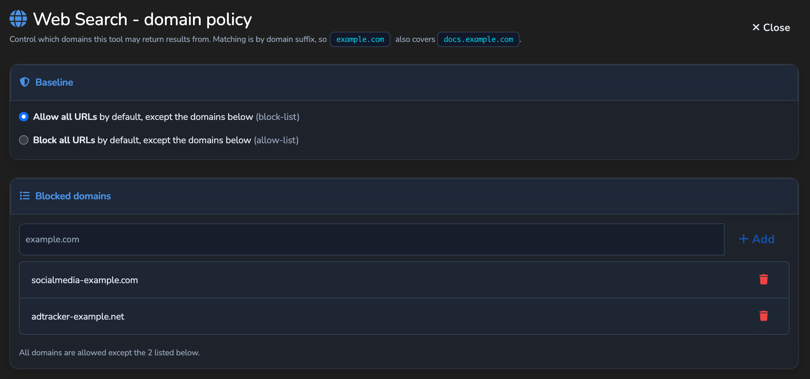

# Inference Controls

The per-request controls a caller can set on an LLM Surface, and the Surface settings that
bound them: reasoning, structured outputs, per-request routing, provider prompt caching,
server tools (Web Search and Web Fetch), and the context-window guard. For the operator
view, see the hosted
[server tools and modalities reference](https://docs.affinidi.com/products/affinidi-trust-fabric/agent-stream/reference/surfaces/server-tools-and-modalities/).

## How the controls flow

Every control follows the same path as the [Client API dialects](CLIENT_API_DIALECTS.md):
the caller's dialect is translated into the OpenAI Chat body at the front door, the
control rides through the pipeline as a field on that body, and it is shaped for the
provider just before the call (`apply_param_rules` and the `transform_to_*` functions in
[`src/pipes/request_shaping.rs`](../src/pipes/request_shaping.rs)). Extension fields such
as `reasoning`, `models`, `provider`, and `transforms` are consumed or stripped there and
never reach a provider that would reject them.

Each control is visible to policy under `input.resource`
([`src/surface_context/mod.rs`](../src/surface_context/mod.rs), `ResourceContext`), so a
Rego rule can allow or deny it per caller:

| Field | Set when |
| --- | --- |
| `reasoning_effort`, `reasoning_max_tokens` | The request asks for reasoning (after the Surface cap). |
| `requested_models`, `requested_providers` | The request carries `models` or `provider`. `requested_providers` is `provider.only`, else `provider.order`. |
| `server_tools` | The Surface has active server tools. |
| `requested_transforms` | The request carries `transforms`. |
| `document_types`, `audio_formats`, `image_formats` | The request carries that media (see [`MODALITIES.md`](MODALITIES.md)). |

## Reasoning

Source: [`src/pipes/reasoning.rs`](../src/pipes/reasoning.rs).

### Request

The pipeline carries one canonical form: a `reasoning` object
(`effort`, `max_tokens`, `exclude`, `enabled`) plus the legacy `reasoning_effort` scalar.

| Caller dialect | Field read | Canonical form |
| --- | --- | --- |
| OpenAI Chat | `reasoning_effort` or `reasoning` | Kept as sent. |
| Anthropic Messages | `thinking: { type: "enabled", budget_tokens }` | `reasoning: { enabled: true, max_tokens }`; `type: "disabled"` gives `enabled: false`. |
| OpenAI Responses | `reasoning: { effort, summary }` | `reasoning.effort`; `summary` is dropped. |

`resolve` reads the effort from `reasoning.effort`, else from the scalar. `enabled`
defaults to `true` and `exclude` to `false`.

### Surface cap

`max_reasoning_tokens` on `PipeConfig` caps the requested budget. The handler applies it
(`apply_cap`) right after dialect normalisation, before any gate. A request over the cap
gets `reasoning.max_tokens` set to the cap and its effort lowered to match; `0` disables
the cap. Parameter override policy can also set or force `reasoning_effort`
(`reasoning_effort` and `reasoning_effort_value` on `ParameterOverrideConfig`).

### Provider shaping

| Provider wire format | Sent | Notes |
| --- | --- | --- |
| OpenAI Chat | `reasoning_effort` (`shape_openai_body`) | Only to a reasoning-capable model; otherwise reasoning is stripped so the provider does not reject it. The `reasoning` object is never sent. |
| Anthropic | `thinking: { type: "enabled", budget_tokens }` (`shape_anthropic_body`) | Budget from `reasoning.max_tokens`, else from effort. At least 1024 tokens; `max_tokens` is raised to budget + 1024 when needed. `temperature` and `top_p` are removed while thinking is on. |
| Gemini | `thinkingConfig: { thinkingBudget, includeThoughts }` (`gemini_thinking_config`) | `includeThoughts` is `false` when `exclude` is set; a disabled request sends `thinkingBudget: 0`. |

Effort maps to a budget as `minimal` 512, `low` 1024, `medium` 4096, `high` 16384
(`effort_to_budget`); a budget maps back to the nearest effort (`budget_to_effort`).

### Response

An Anthropic response's `thinking` and `redacted_thinking` blocks become
`message.reasoning` (text) and `message.reasoning_details` (blocks, with signatures kept
so a later Anthropic turn can send them back). OpenAI `reasoning` passes through. The
conversion back to the caller's dialect emits Anthropic `thinking` blocks or Responses `reasoning`
items; see [`CLIENT_API_DIALECTS.md`](CLIENT_API_DIALECTS.md).

When `exclude` is set, `reasoning` and `reasoning_details` are removed from the buffered
response but still counted.

Streaming carries reasoning in every dialect: OpenAI `delta.reasoning`, an Anthropic
`thinking` block streamed before text, or Responses reasoning-summary events.

### Metering

`ExecutionMetrics.reasoning_tokens` is read from
`usage.completion_tokens_details.reasoning_tokens` on the buffered path
(`parse_reasoning_tokens` in
[`src/pipes/parsers/llm_parser.rs`](../src/pipes/parsers/llm_parser.rs)). It is a
sub-count of output tokens, not an extra charge. Anthropic and Gemini count thinking inside
output tokens, so the field is `0` for them. The buffered response carries it as
`x-agent-stream-reasoning-tokens`.

## Structured outputs

Source: [`src/pipes/structured_output.rs`](../src/pipes/structured_output.rs).

A request asks for schema output with:

```json
{ "response_format": { "type": "json_schema",
                       "json_schema": { "name": "…", "strict": true, "schema": { } } } }
```

OpenAI Responses `text.format` is copied to `response_format` unchanged. `json_object`
works; the flat Responses `json_schema` form is not converted to the nested Chat form, so it
gets no schema shaping or validation.

`shape_body` runs inside `apply_param_rules`, so every call path is covered:

- If the provider wire format is `openai` or `azure` and the model supports JSON schema,
  the schema is sent unchanged and the provider enforces it.
- Otherwise a system message carrying the schema is prepended, and `response_format`
  becomes `{ "type": "json_object" }`, or is removed when the model has no JSON mode.

Model support comes from the request profile, then the catalog's
`capabilities.supports_json_schema`, then a default by wire format.

After the call, the executor unwraps an answer wrapped in a Markdown code fence and
validates it against the schema (`unwrap_response_content`, `validate_response`).
`ExecutionMetrics.schema_valid` records the result, and the buffered response carries
`x-agent-stream-schema-valid: true|false`. A failed validation is reported, not
refused.

## Per-request routing

Source: [`src/pipes/request_routing.rs`](../src/pipes/request_routing.rs), and
`build_routing_pool`, `apply_price_preferences`, and `run_request_routed` in
[`src/pipes/executor.rs`](../src/pipes/executor.rs).

A caller can narrow and reorder the upstreams a Surface already has. It cannot add one.

```jsonc
{
  "models": ["openai/gpt-4o", "claude-haiku-4-5"],
  "provider": {
    "order": ["anthropic", "openai"],
    "only": ["anthropic", "openai"],
    "ignore": [],
    "allow_fallbacks": true,
    "sort": "price",
    "max_price": { "prompt": 5, "completion": 15 }
  }
}
```

The pool is the Surface's own provider plus every configured failover and load-balancing
target, in that order, whether or not those blocks are enabled. The executor then:

1. Keeps candidates whose provider type is in `only` and not in `ignore`, and whose model
   matches an entry in `models`. A model entry matches exactly, or by the part after the
   last `/` (so `openai/gpt-4o` matches `gpt-4o`), ignoring case.
2. Orders by `order` (provider type), else by `models`. Unmatched candidates keep their
   pool position at the end.
3. Applies `max_price`: drops candidates whose input or output price per million tokens is
   above the ceiling, and drops candidates with no price. Prices come from the upstream's
   declared price, else the model catalog.
4. With `sort: "price"`, orders by input plus output price, cheapest first.
5. Drops the Surface's own provider if its circuit breaker is open.
6. With `allow_fallbacks: false`, keeps only the first candidate.

The candidates are tried in order, each with the Surface's retry policy; a
failover-eligible error moves to the next (see
[`RESILIENCE_AND_CACHING.md`](RESILIENCE_AND_CACHING.md#failover)). Each candidate's body
names its own model. Only the Surface's own provider can be sent the caller's key; every
other candidate uses its own stored key.

If no candidate is left, the request fails with `502`
(`no upstream candidate matches the request routing preferences`).

The `models` and `provider` fields are removed before any provider call.

## Provider prompt caching

Provider-side caching is separate from the Agent Stream
[response cache](RESILIENCE_AND_CACHING.md#response-cache).

**Breakpoints.** Anthropic `cache_control: { "type": "ephemeral" }` markers on system or
message content reach an Anthropic provider whichever dialect the caller used.
`transform_from_anthropic_request` keeps marked blocks as content parts, and the
OpenAI-to-Anthropic wire transform (`transform_to_anthropic_format`) emits them as blocks
that carry the marker. OpenAI-family providers cache automatically and need nothing sent.

**Counts.** The parser reads cache reads (`cached_tokens`, `cache_read_input_tokens`) and
cache writes (`cache_creation_input_tokens`, `parse_cache_write_tokens`). They are recorded
as `ExecutionMetrics.cached_tokens` and `cache_write_tokens`, returned on
`x-agent-stream-cached-tokens` and `x-agent-stream-cache-write-tokens`, and carried as
`cache_read_input_tokens` and `cache_creation_input_tokens` in a converted Anthropic
response.

**Price.** Cache tokens are priced apart from ordinary input
(`CacheTokens::of_response` and the cache-pricing helpers in
[`src/pipes/types/llm.rs`](../src/pipes/types/llm.rs), `cache_cost_for_tokens` in
[`src/pipes/streaming.rs`](../src/pipes/streaming.rs)). Each kind uses the catalog's
`cost_per_1k_cache_write`, `cost_per_1k_cache_write_1h`, or `cost_per_1k_cache_read` when
declared, otherwise a ratio of the input price:

| Kind | Default ratio of input price |
| --- | --- |
| 5-minute write | 1.25 (`CACHE_WRITE_INPUT_RATIO`) |
| 1-hour write (`cache_creation.ephemeral_1h_input_tokens`) | 2.0 (`CACHE_WRITE_1H_INPUT_RATIO`) |
| Read | 0.1 (`CACHE_READ_INPUT_RATIO`) |

See [`PROVIDERS_AND_CREDENTIALS.md`](PROVIDERS_AND_CREDENTIALS.md) for catalog pricing and
billed cost.

## Server tools

Source: configuration and engines in
[`src/pipes/server_tools.rs`](../src/pipes/server_tools.rs); the loop
(`execute_with_server_tools`, `run_web_search`, `run_web_fetch`, `fetch_public_url`) in
[`src/pipes/executor.rs`](../src/pipes/executor.rs).

A Surface can let the model call two tools that Agent Stream runs itself: **Web Search**
(`web_search`) and **Web Fetch** (`web_fetch`).

### Configuration

`server_tools` on `PipeConfig` (`ServerToolsConfig`), off by default:

| Key | Default | Meaning |
| --- | --- | --- |
| `enabled` | `false` | Master switch. Tools run only when this and at least one tool are on. |
| `max_iterations` | `3` | Model turns that may call tools, clamped to 1 to 10. |
| `web_search.enabled` | `false` | Offer `web_search`. |
| `web_search.engine` | `tavily` | `tavily`, `brave`, or `google`. |
| `web_search.engine_secret` | none | Secret id of the engine API key. |
| `web_search.google_cse_id` | none | Programmable Search engine id, for `google`. |
| `web_search.max_results` | `5` | Results returned to the model. |
| `web_search.domain_policy`, `web_search.domain_exceptions` | `allow_all`, empty | Which result domains are kept. |
| `web_fetch.enabled` | `false` | Offer `web_fetch`. |
| `web_fetch.max_content_bytes` | `60000` | Extracted text kept per page. |
| `web_fetch.domain_policy`, `web_fetch.domain_exceptions` | `allow_all`, empty | Which hosts may be fetched. |

### Domain policy

`DomainPolicy` sets the baseline and `domain_exceptions` is read against it
(`domain_allowed`):

- `allow_all`: every domain except those listed (a block-list).
- `block_all`: no domain except those listed (an allow-list).

Matching is by suffix and ignores case, so `example.com` also covers `docs.example.com`;
a leading `*.` is ignored.



### The loop

When server tools are active, the executor adds the tool definitions to the request and
runs a model turn. While the model calls `web_search` or `web_fetch`, the executor runs the
calls, appends the assistant turn and a `tool` result message for each call, and runs
another turn. On the last permitted turn `tools` and `tool_choice` are removed so the
model must answer. URL citations are attached to the final message as `annotations`, and
token and cost metrics are summed across turns.

Each model turn is a full executor turn: rate limit, guards, Judge, provider call, and the
rest run again (see [`../ARCHITECTURE.md`](../ARCHITECTURE.md#executor)).

A call the policy refuses (tool not enabled, empty query, blocked domain, blocked
address, engine failure) is not an error: the model receives a `tool` message saying why,
and the call is recorded as a flagged stage. When Web Fetch refuses an address or the fetch
fails, the model is told only that, without the address a host resolved to or the
connection error; the full reason is in the stage detail.

**Web Search** resolves the engine key from the Surface's secrets, queries the engine,
and keeps only results whose host passes the domain policy.

**Web Fetch** checks the URL with `validate_webhook_url`
([`src/url_validation.rs`](../src/url_validation.rs)) and the domain policy. The model
chooses the URL, so the [strict outbound policy](INTEGRATIONS.md#strict-outbound-policy)
applies to the host. The fetch resolves the host once with `resolve_public_host`, refuses
a hostname that resolves to an address that policy refuses, and
pins the connection to the resolved addresses, so a name cannot rebind between the check
and the connect. It follows no redirects, uses no proxy, has a 5-second connect and
15-second total timeout, reads at most 2 MiB, and keeps at most
`max_content_bytes` of extracted text.

### Records and streaming

Each search or fetch is recorded as a pipeline stage (`web_search`, `web_fetch`) with its
query or URL, result count (search) or extracted size in bytes (fetch), and latency, and is
carried into the Governance Record. A Surface with active server tools never streams token
by token (`passthrough_eligible` in [`src/pipes/streaming.rs`](../src/pipes/streaming.rs)).

## Context-window guard

Source: [`src/pipes/context_transform.rs`](../src/pipes/context_transform.rs).

The guard drops messages from the middle of a conversation so the prompt fits the model's
context window (`middle-out`).

`context_management` on `PipeConfig` (`ContextManagementConfig`):

| Key | Default | Meaning |
| --- | --- | --- |
| `enabled` | `false` | Apply `middle-out` when a request would not fit, even if the caller did not ask. |
| `context_window_tokens` | none | The model's context window. Without it the guard does nothing. |
| `keep_recent_messages` | `4` | The most recent messages always kept. |
| `reserve_output_tokens` | `1024` | Room left for the reply when the request names no `max_tokens`, `max_completion_tokens`, or `max_output_tokens`. |

A caller opts in with `transforms: ["middle-out"]` or opts out with `transforms: []`; the
request field wins over `enabled`. The field is removed before the provider call.

The handler runs the guard once (`context_transform::apply`), after document ingestion
and the audio and image gates and before the response-cache lookup, so the buffered and
streaming paths both send the trimmed request. It estimates prompt tokens at about four
characters per token plus a per-message overhead. When the estimate is over the window
minus the output reserve, it removes messages nearest the centre first, never system or
developer messages and never the last `keep_recent_messages`, until the prompt fits.

On the buffered path the result is recorded as a `context_transform` stage and returned in
`x-agent-stream-context-transform` (`middle-out; before=…; after=…; elided=…`).

## Known limitations

- Per-request routing applies only to buffered requests. The streaming path removes
  `models` and `provider` and calls the Surface's own upstream. `sort: "latency"` and
  `sort: "throughput"` keep the filtered order.
- `provider.require_parameters`, `data_collection`, `quantizations`, and model slug
  suffixes such as `:online` are not supported.
- Structured-output validation reports conformance; it does not regenerate an invalid
  answer.
- Gemini thought parts are not returned as `reasoning` text; Gemini thinking tokens are
  counted in output tokens.
- Reasoning tokens are not counted separately on the streaming path.
- Gemini explicit cached content is not supported.
- The context window is configured per Surface; it is not read from the model catalog.
  The guard drops whole messages; it does not truncate one.

## Related

- [`CLIENT_API_DIALECTS.md`](CLIENT_API_DIALECTS.md): how each dialect carries these
  fields.
- [`RESILIENCE_AND_CACHING.md`](RESILIENCE_AND_CACHING.md): failover, load balancing, and
  the response cache.
- [`ROUTING.md`](ROUTING.md): Variants, the Router, canary splits, and the Decider.
- [`MODALITIES.md`](MODALITIES.md): images, audio, documents, and realtime voice.
- [`PROVIDERS_AND_CREDENTIALS.md`](PROVIDERS_AND_CREDENTIALS.md): the model catalog,
  pricing, and key sources.
- [`POLICY.md`](POLICY.md): writing Rego against `input.resource`.
- [`../ARCHITECTURE.md`](../ARCHITECTURE.md): pipeline order.
