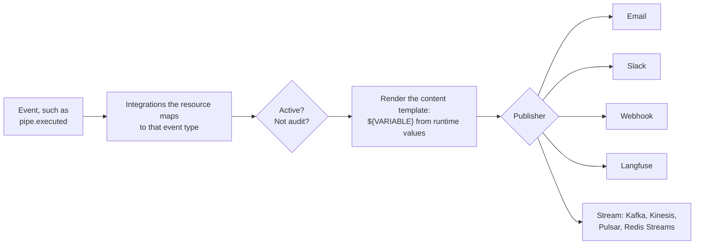
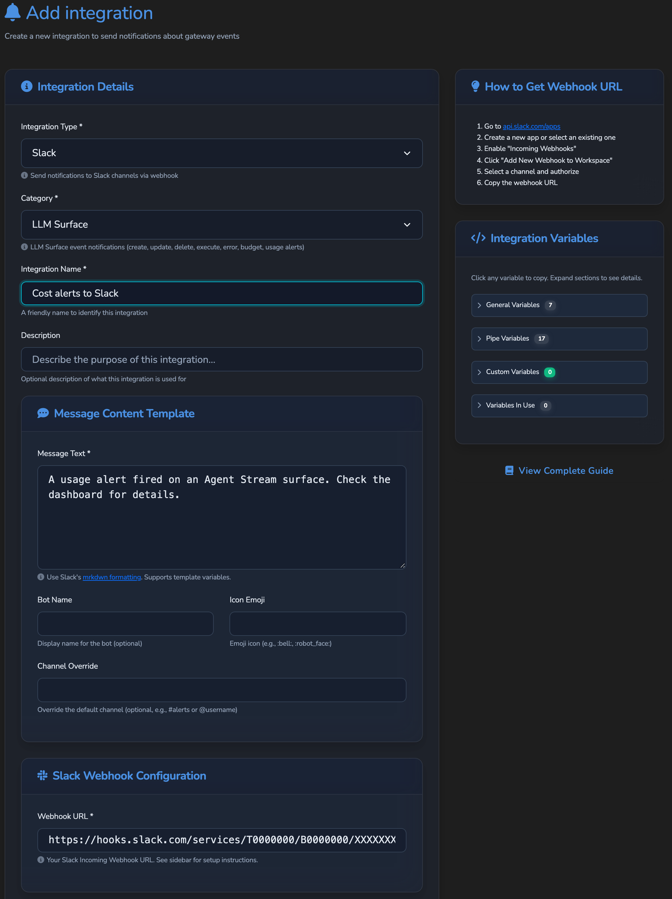
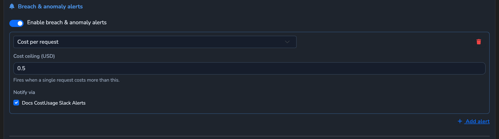

# Integrations

How Agent Stream tells other systems that something happened: a webhook for every LLM
Surface execution, a Slack message when a budget is breached, a Kafka event for every
Governance Record or audit record. Implemented in [`src/integrations/`](../src/integrations/),
with definitions stored by [`src/storage/integrations.rs`](../src/storage/integrations.rs)
and managed by [`src/storage/integration_handlers.rs`](../src/storage/integration_handlers.rs).
For the operator view, see the hosted
[notifications and alerts reference](https://docs.affinidi.com/products/affinidi-trust-fabric/agent-stream/reference/observability/notifications-and-alerts/).

In-dashboard notifications (`/api/v1/notifications`, the bell in the dashboard) are a
separate store; a pending Fabric connection, for example, raises one there. Each route
reads and changes only the signed-in caller's own notifications, except the welcome routes:

| Route (under `/api`) | Purpose | Permission |
| --- | --- | --- |
| `GET /v1/notifications` | List the caller's notifications | Session, no permission |
| `POST /v1/notifications` | Create a notification for the caller | `notifications.edit` |
| `GET /v1/notifications/{id}` | Read one | Session, no permission |
| `PUT /v1/notifications/{id}` | Change one's `status` (for example, mark it read); `title` and `message` cannot be changed | `notifications.edit` |
| `DELETE /v1/notifications/{id}` | Delete one | `notifications.delete` |
| `GET /v1/notifications/unread/count` | The caller's unread count | Session, no permission |
| `GET /v1/notifications/user-welcome-template` | The welcome notification template | Session, no permission |
| `PUT /v1/notifications/user-welcome-template` | Replace the welcome template | `notifications.edit` |
| `POST /v1/notifications/send-welcome` | Send a welcome notification with `title` and `message` to the user named by `user_id` | `notifications.edit` |

## How an event becomes a message

An event carries a set of runtime values. The resource that raised it (a surface, a gateway
record, the user list) names which integrations receive which event types. Each receiving
integration renders its own content template with those values and hands the result to the
publisher for its type ([`integration_service.rs`](../src/integrations/integration_service.rs)).

## Integration definitions

An `Integration` ([`src/storage/integrations.rs`](../src/storage/integrations.rs)):

| Field | Holds |
| --- | --- |
| `type` | The publisher: `email`, `slack`, `webhook`, `stream` or `langfuse` |
| `category` | Which events it serves, and so which runtime variables its template may use |
| `configuration` | Connection details (a JSON object) |
| `content` | The message template (a JSON object) with `${VARIABLE}` placeholders |
| `status` | `active` or `disabled`; only `active` integrations are delivered |
| `tenant_id` | Optional tenant owner |

Valid types and categories are the `integration.types` and `integration.categories` lists in
`agent-stream.json`; `GET /api/v1/integrations/config` returns them. The example
configuration ([`config/examples/agent-stream.example.json`](../config/examples/agent-stream.example.json))
defines these categories:

| Category | Serves |
| --- | --- |
| `general` | Any resource; its templates may use only the general variables |
| `pipe` | LLM Surface events |
| `gateway` | Gateway record events |
| `user` | Dashboard user events |
| `connection_point` | Connection Point invitation redemptions |
| `identity` | Identity events |
| `llm_governance` | Governance Record export |
| `llm_drift` | Drift events |
| `audit` | Governance Audit forwarding |

### Routes

| Route (under `/api`) | Purpose |
| --- | --- |
| `GET /v1/integrations` | List (`integrations.view`); `audit` integrations are left out without `audit.view` |
| `POST /v1/integrations` | Create (`integrations.edit`, plus `secrets.view` to [pair a secret with a destination](#secrets-in-integration-configuration)) |
| `GET`, `PUT`, `DELETE /v1/integrations/{id}` | Read (`integrations.view`), update (`integrations.edit`, plus `secrets.view` to pair a secret with a new destination), delete (`integrations.delete`) |
| `GET /v1/integrations/config` | The configured types and categories |
| `GET /v1/integrations/runtime-variables` | The runtime-variable catalogue |
| `POST /v1/integrations/test` | Send a test message with a supplied configuration and content (`integrations.edit`, plus `secrets.view` to pair a secret with a new destination); an optional `integration_id` names a saved integration whose stored credentials fill in the ones the request leaves out |
| `POST /v1/integrations/{id}/trigger` | Deliver `subject`, `message` and `variables` to one integration (`integrations.edit`) |
| `POST /v1/integrations/trigger-multiple` | Deliver `subject` and `message` to several integrations (`integrations.edit`) |

The `config` and `runtime-variables` catalogues hold no stored data and need no permission.
`trigger`, `trigger-multiple`, and `test` when it loads a saved integration by
`integration_id`, additionally check the caller's tenant, token scope and, for an `audit`
integration, `audit.view`.

Create and update refuse with `400` an unknown type, category or status, a `configuration` or
`content` that is not a JSON object, and a template that uses a variable outside its
category's catalogue (a variable starting with the custom prefix is always allowed). They
also refuse with `400` an email or stream destination that is new or changed and not public
(see [Email and stream destinations](#publishers)). A secret
reference the integration may not use is `400` (`403` in the cases
[secrets in integration configuration](#secrets-in-integration-configuration) lists), an
integration outside the caller's tenant or token scope is `403`, and an appliance at its
integration limit is `403`. Definitions are cached for five minutes; saving an integration
refreshes its cache entry.

## Publishers

| Type | Sends to | `configuration` | `content` |
| --- | --- | --- | --- |
| `email` | An SMTP server | `smtp_host`, `smtp_port`, `smtp_username`, `smtp_password`, `from`, `to` (list), optional `cc`, `bcc`, `use_tls`, `use_starttls` | `subject`, `body`, `format` (`plain` or `html`; a body containing `<html` or `<body` is sent as HTML) |
| `slack` | A Slack incoming webhook | `webhook_url` | `text`, optional `channel`, `bot_name` (default `Agent Stream`), `icon_emoji` |
| `webhook` | An HTTP endpoint | `url`, `method` (`POST`, `PUT` or `PATCH`; default `POST`), optional `headers`, `signing_secret` | The JSON payload template |
| `stream` | Kafka, Amazon Kinesis, Apache Pulsar or Redis Streams | `platform` (`kafka` default, `kinesis`, `pulsar`, `redis`), `topic`, and the platform's settings below | The JSON event template |
| `langfuse` | A Langfuse project | `host` (default `https://cloud.langfuse.com`), `public_key`, `secret_key` | Not used; built from the execution |

**Slack and webhook.** The URL is resolved and refused when it points at an address the
[strict outbound policy](#strict-outbound-policy) refuses, on every `POST /v1/integrations/test` and
every delivery. The send checks every address the host resolves to again at connect time,
so a name cannot rebind to an internal address after the check, and it ignores
`HTTP_PROXY` and `HTTPS_PROXY`.

**Webhook.** Each request carries `X-Webhook-Timestamp` (Unix seconds).
With `signing_secret`, it also carries `X-Webhook-Signature-256: sha256=<hex>`, an
HMAC-SHA256 over `{timestamp}.{body}`. Values in `headers` are templates too. Without a
`content` object the payload is `{subject, message, timestamp, integration_id,
integration_name}`; a stream event without one has the same shape. Any status other than
2xx is a failure.

**Stream platforms** ([`src/integrations/stream_publishers/`](../src/integrations/stream_publishers/)):

| `platform` | Settings |
| --- | --- |
| `kafka` | `brokers` (`host:port` list, comma separated, port 9092 by default); with `auth_type = "sasl"`, `sasl_username` and `sasl_password` (SASL PLAIN over `SASL_PLAINTEXT`) |
| `kinesis` | `region` (default `us-east-1`), `partition_key` (default the integration id); AWS credentials from the default chain |
| `pulsar` | `brokers` (`pulsar://host:port` or `pulsar+ssl://host:port`); with `auth_type = "token"`, `auth_token` |
| `redis` | `redis_url` (`redis://host:port`, or `valkey://`; Unix socket URLs are refused); each event is one stream entry with a single `data` field |

**Email and stream destinations.** The SMTP server and the Redis, Kafka and Pulsar hosts
are checked against the [strict outbound policy](#strict-outbound-policy), as webhooks are: the host must be a plain
host name or IP address that resolves, and every address it resolves to must pass it. The check runs when an integration
is created, when an update changes its type or destination (`smtp_host`, `smtp_port`,
`platform`, `brokers`, `redis_url`, inline or by its `<key>_secret_id` reference, which the
check resolves as a delivery would), and again on every `POST /v1/integrations/test` and
every delivery (a trigger or an event). A host name that now resolves elsewhere, a secret
whose value changed and a destination saved before this check are refused when they send.
Each send connects to what was checked: SMTP and Redis to the checked address, Kafka and
Pulsar to the broker list rebuilt from the checked hosts
([`destinations.rs`](../src/integrations/destinations.rs)).

The test answers a refused destination with `400` and a fixed message that names no
address. Any other failure to deliver the test message (the connection failed, or the
server or client rejected the message) is a single `502` answer, with the reason in the
appliance log. A malformed email address, and a missing or malformed destination, are `400`
with the reason.

A Slack or webhook URL can hold a token, and a referenced one comes from a stored secret, so
no answer repeats it. A saved, tested or referenced Slack or webhook URL that is not an
`http` or `https` URL with a host is refused with `400` and a fixed message naming only the
setting (`url`, `webhook_url` or the `<key>_secret_id` reference). When a Slack or webhook
destination answers a test or a trigger with an error status, the answer gives that status
and leaves the response body out, since a server can echo the request path; the appliance
log keeps the first 256 bytes of the body as an escaped field, at error level, with no URL.
While `secrets.reveal_values` is `false`, every refusal of a referenced URL's value on a
save or a test (not a URL, not allowed, or a host that is not public) is one `400` per key,
`<key>_secret_id does not name a destination this integration may send to`, naming no host,
reason or shape. A save that keeps a saved integration's references answers a caller without
`secrets.view` with the `403` described under [pinned destination](#secrets-in-integration-configuration)
instead. A test of a saved integration at its pinned destination needs no
`secrets.view`, so a test answers a referenced Slack, webhook or Redis URL that the strict
outbound policy refuses, or whose secret no longer holds a URL with a host, with that same
`400` unless the caller holds `secrets.view` while `secrets.reveal_values` is `true`. For a
URL the policy refuses, the appliance log records the reason at warning level under the
setting (`url`, `webhook_url` or `redis_url`); it may name the host, never the URL. A caller without
`secrets.view` gets the `403` described under [pinned destination](#secrets-in-integration-configuration)
instead when the saved reference's value is no longer a URL with a host. A trigger answers
a failed delivery, or a delivery task that failed, with `500`
`Failed to trigger integration: the appliance log has the reason` (in `trigger-multiple`, its
entry's `error` is `the appliance log has the reason`) whatever the integration references,
since a delivery can use a secret the integration referenced when it was cached, unless the
caller holds `secrets.view` while `secrets.reveal_values` is `true`, who gets the error. The appliance log records a delivery
error at error level under the integration id and type, and a failed task at error level
without them. A trigger answers an integration that is not
found, not active, of an unknown type, audit only or unreadable from storage with the reason
whatever the caller holds, since that reason describes no secret.

**Langfuse** sends each LLM Surface execution as a trace plus a generation. Every address
the host resolves to is checked at connect time against the [strict outbound policy](#strict-outbound-policy), and the call ignores
`HTTP_PROXY` and `HTTPS_PROXY`; see [`OBSERVABILITY.md`](OBSERVABILITY.md#langfuse-export).

### Strict outbound policy

A destination that a caller or prompt content chooses, or whose reply the caller sees, is
held to the strict outbound policy (`validate_webhook_url` and
`is_blocked_resolved_webhook_ip` in [`src/url_validation.rs`](../src/url_validation.rs)).
Every caller of these checks uses it, including:

- webhook, Slack and Langfuse publishers, and email and stream destinations;
- the OTLP and metrics exporters;
- connection tests and Web Fetch;
- a new or changed LLM provider `default_base_url`, at save and then on every dial to
  that host (see [`PROVIDERS_AND_CREDENTIALS.md`](PROVIDERS_AND_CREDENTIALS.md));
- the built-in LLM catalog refresh download, unless `llm_catalog.allow_insecure_source`
  is set;
- the VC status-list fetch, the marketplace purchase proxy and mediator discovery.

It refuses a host that is, or resolves to:

- a private address: RFC 1918, shared address space (100.64.0.0/10) or IPv6 unique-local
  (fc00::/7);
- a loopback, unspecified or link-local (169.254.0.0/16, fe80::/10) address;
- a cloud metadata address;
- the benchmarking range (198.18.0.0/15), IPv4 multicast, reserved and broadcast
  (224.0.0.0/3), or IPv6 multicast (ff00::/8);
- any address under the local-use NAT64 prefix `64:ff9b:1::/48`;
- the IPv4-mapped, IPv4-compatible or well-known NAT64 (`64:ff9b::/96`) form of any of
  the above.

The well-known NAT64 form of a public address is allowed, so an IPv6-only cluster whose
DNS64 uses `64:ff9b::/96` keeps working. One that uses a local-use prefix from
`64:ff9b:1::/48` cannot reach these destinations.

### Secrets in integration configuration

The rules below live in
[`src/storage/integration_credentials.rs`](../src/storage/integration_credentials.rs).

**What counts as a credential.** A credential is any `configuration` key, matched
case-insensitively, that is `headers`, `redis_url`, `url` or `webhook_url`, or that ends in
`password`, `secret`, `secret_key`, `api_key`, `apikey`, `token`, `private_key`,
`access_key` or `credentials`. Inside `headers`, a credential header is any name that
contains `auth`, `cookie`, `cred`, `key`, `pass`, `secret`, `session` or `token`, matched
case-insensitively (so `Authorization`, `X-Authorization`, `apikey`, `X-Password` and
`X-Session-Id` count). A value made only of `${VARIABLE}` references is a template, not a
credential.

**Secret references.** A credential is stored as a reference to the secrets store:
`<key>_secret_id` next to the key it fills (for example `smtp_password_secret_id`), and
`headers_secret_id`, a map from header name to secret id, for headers. The id is the
secret's internal id or its public `secret_id`. A save checks each reference as a Surface's
are checked: the secret must exist, belong to the integration's tenant or be appliance-wide,
and fall inside a scoped token's namespace; anything else is refused with `400`. A key
must end in `_secret_id` exactly; another case is refused. Every delivery resolves the
references again for the integration's tenant, as does a test given an `integration_id`; a
test without one resolves them for the caller's token tenant, appliance-wide for a session.
Resolution fails, naming the key, when a secret is missing, deleted or no longer usable, so
a credential is never sent empty; a delivery retries a secrets-store error that looks
transient (a timeout or a lost connection). A save or test that keeps a saved integration's
references answers that failure only to a caller holding `secrets.view`; anyone else gets
the `403` described under pinned destination below, so a refusal does not say whether a
referenced secret is gone or why it fails (a save that succeeds still shows it resolves).
References need a configured secrets store (`503`
otherwise).

**Choosing where a secret is sent.** Create, update and test refuse with `403` unless the
caller holds `secrets.view` when the request pairs a referenced secret with a new
destination: a reference on create or on a test without `integration_id`, a reference the
saved integration does not hold, or any reference once the destination changes (see the
destination lock below). Keeping the saved references and destination needs no
`secrets.view`, so a rename stays an `integrations.edit` action. Without this, anyone who can
edit integrations could send any appliance-wide secret to a host of their choice. Sending a
secret to a chosen host reveals it, so while `secrets.reveal_values` is `false` (see
[`CONFIGURATION_REFERENCE.md`](CONFIGURATION_REFERENCE.md)) such a request is refused with
`403` for every caller, administrators included, unless every secret it references is the
URL its type delivers to: `url_secret_id` for a webhook, `webhook_url_secret_id` for Slack,
and `redis_url_secret_id` for a stream with `platform: redis`. Saved integrations keep
delivering. A referenced URL only becomes the address of the request, so it reaches no one
but that address's own host, and the save pins that host; such a request still needs
`secrets.view`. A request that also references a header, password, token or key, references a
URL key its type does not deliver to (the save would only pin and answer that URL's host and
port), sends a `Host`, `X-Forwarded-Host` or `Forwarded` header, which a shared ingress could
route to another host, or keeps a saved inline credential is refused. The refusal comes
before any reference is resolved, so it is the same whatever the secret holds. The
`secrets.view` check comes before it and before the destination lock (below), and is made on
the request before the saved credentials are merged in, so a caller without `secrets.view`
gets the same `403` whatever the saved integration holds, and cannot tell from it whether a
saved integration keeps an inline credential or signing secret. A saved integration that
still holds an inline `url`, `webhook_url` or `redis_url` (one a failed credential migration
left) counts as a new destination for any request that references a secret, since the
request does not carry the hidden URL, so even a rename of it needs `secrets.view`. A
referenced
`redis_url` that is not a `redis://` URL with a host is refused on save with one fixed
message. While values are hidden, the saved `signing_secret` never follows a referenced URL
whose value moved, since it would sign whatever the new host is sent: confirming the move on
a save, or testing the saved integration there, is refused with `403` unless the request
sends a new signing secret. Tests and deliveries at the pinned destination keep signing with
it. Both rules are stricter than a Surface's: a tenant's own token is not exempt for its
tenant's secrets, and with `reveal_values: false` the only accepted risk is that a
referenced URL's host and port are pinned and returned (see
[`PROVIDERS_AND_CREDENTIALS.md`](PROVIDERS_AND_CREDENTIALS.md#reading-a-secret-back)).
The test route sends the values the reference check approved
(`resolve_authorized_secret`), so a secret swapped between the check and the send is
never used.

**Inline credentials.** Create and update refuse a new inline credential with `400` and
ask for a reference instead, `url`, `webhook_url` and `redis_url` included, so setting up a
webhook, Slack or Redis integration needs a stored secret for its URL. Only
`signing_secret` (for every integration type) may still be sent inline, and a new one must
be at least 32 characters; a credential value made only of `${VARIABLE}` references is not
refused either. A credential sent both inline and by reference is refused. The test route
accepts inline values, since it stores nothing.

**Credentials saved inline earlier.** Inline credentials saved before references are
migrated to the secrets store automatically on every switch to Active (at startup in Active
mode and on each promotion), before the instance reports ready; a Standby never migrates.
Every integration is covered, active or disabled. `signing_secret` and values made only of
`${VARIABLE}` references stay inline. Each credential becomes a secret in the integration's
tenant, named `integration-<id>-<key>` (`integration-<id>-header-<name>` for a header,
lowercased, with any character a secret id cannot hold replaced by `_`, and `-1`, `-2` and so
on added when the id is taken) and tagged `migrated-from-integration`, `integration:<id>` and
`field:<key>` (`field:headers.<Name>` for a header). The inline value is replaced with
`<key>_secret_id` or an entry in `headers_secret_id`, and migrated URLs are pinned as a save
would pin them, without the save-time destination check, since delivery already refuses a
host the rules do not allow. An inline value stored next to a reference for the same field
is dropped when that reference resolves in the integration's tenant, because delivery already
sends the referenced secret; when it does not resolve, the integration is left as it is and
named in the warning.

A secret migrated from an integration that belongs to no tenant, which includes every
integration created in the dashboard, also belongs to no tenant, and any tenant may reference
a secret that belongs to no tenant. Any tenant whose access token or role holds
`secrets.view` can therefore use these secrets, for example from a Surface pointed at a host
it controls, whatever `secrets.reveal_values` is set to (see
[`PROVIDERS_AND_CREDENTIALS.md`](PROVIDERS_AND_CREDENTIALS.md#reading-a-secret-back)).
Rotating a secret does not change this, since the rotated secret still belongs to no tenant.
Two controls work: keep `secrets.view` off tenant access tokens and roles, or assign the
integration to a tenant before upgrading, so its secrets are created in that tenant. Rotate
only values that may already have leaked. Moving an integration to another tenant
changes only its owner, not the tenant of the secrets it references, and delivery resolves
references for the integration's current tenant. An integration that belonged to a tenant
stops delivering once it is moved to another tenant or to appliance-wide, until its
references point at secrets its new owner may use.

The secrets are written first and the integration is saved last, so a run that stops part
way finishes on the next one: it reuses a secret an earlier run wrote when that secret holds
the inline value, and otherwise creates a new one. A secret counts as an earlier run's only
when it carries all three tags, belongs to the integration's tenant and has an id the
migration generates, so a secret someone else tagged is never used or changed. An integration
whose secret write fails, or that is saved through the API while it is being migrated, keeps
its inline credentials, is named in a warning, and is retried on the next switch to Active.
When the integration changed or was deleted during the run, the secrets that run created for
it are deleted, apart from any the changed integration references; when it cannot be read
again or written, they are kept for the next run to reuse.
The check for a concurrent save re-reads the integration just before writing it, so it is
best effort: a save that lands between that read and the write is overwritten. A credential
that is not a string stays inline and is named in the warning, while the integration's other
credentials are migrated. A `<key>_secret_id` that is `null` or empty names no secret, so the
inline value next to it is migrated rather than dropped. When the references an integration
already held no longer resolve to its pin, the migration keeps the old pin and logs a warning,
so deliveries stay refused until a save confirms the new destination. A demotion stops the
migration, and the destination pinning that follows it, before the next integration. Logs name integration ids, fields and secret ids only, with
one `security_audit` line (`integration_credential_migrated`) per credential moved.
Releases before 0.1.18 cannot read migrated integrations, so take a backup before upgrading.
Any signed-in user could read integration credentials before 0.1.18, so rotate the
URLs, signing secrets and other credentials saved before then. Inline credentials are
stored in the definition files, which are encrypted when encryption at rest is enabled (see
[`ENCRYPTION_AT_REST.md`](ENCRYPTION_AT_REST.md)).

**Pinned destination.** A save resolves each `url_secret_id`, `webhook_url_secret_id` and
`redis_url_secret_id` and each `Host`, `X-Forwarded-Host` or `Forwarded` header in
`headers_secret_id`, refuses with `400` a referenced webhook or Slack URL whose host the
[strict outbound policy](#strict-outbound-policy) refuses (each delivery also checks the addresses a
host name resolves to), and records where they send in
`pinned_destination`: each URL's host and port (the scheme's default port when it names
none) and a SHA-256 digest of each routing header. Every delivery resolves the references
again and is refused, without a retry, when they resolve to a different host, port or
routing header, so editing a referenced secret's value cannot move the integration: save the
integration again to confirm the new destination. Confirming a moved destination is choosing
where the integration's secrets go, so a save whose references now resolve somewhere other
than the pin, or a test of a saved integration that would send there, is refused with `403`
unless the caller holds `secrets.view` (checked first, as above), and for everyone while
`secrets.reveal_values` is `false` unless every reference is the URL its type delivers to and
the saved signing secret does not follow the move; a rename or status change alone cannot
confirm it. A save that keeps the saved references but whose referenced URL now fails the
pin (not a URL, or one the policy refuses), a test of a saved integration whose referenced
URL is no longer a URL with a host, and either one whose referenced secret is missing or no
longer usable, are refused for a caller without `secrets.view` with that same `403` (`A secret this integration references changed;
confirming it needs secrets.view`) before any reason, so the answer does not describe the
new value or say whether the secret moved, no longer holds an allowed URL or is gone; a save
or trigger that succeeds still shows the reference resolves to the pin (an accepted risk, see
[`PROVIDERS_AND_CREDENTIALS.md`](PROVIDERS_AND_CREDENTIALS.md#reading-a-secret-back)). A test at the pinned host of a URL the
policy refuses gets the fixed `400` described under [Publishers](#publishers). A caller
holding `secrets.view` gets the reason. A secret whose URL keeps its host and port
(a rotated Slack webhook path, for example) keeps delivering. The server sets
`pinned_destination` and ignores one a request sends; responses return each URL's host and
port, so the dashboard shows the host, and leave out the routing header digests. Whether a
save or test keeps the saved destination is decided by one rule, the one the destination lock
uses, so a field left blank by the dashboard is not a new destination. On every switch to
Active, after the credential migration, an integration saved with such references but
without a pin is pinned once, and the active integrations' configurations are validated in
the background once the instance reports ready; one that cannot be pinned (its secret is missing or not a URL) is refused at
delivery until it is saved again.

**Responses.** List, read, create and update leave every stored inline credential out of
`configuration`, including credential headers inside `headers`. References, other headers,
templates and empty values are returned as stored.

**Updates.** An update replaces `configuration`, except that a stored inline credential the
request leaves out, or sends as `""`, is kept (a template one too, since a form may have no
field for it), and `null` clears it; inside `headers`, a
left-out credential header is kept and `"Name": null` removes it, and `"headers": null`
removes every stored header. A reference left out is not kept, since the API returns it and a
client sends it back like any other visible field. A reference sent for a
stored inline credential replaces it. The test route keeps credentials the same way when it
is given an `integration_id`; without one it sends the inline values it is given and stores
nothing. A request that sends the `********` placeholder is refused with `400` naming the
field.

**Destination lock.** A kept credential that is not a template is refused with `400` ("Re-enter the credentials
when changing where this integration sends") when the request changes the integration
`type`, any of `url`, `webhook_url`, `redis_url`, `smtp_host`, `smtp_port`, `brokers`,
`host`, `platform` or `region` (inline or by its `<key>_secret_id` reference), adds,
removes or changes a `Host`, `X-Forwarded-Host` or `Forwarded` header (in `headers` or
`headers_secret_id`), or turns an encrypted SMTP connection into a plaintext one. This
includes the webhook `signing_secret`, since a signature made with it can be replayed to
the real receiver. A missing field, `null` and `""` all count as unset, so a form that sends
empty fields it never stored does not change the destination. A credential held by
reference is not locked by this rule, since the caller names the secret, its tenancy is
checked and pairing it with a new destination needs `secrets.view` (see above; for a caller
without it, that `403` comes before this `400`), but a destination held by reference is: swapping `url_secret_id` cannot carry a kept credential
to the new URL, and editing the referenced secret's value is caught by the pinned
destination.

## Events

### LLM Surface events

Delivered to the integrations in the surface's `integrations` list, each a
`PipeIntegrationMapping` of `integration_id`, `event_types` and `variables`, merged with
`[surface_defaults] pipe_integrations` in `config.toml` (a default the surface already maps
gains any missing event types). An empty `event_types` receives every event.
([`pipe_integration_triggers.rs`](../src/integrations/pipe_integration_triggers.rs))

| Event | When | Values beyond the common ones |
| --- | --- | --- |
| `pipe.created`, `pipe.updated`, `pipe.deleted` | The surface is saved or deleted | `SURFACE_ID`, `SURFACE_NAME`, `SURFACE_TYPE`, `SURFACE_PROVIDER`, `SURFACE_MODEL`, `SURFACE_ENABLED`, `GOVERNANCE_ENABLED`, `TENANT_ID` |
| `pipe.executed` | A request completed, buffered or streamed | `SURFACE_ID`, `SURFACE_NAME`, `SURFACE_PROVIDER`, `SURFACE_MODEL`, `INPUT_TOKENS`, `OUTPUT_TOKENS`, `TOTAL_TOKENS`, `COST_USD`, `CURRENCY`, `LATENCY_MS`, `TRACE_ID`, `TENANT_ID`, `STREAMING`, `SUCCESS`, `RECORD_ID`, `REQUEST_CONTENT`, `RESPONSE_CONTENT` |
| `pipe.error` | A request failed or was refused | `SURFACE_ID`, `SURFACE_NAME`, `ERROR_MESSAGE`, `TENANT_ID` |
| `pipe.budget.threshold_reached` | Monthly spend crossed the alert threshold | `SURFACE_ID`, `SURFACE_NAME`, `MONTH`, `TOTAL_SPENT_USD`, `BUDGET_LIMIT_USD`, `USAGE_PERCENTAGE`, `REMAINING_BUDGET_USD` |
| `pipe.budget.exceeded` | Monthly spend passed the budget | As above, with `OVERSPEND_USD` instead of `REMAINING_BUDGET_USD` |
| `pipe.usage_alert`, `pipe.cost_spike` | A usage alert tripped (cost or token threshold, error rate), or a cost spike over the rolling baseline | `SURFACE_ID`, `SURFACE_NAME`, `ALERT_TYPE`, `THRESHOLD`, `OBSERVED`, `BASELINE`, `MESSAGE` |
| `member.auto_provisioned` | A caller was provisioned as a new Member | `MEMBER_ID`, `MEMBER_LABEL`, `MEMBER_IDENTIFIER`, `TEAM_IDS`, `TEAM_NAMES` |
| `drift.detected`, `drift.resolved` | The Drift Harness found drift, or drift ended | `SURFACE_ID`, `SURFACE_NAME`, `DRIFT_STATUS`; `drift.detected` also `DRIFT_DIMENSION`, `DRIFT_BASELINE`, `DRIFT_CURRENT`, `DRIFT_DELTA` |

`NEW_STATE` carries the event's full JSON:

- `pipe.executed`: the execution, including `usage_by_stage`, `member_id`, `team_ids`,
  `team_names` and `tenant_id`.
- `pipe.error`: `error`, `stage`, `trace_id`, `tenant_id`, the rejection `categories`
  (`{id, label}`) of a content block, and the `code` of a team-gate (`stage: team_gate`) or
  usage-limit (`stage: usage_limit`) refusal.
- Lifecycle events: `id`, `name`, `description`, `surface_type`, `provider`, `model`,
  `enabled`, `status`, `tenant_id`, `governance_enabled`, `governance_export_otel` and
  `governance_export_integrations`, with the surface defaults applied. `OLD_STATE` is empty on
  create and `NEW_STATE` on delete.

`REQUEST_CONTENT` and `RESPONSE_CONTENT` are filled only when the surface sets
`log_requests` and `log_responses`; both are off by default. A usage alert also reaches the
integrations listed on the alert itself, and a drift event goes only to the integrations
selected in the Drift Harness when any are (see [`LLM_DRIFT.md`](LLM_DRIFT.md)).

### Governance Records

Each signed Governance Record is sent, as `governance.record`, to the integration ids in the
surface's governance export and in `[surface_defaults.governance_export] integrations`
([`src/governance/sink.rs`](../src/governance/sink.rs)). Use the `llm_governance` category:
its values are `RECORD_ID`, `SURFACE_ID`, `SURFACE_NAME`, `CONTENT_HASH`, `PREV_RECORD_HASH`,
`TIMESTAMP`, `CREDENTIAL` (the signed credential, also the message body and `NEW_STATE`) and
`RECORD`. Export is best effort and never affects the request or the local record. See
[`GOVERNANCE_RECORDS.md`](GOVERNANCE_RECORDS.md).

### Gateway and user events

| Resource | Events | Trigger configuration |
| --- | --- | --- |
| Gateway record | `gateway.created`, `gateway.updated`, `gateway.deleted`, `gateway.status_changed`, `gateway.accessed` | `GET`, `PUT /api/v1/gateways/{id}/integrations` (`PUT` needs `gateways.edit`) |
| Dashboard user | `user.created`, `user.approved`, `user.updated`, `user.deleted`, `user.login`, `user.accessed` | `GET`, `PUT /api/v1/users/integrations` (`PUT` needs `integrations.edit`) |

`user.approved` fires when a new user is approved with a role other than administrator, and
when an administrator approves a deleted user's kept record again, together with `user.updated`
in both cases. The event for a kept record carries the user id and the provider account (`oidc`
or `saml_id` in `NEW_STATE`); `USERNAME` is the user id and `USER_EMAIL` is empty until the
user's next sign-in.

A trigger configuration is `{"integration_integrations": [{"integration_id", "event_types",
"variables"}]}`, stored under the integration triggers directory (`gateways/{id}/`,
`users/`). An event is delivered to an integration that is active, in the resource's own
category or `general`, listed in the configuration, and whose `event_types` include the event
or are empty. `variables` adds custom values. Saving refuses with `400` an integration that
does not exist, that the resource cannot reference (a user configuration takes only
integrations without a tenant; a gateway's takes its own tenant's or untenanted ones), that
is outside the caller's token scope, or that is an `audit` integration.

Gateway values: `GATEWAY_ID`, `GATEWAY_NAME`, `GATEWAY_DESCRIPTION`, `GATEWAY_DID`,
`GATEWAY_TYPE`, `GATEWAY_STATUS`, and `GATEWAY_OLD_STATUS` on a status change. User values:
`USER_ID`, `USERNAME`, `USER_EMAIL`, `USER_ROLE`, `USER_STATUS`.

### Connection Point invitations

A Connection Point's own `integrations` list (`integration_id` and `variables`) is delivered
when another appliance redeems the point's invitation and the setup is accepted
([`src/gateways/connection_points/webhook.rs`](../src/gateways/connection_points/webhook.rs)).
The subject is `Message on {name}`, the body describes the received message, and the values
include `CP_ID`, `CP_NAME`, `CP_DESCRIPTION`, `GATEWAY_ID`, `MEDIATOR_ID`, `MESSAGE_ID`,
`MESSAGE_TYPE`, `FROM_DID`, `MESSAGE_BODY` and `TIMESTAMP`. Each integration is delivered in
its own background task. See [`FABRIC.md`](FABRIC.md#pairing).

### Governance Audit forwarding

Every record the audit writer persists to the audit log (policy decisions, audit-control
changes, VP injections, credential delegation) is forwarded once its write is flushed to
every integration that is in the `audit` category, `active`, and has no tenant
([`audit_integration_triggers.rs`](../src/integrations/audit_integration_triggers.rs)). The
integration may be of any type; Email and Slack send one message per record. The event type
is `audit.<category>`:

| Event | Record |
| --- | --- |
| `audit.policy_decision` | An LLM Surface, IDE Surface, appliance-wide or gateway OPA policy allowed or denied a request |
| `audit.audit_configuration_changed` | An administrator changed the audit recording controls |
| `audit.vp_injected` | A signed identity VP was injected into a proxied request or response |
| `audit.token_injected`, `audit.token_refreshed`, `audit.refresh_failed` | A delegated credential was injected, refreshed, or could not be refreshed |
| `audit.consent_granted`, `audit.consent_required` | A user granted OAuth consent, or was asked to |
| `audit.token_revoked`, `audit.user_tokens_revoked`, `audit.token_not_found` | Delegation token revocation and lookup |
| `audit.elicitation_sent`, `audit.elicitation_accepted`, `audit.elicitation_declined`, `audit.elicitation_cancelled`, `audit.elicitation_timed_out` | MCP elicitation outcomes |
| `audit.pre_authorize_blocked` | Pre-authorisation blocked a session for a missing credential |

Values: `AUDIT_RECORD` (the record as JSON, embedded as a JSON object when it fills a whole
string value of a JSON template, inserted as text elsewhere), `AUDIT_CATEGORY`,
`AUDIT_TRACE_ID`, `AUDIT_SURFACE_ID`, `AUDIT_SURFACE_NAME`, `AUDIT_PROTOCOL`,
`AUDIT_AGENT_DID`, `AUDIT_VIA_FABRIC`, `AUDIT_PRINCIPAL` (the authenticated subject),
`AUDIT_AUTH_METHOD`, `AUDIT_DECISION`, `AUDIT_DENY_REASON`, `AUDIT_POLICY_NAME` (the policy
id when it has no name), `AUDIT_POLICY_VERSION`, `AUDIT_POLICY_CONTENT_HASH`, `AUDIT_VP_JWT`
and `AUDIT_VP_FINGERPRINT`. `AUDIT_PRINCIPAL_EMAIL` and `AUDIT_PRINCIPAL_NAME` are always
empty, because Agent Stream records neither.

On `audit.consent_granted`, `AUDIT_VP_JWT` is the agent's signed workload binding for the
consent: a presentation whose proof `challenge` is the delegation token id and whose `domain`
is this appliance's DID (`create_consent_audit_presentation` in
[`src/identity/vc_issuer.rs`](../src/identity/vc_issuer.rs)). It is kept as evidence, so it
lasts as long as the credential inside it, 365 days. Agent Stream has no API that verifies
it: check it outside the appliance with any W3C Data Integrity verifier
(`eddsa-rdfc-2022`), which verifies its signature and expiry, and confirm that its
`challenge` is the record's `tokenId` and its `domain` is this appliance's DID. It cannot pass
as a live presentation: Agent Stream accepts one only with a challenge it issued and an
`expires` at most 6 minutes ahead, so its VP evidence and Fabric checks refuse it. Every
presentation this appliance sends to a verifier expires 5 minutes after it is signed.

A dispatcher takes records from an intake queue of 4096 and fans each out to one queue of
1024 per integration, so a slow sink does not hold up the audit writer or the other sinks. It
reloads the list of audit integrations at least every 30 seconds. A full queue drops the
record for that sink only; the audit log still holds it. Outcomes are counted in
`agent_stream_audit_forward_total` with `result` `delivered`, `failed` or `dropped`.

Audit records carry VP JWTs and principals, so an `audit` integration is listed, read,
created, edited, deleted and manually triggered only by a caller holding `audit.view`; without
an RBAC guard it is always refused. It cannot belong to a tenant (`400`), cannot be linked from
a gateway, user, identity or Connection Point, and event triggers never deliver to it. Policy
decisions are recorded only while Settings › Security enables auditing and its `policies`
category; see [`OBSERVABILITY.md`](OBSERVABILITY.md#policy-decision-audit).

## Runtime variables and templates

`GET /api/v1/integrations/runtime-variables`
([`runtime_variables.rs`](../src/integrations/runtime_variables.rs)) returns the catalogue by
category, each variable with a name, label, description and example. The dashboard builds its
starting templates from it, for the selected category.

Every category includes the general variables:

| Variable | Value |
| --- | --- |
| `APPLIANCE_ID` | The Appliance ID set in Settings › System Settings (`appliance_id`), filled on every delivery and never from event or caller values; left unfilled while none is set. It is not the appliance DID |
| `EVENT_TYPE` | For example `pipe.executed` |
| `TIMESTAMP` | RFC 3339 |
| `NEW_STATE`, `OLD_STATE` | The resource after and before the event, as JSON |

Placeholders match `integration.variable_pattern` in `agent-stream.json`, by default
`${NAME}`, `${NAME:Label}` (the label is ignored) and `$NAME`. A name starting with
`integration.custom_variable_prefix` (default `_`), such as `${_TEAM_CHANNEL}`, is a custom
variable, filled from a trigger configuration's `variables`. A Surface mapping's variable values
are themselves templates over the event's values.

Rendering follows the integration's category: only variables in that category's catalogue,
plus custom variables, are replaced; any other placeholder is left as written. An integration
without a category is not validated and has every runtime value substituted. Webhook and
stream templates are substituted inside the JSON structure, so a value cannot break the JSON.

## Delivery and retries

A delivery loads the integration, refuses it when it is not `active`, when its type has no
publisher, or, from an event trigger, when it is an `audit` integration, and then calls the
publisher with retries: up to five, the first after up to one second and the rest after up to
16 seconds each, with random jitter. A failure is retried only when its error or any underlying
cause contains `timeout`, `connection` or `network` (case-insensitive); any other failure is logged and dropped. A
retried delivery can arrive more than once.

Where a delivery runs:

| Event | Runs |
| --- | --- |
| `pipe.executed` on a buffered response | Inline: the handler awaits delivery, retries included, before it returns the response |
| `pipe.executed` on a streamed response | In a spawned task after the stream ends |
| `pipe.error` from a team-gate or usage-limit refusal | In a spawned task |
| Budget events | In a background task, skipped with a warning when 100 background tasks are already running |
| Connection Point invitation integrations | One spawned task per integration |
| `audit.*` | The audit dispatcher queues above |

Within one event, a surface's matching integrations are delivered one after another.

## Known limitations

- `identity.*`, `mediator.*`, `secret.*` and Connection Point lifecycle events
  (`connection_point.created`, `.updated`, `.deleted`, `.connected`, `.error`) are raised but
  not delivered; their trigger functions only log. `PUT /api/v1/identities/integrations`
  stores a configuration that nothing reads yet.
- The `pipe` catalogue lists the surface variables but not the execution, budget, alert or
  member values (`INPUT_TOKENS`, `COST_USD`, `REQUEST_CONTENT`, `MONTH`, `ALERT_TYPE`,
  `MEMBER_ID` and others). A `pipe` template that names them is refused on save and would not
  be substituted; read them from `${NEW_STATE}`, or use an integration without a category.
- Retry depends on error wording: an HTTP error status from a webhook or Slack does not
  match, so those deliveries are attempted once. A transport failure is retried only when its
  error chain contains one of those words, as a refused connection does; a request that
  times out ("operation timed out") does not match and is attempted once.
- Kafka SASL authentication uses `SASL_PLAINTEXT`; there is no TLS option.
- A delivery to an email or stream destination the check refuses fails, and the appliance
  log names the refused setting. An integration saved with an internal destination before
  this check stops delivering until its destination changes. Only `integrations.edit`
  holders can set, test or trigger a destination.
- Kafka and Pulsar clients resolve the checked broker names again when they connect, and
  connect to the brokers the cluster advertises (Kafka) or redirects a topic lookup to
  (Pulsar), so a broker that passed the check can steer the client to an internal address.
  Closing it needs a connect hook in each client; the Rust Kafka bindings do not expose
  librdkafka's connect callback.
- The example `agent-stream.json` does not list the `langfuse` type, so add it to
  `integration.types` before creating a Langfuse integration.

## Related

- [`OBSERVABILITY.md`](OBSERVABILITY.md): Langfuse export, policy audit, metrics.
- [`GOVERNANCE_RECORDS.md`](GOVERNANCE_RECORDS.md): the records exported as `governance.record`.
- [`LLM_DRIFT.md`](LLM_DRIFT.md): drift events and the Drift Harness integration selection.
- [`USAGE_LIMITS_AND_ATTRIBUTION.md`](USAGE_LIMITS_AND_ATTRIBUTION.md): budgets, usage alerts, Members and Teams.
- [`FABRIC.md`](FABRIC.md): gateway records and Connection Point invitations.
- [`RBAC.md`](RBAC.md): `integrations.edit`, `integrations.delete`, `audit.view`.
- [`ACCESS_TOKENS.md`](ACCESS_TOKENS.md): tenant and token scope on integration references.
- [`ENCRYPTION_AT_REST.md`](ENCRYPTION_AT_REST.md): encryption of stored definitions.
- [`CONFIGURATION_REFERENCE.md`](CONFIGURATION_REFERENCE.md): `integration` in `agent-stream.json`, `[surface_defaults]`.
