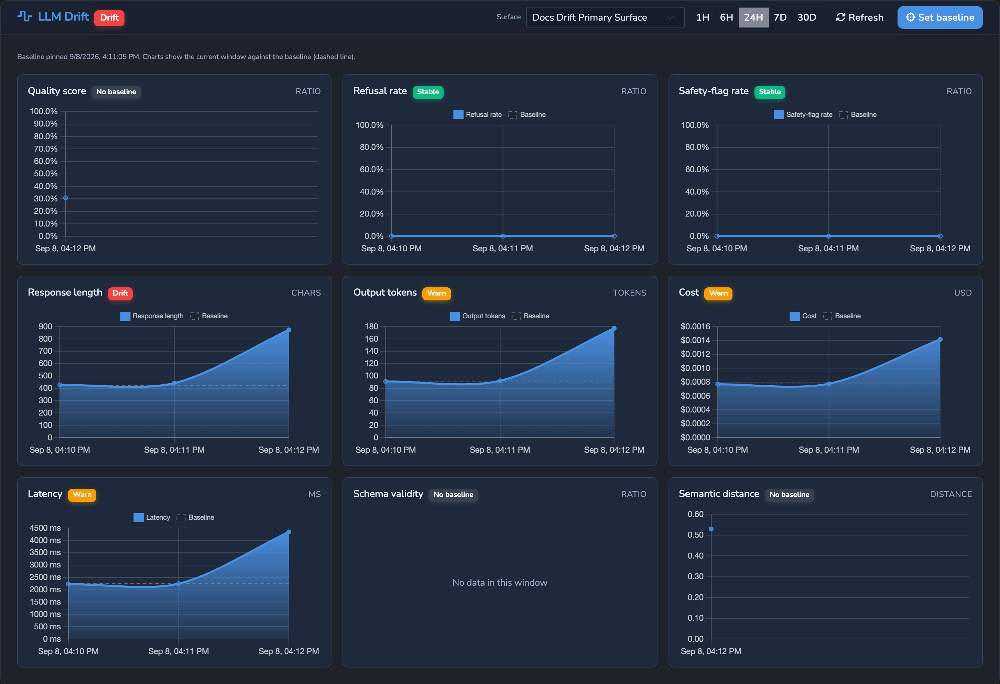
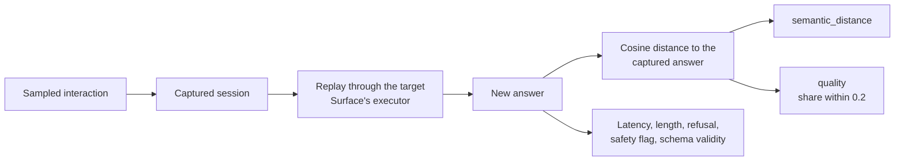
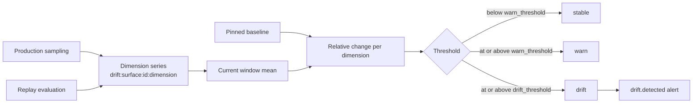

# LLM Drift

How an LLM Surface's behaviour is measured over time: the drift dimensions,
production sampling, replay evaluation, baselines and verdicts, alerts, regression
gating, storage, and the API. The Drift Harness is the Surface element that turns
this on. Hosted documentation:
[LLM Drift reference](https://docs.affinidi.com/products/affinidi-trust-fabric/agent-stream/reference/observability/llm-drift/).

## Overview

A silent provider model update, a prompt or configuration change, or a slow quality
regression shows up as a drift signal on a graph rather than a complaint. Agent Stream
measures a set of independent **drift dimensions** on a Surface, stores each as a time
series, compares the current window to a pinned **baseline**, and alerts when a
dimension moves past a threshold. It answers: is this Surface still behaving the way
it did when it was approved, and if not, on which axis did it change, and when?

Data comes from two sources, both feeding the same dimensions:

- **Production sampling**: a fraction of live traffic, measured from data the request
  path already has. No extra model call.
- **Replay evaluation**: re-running the Surface's captured prompts and comparing each
  new answer with the one originally captured.

Drift is off by default and costs nothing on a Surface that does not enable it. The
source is under [`src/drift/`](../src/drift/).

## Drift dimensions

Each dimension is its own gauge series `drift:surface:{id}:{dimension}`
([`src/drift/dimension.rs`](../src/drift/dimension.rs)).

| Dimension | Label | Unit | Meaning | Filled by |
| --- | --- | --- | --- | --- |
| `quality` | Quality score | ratio | Answer stability: the fraction of replayed answers within cosine distance `0.2` of the captured answer | Replay only |
| `semantic_distance` | Semantic distance | distance | Mean embedding distance between a replayed answer and the captured one | Replay only, with an embeddings model |
| `refusal_rate` | Refusal rate | ratio | Fraction of answers that open like a refusal (a coarse heuristic on common openers) | Sampling and replay; needs the completion text |
| `safety_flag_rate` | Safety-flag rate | ratio | Fraction of sampled successful buffered interactions where the Jury rejected an answer and a Redrive recovered it | Sampling and replay; buffered path only |
| `response_length` | Response length | chars | Mean completion length in characters | Sampling and replay; needs the completion text |
| `output_tokens` | Output tokens | tokens | Mean output tokens | Every sampled interaction |
| `cost` | Cost | usd | Mean cost per interaction at the catalog price | Every sampled interaction |
| `latency_ms` | Latency | ms | Mean end-to-end latency | Every sampled interaction |
| `schema_valid_rate` | Schema validity | ratio | Structured-output conformance | Requests with `response_format: json_schema`, buffered path only |

The completion text is available on the buffered path, and on a stream only when
governance recording reassembled it. Blocked requests are not sampled, so a request
the Judge or a witness blocked does not move `safety_flag_rate`.

`GET /v1/drift/dimensions` returns each dimension's label, unit, and a `source_hint`
explaining when it fills, so an empty chart can be told apart from a fault.



### Why a dimension has no data

- `quality` and `semantic_distance` come only from a replay evaluation. Enable replay
  (with an embeddings model for `semantic_distance`), let the Surface capture some
  traffic, then run or schedule an evaluation.
- `schema_valid_rate` fills only when callers request structured output
  (`response_format: { "type": "json_schema", ... }`).
- `refusal_rate` and `response_length` need the completion text, which a stream
  carries only when governance recording reassembled it.
- `latency_ms`, `output_tokens`, and `cost` fill from any sampled traffic once drift
  is on.

## Configuration

The `drift` block on the Surface config (`DriftConfig` in
[`src/drift/config.rs`](../src/drift/config.rs)) is set on the base Surface only, not
per Variant.

```jsonc
"drift": {
  "enabled": true,
  "sample_rate": 1.0,
  "warn_threshold": 0.25,
  "drift_threshold": 0.5,
  "gate_on_regression": false,
  "eval": {
    "enabled": true,
    "schedule": { "enabled": true, "interval_secs": 3600 },
    "embeddings": { /* catalog provider, model, and secret */ },
    "max_sessions": 50,
    "max_run_cost_usd": 2.0
  },
  "alert_cadence": { "re_alert_interval_mins": 60, "max_alerts": 5 },
  "alert_integrations": ["drift-slack"]
}
```

| Field | Default | Meaning |
| --- | --- | --- |
| `enabled` | `false` | Turns drift monitoring on. |
| `sample_rate` | `1.0` | Fraction of interactions sampled. |
| `warn_threshold`, `drift_threshold` | `0.25`, `0.5` | Relative-change thresholds. Non-positive values fall back to the defaults, and `drift_threshold` is raised to at least `warn_threshold`. |
| `gate_on_regression` | `false` | Refuse Surface saves while drifting; see [Regression gating](#regression-gating). |
| `eval.enabled` | `false` | Turns replay evaluation on. |
| `eval.schedule` | none | `{enabled, interval_secs}`; the interval is floored at 300 seconds. Scheduled runs happen only on the Active instance. |
| `eval.embeddings` | none | The embeddings model for `semantic_distance`, chosen from the model catalog. |
| `eval.max_sessions` | `50` | Sessions replayed per run, capped at 200. |
| `eval.max_run_cost_usd` | appliance default | Spend ceiling for one run. `0` opts this Surface out of the ceiling. |
| `alert_cadence` | `[drift]` defaults | Per-Surface override of the re-alert interval and cap. |
| `alert_integrations` | none | Integrations in the `llm_drift` category to notify. |


Appliance settings:

| Where | Key | Default | Meaning |
| --- | --- | --- | --- |
| `config.toml` `[drift]` | `re_alert_interval_mins` | `60` | Minutes between re-alerts while a Surface stays drifting. |
| `config.toml` `[drift]` | `max_alerts` | `5` | Alerts per Surface per baseline; `0` is unlimited. |
| `config.toml` `[storage_paths]` | `drift`, `drift_baselines`, `drift_runs`, `drift_sessions`, `drift_eval_state` | | Drift storage directories. |
| `agent-stream.json` `drift` | `eval_max_consecutive_failures` | `3` | Failed scheduled runs before auto-suspend; `0` disables. |
| `agent-stream.json` `drift` | `eval_session_timeout_secs` | `30` | Per-session replay timeout. |
| `agent-stream.json` `drift` | `eval_max_run_cost_usd` | `5.0` | Appliance-wide run spend ceiling; `null` for none. |
| `agent-stream.json` `drift` | `max_runs_per_surface` | `50` | Run records kept per Surface. |
| `agent-stream.json` `drift` | `max_sessions_per_surface` | `200` | Captured sessions kept per Surface. |
| `agent-stream.json` `drift` | `max_run_age_days`, `max_session_age_days` | `null` | Optional age limits; `null` or `0` means none. |

Appliance settings are read from `NetworkConfig.drift` ([`src/config/network.rs`](../src/config/network.rs))
and the `[drift]` block of the bootstrap config ([`src/config/types.rs`](../src/config/types.rs)).

## Production sampling

`record_interaction` ([`src/drift/record.rs`](../src/drift/record.rs)) runs on the
buffered and streaming success paths. For each sampled interaction it folds one
observation per dimension into the drift store and, when both the prompt messages
and the completion text are available, captures the session for later replay. It
runs off the request path and does nothing when the drift store is absent.

## Replay evaluation

While drift monitoring is on, each sampled interaction is captured as a
`RecordedSession` (`{id, surface_id, captured_at, messages, output, latency_ms,
output_tokens}`) in a per-Surface store ([`src/drift/session_store.rs`](../src/drift/session_store.rs)).
A replay ([`src/drift/runner.rs`](../src/drift/runner.rs)) re-runs those sessions
through the target Surface's executor and compares each new answer with the captured
one:



- The cosine distance between the two answers, using the configured embeddings model,
  folds into `semantic_distance`.
- A replay within distance `0.2` counts as stable; the stable fraction is `quality`.
  Without an embeddings model, a replay that succeeded counts as stable.
- Latency, length, refusal, safety-flag, and schema validity are re-measured under
  the same inputs.

The replay runs the target's full governed pipeline, so its Prompt Guard, Expert
Witnesses, Judge, Jury, and Decider are exercised on every replayed turn. There is no
separate grader.

### Runs

`POST /v1/drift/eval/run?surface_id=` starts a run and returns at once with a
`DriftRun` in `running` status ([`src/drift/run.rs`](../src/drift/run.rs)). Poll
`GET /v1/drift/runs/{id}` for `progress_done`, then the aggregate and per-session
results. `POST /v1/drift/eval/cancel?run_id=` stops a run between sessions; it is
recorded as `cancelled`, and the route returns `404` when no in-flight run has that
id. Each session is wrapped in the per-session timeout, so one stuck upstream cannot
hang a run.

| `status` | Meaning |
| --- | --- |
| `pending`, `running` | In flight. |
| `completed` | Finished. |
| `failed` | A manual run that replayed no sessions, or whose every session errored, with a `failure_reason`. |
| `cancelled` | Cancelled by an operator. |
| `stopped` | A usage limit or the run's cost ceiling was reached; the reason is in `failure_reason`. |

A run's `trigger` is `manual` (the API was called) or `scheduled` (the scheduler ran
it). A scheduled run with no captured sessions is discarded silently: it is never
stored and never counts toward auto-suspend. A cancelled or stopped run is a
truncated sample: it never folds into the drift series and never counts as a failure,
but its partial results and `cost_usd` are kept.

### Experiments

`target_surface_id` and `variant` on the run request replay the **source** Surface's
captured sessions through a different Surface or Variant, to compare a different
model, prompt, or Judge and Jury against the captured answers. Only a plain self-run
folds into the source's dimensions. An experiment is inspect-only: it is stored in
run history tagged with its target and Variant, and its `dimension_verdicts` compare
it with the **target** Surface's baseline and thresholds.

### Scheduling and auto-suspend

The scheduler ([`src/drift/scheduler.rs`](../src/drift/scheduler.rs)) runs every
Surface whose `eval.schedule` is enabled, one run at a time, at intervals of at least
five minutes, and only while the instance is Active. When the instance is demoted, or
demoted and promoted again, a scheduled run already in progress stops before its next
session and records nothing: no drift samples, run record, or change to the failure count.
A per-Surface state ([`src/drift/eval_state.rs`](../src/drift/eval_state.rs))
counts consecutive failed runs; at `eval_max_consecutive_failures` the Surface's
scheduled evaluation is suspended. A manual run always executes, even while
suspended, and a successful run clears the count and the suspension.

### Cost

A replay is real provider spend, metered like live traffic:

- The main-LLM stage is recorded in the target Surface's monthly usage buckets, so it
  counts toward the Surface's usage limits. Judge, Jury, and Decider record their own
  buckets from inside their executors.
- The spend is attributed to the Surface's attributed Member: the Member whose identifier matches
  the target Surface's API-key source-auth secret id, with that Member's Teams. When
  the Surface's team attribution enforces, the replay is held to that Member's and
  Teams' budgets, and the billed cost counts toward them. When no Member claims the
  Surface, the spend is filed under the built-in `drift-runner` Member.
- Two guards are checked before each session, so a run can overshoot by at most the
  session in flight: the target Surface's usage limits, and the run's cost ceiling
  (`eval.max_run_cost_usd`, else `eval_max_run_cost_usd`). Either ends the run as
  `stopped`.
- An embedding call that a spent budget refuses is skipped, not failed.

See [USAGE_LIMITS_AND_ATTRIBUTION.md](USAGE_LIMITS_AND_ATTRIBUTION.md).

## Baseline and verdict

A baseline is the mean of each dimension over the window that was current when it was
pinned (`DriftBaseline` in [`src/drift/baseline.rs`](../src/drift/baseline.rs)), one
per Surface, stored apart from the Surface config.
`POST /v1/drift/baseline?surface_id=&window_secs=` pins the mean over the last
`window_secs` seconds (default 86400, clamped to 300 to 2592000) for the Surface named by
`surface_id`, which is required.

For each dimension, the current window's count-weighted mean is compared with the
baseline ([`src/drift/verdict.rs`](../src/drift/verdict.rs)):

```text
relative_change = |current − baseline| / max(|baseline|, floor)
```

The floor stops a near-zero baseline from reading as infinite drift:

| Dimensions | Floor |
| --- | --- |
| `quality`, `refusal_rate`, `safety_flag_rate`, `schema_valid_rate`, `semantic_distance` | `0.05` |
| `latency_ms` | `100` |
| `response_length` | `80` |
| `output_tokens` | `20` |
| `cost` | `0.0005` |

The change is symmetric: a large move in either direction counts. At or above
`drift_threshold` the dimension is `drift`, at or above `warn_threshold` it is
`warn`, otherwise `stable`. A dimension with no baseline entry or no samples in the
window is `unknown`, meaning not measured, not a severity.

The Surface verdict is the worst of the dimensions that could be judged. `unknown`
dimensions are left out, because several fill only under specific conditions; the
Surface is `unknown` only when no dimension could be judged.

From sample to alert:



## Alerts

A periodic evaluator ([`src/drift/evaluator.rs`](../src/drift/evaluator.rs)) re-judges
every drift-monitored Surface every five minutes over the trailing hour.

- On entering `drift`, `drift.detected` fires. Its `new_state` carries `surface_id`,
  `surface_name`, `status`, `window_seconds`, the headline `dimension`, `baseline`,
  `current`, and `delta`, and `dimensions`: every evaluated dimension with `id`,
  `label`, `unit`, `status`, `baseline`, `current`, and `delta` (an unmeasured value
  is `null`, never `0`).
- While the Surface stays drifting, the alert re-fires no more often than the re-alert
  interval and at most `max_alerts` times per baseline.
- When the Surface leaves drift, `drift.resolved` fires once with the same
  `new_state` minus the headline fields.
- Alerts go to `alert_integrations` (integrations in the `llm_drift`, "LLM Drift",
  category), or, when none are chosen, to the Surface's own `drift.detected`
  integration mappings (`trigger_pipe_drift_detected` in
  [`src/integrations/pipe_integration_triggers.rs`](../src/integrations/pipe_integration_triggers.rs)).
  Templates can use `DRIFT_STATUS`, `DRIFT_DIMENSION`, `DRIFT_BASELINE`,
  `DRIFT_CURRENT`, and `DRIFT_DELTA`.

Alert state is held in memory, so a restart while a Surface is drifting does not emit
`drift.resolved`.

## Regression gating

With drift enabled and `gate_on_regression` on, saving the Surface
(`PUT /v1/pipes/{id}`) is refused with `409` while its verdict over the last hour
against its baseline is `drift` ([`src/drift/gating.rs`](../src/drift/gating.rs)). A
missing store, no baseline, or no samples resolve to `unknown`, which never blocks.
Re-pin the baseline or turn gating off to proceed; either is a clean save.

## Storage

| Data | Location | Retention |
| --- | --- | --- |
| Dimension series | `storage_paths.drift` (`_storage/drift`), a separate RRD store keyed `drift:surface:{id}:{dimension}` | RRD tiers |
| Baselines | `storage_paths.drift_baselines`, keyed by Surface id | Until re-pinned |
| Captured sessions | `storage_paths.drift_sessions` (`_storage/drift_sessions`) | `max_sessions_per_surface`, optional age |
| Run records | `storage_paths.drift_runs` (`_storage/drift_runs`) | `max_runs_per_surface`, optional age |
| Eval state | `storage_paths.drift_eval_state` | Per Surface |

Baselines, captured sessions, and run records use the appliance's file storage, so
they are encrypted when encryption at rest is configured (see
[ENCRYPTION_AT_REST.md](ENCRYPTION_AT_REST.md)). Captured sessions hold real prompts
and completions.

Each RRD sample is `{sum, count}`, and reads return the per-bucket mean, so coarse
tiers roll up correctly. The drift namespace is disjoint from the usage, operational,
and rejection series, and drift series are served only by `/v1/drift/series`, never by
the main telemetry routes. Count and age limits are enforced on write
([`src/drift/retention.rs`](../src/drift/retention.rs)) and, when an age limit is set,
by a sweep every six hours so idle Surfaces are pruned too. Series hold aggregate
values only, never bodies.

## API

All routes are in [`src/identity/handlers/drift.rs`](../src/identity/handlers/drift.rs).
`drift.view` and `drift.manage` default to administrator.

| Route | Permission | Returns |
| --- | --- | --- |
| `GET /v1/drift/series?keys=&from=&to=` | `drift.view` | Dimension series. Accepts only well-formed `drift:surface:{id}:{dimension}` keys. |
| `GET /v1/drift/dimensions` | `drift.view` | Dimension metadata and `source_hint`. |
| `GET /v1/drift/verdict?surface_id=&from=&to=` | `drift.view` | Per-dimension and overall verdict against the baseline. |
| `GET /v1/drift/baseline?surface_id=` | `drift.view` | The pinned baseline. |
| `POST /v1/drift/baseline?surface_id=&window_secs=` | `drift.manage` | Pin the mean over the last `window_secs` (default 86400, 300 to 2592000) as the baseline. `surface_id` is required. |
| `GET /v1/drift/sessions?surface_id=` | `drift.view` | Captured sessions, newest first. |
| `POST /v1/drift/eval/run?surface_id=&target_surface_id=&variant=` | `drift.manage` | Start a replay; target and Variant default to the source. |
| `POST /v1/drift/eval/cancel?run_id=` | `drift.manage` | Cancel an in-flight run. |
| `GET /v1/drift/runs?surface_id=&limit=` | `drift.view` | Run history, newest first. With `surface_id`: that Surface's runs, in-flight first. Without it: the most recent `limit` (default 25, 1 to 200) across all Surfaces. |
| `GET /v1/drift/runs/{id}` | `drift.view` | One run, live while in flight. |

`surface_id` is validated as a Surface id (`[A-Za-z0-9_-]`, length-capped). The API
starts and schedules replays of captured traffic; it does not run arbitrary prompts.

## Known limitations

- Baselines are per Surface, not per Variant.
- `safety_flag_rate` reflects Jury rejections recovered by Redrive on the buffered
  path; blocked requests and streams do not move it.
- `refusal_rate` uses a heuristic on common refusal openers; it tracks relative
  change, not exact accuracy.
- Alert state is in memory and is lost on restart.
- Drift series are per instance, like the rest of telemetry.

## Related

- [GUARDRAILS.md](GUARDRAILS.md): the Jury and Redrive behind `safety_flag_rate`.
- [USAGE_LIMITS_AND_ATTRIBUTION.md](USAGE_LIMITS_AND_ATTRIBUTION.md): how replay spend is metered and attributed.
- [OBSERVABILITY.md](OBSERVABILITY.md): usage telemetry and events.
- [INTEGRATIONS.md](INTEGRATIONS.md): the `llm_drift` category and templates.
- [ROUTING.md](ROUTING.md): Variants used as replay targets.
- [RBAC.md](RBAC.md): `drift.view` and `drift.manage`.
- [CONFIGURATION_REFERENCE.md](CONFIGURATION_REFERENCE.md): `[drift]` and `storage_paths`.
