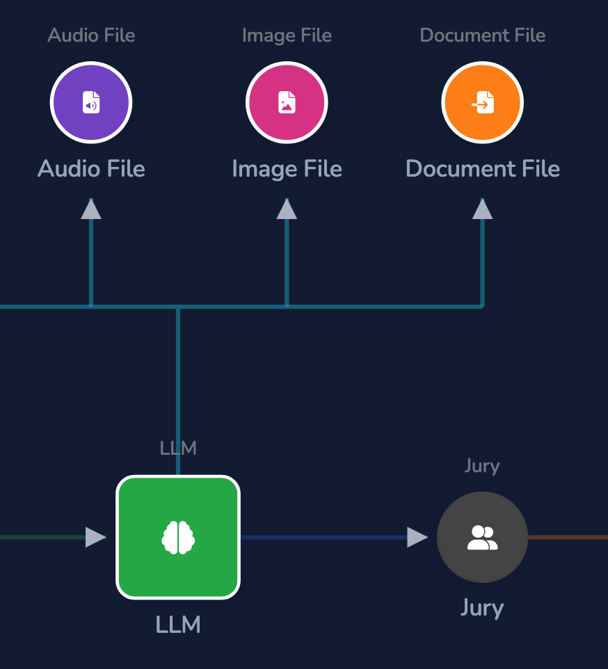
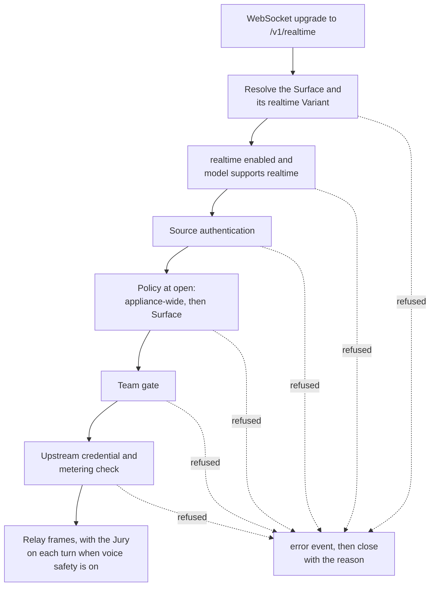

# Modalities

How an LLM Surface accepts and returns media other than text: inline images, inline audio,
attached documents, transcription uploads, text to speech, and realtime voice; the gates
that control them; voice safety; and the multimedia store that keeps media as governance
evidence. For the operator view, see the hosted
[inputs and modalities concepts](https://docs.affinidi.com/products/affinidi-trust-fabric/agent-stream/concepts/inputs-and-modalities/).

Every Client API dialect is normalised to the OpenAI Chat body first (see
[`CLIENT_API_DIALECTS.md`](CLIENT_API_DIALECTS.md)), so each modality is handled once on
that body, whatever the caller's SDK.

## Transports

| Transport | Caller sends | Handled by |
| --- | --- | --- |
| Inline image | `image_url` part (data URL or remote URL) in a chat request | Image gate, then the normal pipeline |
| Inline audio | `input_audio` part (base64 `wav` or `mp3`) in a chat request | Audio gate, then the normal pipeline |
| Attached document | `file` part with inline `file_data` in a chat request | Document ingestion, then the normal pipeline |
| Transcription | `multipart/form-data` to `/v1/audio/transcriptions` or `/v1/audio/translations` | Upload passthrough |
| Text to speech | JSON to `/v1/audio/speech` | Binary passthrough |
| Realtime voice | WebSocket upgrade to `/v1/realtime` | Realtime relay |

## Gates on chat requests

Three per-Surface blocks on `PipeConfig` decide which media a chat request may carry. All
three can be overridden per Variant. The handler runs them in this order, after the team
gate and before the context-window guard, so the buffered and streaming paths are both
covered (see [`../ARCHITECTURE.md`](../ARCHITECTURE.md#full-order)):

1. Document ingestion (`document_ingestion`).
2. The realtime-only check: a chat request to a Surface whose model supports only realtime
   voice is refused with `400 realtime_only_model`, naming `GET /v1/realtime`.
3. The audio gate (`audio_input`).
4. The image gate (`image_input`).

Every refusal is `400` with type `invalid_request_error`.

The accepted formats are published by `supported_input_modalities()`
([`src/pipes/modality.rs`](../src/pipes/modality.rs)) as `input_modalities` on
`GET /api/v1/pipes/config`, which the dashboard reads.

In the dashboard, binding an **Audio File**, **Image File**, or **Document File** element
from the Inputs palette to the LLM node turns on `audio_input`, `image_input`, or
`document_ingestion`.

### Images

`image_input` (`ImageInputConfig` in
[`src/pipes/image_input.rs`](../src/pipes/image_input.rs)) is off by default: a Surface
without it refuses any image the caller attaches, whether an `image_url` part or a `file`
part whose `file_data` is a `data:image/…` URL. Images a tool returned (in a `tool`
message, such as a screenshot in a Claude Code `tool_result`) are dropped instead on such a
Surface, so the conversation is still served; with `image_input` on they are gated like
any other image.

| Key | Default | Meaning |
| --- | --- | --- |
| `enabled` | `false` | Accept image input. |
| `allowed_formats` | `png`, `jpeg`, `gif`, `webp` | Formats accepted for inline `data:` images. |
| `max_bytes` | 20 MiB | Total decoded inline image bytes per request. |

Remote image URLs are forwarded without format or size checks; the gateway cannot inspect
them. Refusals carry code `image_not_supported`.

### Audio input

`audio_input` (`AudioInputConfig` in [`src/pipes/audio.rs`](../src/pipes/audio.rs)) is off
by default.

| Key | Default | Meaning |
| --- | --- | --- |
| `enabled` | `false` | Accept `input_audio` parts. |
| `allowed_formats` | `wav`, `mp3` | Accepted formats. |
| `max_bytes` | 25 MiB | Total decoded audio bytes per request. |

The Surface's model must also accept audio. `supports_audio_input` comes from the request
profile, then the catalog's `capabilities.supports_audio_input`, then a default: `true` for
Gemini, `false` for Anthropic, and for any other schema `true` only when the model name
contains `audio` or `realtime`. All refusals (not enabled, model cannot take audio,
format not allowed, too large) carry code `audio_not_supported`.

On the wire, OpenAI receives `input_audio` unchanged, and Gemini receives it as an
`inline_data` part (`transform_to_gemini_format`). Anthropic Messages has no audio input
form; an OpenAI Responses `input_audio` part is normalised to the same `input_audio` part.

### Documents

`document_ingestion` (`DocumentIngestionConfig` in
[`src/pipes/document_ingestion.rs`](../src/pipes/document_ingestion.rs)) extracts an
attached document to prompt text before the provider call, so any model can read it and
the text passes through Prompt Guard, the Judge, and the context-window guard.

A document arrives as `{ "type": "file", "file": { "filename", "file_data" } }`. An
Anthropic `document` block and a Responses `input_file` part are normalised to that shape
first.

| Key | Default | Meaning |
| --- | --- | --- |
| `enabled` | `false` | When off, `file` parts pass through untouched. |
| `allowed_types` | `text`, `markdown`, `csv`, `json`, `docx` | Accepted types. `pdf` is accepted only if added here. |
| `max_file_bytes` | 5 MiB | Decoded size per document. |
| `max_extracted_chars` | 100,000 | Extracted characters kept per document; longer text is truncated with a marker. |
| `mode` | `auto` | `auto`, `extract`, or `passthrough`. |

| `mode` | Behaviour |
| --- | --- |
| `auto` | Extract the types the gateway parses; forward the rest untouched. |
| `extract` | Extract every allowed type; fail a type the gateway cannot parse. |
| `passthrough` | Never extract; still enforce the allow-list and size cap. |

Text, Markdown, CSV, and JSON are decoded directly. DOCX is read from
`word/document.xml` text runs, with zip-bomb limits on entry count (`DOCX_MAX_ENTRIES`,
512) and compression ratio (`DOCX_MAX_RATIO`, 200). PDF is recognised but not extracted:
it is refused unless `pdf` is in `allowed_types`, and then forwarded untouched in `auto`
and `passthrough` and refused in `extract`. An extracted document is replaced by a `text`
part.

A document that is not allowed, too large, or cannot be parsed fails the request (`400`).

### What reaches an Anthropic upstream

When the Surface's upstream speaks Anthropic Messages (`transform_to_anthropic_format` in
[`src/pipes/request_shaping.rs`](../src/pipes/request_shaping.rs)), the parts that pass
the gates become Anthropic content blocks in their original order, each keeping its
`cache_control`:

| Part | Anthropic block |
| --- | --- |
| `image_url` with a base64 `data:` URL | `image`, `base64` source (`image/jpg` is sent as `image/jpeg`). |
| `image_url` with an `http` or `https` URL | `image`, `url` source. Anthropic fetches it; the gateway does not. |
| `file` with PDF `file_data` | `document`, `base64` source, `filename` as `title`. |
| `file` with `text/*` or JSON `file_data` | `document`, plain-text `text` source, when the payload is base64-encoded UTF-8. |
| `file` with JPEG, PNG, GIF or WebP `file_data` | `image`, `base64` source, after the image gate. |
| `file` with any other `file_data` | Refused (see below). |
| `file` with `file_id` | `document`, Files API `file` source. No `anthropic-beta` header is needed. |

Claude reads an attached file only as a PDF, plain text, or one of those four image types.
A request with any other inline file (a DOCX, a spreadsheet, an unrecognised binary, a
text file that is not UTF-8, such as a Latin-1 or UTF-16 CSV, or a `file_data` that is not
a base64 `data:` URL) is refused with `400 unsupported_content` before anything is sent,
rather than answered as if nothing was attached. The refusal is final: a retry policy does
not repeat it, and it never fails over. Turn on
`document_ingestion` to extract the types the gateway can parse (DOCX among them) into
text first. A `file_id` is sent as a `document`, so one naming an image or another type
is refused by Anthropic.

A document that ingestion extracted is already a `text` part, so it is sent once, as text.
An `image_url` whose URL is neither a base64 `data:` URL nor `http(s)` is dropped, as is
any other part type (`input_audio` included). The system prompt carries text only.
Image and document parts inside a `tool` message are sent as `tool_result` content
blocks. An OpenAI-compatible upstream takes only text in a `tool` message, so there they
move, in order, into a `user` message after that run of tool messages.

A part naming a stored file (`file_id`) is subject to the shared-credential rule: on a
provider key the Surface's tenant does not own, the request is refused with
`403 shared_credential_call_refused` before anything is sent.

Claude on Bedrock gets the same blocks but reads only inline sources: a request with an
`http(s)` image or a `file_id` is refused with `400 unsupported_content` before
anything is sent (see
[`PROVIDERS_AND_CREDENTIALS.md`](PROVIDERS_AND_CREDENTIALS.md#provider-types)).

### What the gates record

The detected media are visible to policy as `input.resource.document_types`,
`audio_formats`, and `image_formats` (computed from type markers without decoding;
`document_types_present`, `audio_formats_present`, `image_formats_present`). On the
buffered path the outcome is returned in `x-agent-stream-documents`,
`x-agent-stream-audio`, and `x-agent-stream-images`, and recorded as the
`document_ingestion`, `audio_input`, and `image_input` stages.

### What a Judge can inspect

The Judge and other text guards see only text the gateway has before the provider call:
plain text parts, and documents extracted in `auto` or `extract` mode. Images, inline
audio, and forwarded documents such as PDF are gated by type and size, but their content
is interpreted only by the provider.

## Transcription

`/v1/audio/transcriptions` and `/v1/audio/translations` (`is_audio_multipart_path` in
[`src/pipes/streaming.rs`](../src/pipes/streaming.rs)) take the upload path
(`proxy_file_upload`, then `execute_upload`). It runs source auth, inbound policy, and the
team gate, then forwards the multipart body unchanged, boundary intact, and returns the
provider's JSON transcript.

An upload passthrough bills nothing. While a budget is in scope, a transcription on the
operator's key is refused with `403 endpoint_not_metered`; on the caller's or the tenant's
own key it runs. See [`USAGE_LIMITS_AND_ATTRIBUTION.md`](USAGE_LIMITS_AND_ATTRIBUTION.md).

## Text to speech

`/v1/audio/speech` (`is_binary_endpoint`) runs every gate, then the request-side guards
(circuit breaker, rate limit, request Prompt Guard, request Expert Witness), and returns
the provider's audio bytes unchanged (`execute_binary` in
[`src/pipes/executor.rs`](../src/pipes/executor.rs)).

It is priced by the characters of the request's `input` text, counted as input tokens at
the upstream's input price (`binary_input_units`), the unit in which OpenAI prices `tts-1`
and `tts-1-hd`. A model priced by its audio output, or with no price, cannot be metered
this way: while a budget is in scope it is refused on the operator's key with
`403 model_not_metered`.

The provider must append the request path (OpenAI or an OpenAI-compatible endpoint), and
the path must end in `/audio/speech`. A provider with a fixed endpoint (Anthropic, Gemini,
Claude on Bedrock, Azure OpenAI, Replicate, Hugging Face, Custom, Microsoft 365 Copilot) is refused before anything is sent,
with `400 binary_endpoint_unsupported`.

## Realtime voice

Source: [`src/pipes/realtime.rs`](../src/pipes/realtime.rs).

A WebSocket upgrade to `{route}/v1/realtime` (`is_realtime_path`) opens a relay: the caller
speaks to Agent Stream over one WebSocket, Agent Stream speaks to the provider over a
second, and every frame is pumped between them.

### Session open

`handle_realtime_get` runs, in order:

1. Resolve the Surface and its realtime Variant (see
   [`ROUTING.md`](ROUTING.md#realtime-voice)).
2. Check that `realtime.enabled` is set (`realtime_not_enabled`) and that the model
   supports realtime (`realtime_not_supported`).
3. Source authentication. A browser cannot set `Authorization` on a WebSocket handshake,
   so the token is also accepted as a `Sec-WebSocket-Protocol` entry `bearer.<token>` or
   `openai-insecure-api-key.<token>` (`bearer_from_subprotocols`).
4. Policy at open: the appliance-wide policy, then the Surface policy, once, with
   `input.resource.modality` set to `audio_realtime` (`evaluate_open_policy`). Policy is
   not evaluated per turn.
5. The team gate.
6. The upstream credential, and the metering check: while a budget is in scope, a session
   whose upstream key or voice-safety Juror key is the operator's is refused with
   `realtime_not_metered`.

A refusal completes the handshake, sends an OpenAI-style `error` event
(`type: "realtime_error"`, with the code), and closes with the reason
(`reject_realtime`). A browser cannot read an HTTP error on a refused upgrade, so this is
how it learns why. Each refusal is logged and recorded as a failed connection; an accepted
session is recorded with its duration when it ends.

The client leg stays on HTTP/1.1 WebSocket upgrade; TLS listeners advertise only
`http/1.1`. A reverse proxy in front must pass `Connection: upgrade` and
`Upgrade: websocket` on `…/v1/realtime`.

### Configuration

`realtime` on `PipeConfig` (`RealtimeConfig`), overridable per Variant:

| Key | Default | Meaning |
| --- | --- | --- |
| `enabled` | `false` | Accept realtime sessions. |
| `allowed_formats` | `pcm16` | Audio formats. |
| `max_session_secs` | `600` | Session duration cap, clamped to 10 to 3600. Both legs close when it passes. |
| `voice` | none | Default voice sent to the provider. |
| `safety` | none | Voice safety (below). |
| `audio_streams` | none | Filler clips (below). |

Realtime support comes from the catalog's `request_profile.supports_realtime`, then
`capabilities.supports_realtime`, else `model_supports_realtime`: an `openai` or `azure`
model whose name contains `realtime`, or a `gemini` model whose name contains `live`,
`native-audio`, or `realtime`. The relay speaks two provider dialects (`RealtimeDialect`):
OpenAI Realtime and Gemini Live. Any other wire format, including Azure, is refused with
`realtime_not_supported`.

### Gemini Live

The caller always speaks OpenAI Realtime. For a Gemini provider the relay translates both
legs (`client_event_to_gemini`, `gemini_event_to_client`):

- `session.update` becomes the Gemini `setup` message (`gemini_setup`), built from the
  Surface model and the caller's instructions and voice, and sent first; audio is held
  until it is sent.
- `input_audio_buffer.append` becomes `realtimeInput.audio`; the PCM rate is declared in
  the MIME type and Gemini resamples.
- `setupComplete` becomes `session.created`, model audio becomes `response.audio.delta`,
  output transcription becomes `response.audio_transcript.delta`, and `turnComplete`
  becomes `response.done`. The caller's input transcript is emitted once, when the model
  starts replying or at `turnComplete`.

The Gemini Live socket URL (`gemini_live_url`) carries no key; the key travels in the
handshake header (below).

### Upstream connection

The provider credential goes in a handshake header marked sensitive
(`realtime_auth_header`): `Authorization: Bearer <key>` for OpenAI Realtime, and
`x-goog-api-key` for Gemini Live. It is never put in the URL. A provider key that is not a
valid header value (for example one containing a newline) closes the session with an
error before anything is sent to the provider, and the session is recorded as failed.

The relay builds its own socket rather than using a shared HTTP client:

1. Resolve the provider host (`resolve_realtime_upstream`); an IP literal is used as is.
2. Check every resolved address (`validate_realtime_addresses`). This is the same check
   `ServiceEndpointDnsResolver` applies to Judge and Jury calls
   (`url_validation::validate_service_endpoint_addresses`): private addresses are
   allowed, except for a host whose catalog base URL passed the public-address check when
   saved, which must resolve only to public addresses; loopback, unspecified, link-local and
   cloud metadata addresses are always refused.
3. Connect only to an address that passed the check, trying each in turn with a 10 s
   connect timeout per address.
4. Run the TLS (for a `wss://` URL, verified against the hostname) and WebSocket handshake
   on that socket.

The whole dial (DNS, connect, TLS and WebSocket handshake) is bounded by
`REALTIME_DIAL_TIMEOUT` (30 s), so an upstream that accepts and then stalls cannot hold
the caller's socket open. A failed dial, like an invalid key, sends the caller an `error`
event with code `upstream_unavailable` and the message
`realtime upstream connection failed — check the model and provider key`, then closes its
socket (`close_client_with_error`).

### Turns and records

A session is split into turns: one committed caller input, then one model reply, delimited
by the provider's turn events. `RealtimeAccumulator` reassembles each turn, and each turn is
written as one Governance Record on the Surface's hash chain, interleaved with chat
records. Audio segments go to the [multimedia store](#multimedia-store); the record
carries only their hashes. See [`GOVERNANCE_RECORDS.md`](GOVERNANCE_RECORDS.md).

Realtime audio has no price, so a session's audio spend is not metered. Voice-safety Juror
usage is billed per turn to the Member and Teams the session is attributed to.

### Voice safety

Source: [`src/pipes/realtime_safety.rs`](../src/pipes/realtime_safety.rs).

A realtime Surface can apply its **Jury** to every model reply. `realtime.safety`
(`RealtimeSafetyConfig`):

| Key | Default | Meaning |
| --- | --- | --- |
| `enabled` | `false` | Turn voice safety on. It runs only if the Surface's `jury` is also enabled. |
| `mode` | `gated` | `gated` or `barge_in`. |
| `refusal_message` | "I'm sorry, but I can't help with that." | Spoken and shown when a turn is blocked. |
| `barge_in_min_chars` | `160` | Barge-in only: new transcript characters between Jury runs. |

The review rules are the Surface's own `jury` configuration; the Jury runs on the reply
transcript (`execute_jury`), so it works for both provider dialects.

- **Gated** holds the model's reply audio and transcript, runs the Jury at turn end, and
  releases the audio only if it passes. No blocked reply audio reaches the caller. While
  the reply is held the relay sends an `output_audio.reviewing` event, at the caller's
  turn end when filler clips are configured, otherwise at `response.done`.
- **Barge-in** forwards audio live and runs the Jury on the growing transcript. On a
  violation it sends `output_audio.flush` so the caller drops queued audio, then the
  refusal, and drops the rest of the turn. Some reply audio may already have played.

A blocked turn sends `output_audio.flush` (with the rejection category), a refusal
transcript, and `response.done` with `status: "blocked"`, and is recorded as a blocked
Governance Record. A Jury error also blocks.

The **Judge is not supported on realtime voice.** The provider receives the caller's audio
before the gateway has any transcript, so a Judge cannot run before the model.
`safety.judge` is accepted for compatibility and ignored. Put voice on a Variant without a
Judge.

### Filler clips

Filler clips are short pre-recorded voice clips the relay plays while a Gated reply is
being reviewed, instead of silence. Source:
[`src/pipes/audio_streams.rs`](../src/pipes/audio_streams.rs).

The catalog is the `audio_streams` file under `[config_files]` (default
`audio_streams.json`): `{ "clips": [ { "id", "file", "text", "label", "voice", "tags" } ] }`.
The WAV files live under `[storage_paths] audio_streams`. Every clip must be PCM16, 24 kHz,
mono, so it can be sent as `response.audio.delta` without transcoding. Clips are loaded
and checked at startup; a missing or invalid clip is logged and skipped. The catalog is
published as `audio_streams` on `GET /api/v1/pipes/config`.

`tools/audio_streams/generate.mjs` turns each catalog entry's `text` into a clip with
OpenAI or Gemini text to speech (see [`../tools/audio_streams/README.md`](../tools/audio_streams/README.md)).

A Surface uses clips through `realtime.audio_streams` (`RealtimeAudioStreamsConfig`):

| Key | Meaning |
| --- | --- |
| `filler_tiers[]` | `{ after_ms, clips }`: clips played by elapsed time during a hold, timed from the caller's turn end. |
| `refusal_buckets[]` | `{ category, clips }`: refusal clips by rejection category, with a `default` bucket. |
| `on_fail` | Clips played on an upstream error. |
| `filler_guard_band_ms` | Gap after a filler clip finishes before the held reply is released. Default 2000. |

Clips are picked round-robin within a tier or bucket and sent as `response.audio.delta`
events, so the caller plays them like model audio.

## Multimedia store

Source: [`src/governance/multimedia_store.rs`](../src/governance/multimedia_store.rs).

Governance Records never embed media bytes. Each binary attachment is stored once, keyed by
the SHA-256 of its bytes, and the record carries a reference.

`extract_binary_attachments` finds, on the OpenAI Chat body, `input_audio` parts, `file`
parts with inline `file_data`, and `image_url` parts with a `data:` URL. Parts that only
reference content (`file_id`, remote image URLs) have no bytes and are skipped.

The store is rooted at `[storage_paths] multimedia_store` and created at startup. Blobs are
sharded by the first two hex characters of the hash (`<root>/<xx>/<sha256>`) with a JSON
sidecar (`<sha256>.json`: kind, media type, filename, size, first seen). Identical bytes are
written once. When encryption at rest is configured, blob bytes are encrypted with it; the
file name stays the plaintext hash. `put`, `get`, and `verify` (re-hash a stored blob)
are the operations.

`GovernanceRecord.attachments` holds `MediaRef { kind, media_type, filename, sha256,
bytes, stored }`, inside the signed credential. When the Surface's body capture is on, the
bytes are stored (`extract_and_store`); when it is off, only the hashes are recorded
(`extract_refs`). See [`GOVERNANCE_RECORDS.md`](GOVERNANCE_RECORDS.md).

## Known limitations

- Transcription and realtime audio are not priced; under a budget they run only on an
  owned key.
- The audio capability check uses the Surface's configured model, not a model chosen by
  per-request `models[]` routing.
- A realtime session has no idle timeout, concurrent-session cap, or frame-size limit;
  only `max_session_secs` bounds it.
- When document ingestion extracts a document, the original file is not stored in the
  multimedia store; only the request the model saw is captured.
- The multimedia store has no retention or garbage collection.
- The dashboard Test sandbox does not run the audio and image gates.
- PDF is forwarded, not extracted.

## Related

- [`CLIENT_API_DIALECTS.md`](CLIENT_API_DIALECTS.md): how each dialect carries media.
- [`ROUTING.md`](ROUTING.md): routing by modality and realtime Variants.
- [`INFERENCE_CONTROLS.md`](INFERENCE_CONTROLS.md): the context-window guard.
- [`GUARDRAILS.md`](GUARDRAILS.md): Judge and Jury.
- [`GOVERNANCE_RECORDS.md`](GOVERNANCE_RECORDS.md): records, attachments, and the hash
  chain.
- [`USAGE_LIMITS_AND_ATTRIBUTION.md`](USAGE_LIMITS_AND_ATTRIBUTION.md): budgets and
  unmetered endpoints.
- [`PROVIDERS_AND_CREDENTIALS.md`](PROVIDERS_AND_CREDENTIALS.md): the model catalog and
  capabilities.
- [`ENCRYPTION_AT_REST.md`](ENCRYPTION_AT_REST.md): encryption of stored media.
- [`../ARCHITECTURE.md`](../ARCHITECTURE.md): pipeline order.
