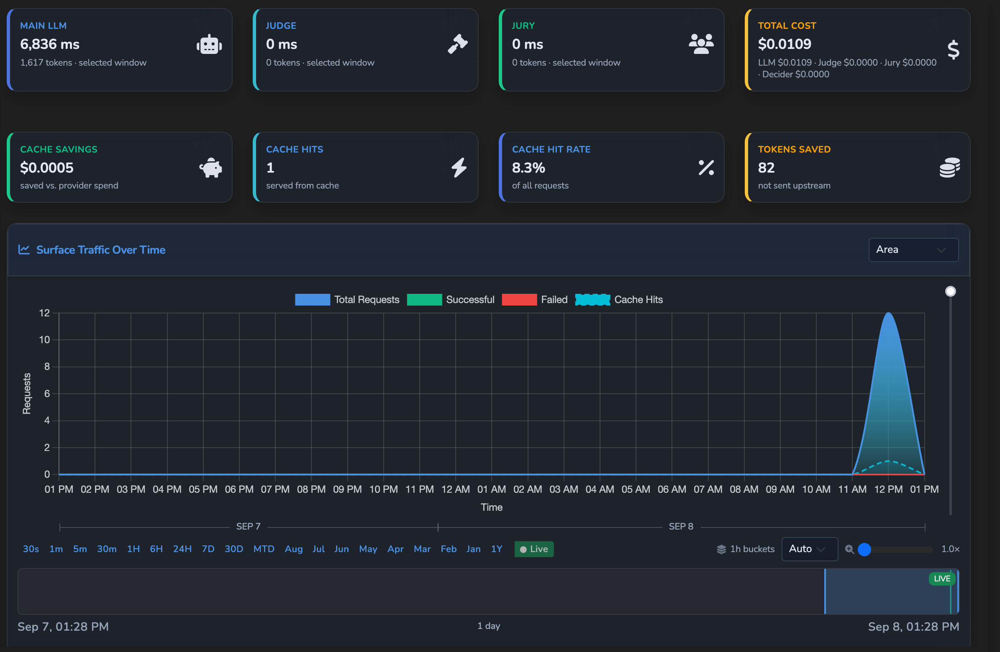

# Observability

How Agent Stream reports what it does: logs, OpenTelemetry export, Prometheus and
CloudWatch metrics, the dashboard WebSocket, policy audit, response headers, usage
telemetry, Langfuse export, and live stage streaming. For the operator view, see the hosted
[observability concepts](https://docs.affinidi.com/products/affinidi-trust-fabric/agent-stream/concepts/observability/)
and [telemetry and exports reference](https://docs.affinidi.com/products/affinidi-trust-fabric/agent-stream/reference/observability/telemetry-and-exports/).

Configuration comes from three places:

| Source | Holds |
| --- | --- |
| `[logging]` in `config.toml` | `level`, `json`, `log_directory` |
| `logging` in `agent-stream.json` | `redaction` rules and `audit_identity_binding_vp` |
| `metrics.json` (`[config_files] metrics`) | OpenTelemetry, CloudWatch, retention and advanced settings; example in [`config/examples/metrics.example.json`](../config/examples/metrics.example.json) |

## Logging

[`src/main.rs`](../src/main.rs) (`init_logging`) builds one `tracing` subscriber from a list
of layers:

1. the reloadable OpenTelemetry trace layer and log layer (no-ops while export is off);
2. `WebSocketLogLayer`, which tells dashboard clients that new log lines exist;
3. `StageStreamLayer`, which feeds [live stage streaming](#live-stage-streaming);
4. a formatter to standard error, and, when `log_directory` is set, a second one to
   `{log_directory}/agent-stream.log`.

`level` (`trace`, `debug`, `info`, `warn`, `error`; default `info`) sets the maximum level of
both formatters; an unparsable level stops startup. `json = true` writes JSON lines;
otherwise `SimpleFormat` ([`simple_format.rs`](../src/observability/simple_format.rs)) writes
plain text. The log file is never rotated by the process. `GET /api/v1/logs/download`
(`logs.view`, administrator by default) downloads it, and `POST /api/v1/logs/truncate`
(`settings.edit`; reading the log does not allow truncating it) truncates it. The same lines
reach the dashboard as the log tail: `GET /v1/dashboard/stats` and `GET /v1/dashboard/delta`
do not read the log file for a caller without `logs.view` and leave the lines out, the
WebSocket drops the delta's `logs` section for such a caller, and the dashboard shows the
Logs page and a Surface's Monitoring log tail only to holders of it. A log tail read goes
back at most 8 MiB from the end of the file, so when lines are very long it returns fewer
lines than requested.

Every inbound request is logged to the `agent-stream::access` target with its method, path,
query string, `Host`, `Accept`, `User-Agent`, `Origin`, `mcp-session-id`, `x-forwarded-for`
and `x-forwarded-proto`, at `INFO`, or `DEBUG` for static assets, `/api/` paths, `did.json`
documents and dashboard page loads. The query string keeps only parameter names, with each
value replaced by `<redacted>`, so the value of an OAuth `code` or of a token sent as a query
parameter is never logged. A parameter sent without `=` is logged as sent. The `http.uri`
field of the `http.request` trace span is redacted the same way. The `x-forwarded-for` value is the client address the proxy reported, which
is personal data in some jurisdictions.

Management actions with security weight log to the `security_audit` target: LLM connection
tests, and every refused [Surface ownership](RBAC.md#surface-ownership) check, as a `WARN`
event `surface_ownership_denied` with `actor_id` (the refused user) and `pipe_id` (the
Surface), plus `ide_pipe_id` when the Surface was being listed in an IDE Surface's
Catalogue. Each inline integration credential moved to the secrets store logs an `INFO`
event `integration_credential_migrated` with `integration_id`, `tenant_id`, `field`,
`action` and `secret_id`, never the value
([INTEGRATIONS.md](INTEGRATIONS.md#secrets-in-integration-configuration)). At startup it also
logs one `stored_secret_binding` line per stored secret binding (see
[`PROVIDERS_AND_CREDENTIALS.md`](PROVIDERS_AND_CREDENTIALS.md)). These are ordinary log
lines, not tamper-evident records, and OpenTelemetry exports them only when `logs.targets`
names `security_audit`.

The `audit` target carries backup and restore events ("Storage operation audit") and user
management events (`user.updated`, `user.update_denied`). Every audit-configuration change,
and any failure to deliver it, is logged under `audit_control`. Neither target is in the default
`logs.targets`, so OpenTelemetry exports them only when it names them.

### Log redaction

`logging.redaction` in `agent-stream.json` holds `enabled` and an ordered list of `rules`,
each with a `name`, a `pattern` and a `replacement` that may use capture groups (`${1}`).
[`LogRedactor`](../src/observability/log_redact.rs) compiles them once at startup,
case-insensitively; a rule whose pattern does not compile is reported on standard error and
skipped. The example configuration redacts JWTs, `Authorization` header values, password
fields, access and refresh tokens, session identifiers and PEM private keys.

The same redactor applies to:

- both formatters, through `RedactingMakeWriter`;
- exported spans, through `RedactingSpanExporter`, which rewrites string attributes;
- exported OpenTelemetry log records: body and string attributes, except identifier
  attributes (`trace_id`, any `*_trace_id`, any `*_hash`), which stay whole so a record still
  joins its request.

Redaction rules are read at startup. A later OpenTelemetry reload reuses the startup
redactor.

## OpenTelemetry

[`src/observability/opentelemetry.rs`](../src/observability/opentelemetry.rs) exports traces,
metrics and logs over OTLP. The `opentelemetry` block of `metrics.json`
([`src/config/metrics_config.rs`](../src/config/metrics_config.rs)):

| Key | Default | Meaning |
| --- | --- | --- |
| `enabled` | none (required) | Master switch for all three signals |
| `endpoint` | none (required) | Collector endpoint; must start with `http://` or `https://` |
| `protocol` | `grpc` | `grpc` uses `endpoint` verbatim. `http` (binary protobuf) appends `/v1/traces`, `/v1/metrics` or `/v1/logs` unless the endpoint already ends with that path; a path prefix is kept |
| `auth` | none | `header_name`, `secret_id` and `header_format` (default `{value}`, for example `Bearer {value}`); see below |
| `service_name` | none (required) | `service.name` resource attribute |
| `environment` | none (required) | `deployment.environment` resource attribute |
| `instance_id` | host name, else a UUID fixed for the process | `service.instance.id` resource attribute |
| `traces.sample_rate` | none (required) | `1.0` or more always samples, `0.0` or less never, otherwise trace-id ratio |
| `traces.target_crates` | `["agent-stream"]` | Span targets kept by the business-logic filter, matched exactly or as a `::` prefix. The default covers the HTTP request and task spans; add `agent_stream` to export module spans such as `fabric.forward_request`. `trust_gateway`, the target before the rename, is deprecated: it is read as `agent-stream` and logs a warning at startup |
| `metrics.export_interval_seconds` | none (required) | Periodic metric export interval |
| `logs.enabled` | none (required) | Export log records |
| `logs.targets` | `["policy_audit", "governance_record", "credential_delegation"]` | Exported log targets: exact or module-path prefix; `"*"` exports everything |

The `traces`, `metrics` and `logs` blocks, with their `enabled` flags, and the top-level
`cloudwatch` block are required; a file without them fails to parse, and the appliance starts
with OpenTelemetry disabled.

Every signal carries `service.name`, `service.version`, `deployment.environment` and
`service.instance.id`. Exports use a 10-second timeout.

**Traces.** Spans pass a business-logic filter, which drops internal dependency spans
(`h2`, `hyper`, `tower`, `tokio` and others) ([`span_filter.rs`](../src/observability/span_filter.rs)),
then the redacting exporter, then a batch exporter. HTTP request spans for dashboard
static assets are logged at `DEBUG` ([`http_trace.rs`](../src/observability/http_trace.rs)).
A received Fabric `forward-request` continues the sender's trace from its `otel_context`;
that span is exported only when `traces.target_crates` includes `agent_stream` (see [`FABRIC.md`](FABRIC.md#receiving-a-forward-request)).

**Metrics.** The OTLP meter exports the instruments named in
[`metric_names.rs`](../src/metrics/backends/metric_names.rs) (`otel` module), such as
`gateway.connections.total`, `gateway.pipe.executions.total`, `gateway.pipe.tokens.total`,
`gateway.pipe.cost.total` and `gateway.pipe.latency`.

**Logs.** By default only the audit targets are exported: `policy_audit`
([policy-decision audit](#policy-decision-audit)), `governance_record` (each signed
Governance Record, see [`GOVERNANCE_RECORDS.md`](GOVERNANCE_RECORDS.md)) and
`credential_delegation`.

**Upgrading from the `trust_gateway` names.** The HTTP request and task spans now use the
targets `agent-stream` and `agent-stream::access`, and the system meter is now
`agent-stream.system`. Update `RUST_LOG` filters that name `trust_gateway` or
`trust_gateway::access`, and any dashboards or alerts keyed on the `trust_gateway.system` meter.
`traces.target_crates` keeps accepting `trust_gateway`, as described above.

### Collector authentication

`auth.secret_id` names a secret in the secrets store; the secret value is never written to
`metrics.json`, and `GET /v1/metrics/config` never returns `secret_id` (a `PUT` that leaves it
out, or blank, keeps the stored one). At startup the secret is read and `header_format` is filled with it, and the
header is attached to every trace, metric and log export (gRPC metadata or HTTP header). When
OpenTelemetry is configured with `auth` and the secret cannot be read, startup fails rather
than exporting unauthenticated.

```json
"opentelemetry": {
  "enabled": true,
  "endpoint": "https://collector.example.com:4318",
  "protocol": "http",
  "auth": { "header_name": "Authorization", "secret_id": "otel-collector-token", "header_format": "Bearer {value}" }
}
```

### Changing the configuration at runtime

| Route (under `/api`) | Purpose |
| --- | --- |
| `GET /v1/metrics/config` | Read `metrics.json` |
| `PUT /v1/metrics/config` | Validate and write `metrics.json`, then apply OpenTelemetry without a restart |
| `POST /v1/metrics/test-connection` | Test reachability of an OTLP endpoint |

All three routes, and `POST /v1/metrics/truncate`, need `settings.edit`
(`create_metrics_config_router`). `PUT` refuses with `400` an enabled configuration with an
empty endpoint, an endpoint without `http://` or `https://`, an empty service name, or a
sample rate outside 0.0 to 1.0. `prepare_save`
([`metrics_config.rs`](../src/identity/handlers/metrics_config.rs)) then checks the save
against the stored `metrics.json`:

- An access token bound to a tenant cannot save it (`403`): `metrics.json` is
  appliance-wide and its secret is resolved with no tenant check.
- Pairing a secret with a collector it was not already sent to (another secret, another
  endpoint, or turning export or auth on) also needs `secrets.view`.
- A changed export target (the endpoint while export is enabled) must pass the
  [strict outbound policy](INTEGRATIONS.md#strict-outbound-policy)
  (`validate_resolved_webhook_url`); a target it refuses gets one generic `400`. An
  unchanged stored target is not rechecked, so a local or private collector written to `metrics.json` on disk keeps
  working when other settings are saved; the startup load of `metrics.json` is not
  validated.

Each save is logged with the user. After writing, it resolves the auth header and calls
`reload_otel`, which rebuilds the providers, swaps the trace and log layers in place,
re-points the global meter provider, and shuts the old providers down. If the reload fails,
the file stays saved, the error goes to the log, and the response says only that a restart
may be required. The CloudWatch, `retention` and `advanced` blocks and `traces.target_crates`
are not reloaded.

`POST /v1/metrics/test-connection` (`probe_collector`) answers only reachable or not
reachable. A refused and a timed-out connection give the same answer, with no latency or OS
error, and every not-reachable answer comes after the full 5 s timeout, so neither the answer
nor its timing tells closed from filtered ports. It tests an address that passes the same
public-address check, or the stored export target (the `metrics.json` endpoint while export
is enabled, which may be local or private); anything else gets the save's generic `400`. It
connects only to the addresses it checked.

**Known gap.** The OTLP exporter ([`opentelemetry.rs`](../src/observability/opentelemetry.rs))
dials with opentelemetry-otlp's own HTTP client, which resolves DNS on every connect and
follows redirects, so a collector that passed the save check could redirect or rebind exports
(with a custom auth header) to an internal address. Closing it needs a custom
`opentelemetry_http::HttpClient` (the exporter uses reqwest 0.12, this crate 0.13). Only
`settings.edit` holders can set the endpoint.

## Metrics

[`MetricsStore`](../src/metrics/store.rs) records every connection, surface execution and
rule validation and fans them out to the enabled backends
([`src/metrics/backends/`](../src/metrics/backends/)): Prometheus (always), OpenTelemetry
(while enabled) and CloudWatch (while enabled). It also keeps an in-memory window for the
dashboard, bounded by `metrics_retention_minutes` in `config.toml` (default 360), with
aggregates cached for `metrics_cache_ttl_seconds` (default 1). `POST /api/v1/metrics/truncate`
drops old entries.

`GET /api/v1/version` is public and returns `{"version": ...}`, the version of the running
build. Readiness and liveness probes are in
[`CONFIGURATION_RELOAD.md`](CONFIGURATION_RELOAD.md#server-mode).

### Prometheus

`GET /api/v1/metrics/prometheus` serves the text exposition format (`text/plain;
version=0.0.4`). The route bypasses dashboard session authentication. Its own protection
comes from Settings › System Settings ([`src/storage/settings_store.rs`](../src/storage/settings_store.rs)):

| Setting | Effect |
| --- | --- |
| `prometheus_auth_enabled` | When `true`, the endpoint requires HTTP Basic authentication. Off by default, leaving the endpoint open |
| `prometheus_auth_username` | Compared in constant time |
| `prometheus_auth_password_hash` | bcrypt hash the password is verified against. No settings response returns it: `/api/v1/settings` and `/api/v1/user-settings` (`GET`, `POST`, `DELETE`) send it empty, and the redacted storage export replaces it. Versions 0.1.0 to 0.1.17 returned it from `/api/v1/user-settings` to any signed-in caller; if anyone you don't trust could sign in, set a new password, which replaces the stored hash |

A missing, malformed or wrong credential is answered `401` with
`WWW-Authenticate: Basic realm="metrics"` ([`src/identity/handlers/metrics.rs`](../src/identity/handlers/metrics.rs)).

Metric families ([`metric_names.rs`](../src/metrics/backends/metric_names.rs), `prom`):

| Area | Metrics |
| --- | --- |
| Requests | `agent_stream_requests_total`, `_requests_success_total`, `_requests_failure_total`, `_requests_gateway_fault_total`, `_request_duration_seconds` |
| Traffic | `agent_stream_active_connections`, `_bytes_sent_total`, `_bytes_received_total`, `_throughput_bytes_per_sec`, `_connections_per_minute`, `_avg_request_latency_ms`, `_avg_response_latency_ms`, `_unique_identities` |
| Rules and routing | `agent_stream_rule_validations_accepted_total`, `_rule_validations_rejected_total`, `_variant_routing_decisions_total` |
| Policy and audit | `agent_stream_policy_decisions_total`, `_policy_evaluation_failures_total`, `_audit_forward_total` |
| LLM | `gen_ai_client_token_usage_input`, `gen_ai_client_token_usage_output`, `gen_ai_server_request_duration_seconds`, `gen_ai_server_request_count_total`, `gen_ai_cost_usd_total`, `gen_ai_server_error_count_total` |
| Failover and spend | `agent_stream_llm_failover_total`, `_llm_failover_backup_attempts_total`, `_llm_failover_suppressed_total`, `_llm_failover_duration_seconds`, `_budget_skipped_total`, `_stream_usage_estimated_total` |
| Users | `agent_stream_user_events_total`, `_users_active`, `_user_logins_total`, `_auth_attempts_total`, `_auth_failures_total` |
| Encryption and terms | `agent_stream_kms_operation_total`, `_kms_operation_duration_seconds`, `_affinidi_terms_refresh_total`, `_affinidi_terms_refresh_duration_seconds`, `_affinidi_terms_cache_age_seconds`, `_affinidi_terms_publication_sequence` |

### CloudWatch

With `cloudwatch.enabled` in `metrics.json`, the store pushes aggregates to Amazon CloudWatch
([`cloudwatch.rs`](../src/metrics/backends/cloudwatch.rs)) under `namespace` (required;
the example sets `AgentStream`), with optional
`dimensions` (`name`, `value` pairs). The region is `cloudwatch.region`, else `aws_region` in
`config.toml`, else `us-east-1`; credentials come from the AWS default chain, using
`aws_profile` from `config.toml` when set. Metrics include `RequestCount`, `SuccessCount`,
`FailureCount`, `GatewayFaultCount`, `SuccessRate`, `AverageRequestLatency`,
`AverageResponseLatency`, `ActiveConnections`, `ThroughputBytesPerSec`,
`ConnectionsPerMinute`, `UniqueIdentities`, `RuleAcceptCount`, `RuleRejectCount`,
`UserCreatedCount`, `ActiveUsers` and `UserLogins`. CloudWatch settings are read at startup.

## Dashboard WebSocket

The dashboard receives live updates over `GET /api/ws` (also `/api/ws/dashboard`)
([`src/server/websocket.rs`](../src/server/websocket.rs)).

**Access.** With `websocket_require_auth` (`config.toml`, default `true`) and an
authentication mode configured, the upgrade needs a valid dashboard session, presented as
`Authorization: Bearer` or the session cookie. A token in the query string is refused with
`400`. A cookie-authenticated upgrade must carry an `Origin` from the allow-list built from
`cors` and the WebAuthn external origin in `agent-stream.json` (`403` otherwise), and a
session still waiting on Terms consent is refused with `403`. With `websocket_require_auth =
false` the unauthenticated handler is mounted; it knows no user, so its clients receive only
`refresh_dashboard` notices and load data over the authenticated HTTP API.

**Who receives what.** Every connection gets the same broadcasts, so each update is checked
against the connection's `WsAccess`, decided from the user's role when it connects and
re-checked on every 30-second ping (`WsRecheck`). The socket closes once its session is
revoked or has expired (a role change, disable or logout revokes it), and otherwise follows
the user's current role. `payload_captured` and `onboarding_attempt` need `surfaces.capture`;
`log_entry` and a delta's `logs` section need `logs.view`; identity, metrics,
surface-expiry and dashboard-delta updates need `dashboard.view`; `refresh_dashboard` goes to
everyone. A delta's `channels` entries drop `latest_payload` (the Surface's last captured
request) without `surfaces.capture`. Identity updates never carry the identity's
`private_key`. The match on the update type is exhaustive, so a new type must be given a
permission.

**Messages.** On connect the server sends `{"type": "connected"}`, then forwards updates from
one broadcast channel of `websocket_broadcast_buffer` entries (default 500). It pings every
30 seconds. Updates are JSON objects with a snake_case `type`:

| `type` | Sent when |
| --- | --- |
| `dashboard_delta` | A dashboard delta is ready (below) |
| `metrics_updated` | Every 5 seconds, when connection counts or per-surface stats changed |
| `log_entry` | At most once a second after log lines were written; the entry is empty and only prompts a refresh |
| `payload_captured` | A Fabric forward was served ([payload capture](#payload-capture)) |
| `identity_created`, `identity_updated` | An identity record changed |
| `channel_expired` | A temporary surface record expired and was removed |
| `onboarding_attempt`, `refresh_dashboard` | Onboarding activity, or a full refresh is needed |

**Delta broadcast.** `init_dashboard_delta_broadcast`
([`dashboard.rs`](../src/observability/dashboard.rs)) runs every 5 seconds. It skips the cycle
when no client is connected, and skips the send when a content hash of the delta (counts and
values, not bucket timestamps) is unchanged. Otherwise it serialises one
`{"type": "dashboard_delta", "delta": {"timestamp": ..., "changes": {...}}}` message and
broadcasts it. `changes` holds the
sections `metrics`, `logs` (new entries since the last broadcast), `channels`, `identities`,
`tasks`, `unread_count` and `pipe_metrics`. A client can narrow what it receives by sending
`{"type": "subscribe", "sections": [...]}`; an empty list means every section. The same
delta is available by HTTP at `GET /api/v1/dashboard/delta`, alongside
`/v1/dashboard/stats`, `/v1/dashboard/surface/{id}/metrics`,
`/v1/dashboard/surface/{id}/ucp-operations` (per-operation UCP statistics for one surface),
`/v1/dashboard/metrics/hierarchical` and `/v1/dashboard/system-metrics`. All six need
`dashboard.view` (`dashboard_reads_router`). `GET /v1/dashboard/stats` and
`GET /v1/dashboard/delta` filter the same way: log lines need `logs.view`, and each
Surface's `latest_payload` needs `surfaces.capture`. An access token narrowed to a tenant or
to resources reads one Surface's metrics or UCP statistics only for a Surface it owns; any
other id, known or not, answers `404`. It is refused (`403`) on the four reads that span
every tenant: stats and delta, `/v1/dashboard/metrics/hierarchical`, which holds every
Surface's connections and callers, and `/v1/dashboard/system-metrics`, which reports the
host.
`GET /v1/agents`, which returns the latest captured payloads per agent, needs
`surfaces.capture` and refuses such a token.

### Payload capture

When a Fabric `forward-request` has been forwarded,
[`broadcast_payload_capture_async`](../src/observability/payload_capture.rs) records the
request as the surface record's latest payload (and, when the caller identity is known, as
that identity's last payload) in the metrics store, and broadcasts `payload_captured` with
the request body, the response body or status, a `validation_status` from the response
status (`success`, `client_error`, `server_error`) and the Variant alias. No surface setting
gates it. LLM Surface traffic does not produce `payload_captured`; its content capture is
the opt-in `log_requests` and `log_responses` (see [Langfuse export](#langfuse-export)).

### Task monitor

[`TaskMonitor`](../src/observability/task_monitor.rs) tracks each running surface listener
task: status (`running`, `starting`, `stopping`, `error`), connections, bytes, errors and last
activity, with derived connections per minute, throughput and uptime. Active-connection
counts with no activity for two minutes are reset. Its summary feeds the dashboard stats and
the `tasks` section of the delta.

## Request correlation

Each surface request runs inside a request context
([`src/observability/request_context.rs`](../src/observability/request_context.rs)). Its
trace id continues an incoming `X-Gateway-Trace-Id` header (the trace id an Agent Gateway in
front of Agent Stream sets) when the value is a UUID, and is a new UUID otherwise, so a caller
cannot inject arbitrary text into records. The same id is written to the
`x-agent-stream-trace-id` response header, the policy audit, Governance Records,
`pipe.executed` and `pipe.error` events, and usage telemetry. The context also carries the
caller, the resolved Member and Teams, and the owning tenant.

## Response headers

Buffered responses carry `x-agent-stream-*` headers, so a client can read usage and cost
without parsing the body ([`src/pipes/handlers/http_handlers.rs`](../src/pipes/handlers/http_handlers.rs),
`build_response_headers`). See also the hosted
[response headers reference](https://docs.affinidi.com/products/affinidi-trust-fabric/agent-stream/reference/observability/response-headers/).

| Header | Value |
| --- | --- |
| `x-agent-stream-trace-id` | The request's trace id; a fresh UUID on a cache hit |
| `x-agent-stream-provider`, `x-agent-stream-model` | The resolved provider and model |
| `x-agent-stream-input-tokens`, `-output-tokens`, `-total-tokens` | Token usage (the saved tokens on a cache hit) |
| `x-agent-stream-cached-tokens`, `-cache-write-tokens`, `-reasoning-tokens` | Provider-side cache reads and writes, reasoning tokens |
| `x-agent-stream-cost-usd` | Cost at the catalog price, whoever's key served it |
| `x-agent-stream-billed-cost-usd` | The part of that cost billed to the account (`0` on a cache hit) |
| `x-agent-stream-key-source` | `client`, `customer` or `platform`: the key the main call sent. Absent on a cache hit |
| `x-agent-stream-cache` | `hit` or `miss` |
| `x-agent-stream-cache-saved-usd` | On a cache hit, the spend the hit avoided |
| `x-agent-stream-schema-valid` | Present when structured-output validation ran |
| `x-agent-stream-context-transform` | Present when a context transform was applied |
| `x-agent-stream-documents`, `-audio`, `-images` | Present when document ingestion or the audio or image gate applied |

A streamed (SSE) chat response carries only the headers known before the first token:
`x-agent-stream-trace-id`, `-provider`, `-model`, `-key-source`, and
`x-agent-stream-cache: miss`. A binary passthrough response carries `x-agent-stream-cost-usd`,
`-billed-cost-usd` and `-key-source`. `handle_chat_completions` also sets
`x-agent-stream-ingress-skin` to the negotiated Client API dialect, and the stream
execution endpoint `POST /api/v1/pipes/{pipe_id}/execute/stream` sets
`x-agent-stream-conversation-id`. Request headers in the same namespace, such as
`x-agent-stream-upstream-authorization` and `x-agent-stream-emit-stages`, are covered in
[`PROVIDERS_AND_CREDENTIALS.md`](PROVIDERS_AND_CREDENTIALS.md) and
[below](#live-stage-streaming); an upstream header configured with the `x-agent-stream-`
prefix is refused.

### Security headers

Every response from every listener, dashboard, management API, data plane and DID documents
alike, carries these unless its handler set its own value
([`src/proxy/security_headers.rs`](../src/proxy/security_headers.rs)):

| Header | Value |
| --- | --- |
| `Content-Security-Policy` | An HTML page gets the dashboard policy below; any other response gets `default-src 'none'; frame-ancestors 'none'` |
| `X-Content-Type-Options` | `nosniff` |
| `X-Frame-Options` | `DENY` |
| `Referrer-Policy` | `strict-origin-when-cross-origin` |
| `Strict-Transport-Security` | `max-age=31536000`, on a TLS listener only, without `includeSubDomains` |

The dashboard policy runs scripts only from the appliance and `cdn.jsdelivr.net` (Bootstrap),
never inline or evaluated script; takes styles and fonts from the appliance and the CDNs
`index.html` loads (`cdnjs.cloudflare.com`, `fonts.googleapis.com`, `fonts.gstatic.com`,
`cdn.jsdelivr.net`); allows inline style attributes; and refuses framing, plugins and a
changed base URL. `connect-src` admits any `https` or `wss` origin, because the IDE and MCP
sandboxes call operator-configured identity providers and Access Points on other hosts.

Two server-rendered pages run an inline script and send their own policy, allowing only that
script by a per-response nonce: the SAML sign-in page that hands the session to the dashboard
([`DASHBOARD_SIGN_IN.md`](DASHBOARD_SIGN_IN.md#saml-sign-in)) and the page a delegated OAuth
grant ends on. An uploaded image keeps its stricter `default-src 'none'; sandbox`.

## Policy-decision audit

Every OPA decision point (an LLM Surface's front door, an IDE Surface model policy, the
appliance-wide and per-gateway Trust Fabric policies, and a surface record's policy) calls
[`record_policy_decision`](../src/observability/policy_audit.rs). Each event carries the
scope (`pipe`, `ide`, `gateway`, `surface`), the flow (`access_point`, `transit_point`,
`fabric`), the outcome (`allow`, `deny`, `error`, `missing_engine`), the policy id, name,
definition id, version and content hash, the surface id and compiled `policy_key`, the trace
id, the HTTP method and path, and a redacted caller summary (auth method, principal, DID,
whether a workload binding was present). It never records bodies, headers, credentials or VP
material. Three sinks are driven from it:

| Sink | When |
| --- | --- |
| `tracing` event with target `policy_audit` | Always: `WARN` for deny, error and missing engine, `DEBUG` for allow |
| `agent_stream_policy_decisions_total`, `agent_stream_policy_evaluation_failures_total` | Always |
| A JSONL record in the audit log | Only while Settings › Security enables auditing (`audit_enabled`) and its `policies` category; off by default and changeable without a restart |

The audit log is `{log_directory}/delegation-audit.jsonl`, or
`_storage/audit/delegation-audit.jsonl` without a log directory, rotated daily
([`src/delegation_vault/audit.rs`](../src/delegation_vault/audit.rs)). It also holds
credential-delegation events, audit-configuration changes, and, when
`logging.audit_identity_binding_vp` is `true`, a `vp_injected` row for each identity-binding
VP injection. `GET /api/v1/audit` reads every category with `category`, `flow`, `scope` and
`decision` filters; `GET /api/v1/delegation-audit` reads only credential-delegation records.
Both require `audit.view`. Each record written is also forwarded to Governance Audit
integrations (see [`INTEGRATIONS.md`](INTEGRATIONS.md#governance-audit-forwarding)).

## Usage telemetry

Usage history lives in the process, with no external time-series database
([`src/telemetry/`](../src/telemetry/), [`src/timeseries/`](../src/timeseries/)). Both the
usage store and the operational store (`ops_telemetry`) use one embedded round-robin engine
behind the `TimeSeriesBackend` trait; it is the only backend this tree ships.

The resolution pyramid ([`tiers.rs`](../src/timeseries/tiers.rs)) is additive, so a coarse
bucket is the sum of the finer buckets it spans:

| Tier | Step | Kept for |
| --- | --- | --- |
| `30s` | 30 s | 2 hours |
| `1m` | 1 min | 6 hours |
| `5m` | 5 min | 24 hours |
| `30m` | 30 min | 7 days |
| `1h` | 1 hour | 14 days |
| `12h` | 12 hours | 60 days |
| `24h` | 1 day | 180 days |
| `7d` | 7 days | about 1.5 years |
| `30d` | 30 days | about 2 years |
| `1y` | 1 year | 5 years |

Each tier is snapshotted to JSON under `[storage_paths] telemetry` and `ops_telemetry`,
every step but no more often than every 10 seconds and no less often than hourly, and all
tiers are flushed on shutdown.

| Series key | Records |
| --- | --- |
| `surface:{pipe_id}`, `surface:{pipe_id}:stage:{llm,judge,jury,decider}` | A surface and its model-calling stages |
| `member:{member_id}`, `member:{member_id}:surface:{pipe_id}`, `team:{team_id}` | Attributed usage |
| `rejection:all:{category}`, `rejection:surface:{pipe_id}[:stage:{stage}]:{category}`, `rejection:team:{team_id}:{category}`, `rejection:member:{member_id}:{category}` | Guardrail blocks by canonical rejection category |
| `ops:all`, `ops:surface:{id}` | Connections, throughput, tokens and a latency histogram |



A usage point carries `cost` (catalog price), `billed_cost` (spend on platform keys),
`tokens`, `requests`, and `requests_by_key_source` (`client`, `customer`, `platform`).

| Route (under `/api`) | Returns |
| --- | --- |
| `GET /v1/telemetry/series?keys=&from=&to=&max_points=&resolution=` | Up to 256 comma-separated keys; `max_points` defaults to 500; `resolution` forces a tier, otherwise the finest tier that fits and covers `from` is used |
| `GET /v1/telemetry/rejections?scope=&from=&to=&resolution=` | Counts per rejection category under a `rejection:` prefix |
| `GET /v1/dashboard/ops-series` | Operational `ops:*` series |

These routes require `metrics.view`; member and team keys also require
`metrics.view_attributed`. Deleting a surface or Member removes its series.

## Langfuse export

The `langfuse` integration type ([`langfuse.rs`](../src/integrations/publishers/langfuse.rs))
sends each LLM Surface execution to Langfuse as a trace plus a generation, through
`POST {host}/api/public/ingestion` with HTTP Basic authentication. Configuration: `host`
(default `https://cloud.langfuse.com`), `public_key` and `secret_key`. The ingestion URL is
checked before each send (`validate_resolved_webhook_url`), and the request goes through
`http_client::with_strict_validating_resolver` with a 15-second timeout, which checks every
address the host resolves to at connect time against the
[strict outbound policy](INTEGRATIONS.md#strict-outbound-policy), so a DNS change cannot point the exporter at an internal address. That client follows no redirects and ignores
`HTTP_PROXY`, `HTTPS_PROXY` and `NO_PROXY`, so the appliance needs direct egress to the
Langfuse host. The generation carries provider, model, token usage, cost and
latency, plus the request and response content when the surface enables `log_requests` and
`log_responses` (both off by default). Attach it to a surface's `pipe.executed` event. The
same two flags fill `REQUEST_CONTENT` and `RESPONSE_CONTENT` for other integrations; see
[`INTEGRATIONS.md`](INTEGRATIONS.md).

## Live stage streaming

A caller can watch the pipeline stages of its own in-flight chat request, such as
Prompt Guard, Judge, Jury, and Decider, without any access to administrator logs. It opts
in by sending:

```http
x-agent-stream-emit-stages: true
```

### What the caller receives

The header switches `handle_chat_completions` to `handle_chat_completions_with_stages`
([`src/pipes/handlers/http_handlers.rs`](../src/pipes/handlers/http_handlers.rs)). That
handler returns a Server-Sent Events response that carries stage events as they occur.

| Surface shape | What the stream contains |
| --- | --- |
| No response-side stage | Stage events plus the provider's token frames, forwarded verbatim, so the answer still streams |
| A stage that needs the whole answer: Jury, Decider, a Comparer or Summariser mode, or a response guard | Stage events, then the completion as one final `result` event |
| The buffered response cannot be read | A `502` event of type `response_read_error`, never an empty body presented as success |

The caller's `stream` flag is kept. `stream_options` is dropped, because it is valid only
with an upstream stream and a provider rejects it on the buffered path.

The response sets `x-accel-buffering: no`, so a reverse proxy or tunnel flushes each frame
instead of holding the response until it completes.

### Isolation and access

Events are correlated with the caller's own request span, so a stream only ever carries
its own request's stages. Access is authorised by the Surface's own inbound credential on
that request; no separate permission is involved.

### How events are captured

[`src/observability/stage_stream.rs`](../src/observability/stage_stream.rs) keeps a registry
of open streams, keyed by a per-request stream key.

- `register` returns a bounded channel with room for 256 events. When a consumer stalls,
  further events are dropped rather than buffered without limit.
- `register` also returns a `StageStreamGuard`. Dropping the guard removes the registry
  entry, including during a panic unwind, so a request task that fails early cannot leak an
  entry.
- `StageStreamLayer` is a `tracing` layer. It reads stage log events of the form
  `[PIPE:id] [STAGE:name] {json}` (parsed by `parse_stage`) and forwards each one to the
  stream registered for the request span that emitted it.

## Known limitations

- `traces.enabled` and `metrics.enabled` in `metrics.json` are not consulted: while
  `opentelemetry.enabled` is `true`, traces and metrics are exported. Only `logs.enabled`
  switches a single signal.
- The `metrics.batch_*` keys, `retention` and `advanced` (including `host_metrics`) are
  accepted and shown in the dashboard but not used by the exporter, which uses fixed batch
  settings and a 10-second export timeout.
- A dashboard WebSocket client that falls more than `websocket_broadcast_buffer` updates
  behind is disconnected and must reconnect.
- The example `agent-stream.json` lists integration types without `langfuse`, so with it a
  Langfuse integration is refused as an invalid type until `langfuse` is added to
  `integration.types`.
- Prometheus Basic authentication is off by default.

## Related

- [`GOVERNANCE_RECORDS.md`](GOVERNANCE_RECORDS.md): the signed, durable record of each interaction.
- [`LLM_DRIFT.md`](LLM_DRIFT.md): drift time series and evaluation.
- [`GUARDRAILS.md`](GUARDRAILS.md): the stages that emit stage events.
- [`INTEGRATIONS.md`](INTEGRATIONS.md): events, Governance Audit forwarding, delivery.
- [`USAGE_LIMITS_AND_ATTRIBUTION.md`](USAGE_LIMITS_AND_ATTRIBUTION.md): Members, Teams, billed cost and key sources.
- [`POLICY.md`](POLICY.md): the policies the audit records.
- [`FABRIC.md`](FABRIC.md): Fabric forwards and trace propagation.
- [`RBAC.md`](RBAC.md): `metrics.view`, `logs.view`, `audit.view`.
- [`CONFIGURATION_REFERENCE.md`](CONFIGURATION_REFERENCE.md): `config.toml` and `metrics.json` keys.
- [`CONFIGURATION_RELOAD.md`](CONFIGURATION_RELOAD.md): what applies without a restart.
