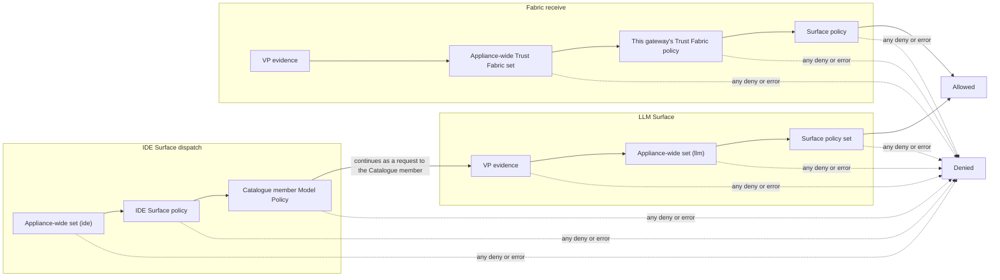
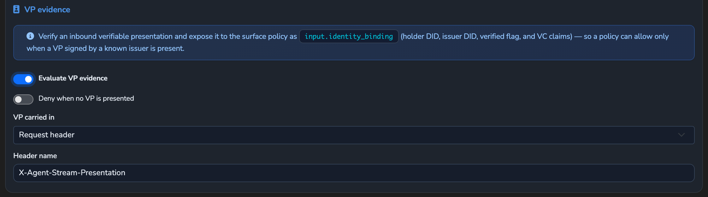
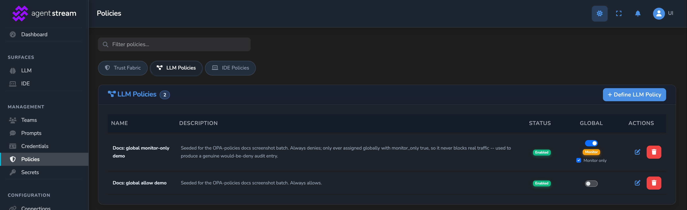
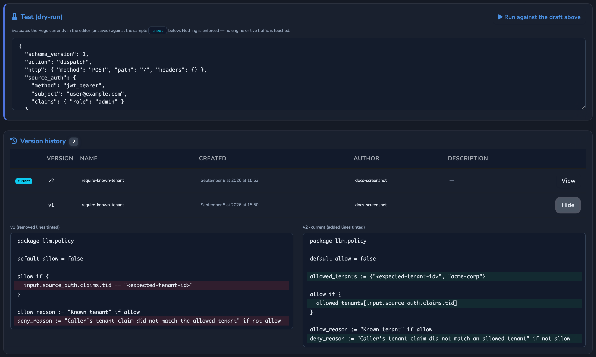

# Policy

How Agent Stream evaluates OPA (Rego) policy: the policy layers and their packages, the
order they run in, the `input` document each receives, versioned policy definitions,
appliance-wide enforcement, VP evidence, audit, and change control. For concepts and
walkthroughs, use the hosted
[OPA policies reference](https://docs.affinidi.com/products/affinidi-trust-fabric/agent-stream/reference/policies/opa-policies/).

Policy is evaluated in-process by [Regorus](https://github.com/microsoft/regorus) (Rust
Rego, no sidecar). The engine is in [`src/policies/opa.rs`](../src/policies/opa.rs), the
input contract in [`src/surface_context/mod.rs`](../src/surface_context/mod.rs), LLM and
IDE Surface engines and the appliance-wide sets in
[`src/pipes/policy_manager.rs`](../src/pipes/policy_manager.rs), and the Trust Fabric and
fabric surface managers in [`src/policies/`](../src/policies/).

## Layers and packages

Each layer queries a fixed Rego package. A policy that declares a different package
resolves to no value at that query and denies.

| Layer | Definition `policy_type` | Package | Query | Applies to |
| --- | --- | --- | --- | --- |
| Trust Fabric | `appliance` | `agentstream.policy` | `data.agentstream.policy.allow` | Requests received from a peer appliance over the Fabric |
| LLM Surface | `llm` | `llm.policy` | `data.llm.policy.allow` | LLM Surfaces and their Variants |
| IDE Surface | `ide` | `ide.policy` | `data.ide.policy.allow` | The IDE Surface front door, and each Catalogue member's Model Policy |
| Fabric surface | none | `surface.policy` | `data.surface.policy.allow` | The internal surface record (`AgentSurface`) a Fabric `forward-request` targets |

The three creatable definition types are `appliance`, `llm`, and `ide`. The
`surface.policy` layer is a runtime layer only: no creatable type declares its package.
Definitions stored with `package channel.policy` are migrated to `surface.policy` when
configuration loads (startup and config reload).

The LLM and IDE layers share one manager, which stores each compiled engine with the
query for its Surface type (`policy_query_for`). A Catalogue member's Model Policy is an
`ide` definition, evaluated at `data.ide.policy.allow` under the front-door identity. After
dispatch, the Catalogue member LLM Surface's own policy runs at `data.llm.policy.allow`.

## Order of evaluation

Every layer combines **deny-overrides** and fails closed: any deny, evaluation error,
missing engine, or missing, disabled, or uncompilable referenced definition denies. A
deny at an earlier layer is final; a later allow cannot override it.

The layers each path runs, in order:



### LLM Surface

After the Router and Variant stage and source authentication (see
[`../ARCHITECTURE.md`](../ARCHITECTURE.md#full-order)), `enforce_inbound_policy` in
[`src/pipes/handlers/http_handlers.rs`](../src/pipes/handlers/http_handlers.rs) runs:

1. **VP evidence**, when the Surface enables it. A required presentation that is missing
   or invalid answers `403` `vp_required` before any Rego runs.
2. **The appliance-wide set** for the Surface type (`llm`). Deny answers `403`
   `policy_denied` "Request denied by appliance-wide policy".
3. **The Surface policy set** (`opa_policy`). Deny answers `403`.

The same gate runs on chat, file upload, speech to text, and the file and batch `GET`
passthrough. Realtime voice evaluates the appliance-wide set and then the Surface policy at
session open, with `action: "connect"` and `resource.modality: "audio_realtime"`.

### IDE Surface

1. IDE source authentication, then the appliance-wide set for `ide`, then the IDE Surface
   policy (`ide.policy`).
2. The resolved Catalogue member's Model Policy (`opa_policy_id` on the Catalogue member,
   `ide.policy`).
3. The request continues as a request to the Catalogue member LLM Surface, which runs the
   LLM Surface order above, including the appliance-wide `llm` set.

### Fabric receive

In `enrich_and_evaluate_policies`, with the Trust Fabric layers in
`enforce_gateway_policies`
([`src/gateways/connection_points/message_processor.rs`](../src/gateways/connection_points/message_processor.rs)),
after sender authorisation, the surface record lookup, and source authentication:

1. **VP evidence**: a presentation carried by the `forward-request` is verified and becomes
   `input.identity_binding` for the surface layer.
2. **The appliance-wide Trust Fabric set** (`appliance`).
3. **This appliance's Trust Fabric policy set** (`opa_policy_config` on its own gateway
   record).
4. **The surface policy** (`surface.policy`, from the surface record's `target.policy`).

A deny at steps 2 or 3 answers a `forward-response` with status `403` "Request blocked by
gateway policy". A surface with a policy reference but no compiled engine answers `403`
"Agent trust policy could not be evaluated". Public discovery reads (see
[`SOURCE_AUTH.md`](SOURCE_AUTH.md#public-discovery-reads)) skip steps 3 and 4. The
appliance-wide set still evaluates them, with `request.purpose` `"discovery"` and no
`source_auth`, so an `appliance` policy that requires a signed-in caller refuses them
unless it allows `input.request.purpose == "discovery"`. A baseline that keeps agent
cards and UCP profiles discoverable while requiring sign-in for everything else:

```rego
package agentstream.policy

import rego.v1

default allow := false

allow if input.request.purpose == "discovery"

allow if input.source_auth
```

The Trust Fabric layers are skipped when neither an appliance-wide `appliance` set nor
this appliance's own Trust Fabric policy is configured. Once either is configured, it is
enforced fail-closed.

## Policy definitions

Every layer resolves its Rego from a stored policy definition, referenced by id. A
definition is a `PolicyDocument`
([`src/policies/policy_definitions.rs`](../src/policies/policy_definitions.rs)), one JSON
file per id:

| Field | Meaning |
| --- | --- |
| `id`, `name`, `description` | Identity and labels. Bindings resolve by `id`, so a rename never breaks enforcement. |
| `policy_type` | `appliance`, `llm`, or `ide`. Fixed after creation, because it fixes the package. |
| `enabled` | A disabled definition evaluates as missing, which denies. |
| `current_version` | The version enforced at runtime. |
| `versions` | Append-only list of `PolicyVersion`. |
| `sample_input` | Saved sample input for the dry run; not versioned. |
| `tenant_id` | Owning tenant, or absent for appliance-global. See [`ACCESS_TOKENS.md`](ACCESS_TOKENS.md#tenant-ownership). |

A `PolicyVersion` carries `version` (monotonic, 1-based), `policy` (the Rego),
`content_hash`, `created_at`, `created_by` (the authoring user), an optional `note`, and
the `name` and `description` as they stood for that version. Editing the Rego appends a
version and moves `current_version`; earlier versions are never changed.

### Content hash

```text
content_hash = "sha256:" + hex(SHA-256(policy_type ∥ 0x1e ∥ rego))
```

The type is mixed in, so the same Rego under a different type hashes differently. Every
decision made by a stored definition records the definition id, `policy_version`, and
`policy_content_hash`, so an audit or Governance Record resolves to the exact bytes
enforced.

### Write-time validation

Create and update validate before anything is persisted, and reject with `400`:

- unsafe ids, blank or oversized names, and oversized descriptions;
- an enabled definition with an empty body (a disabled draft may be empty);
- a package that does not match `policy_type`, or no leading `package` line;
- malformed Rego, or source over 128 KiB, 4,000 lines, or 4,096 columns;
- `numbers.range`, `http.send`, `opa.runtime`, and `print`;
- a read of `input.mcp`, `input.metadata`, `input.resource.tool` or `input.resource.route`,
  in dot or bracket form. No request carries these fields, so a rule using one would never
  match: a `deny` keyed on an MCP tool name would save and never fire.

`POST /v1/surfaces/validate-policy` runs the same checks without saving
(`policies.edit`), and inline gateway Rego is checked the same way when a gateway's policy
is updated. A policy already stored is not checked again when it loads, so one saved before
this check keeps loading after an upgrade and still never matches on those fields; edit it to
remove them. Only a direct read, in dot or bracket form with a literal key, is detected. These
are not refused, and still never match:

- copying `input` (or `input.resource`) into a variable and reading the field from that;
- `object.get(input, "mcp", {})` and the other `object` builtins;
- a computed key, such as `input[k]` or `input.resource[k]`.

### Runtime bounds

An evaluation fails closed after 100 ms. Serialized input over 256 KiB is refused. At most
32 evaluations and 4 compilations run concurrently, process-wide.

### Binding a definition

| Object | Field | Notes |
| --- | --- | --- |
| LLM or IDE Surface, and each Variant | `opa_policy { enabled, policy_definition_id, policy_definition_ids, log_decisions }` | `policy_definition_ids` adds further definitions to the set. Both `enabled` and a reference are needed. `log_decisions` logs the full input and decision for authoring; leave it off in production. |
| Catalogue member | `opa_policy_id` | The Catalogue member's Model Policy, an `ide` definition. |
| Gateway record | `opa_policy_config { enabled, policy_definition_id, policy_definition_ids }` | `appliance` definitions, deduplicated, evaluated as one set. A gateway with no reference falls back to inline `policy` Rego. |
| Fabric surface record | `target.policy { policy_definition_id }` | The referenced Rego must declare `package surface.policy`. |

### Live updates

Saving, disabling, or deleting a definition recompiles every engine that references it:
Surfaces and Variants, Catalogue members, fabric surface records, gateways named by
`policy_definition_id`, and the appliance-wide sets. A definition that is gone, disabled,
or fails to compile evicts the engine, so a previously compiled allow never stays active.
No Surface edit or restart is needed.

## Deny reasons

A policy can state its reason with sibling rules in the same package:

- `deny_reason := "..."` when `allow` is false. Without it the reason is
  `"Policy denied request"`.
- `allow_reason := "..."` when `allow` is true.

The reason is written to the decision log and the audit record. It is not returned to the
caller.

## The `input` document

Every layer serialises the same `PolicyInput` struct. Absent optional fields are omitted,
not `null`, so guard on presence before dereferencing.

```json
{
  "schema_version": 1,
  "environment": { "now": "2026-08-15T12:00:00Z" },
  "http": {
    "method": "POST",
    "path": "/llm/research/v1/chat/completions",
    "headers": { "content-type": "application/json" }
  },
  "gateway": { "direction": "inbound" },
  "channel": { "config_id": "0891830d-932b-4dbb-b0fb-ace92a0fbdaf", "name": "research" },
  "source_auth": { "method": "jwt_bearer", "subject": "user@example.com", "claims": { "role": "admin" } },
  "action": "dispatch",
  "resource": { "surface_type": "llm", "model": "gpt-4o-mini" },
  "identity_binding": {
    "verified": true,
    "agent_did": "did:web:example.com:caller",
    "gateway_did": "",
    "issuer_did": "did:web:issuer.example",
    "identity_fields": { "role": "admin" }
  }
}
```

`http.headers` has every header whose lowercased name contains `authorization`, `cookie`,
`token`, `api-key`, or `apikey` removed. Use `input.source_auth` for the caller's identity.

### Field availability

| Field | Trust Fabric | Fabric surface | LLM Surface | IDE Surface | Notes |
| --- | :-: | :-: | :-: | :-: | --- |
| `schema_version`, `environment.now` | ✓ | ✓ | ✓ | ✓ | Always present. `schema_version` is `1`. |
| `http.method`, `.path`, `.headers` | ✓ | ✓ | ✓ | ✓ | `http.path` is the client's request path, except on IDE Surface model discovery, where it is `/v1/models`. |
| `gateway.direction` | ✓ | ✓ | ✓ | ✓ | Always `"inbound"`. |
| `gateway.source_id` | ✓ | ✓ | | | The sending appliance's DID. |
| `channel.config_id`, `.name` | ✓ | ✓ | ✓ | ✓ | Surface id and name. |
| `channel.variant_alias` | | ✓ | | | The surface record's Variant. |
| `source_auth` | ✓ | ✓ | ✓ | ✓ | Only when the caller authenticated. |
| `action` | | | ✓ | ✓ | `"dispatch"`; `"connect"` for realtime. IDE: front-door dispatch only. |
| `resource` | | | ✓ | ✓ | See below. IDE: front-door dispatch only (`surface_type`, `model`). |
| `request.purpose` | ✓ | | | ✓ | `"discovery"` (`GET /v1/models`) or `"dispatch"`. Front door and Catalogue member Model Policy. Trust Fabric: `"discovery"` on a public discovery read only. |
| `request.forwarded_upstream_auth` | | | | ✓ | Present, as `true`, only when an upstream credential header was sent. |
| `identity_binding` | | ✓ | ✓ | | Fabric: when the presentation verified. LLM Surface: when VP evidence is on and a presentation was supplied. |
| `extension_identity` | | ✓ | | | `did`, `identity_hash` of the caller resolved from the request. |
| `agent` | | ✓ | | | `trust_verification`, `did`, `agent_dna`. |

On an LLM Surface chat request, `resource` carries `surface_type` and `model`, and when the
request asks for them `reasoning_effort`, `reasoning_max_tokens`, `requested_models`,
`requested_providers`, `requested_transforms`, `document_types`, `audio_formats`, and
`image_formats`, plus `server_tools` when the Surface has active server tools. File upload,
speech to text, and the passthrough reads carry only `surface_type`. Realtime carries
`surface_type`, `model`, and `modality`.

The input has no `mcp`, `metadata`, `resource.tool` or `resource.route` field, so a policy
cannot gate on an MCP method or tool name. Saving a policy that reads one is refused (see
[Write-time validation](#write-time-validation)).

An LLM Surface answers `…/v1/chat/completions`, `…/v1/messages`, and `…/v1/responses`. A
rule that matches only the chat path denies Anthropic Messages and OpenAI Responses
clients; match a common prefix instead (see
[`CLIENT_API_DIALECTS.md`](CLIENT_API_DIALECTS.md)).

### `source_auth`

`method` selects the shape:

```json
{ "method": "jwt_bearer", "subject": "user@example.com", "claims": { "role": "admin" } }
{ "method": "api_key", "key_name": "my-api-key" }
{ "method": "mtls", "principal": "spiffe://acme/agent-1", "fingerprint": "sha256:ab12...",
  "subject_dn": "CN=agent-1,O=Acme", "issuer_dn": "CN=Acme Root CA",
  "sans": { "dns": ["agent-1.acme.example"] } }
```

Empty `sans` arrays are omitted. See [`SOURCE_AUTH.md`](SOURCE_AUTH.md).

## VP evidence

An LLM Surface can require and evaluate a verifiable presentation. It is off unless the
`vp_evidence` block is present and enabled:

```json
{
  "vp_evidence": {
    "enabled": true,
    "require_present": true,
    "source": "header",
    "header_name": "X-Agent-Stream-Presentation"
  }
}
```

| Field | Default | Effect |
| --- | --- | --- |
| `enabled` | `false` | Evaluate VP evidence on this Surface. |
| `require_present` | `false` | Deny with `403` `vp_required` when no presentation is supplied or it cannot be verified. |
| `source` | `header` | `header`, or `body` (the `verifiable_presentation` field of the JSON body). The file and batch `GET` passthrough and the multipart upload routes carry no JSON body, so with `body` and `require_present` they are always refused; use `header` for a Surface that serves them. |
| `header_name` | `X-Agent-Stream-Presentation` | The header when `source` is `header`. |



The presentation is verified with the appliance's VC issuer
(`verify_presentation_with_issuer`). A verified presentation populates
`input.identity_binding` with `verified: true`, `agent_did` (the holder), `issuer_did`, and
`identity_fields` (the credential claims). When `require_present` is off, a presentation
that cannot be verified still populates `identity_binding` with `verified: false`.

Verification (`LocalVerifier::verify_vp`,
[`src/identity/ssi/verifier.rs`](../src/identity/ssi/verifier.rs)) fails closed unless all
of these hold:

- the presentation proof verifies and its `verificationMethod` is a DID URL of the VP
  `holder`;
- the presentation carries exactly one proof, and that proof's `expires` is in the future;
- every embedded credential's issuer is trusted: this appliance's own DID or a DID listed in
  `did.trusted_issuers` in `agent-stream.json` (checked before the issuer DID is resolved);
- every embedded credential's own proof verifies, and its `verificationMethod` is a DID URL
  of the credential's `issuer` (embedded method objects are refused);
- a `BitstringStatusListEntry` with purpose `revocation` or `suspension` points at a status
  list signed by the same issuer whose bit is clear. Another issuer's list is fetched over
  HTTPS from a public host only, without redirects, with a 10 s timeout and a 512 KiB limit;
  this appliance's own list is read locally. Any other `credentialStatus` type rejects the
  credential. A credential without `credentialStatus` is not status-checked.

A presentation accepted as VP evidence must also be fresh and used only once
(`accept_vp_challenge` in [`src/identity/vc_issuer.rs`](../src/identity/vc_issuer.rs)). Its
proof must expire no more than 6 minutes ahead (this appliance's own presentations last 5
minutes; the extra minute allows for clock skew), its `domain` must name this appliance's DID,
and its `challenge` must be one this Surface issued that has not been used and has not
expired. On a request dispatched through an IDE Surface, a challenge that IDE Surface issued
is accepted too. A challenge issued to an authenticated caller is accepted only on a request
authenticated as that same caller. A presentation without a challenge is refused. The
challenge is used up before the presentation is verified, so concurrent copies of one
presentation cost no signature check or DID lookup, and a presentation that then fails
verification, or whose request the policy refuses, has used its challenge too. The same
presentation cannot be replayed.

One presentation authenticates one request. Every request that carries one uses its
challenge, the file and batch `GET` passthrough reads included, so a caller asks for a new
challenge before each request and never sends the same presentation header twice: the second
request's presentation is unverified, and refused where the Surface requires one. A client
that polls a batch and then posts asks for a challenge before each of those requests; the
passthrough reads can return file contents, so they are not exempt.

A proof whose `expires` is out of range is refused with a reason that states how far off it
is, for example `presentation proof expires 412s ahead, ... more than the 360s allowed`, so a
clock that is ahead or behind shows in the log.

Cross-appliance Fabric identity therefore needs each peer appliance's DID in
`did.trusted_issuers`; otherwise the caller identity is recorded unverified. On Fabric receive
the challenge is the `forward-request` envelope's id instead of an issued one (see
[Presentation binding](FABRIC.md#presentation-binding)).

On Fabric receive, `identity_binding` also carries `gateway_did`, the sending appliance.

### Getting a VP challenge

Before each request that carries a presentation, the caller asks the Surface for a
challenge:

```http
POST {surface route}/v1/vp-challenge
```

```json
{
  "challenge": "Qm9yZWQ0c2t5LWNoYWxsZW5nZS1leGFtcGxlLXZhbHVl",
  "domain": "did:webvh:QmScid:agent-stream.example.com",
  "expires_at": "2026-10-22T10:05:00Z"
}
```

The caller signs its presentation with `challenge` and `domain` as proof options and sends
it before `expires_at`, 5 minutes after issue. The response carries
`Cache-Control: no-store`.

- The source authentication of the Surface asked runs first, the IDE Surface's own on an IDE
  Surface (`401` without a valid credential), so a caller without the Surface's credentials
  cannot tell whether it issues challenges. A disabled Surface has no route, so a request to
  it gets the same `404` as one to a route with no Surface. The inbound policy does not run,
  because a challenge grants nothing by itself; the policy runs on the request that carries
  the presentation.
- An enabled LLM Surface with VP evidence enabled issues challenges. So does an IDE Surface
  with an exposed, enabled Catalogue member that has VP evidence enabled, which evaluates the
  presentation after dispatch; a caller going through an IDE Surface asks the IDE Surface
  for the challenge. Any other Surface answers `404`.
- A challenge is redeemed only on the Surface that issued it, or, for an IDE Surface, on the
  member a request is dispatched to through it. A challenge issued to an authenticated caller
  is redeemed only by that caller; one issued to an unauthenticated caller by whoever presents
  it.
- Each caller holds at most 32 unused challenges on one Surface (`429` beyond that); a
  challenge stops counting once it is redeemed or expires. Callers are told apart by their
  source-authentication principal, and unauthenticated callers by their client address: the
  connecting address, or the `X-Forwarded-For` client when the connection comes from a proxy
  in `tls.client_auth.trusted_proxies`, the same rule as the sign-in limits. **Behind a load
  balancer or proxy, list it in `tls.client_auth.trusted_proxies`**: otherwise every
  unauthenticated caller shares the proxy's address and its 32 challenges, and one caller can
  hold them all. On a Surface with source authentication every caller is authenticated, so
  this only concerns Surfaces open to unauthenticated callers.
- Each Surface holds at most 100,000 unused challenges (`503` when full) and is kept apart from
  the others: a full or busy Surface does not affect them. Expired challenges are swept every
  minute; until then they still count towards the limit.
- Challenges are held in memory only. A restart or a standby promotion discards them, and the
  caller asks for a new one. A challenge is redeemable only on the instance that issued it,
  which is one reason to keep at most one instance Active (see
  [`CONFIGURATION_RELOAD.md`](CONFIGURATION_RELOAD.md#server-mode)).

### Revoking an agent identity

Every credential this appliance puts in a presentation carries a `BitstringStatusListEntry`
(purpose `revocation`) pointing at the appliance's own status list, served publicly at
`https://{did.domain}/credentials/status/revocation`
([`src/identity/status_list.rs`](../src/identity/status_list.rs)). Each local agent identity
holds one random index in that 131,072-entry list, so all of its credentials share it.

`POST /api/v1/agents/{did}/revoke` sets that index, which revokes every credential issued to
the agent, before or after the call. It needs `identity.issue`, refuses an access token
narrowed to a tenant or to resources, answers `204` (also when the agent is already revoked)
and `404` for a DID that is not a local agent identity. Revocation cannot be undone. Percent-encode
the DID in the path; a `did:web` port separator `%3A` becomes `%253A`.
`GET /api/v1/agents` reports `revoked` for each agent.

A verifier rejects a revoked credential the next time it reads the list. Credentials issued
before this appliance version carry no `credentialStatus` and cannot be revoked; they stay
valid until their `validUntil`, 365 days after issue. The JWT returned by
`POST /api/v1/identity/issue` carries no status entry either; presentations never embed it.

```rego
package llm.policy

default allow := false

allow if {
    input.identity_binding.verified
    input.identity_binding.issuer_did == "did:web:issuer.example"
}
```

## Appliance-wide enforcement

A policy can be enforced on every object of a type (a Global policy), independent of each object's own
configuration. The assignments are one document
([`src/policies/global_policy.rs`](../src/policies/global_policy.rs)):

```json
{
  "assignments": {
    "llm":       [ { "policy_id": "llm-baseline", "monitor_only": false } ],
    "ide":       [ { "policy_id": "ide-baseline", "monitor_only": false } ],
    "appliance": [ { "policy_id": "fabric-baseline", "monitor_only": true } ]
  }
}
```

| Key | Enforced on | Package |
| --- | --- | --- |
| `llm` | Every LLM Surface, including each Catalogue member when dispatched | `llm.policy` |
| `ide` | Every dispatch through an IDE Surface front door | `ide.policy` |
| `appliance` | Every request received over the Fabric | `agentstream.policy` |

Each list is evaluated deny-overrides, before the object's own policies. An assignment with
`monitor_only: true` is evaluated and recorded but never blocks.



The set fails closed. If an enforced (not monitor-only) assignment names a definition that
is missing, disabled, empty, or does not compile, every request of that type (for `ide`,
every dispatch) is denied and recorded as `missing_engine`. Deleting a definition does not remove it from the
assignments, so delete or replace the assignment first.

`PUT /v1/policy-assignments` rejects with `400` a definition that does not exist, whose
`policy_type` does not match the key, or that is tenant-owned. A tenant-scoped access token
is refused with `403`.

## Audit and attestation

Every decision is recorded through `record_policy_decision`
([`src/observability/policy_audit.rs`](../src/observability/policy_audit.rs)) to three
sinks:

| Sink | When |
| --- | --- |
| Structured `tracing` event | Always. Denials and failures at `WARN`, allows at `DEBUG`. |
| Prometheus counters | Always: decision counts and evaluation failures. |
| Durable, redacted JSONL record | When `audit_enabled` and the `policies` audit category are on in settings. Read live, no restart. |

A record carries scope (`pipe`, `ide`, `gateway`, `surface`), flow (`access_point`,
`fabric`), outcome (`allow`, `deny`, `error`, `missing_engine`), reason, policy id,
definition id, name, version and content hash, Surface id, trace id, HTTP method and path,
and a redacted caller summary (auth method, principal, DID), the gateway DID, and whether a
workload binding was present. It never records bodies, headers, credentials, or raw
presentations.

When a Surface has Governance Records enabled (`governance_recording`), an LLM Surface
policy denial also produces a signed `Blocked` Governance Record naming the deciding stage
(`vp_evidence`, `global_policy`, or the Surface policy) and the deciding policy's version
and hash. See [`GOVERNANCE_RECORDS.md`](GOVERNANCE_RECORDS.md).

## Change control

Policy routes are on the management API, gated by RBAC (see [`RBAC.md`](RBAC.md)). All four
permissions default to `administrator`.

| Route | Permission | Purpose |
| --- | --- | --- |
| `GET /v1/policy-definitions` | `policies.view` | List definitions |
| `POST /v1/policy-definitions` | `policies.edit` | Create |
| `GET /v1/policy-definitions/{policy_id}` | `policies.view` | Read the current version |
| `PUT /v1/policy-definitions/{policy_id}` | `policies.edit` | Append a version or change metadata |
| `DELETE /v1/policy-definitions/{policy_id}` | `policies.delete` | Delete |
| `GET /v1/policy-definitions/{policy_id}/versions` | `policies.view` | Version history, newest first, with author, time, hash, and note |
| `POST /v1/policy-definitions/{policy_id}/simulate` | `policies.view` | Dry run |
| `GET /v1/policy-definitions/{policy_id}/impact` | `policies.view` | Blast radius |
| `GET /v1/policy-assignments` | `policies.view` | Read appliance-wide assignments |
| `PUT /v1/policy-assignments` | `policies.publish` | Replace appliance-wide assignments |

Authoring (`policies.edit`) and fleet-wide enforcement (`policies.publish`) are separate
permissions, so they can be granted to different roles. Updating a definition that an
appliance-wide assignment references also requires the caller's role to hold
`policies.publish`; otherwise the update answers `403`.

### Dry run

`simulate` evaluates a sample `input` in a throwaway engine. Nothing is enforced and no
runtime engine is touched.

```json
{ "input": { "source_auth": { "method": "api_key", "key_name": "ci" } }, "version": 2 }
```

Send `version` to evaluate a stored version (default: current), or `policy` (and
optionally `policy_type`) to evaluate an unsaved draft. The response carries `allow`,
`reason`, `policy_type`, `version` (absent for a draft), `content_hash` of the exact Rego
evaluated, and `query`. Draft Rego and input are each limited to 128 KiB and 256 KiB, and
the evaluation to 2 seconds.



### Impact

`impact` returns `pipes` (LLM and IDE Surfaces), `surfaces` (fabric surface records),
`gateways`, `globally_enforced`, `global_types`, and `total`. Review it before an edit,
delete, or appliance-wide assignment.

### Tenancy

A tenant-scoped access token can read appliance-global definitions and reference them from
its own Surfaces, but can update or delete only definitions its tenant owns and its
resource pattern allows. See [`ACCESS_TOKENS.md`](ACCESS_TOKENS.md#tenant-ownership).

## Example policies

Trust Fabric (`agentstream.policy`), require a resolved peer DID and a JWT admin:

```rego
package agentstream.policy

default allow := false

allow if {
    startswith(input.gateway.source_id, "did:")
    input.source_auth.method == "jwt_bearer"
    input.source_auth.claims.role == "admin"
}
```

Fabric surface (`surface.policy`), require trust-registry verification, and admin for one
Variant:

```rego
package surface.policy

default allow := false

allow if {
    input.agent.trust_verification == true
    input.channel.variant_alias != "canary"
}

allow if {
    input.agent.trust_verification == true
    input.channel.variant_alias == "canary"
    input.source_auth.claims.role == "admin"
}

deny_reason := "requires a trust-verified agent" if not allow
```

LLM Surface (`llm.policy`), restrict by organisation claim and refuse high reasoning effort:

```rego
package llm.policy

default allow := false

allow if {
    input.source_auth.method == "jwt_bearer"
    input.source_auth.claims.org == "acme-corp"
    not input.resource.reasoning_effort == "high"
}

deny_reason := "caller org is not permitted" if not allow
```

IDE Surface front door (`ide.policy`), open discovery to authenticated callers and require
admin to dispatch:

```rego
package ide.policy

default allow := false

allow if {
    input.request.purpose == "discovery"
    input.source_auth
}

allow if {
    input.request.purpose == "dispatch"
    input.source_auth.claims.role == "admin"
}
```

Catalogue member Model Policy (`ide.policy`), restrict one model to a group:

```rego
package ide.policy

default allow := false

allow if {
    input.source_auth.method == "jwt_bearer"
    "premium-models" in input.source_auth.claims.groups
}
```

## Testing a policy

- Run the definition through `simulate` with representative inputs, including the
  unauthenticated case (no `source_auth`) and each ingress path your callers use.
- Roll out an appliance-wide policy as `monitor_only: true` first and watch the
  `policy_decision` records for would-be denials, then set it to `false`.
- Check `impact` before changing or deleting a definition other objects reference.
- Use `log_decisions` on a Surface's `opa_policy` while authoring to see the exact
  `input`, then turn it off.

### Common mistakes

| Mistake | Symptom | Fix |
| --- | --- | --- |
| Package does not match the layer | Query resolves to no value; every request is denied | Match the package to the layer (table above) |
| `policy_type` does not match the package | Create or update rejected with `400` | Align them |
| No `default allow` | Undefined result; denied | Declare `default allow := false` (or `true`) |
| Reading a credential from `input.http.headers` | Header absent | Credential headers are stripped; use `input.source_auth` |
| Comparing an absent field to `null` | Never matches | Absent fields are omitted; test for presence |
| Using `input.agent` or `input.extension_identity` outside `surface.policy` | Always absent | They are populated only on the fabric surface layer |
| Gating on `input.mcp`, `input.metadata`, `input.resource.tool` or `input.resource.route` | Save refused with `400` | No request carries them; gate on fields in [Field availability](#field-availability) |
| Matching only `/v1/chat/completions` on an LLM Surface | Anthropic Messages and Responses clients denied | Match a common prefix |
| Inline gateway Rego instead of a definition | No version or hash recorded; edits do not propagate | Reference an `appliance` definition |

## Known limitations

- **No creatable type for `surface.policy`.** A fabric surface record's `target.policy`
  must reference a definition whose Rego declares `package surface.policy`, which no
  creatable `policy_type` passes at write time.
- **VP evidence scope.** VP evidence applies to LLM Surfaces (including Catalogue members
  when dispatched) and to Fabric receive. An IDE Surface takes none of its own: saving an IDE
  Surface with VP evidence is refused with `400`, so set it on its member LLM Surfaces.
  Realtime voice sessions do not evaluate presentations.
- **VP challenges on an open Surface.** On a Surface without source authentication, callers
  are told apart only by client address. Many addresses together can fill the Surface's
  100,000 unused challenges, about 3,125 at 32 each, and new requests are then refused with
  `503` until the challenges expire, at most 5 minutes later; other Surfaces are unaffected.
  Behind a proxy that is not in `tls.client_auth.trusted_proxies`, every caller shares one
  address and its 32 challenges. Require source authentication on a Surface that requires
  presentations.
- **Monitor-only is per assignment.** `monitor_only` exists only on appliance-wide
  assignments, not on a Surface's own policy.
- **No per-evaluation memory quota.** Source and input bounds, the blocked builtins, the
  100 ms deadline, and the concurrency caps limit amplification, but there is no exact
  per-evaluation heap limit.
- **Impact is computed per request.** The impact view reads Surfaces, surface records, and
  gateways on each call.

## Related

- [`../ARCHITECTURE.md`](../ARCHITECTURE.md): the full request pipeline and the Fabric path.
- [`SOURCE_AUTH.md`](SOURCE_AUTH.md): source authentication, which runs before policy.
- [`RBAC.md`](RBAC.md): the `policies.*` permissions.
- [`ACCESS_TOKENS.md`](ACCESS_TOKENS.md): tenant ownership of policy definitions.
- [`GOVERNANCE_RECORDS.md`](GOVERNANCE_RECORDS.md): signed records of blocked requests.
- [`OBSERVABILITY.md`](OBSERVABILITY.md): audit sinks and forwarding.
- [`IDE_SURFACES.md`](IDE_SURFACES.md): IDE Surface dispatch and Catalogue member Model Policies.
- [`FABRIC.md`](FABRIC.md): Fabric connections and surface records.
- [`../CONTEXT.md`](../CONTEXT.md): the glossary.
