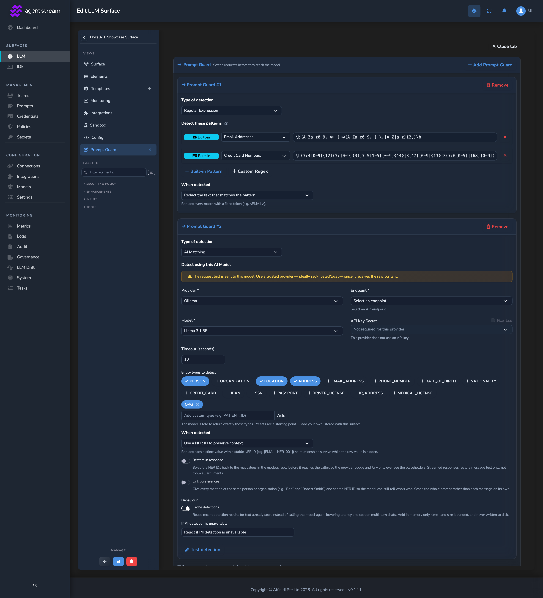
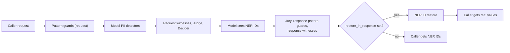

# Prompt Guard

How Prompt Guard detects sensitive data on an LLM Surface, what it does with a
match, and how NER IDs pseudonymise values and restore them in the response. For the
other safety stages and the pipeline order, see [GUARDRAILS.md](GUARDRAILS.md).
Hosted documentation:
[PII protection](https://docs.affinidi.com/products/affinidi-trust-fabric/agent-stream/concepts/pii-protection/).

## Overview

Prompt Guard inspects the text on a Surface and, for each match, rejects the call,
redacts the value, or replaces it with a NER ID. It is the only safety stage that
rewrites content. With NER IDs, the provider and every review stage see consistent
placeholders instead of real values, and the caller can still receive the real values
back.

```text
John Smith lives at 101 Main Street. John's email is john.smith@example.com.
[PERSON_NER_001] lives at [ADDRESS_NER_001]. [PERSON_NER_001]'s email is [EMAIL_NER_001].
```

Detection is two-layered:

- **Patterns.** Built-in and custom regular expressions, deterministic and in-process.
  On the request and the response.
- **Model-backed detection.** An OpenAI-compatible model you choose finds free-form
  values that patterns miss: names, addresses, organisations, locations, and any type
  you name. On the request only.



Prompt Guard is configured per Surface under `prompt_guard`
([`src/pipes/prompt_guard/config.rs`](../src/pipes/prompt_guard/config.rs)) and is off
until configured.

## Where it runs

On the request side, inside each executor attempt, in this order
(`execute_once` and `execute_streaming` in [`src/pipes/executor.rs`](../src/pipes/executor.rs)):

1. Pattern guards (`prompt_guard.request`), in list order.
2. Model PII detectors (`prompt_guard.llm_pii`), on the already-masked text.
3. Pronoun linking, when any request guard sets `link_pronouns`.

Then the request Expert Witnesses, Judge, and Decider run, then the model. On the
response side, after the Jury: pattern guards (`prompt_guard.response`), then the
response Expert Witnesses, then NER ID restore. The provider, Decider, Judge,
Jurors, and witnesses therefore only see the masked or pseudonymised text.



All request-side steps run on both the buffered and the streaming path. Response
pattern guards force the buffered path; see
[GUARDRAILS.md](GUARDRAILS.md#pipeline-order).

Detection and masking cover each message's `content` (a string, or the `text` parts
of a content array) and assistant `tool_calls[].function.arguments`.

## Configuration

```jsonc
"prompt_guard": {
  "enabled": true,
  "request": [
    {
      "regex": {
        "action": "mask",
        "mask_mode": "pseudonymize",
        "restore_in_response": true,
        "link_pronouns": false,
        "rules": [
          { "builtin": "email" },
          { "builtin": "ssn" },
          { "pattern": "ACC-\\d{6}", "label": "account_id" }
        ]
      }
    }
  ],
  "response": [
    { "regex": { "action": "reject", "rules": [ { "builtin": "credit_card" } ] } }
  ],
  "llm_pii": [
    {
      "provider_type": "openai",
      "endpoint_url": "/v1/chat/completions",
      "model": "gpt-4o-mini",
      "api_key_secret": "pii-detector-key",
      "entity_types": ["PERSON", "ADDRESS", "ORG", "LOCATION"],
      "action": "mask",
      "mask_mode": "pseudonymize",
      "restore_in_response": true
    }
  ]
}
```

| Field | Default | Meaning |
| --- | --- | --- |
| `enabled` | `true` | Turns the whole Prompt Guard on or off. |
| `request` | `[]` | Pattern guards on the request. |
| `response` | `[]` | Pattern guards on the response. |
| `llm_pii` | `[]` | Model PII detectors on the request. A single object is also accepted. |
| `external` | none | Legacy single external guardrail, migrated into an Expert Witness at runtime; see [GUARDRAILS.md](GUARDRAILS.md#legacy-prompt_guardexternal). |

A Variant can override `prompt_guard` as a whole; see [ROUTING.md](ROUTING.md).

## Pattern guards

Each entry in `request` or `response` is `{ "regex": RegexRules, "rejection": RejectionConfig? }`.

| `regex` field | Default | Meaning |
| --- | --- | --- |
| `action` | `reject` | `reject` blocks on the first match; `mask` rewrites every match. |
| `mask_mode` | `redact` | With `mask`: `redact` replaces each match with `<ENTITY>`; `pseudonymize` replaces each distinct value with a NER ID. |
| `restore_in_response` | `false` | Request side, `pseudonymize` only: put the real values back in the answer. |
| `link_pronouns` | `false` | Request side, `pseudonymize` only: link a pronoun to a lone named person. |
| `rules` | required | Built-in or custom patterns, applied in order. |

A rule is either `{"builtin": "<key>"}` or `{"pattern": "<regex>", "label": "<name>"}`.
Rules run in sequence, each on the output of the one before. With `reject`,
processing stops at the first match, which returns the guard's `rejection` or the
default 403 body
`{"error":{"message":"Request rejected: content violates prompt guard policy","type":"prompt_guard_violation","code":"content_policy_violation"}}`.
The `INFO` log line for the rejection names the built-in pattern or custom rule that
matched, never the matched text.

The entity name used in a placeholder is the built-in key upper-cased (`EMAIL`,
`PHONE_NUMBER`, `STREET_ADDRESS`), or a custom rule's `label` upper-cased. A custom
rule without a label redacts to `<MASKED>` and pseudonymises as `CUSTOM`.

### Built-in patterns

Built-in patterns are loaded once at startup from `prompt-guard.json`, named by
`prompt_guard` under `[config_files]` in `config.toml`
([`src/pipes/prompt_guard/definitions.rs`](../src/pipes/prompt_guard/definitions.rs)).
The shipped file is
[`config/examples/prompt-guard.example.json`](../config/examples/prompt-guard.example.json).
Each entry has a `key`, `label`, `icon`, `description`, and `regex`. An invalid regex
is skipped with a warning at load, and a rule naming an unknown key is skipped with a
warning at request time. `GET /v1/prompt-guard/config` serves the pattern list.

| Key | Matches |
| --- | --- |
| `email` | Email addresses |
| `ssn` | US Social Security Numbers (`NNN-NN-NNNN`), excluding invalid ranges |
| `ssn_simple` | Any `NNN-NN-NNNN` |
| `phone_number` | US, international (`+` country code), and Australian mobile numbers |
| `credit_card` | Visa, Mastercard, Amex, Diners Club, Discover, and JCB numbers |
| `date_of_birth` | Dates preceded by birth keywords (birth, dob, born) |
| `ip_address` | IPv4 addresses with octet validation |
| `passport` | US passport numbers |
| `street_address` | Basic US street addresses |

## Model-backed detection

Each entry in `llm_pii` (`LlmPiiConfig`) sends the request text to an
OpenAI-compatible chat-completions endpoint and asks it to return
`{"entities": [{"type", "text", "group"}]}`
([`src/pipes/prompt_guard/llm_pii.rs`](../src/pipes/prompt_guard/llm_pii.rs)).


| Field | Default | Meaning |
| --- | --- | --- |
| `enabled` | `true` | Runs this detector. |
| `provider_type` | `""` | Resolves a relative `endpoint_url` against the provider's base URL, like a Judge target. Empty means `endpoint_url` is a full URL. |
| `endpoint_url` | required | Full URL or a path such as `/v1/chat/completions`. |
| `model` | required | Detection model. |
| `api_key_secret` | none | Secret id for the detector's key, sent as a bearer token. |
| `entity_types` | `PERSON`, `ADDRESS`, `ORG`, `LOCATION`, `EMAIL_ADDRESS`, `PHONE_NUMBER` | Types the model is asked for; returned types outside the list are dropped. Any custom type name works. |
| `action` | `mask` | `mask` rewrites each value per `mask_mode`; `reject` blocks when any PII is found. |
| `mask_mode` | `pseudonymize` | `redact` or `pseudonymize`, with `action = mask`. |
| `rejection` | 403 prompt-guard body | Response for `action = reject`. |
| `restore_in_response` | `false` | Restore detected values in the answer. |
| `link_coreferences` | `false` | Collapse each coreference group to one NER ID. |
| `cache_detection` | `true` | Cache results in memory; see [Detector cache](#detector-cache). |
| `timeout_secs` | `10` | Per-call timeout. |
| `fail_closed` | `true` | When the detector is unavailable: `true` rejects the request, `false` continues with only the pattern masking already applied. |

With `action = reject`, `mask_mode`, `restore_in_response`, and `link_coreferences`
do not apply. `fail_closed` is separate from `action`: it decides what happens when
the detector errors or times out, not when it finds PII.

How detection works:

- The model returns values, not offsets. Each value is located in the text by
  substring match, with overlaps removed, so a model that rephrases a span cannot
  corrupt the request.
- Several detectors run concurrently, so the added latency is that of the slowest.
  Their results are applied one after another through one shared NER ID allocator,
  and a value caught by two detectors, or by a pattern and a detector, gets one ID.
  If any `reject` detector finds PII, the request is rejected.
- The system prompt is `pii_detection_prompt` at the top level of
  `prompt-guard.json`, with a built-in default when absent. `Allowed types: ...` is
  appended from `entity_types` on each call. The request asks for `temperature: 0`
  and JSON mode, adjusted by the model catalog for models that reject them.
- A detector with a stored key is checked against the caller's budget before the
  request makes any call; a budget refusal refuses the request even when
  `fail_closed` is `false`. A keyless detector is never refused for budget.

### Detector cache

With `cache_detection` on, results are cached per message, keyed by
`sha256(model, entity_types, message_text)`. A multi-turn chat re-sends earlier turns
verbatim, so only the newest message reaches the model; unseen messages are detected
in one batched call. With `link_coreferences` on, the cache is keyed on the whole
prompt instead, so the model still sees every mention together and only exact repeats
are reused. The cache is in memory only, never written to disk, and bounded to one
hour and 10,000 entries ([`src/pipes/prompt_guard/pii_cache.rs`](../src/pipes/prompt_guard/pii_cache.rs)).

### Detector health and test

| Route | Permission | Returns |
| --- | --- | --- |
| `GET /v1/prompt-guard/detector-stats` | `metrics.view` | Successful and failed detector calls since process start, and the error rate |
| `POST /v1/prompt-guard/detector-test` | `pipes.edit` | One live detector call against a sample sentence, cache bypassed: the detected entities or the error |

- A detector **with a stored API key** can be tested only after the surface is saved.
  The test sends the key only to the endpoint saved with it, and only with the saved model,
  so save a changed model before testing it. Only users who may view secrets
  (`secrets.view`) can save a stored key with a new endpoint.
- The test shows the endpoint's reply, so it refuses private, link-local, loopback and
  cloud-metadata addresses and follows no redirects. A self-hosted detector on a private
  network still works on live traffic but cannot be tested from the editor.
- A test waits at most 30 seconds for the detector, whatever `timeout_secs` says.

When a detector runs on a Surface with Governance Records on, the record gets a
`prompt_guard_model_pii` stage: `Observed` with the number of values masked and
detectors run, or `Flag` with the number of detectors that were unavailable when the
request continued with regex masking only. The stage never contains the value map.

## NER IDs

With `mask_mode: pseudonymize`, each distinct value becomes a NER ID of the form
`[{ENTITY}_NER_{NNN}]`, numbered from `001` per entity type in reading order.

- One allocator lives for one guard pass (the request side, or the response side) and
  is shared by every pattern guard and detector in that pass, across all messages. The
  same `(entity type, value)` always gets the same ID within a request.
- IDs are not stable across requests.
- The map from NER ID to value lives only for the request and is never written to
  disk. Governance Records store the caller's original request and the restored
  answer; the provider received only NER IDs.

### Name-variant linking

For `PERSON` values, a value whose name tokens are a subset or superset of a single
person already seen reuses that person's ID. Tokens are compared lower-cased, with
possessives, punctuation, and honorifics such as `Mr` and `Dr` removed. `John Smith`,
`John`, `John's`, and `Dr. Smith` all become `[PERSON_NER_001]`. A surname that
matches two known people is ambiguous and gets its own ID. Other types key on the
exact value.

### Pronoun linking

With `link_pronouns` on a request guard, a singular gendered pronoun (`he`, `him`,
`his`, `himself`, `she`, `her`, `hers`, `herself`) is replaced with a person's NER ID
only when exactly one distinct person ID appears before it in the message
(`link_pronouns_in_body` in [`src/pipes/prompt_guard/filter.rs`](../src/pipes/prompt_guard/filter.rs)).
With two or more people, or a pronoun before any person, it is left alone. `they` is
never linked. Pronouns are not PII, so this adds consistency, not privacy; with
restore on, the pronoun comes back as the person's name.

### Coreference groups

The detector tags each mention with a `group` shared by every mention of one
real-world entity, including aliases with no tokens in common (`Bob` and
`Robert Smith`, `Acme` and `Acme Corporation`). With `link_coreferences` on, every
mention in a group gets one NER ID keyed on the group's longest value, and restores
to that value. Only the values the detector returns are grouped, so common words are
never replaced. It applies with `mask_mode: pseudonymize`.

### Restore in the response

When a request pattern guard or a detector sets `restore_in_response`, the request's
NER ID map is kept for the response. After every model-facing stage, the real values
are spliced back into `choices[].message.content`, `delta.content`, and buffered
`tool_calls` arguments in one Aho-Corasick pass (`rehydrate_response`).

On a stream, a NER ID can be split across SSE chunks. The stream rehydrator
([`src/pipes/prompt_guard/stream_rehydrate.rs`](../src/pipes/prompt_guard/stream_rehydrate.rs))
holds back any trailing text that starts at an unclosed `[` and could still become a
NER ID, bounded by the longest ID, and emits completed IDs restored in one piece. Text
still held at the end is flushed before the final chunk. It is created only when a
restore map exists, so other streams pass through unchanged. A streamed Governance
Record holds the restored text the client received.

## Security and privacy

- **Trusted detector only.** The request text is sent to the detection model. Point
  it at a model you trust, ideally self-hosted.
- **Validated endpoint.** The detector's resolved endpoint is SSRF-checked when the
  Surface is saved (`LlmPiiConfig::validate`) and before each call.
- **Bounded input.** At most 256 KiB of text is sent to a detector
  (`MAX_DETECT_TEXT_BYTES`).
- **Injection-resistant framing.** The inspected text is wrapped in a per-call random
  delimiter, and a code-enforced instruction tells the model to treat it as data only,
  so a caller cannot easily talk the detector out of finding their PII. Pattern guards
  and `fail_closed` remain the hard backstops.
- **No persisted values.** The NER ID map and the detector cache stay in memory and
  are never written to disk.

## Known limitations

- Model-backed detection runs on the request only; the response has pattern guards.
- Text beyond the first 256 KiB of a request is not inspected by a detector.
- On a stream, restore covers `delta.content` only, not streamed tool-call argument
  fragments.
- NER IDs are stable within one request, not across requests.
- `prompt-guard.json` is read once at startup; editing it needs a restart.
- A content block cannot be retracted from bytes already streamed, which is why
  response pattern guards force the buffered path.

## Related

- [GUARDRAILS.md](GUARDRAILS.md): Expert Witness, Judge, Jury, and the pipeline order.
- [GOVERNANCE_RECORDS.md](GOVERNANCE_RECORDS.md): the `prompt_guard_model_pii` stage and recorded bodies.
- [PROVIDERS_AND_CREDENTIALS.md](PROVIDERS_AND_CREDENTIALS.md): secrets and the model catalog.
- [USAGE_LIMITS_AND_ATTRIBUTION.md](USAGE_LIMITS_AND_ATTRIBUTION.md): budget checks on detector calls.
- [RBAC.md](RBAC.md): `metrics.view` and `pipes.edit`.
- [CONFIGURATION_REFERENCE.md](CONFIGURATION_REFERENCE.md): `[config_files]` keys.
