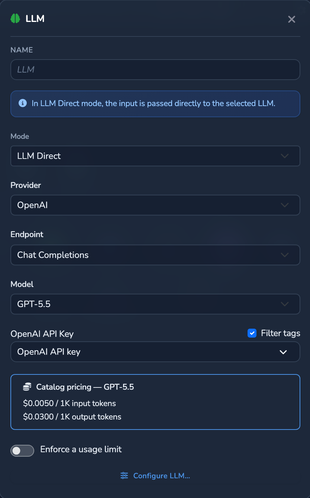
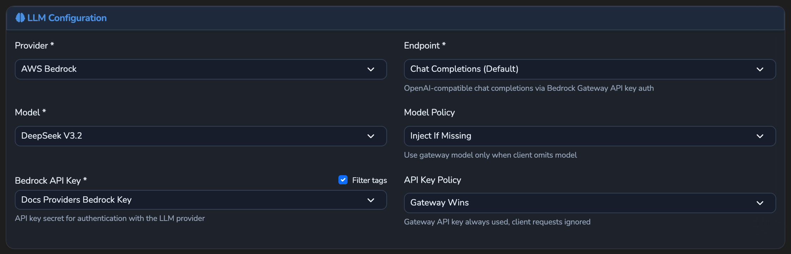
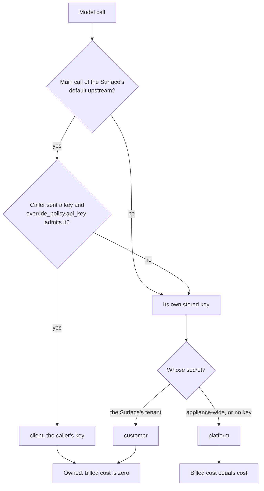

# Providers and Credentials

How an LLM Surface reaches its upstream provider: which provider types exist,
where model prices come from, which endpoints a Surface forwards, which
credentials each call sends, how the call is priced, and who pays for it.

For the product concepts, see the hosted
[Providers and models](https://docs.affinidi.com/products/affinidi-trust-fabric/agent-stream/concepts/providers-and-models/)
page. This page documents the implementation, mainly in
[`src/pipes/types/llm.rs`](../src/pipes/types/llm.rs),
[`src/llm_catalog/`](../src/llm_catalog/),
[`src/pipes/executor.rs`](../src/pipes/executor.rs),
[`src/pipes/upstream_headers.rs`](../src/pipes/upstream_headers.rs),
[`src/pipes/key_source.rs`](../src/pipes/key_source.rs),
[`src/pipes/metering.rs`](../src/pipes/metering.rs),
[`src/pipes/shared_credential.rs`](../src/pipes/shared_credential.rs),
[`src/secrets/mod.rs`](../src/secrets/mod.rs) and
[`src/identity/handlers/pipe_pricing.rs`](../src/identity/handlers/pipe_pricing.rs).

In code a Surface is a *pipe* (`PipeConfig`).

## Moving parts

| Part | What it is |
| --- | --- |
| Provider | The upstream vendor and wire format, chosen by `provider_type` in the Surface's `pipe_type.provider` block. |
| Model catalog | The administrator-owned list of providers, endpoints, models and their prices (`llm.json`, plus `custom_llm.json`). |
| Provider key | The upstream's own API key, a secret reference in the provider config (`api_key_secret`, or `auth_secret` on a `custom` provider) or on an LLM target. |
| Upstream headers | Extra operator-named headers sent to the Surface's own upstream, each value resolved from the secrets store (`upstream_headers`). |
| Target headers | The same list on an individual LLM target (`LLMTarget.headers`), sent only to that target. |
| Caller's key | A provider key the caller sends with the request, used only when the Surface's `override_policy.api_key` admits it. |
| Key source | The label on every model call saying whose credentials it used: `client`, `customer` or `platform`. |
| Declared price | A per-upstream price (`upstream_pricing`, `LLMTarget.pricing`) that takes precedence over the catalog. |
| Call budget | The member and team budget each platform-key call is checked against before it is sent. |

## Provider types

`LLMProvider` ([`src/pipes/types/llm.rs`](../src/pipes/types/llm.rs)) is
deserialised from `provider_type`. Each type has a wire format (`api_schema`)
and either appends the caller's path to its base URL or calls a fixed endpoint
(`LLMProviderExt::supports_path_suffix` in
[`src/pipes/types/llm_provider_ext.rs`](../src/pipes/types/llm_provider_ext.rs)).

| `provider_type` | Wire format | Caller's path appended |
| --- | --- | --- |
| `openai` and every preset below | OpenAI | Yes |
| `mistral`, `together_ai`, `cohere` | OpenAI | Yes |
| `ollama` | OpenAI, unless its `api_schema` names another | Yes |
| `bedrock` | OpenAI-compatible gateway; Claude models use InvokeModel with the Anthropic schema | Yes, except Claude models |
| `anthropic` | Anthropic Messages | No |
| `gemini` | Gemini `generateContent` | No |
| `azure` | OpenAI, at a fixed deployment URL (`deployment_name`, `endpoint`, `api_version`) | No |
| `replicate`, `huggingface` | Provider-specific | No |
| `custom` | OpenAI, at a full `endpoint`; its key is `auth_secret`, sent in `auth_header` (no key is sent when `auth_header` is unset) | No |
| `m365_copilot` | Microsoft 365 Copilot Chat API; see [M365_COPILOT.md](M365_COPILOT.md) | No |

A Claude model on `bedrock` (`anthropic.claude-*` or a cross-region `<region>.anthropic.claude-*`
id) is called at `bedrock-runtime.<region>.amazonaws.com/model/<model>/invoke`. The base
upstream, a Decider candidate and a Judge or Juror all send the Anthropic Messages body that
`transform_to_bedrock_anthropic_format` builds (no `model`, `anthropic_version:
"bedrock-2023-05-31"` in the body), and the Anthropic response is converted back to OpenAI
Chat. InvokeModel answers in one piece, so such a Surface never streams token by token, and
neither does a Surface with such a Decider candidate. Bedrock reads images and documents
only inline: a request carrying an image URL or a stored file reference (`file_id`) is
refused with `400 unsupported_content` before anything is sent.

Every Surface accepts all three client dialects by default, whatever its provider,
unless its Client API formats control restricts them; see
[CLIENT_API_DIALECTS.md](CLIENT_API_DIALECTS.md).

### OpenAI-compatible presets

`groq`, `xai`, `openrouter`, `fireworks`, `cerebras`, `deepseek`, `moonshot`,
`sambanova`, `hyperbolic`, `nvidia` and `nebius` build an `LLMProvider::OpenAI`
with a preset base URL from
[`src/pipes/defaults.rs`](../src/pipes/defaults.rs) when no `base_url` is
given. They reuse the OpenAI schema, headers and path handling and keep their
own `provider_type` for attribution and pricing. An explicit `base_url` wins.

| `provider_type` | Preset base URL |
| --- | --- |
| `groq` | `https://api.groq.com/openai` |
| `xai` | `https://api.x.ai` |
| `openrouter` | `https://openrouter.ai/api` |
| `fireworks` | `https://api.fireworks.ai/inference` |
| `cerebras` | `https://api.cerebras.ai` |
| `deepseek` | `https://api.deepseek.com` |
| `moonshot` | `https://api.moonshot.ai` |
| `sambanova` | `https://api.sambanova.ai` |
| `hyperbolic` | `https://api.hyperbolic.xyz` |
| `nvidia` | `https://integrate.api.nvidia.com` |
| `nebius` | `https://api.studio.nebius.com` |

The shipped catalog lists each preset with real model ids and no prices, so a
preset model costs nothing until a price is added (and an operator key will not
serve it on a tenant's Surface; see
[An operator key never serves an unpriced model](#an-operator-key-never-serves-an-unpriced-model)).
A vendor whose API sits under a non-standard path uses `custom` with a full
endpoint.

### Custom catalog providers

Any other `provider_type` is resolved against the merged catalog
(`resolve_custom_catalog_provider`): a provider defined in `custom_llm.json`
maps to the variant its `api_schema` implies, so it is usable in a Surface like
a built-in one. An unknown type that is not in the catalog fails to
deserialise.


## Model catalog

The catalog ([`src/llm_catalog/`](../src/llm_catalog/)) is a JSON document
`{ "providers": [ ... ] }`. Each provider carries its `enum_value`,
`default_base_url`, `api_version_prefix`, `api_schema`, endpoints and models.
Each model carries its `value`, `cost_per_1k_input`, `cost_per_1k_output`,
capabilities, parameters and request profile. The catalog feeds:

- every price no Surface declares itself;
- the request-shaping profile per model (parameter aliasing, stripping and
  required defaults; see [INFERENCE_CONTROLS.md](INFERENCE_CONTROLS.md));
- the dashboard's provider and model lists.



### Files

| File | Role |
| --- | --- |
| `llm.json` in `[storage_paths] llm_configuration` | The built-in catalog. Seeded once from `config_files.llm` (the example is [`config/examples/llm.example.json`](../config/examples/llm.example.json)); the storage copy is authoritative and never overwritten by the seed. |
| `custom_llm.json` beside it | Operator-defined providers, merged after the built-in ones. Never seeded. |

`LlmProviderCatalog` reads both from disk through a cache keyed on the two
files' modification times, so a manual edit or a catalog write takes effect on
the next read without a restart. A custom provider is dropped from the merge
when it lacks an identity, reuses a built-in `enum_value`, or repeats an
earlier custom one. A custom file that is not valid JSON is ignored as a whole.

Both files are checked against the embedded schema
[`config/schemas/llm_catalog.schema.json`](../config/schemas/llm_catalog.schema.json)
on every write through the API, and so is a single provider sent on its own
(`POST /api/v1/llm-providers` and `PUT /api/v1/llm-providers/{enum_value}`).

A provider's `default_base_url` is dialled with its provider key attached. On create,
update and custom save, a new or changed `default_base_url` must pass the
[strict outbound policy](INTEGRATIONS.md#strict-outbound-policy) (`check_base_url`,
`validate_resolved_webhook_url`); a URL it refuses gets `400`. The URL already stored
for the same provider passes, so built-in Ollama on `localhost` and a self-hosted
provider written to disk keep working; a built-in refresh is not checked. A URL that
passed the check is marked `default_base_url_public` (set by the server, never taken
from the request body), and the DNS check every outbound service client uses
(`validate_service_endpoint_addresses` in
[`src/url_validation.rs`](../src/url_validation.rs)) then refuses every address the
strict outbound policy refuses for that host at dial time, so a name that resolved
publicly at save cannot later be pointed at the internal network. A provider marked
public whose host is, or resolves to, a refused address, such as one in shared address
space (100.64/10) or the benchmarking range (198.18/15), fails every request until its
`default_base_url` is changed.

### Refreshing the built-in catalog

Refresh is on demand only; nothing polls for a new catalog.

- `llm_catalog.refresh_url` in `agent-stream.json` names a published
  `llm.json`. Absent or blank, the action is unavailable and
  `GET /api/v1/llm-providers/refresh` reports so, letting the dashboard hide
  the button.
- The URL is validated at startup (`LlmCatalogConfig::validate` in
  [`src/config/network.rs`](../src/config/network.rs)): it must be absolute,
  carry no credentials, use https and point at a public host. A plain http or
  private-network mirror needs `llm_catalog.allow_insecure_source: true`
  (default `false`); a URL naming a loopback, link-local or cloud metadata host
  is refused either way. Startup does not resolve the host; a name that resolves
  to such an address is refused by the refresh. A
  refused URL fails loading `agent-stream.json` (`NetworkConfig::load_from_file`).
- `POST /api/v1/llm-providers/refresh` checks the URL again
  (`validate_service_endpoint_url`: http or https, no loopback, link-local or
  cloud metadata host or resolved address)
  and downloads it with a 30-second timeout, no redirects and an 8 MiB cap.
  Unless `allow_insecure_source` is set, the download goes through
  `http_client::with_strict_validating_resolver`, which re-checks every
  resolved address at connect time against the
  [strict outbound policy](INTEGRATIONS.md#strict-outbound-policy). The document is validated against the schema and swapped
  in, keeping the previous file as `llm.json.bak`. A failed download or an
  invalid document leaves the catalog untouched.
- `POST /api/v1/llm-providers/refresh/rollback` restores `llm.json.bak`.

### Routes and permissions

Routes are in [`src/llm_catalog/router.rs`](../src/llm_catalog/router.rs).
Every route, reads included, needs the `llm_catalog.edit` RBAC feature
(`Feature::LlmCatalogEdit`, administrator by default; a token's permission
allow-list must name it), because the catalog prices every call no Surface
prices itself and its model switches decide what Surfaces may call. Surface
editors read the providers they pick from through `GET /v1/pipes/config` instead,
and the dashboard shows the **Models** page only to holders of
`llm_catalog.edit`.

| Method and path | Purpose | Feature |
| --- | --- | --- |
| `GET /api/v1/llm-providers` | The merged catalog | `llm_catalog.edit` |
| `GET /api/v1/llm-providers/{enum_value}` | One provider | `llm_catalog.edit` |
| `POST /api/v1/llm-providers` | Add a built-in provider | `llm_catalog.edit` |
| `PUT`, `DELETE /api/v1/llm-providers/{enum_value}` | Change or remove one | `llm_catalog.edit` |
| `GET /api/v1/llm-providers/custom` | The raw custom document and its parsed providers | `llm_catalog.edit` |
| `PUT /api/v1/llm-providers/custom` | Replace the custom document | `llm_catalog.edit` |
| `GET /api/v1/llm-providers/refresh` | Whether refresh is configured | `llm_catalog.edit` |
| `POST /api/v1/llm-providers/refresh` | Refresh from `refresh_url` | `llm_catalog.edit` |
| `POST /api/v1/llm-providers/refresh/rollback` | Restore the backup | `llm_catalog.edit` |

Every write checks each model's and endpoint's `cost_per_1k_input` and
`cost_per_1k_output` (`validate_catalog_prices` in
[`src/llm_catalog/store.rs`](../src/llm_catalog/store.rs)): 0 to 100 USD per
1K tokens.

## Model discovery

`GET {route}/v1/models` on an LLM Surface is answered by Agent Stream from the
Surface's own configuration, with no provider call (`serve_models_list` in
[`src/pipes/handlers/http_handlers.rs`](../src/pipes/handlers/http_handlers.rs)).
It returns an OpenAI model list: the base model plus each Variant's model,
deduplicated, with `owned_by` set to the provider type.

```json
{ "object": "list", "data": [
  { "id": "gpt-4o", "object": "model", "created": 1750000000, "owned_by": "openai" },
  { "id": "gpt-4o-mini", "object": "model", "created": 1750000000, "owned_by": "openai" }
] }
```

It reads only the Surface configuration: no source auth, policy or team gate
runs for it. On an IDE Surface the same path returns the caller's filtered
menu instead; see [IDE_SURFACES.md](IDE_SURFACES.md#model-discovery).

## Non-chat endpoints and passthroughs

The data plane is one wildcard route per Surface, so the path after the
Surface's route reaches the executor as the *path suffix*. On a provider that
appends it, a call to `{route}/v1/embeddings` is sent to
`{base}/v1/embeddings`. A provider with a fixed endpoint ignores the suffix and
stays chat-only.

| Request | How it runs |
| --- | --- |
| JSON endpoints: chat, embeddings, moderations, rerank, image generation | The full pipeline, like chat. |
| `POST /v1/audio/speech` (text to speech) | Every handler gate, then the request-side executor stages, then a binary passthrough. |
| `POST /v1/files`, `/v1/audio/transcriptions`, `/v1/audio/translations` with `multipart/form-data` | Upload passthrough. |
| `GET` under `/v1/batches` or `/v1/files` | GET passthrough. |
| `GET /v1/models` | Answered locally; see [Model discovery](#model-discovery). |

Audio and image specifics (formats, sizes, realtime) are in
[MODALITIES.md](MODALITIES.md).

### Usage on non-chat responses

The response parser (`parse_auto` in
[`src/pipes/parsers/llm_parser.rs`](../src/pipes/parsers/llm_parser.rs)) reads
`usage.prompt_tokens` and treats a missing `completion_tokens` as zero, so
embeddings bill input only. A response with no `usage` block (moderations,
rerank) is metered as zero tokens when the path suffix is not
`/chat/completions`; a chat completion without usage is still an error (502).

Request-side chat stages are inert on these bodies by construction: pattern
guards read `messages`, and parameter rules only inject a model's catalog
`required_params`.

### Binary passthrough (text to speech)

`is_binary_endpoint` (a suffix ending in `/audio/speech`) routes the request to
`PipeExecutor::execute_binary`, which:

1. refuses a path that does not decode to a speech endpoint on a provider that
   appends it (`binary_endpoint`), on every key, with 400
   `binary_endpoint_unsupported` (a fixed-endpoint provider would receive it at
   its chat endpoint);
2. runs the circuit breaker, rate limit, request Prompt Guard and request
   Expert Witnesses;
3. prepares the base provider, applies the SSRF guard, budget, metering and
   shared-credential checks, and sends;
4. returns the upstream bytes verbatim with the upstream `Content-Type`.

Response-side stages do not apply, and a binary response is never stored in
the response cache. Pricing is under
[Text to speech](#text-to-speech).

### Upload passthrough

A `multipart/form-data` POST to `/v1/files` or a speech-to-text endpoint goes
to `proxy_file_upload`: source auth, the inbound policy gate and the team gate
run, then `execute_upload` forwards the body verbatim and returns the
provider's JSON. There is no JSON body, so model checks and guards are inert.

### GET passthrough (batches and files)

A `GET` on a Surface route normally serves the dashboard's single-page app.
Before that fallback, `handle_pipe_health` matches the longest route and, when
`is_proxyable_get_path` holds, hands the request to `proxy_api_get`:

- the suffix must contain `/v1/batches` or `/v1/files`;
- a suffix with a `.` or `..` segment, or with `%`, `;`, `\` or a control
  character anywhere, is never proxied, because a decoding proxy or servlet
  container could resolve it to another endpoint, and a URL parser drops tab,
  CR and LF before it resolves dot segments.

`proxy_api_get` runs source auth, the inbound policy gate (appliance-wide and
Surface policy, with VP evidence) and the team gate, in chat's order. The
policy input carries `http.method: "GET"`, the raw path, `action: "dispatch"`
and `resource.surface_type`; there is no body, so no `resource.model`.
`execute_get` then runs the circuit breaker, rate limit, provider auth and the
SSRF guard and returns the upstream bytes with their `Content-Type`, including
binary `/content` downloads. There are no guards and no metering.

`POST /v1/batches` (create) is an ordinary JSON call on the buffered path.

On a platform key under a budget, batches, uploads and polls are refused by the
metering rule; on a credential the tenant does not own, reads and uploads are
refused by the shared-credential rule. See
[Unmetered endpoints](#unmetered-endpoints) and
[Shared operator credentials](#shared-operator-credentials).

## Upstream headers

An upstream sometimes authenticates the gateway separately from the model: a
mesh ingress, a reverse proxy, or a tunnel with its own ingress key. Upstream
headers let any provider type send that second credential alongside the
provider's own key.

Each entry is `UpstreamHeader { name, secret_id }`. The value is resolved from
the secrets store at request time and is never stored on the Surface.

```json
"upstream_headers": [
  { "name": "x-asp-api-key", "secret_id": "ingress-key" }
]
```

`PipeExecutor::append_target_headers` adds them inside
`resolve_provider_headers`, the single point every buffered, streaming,
Microsoft 365 Copilot and Decider-candidate send goes through.

### Per-target headers

Every LLM target carries its own list in `LLMTarget.headers`
([`src/pipes/judge_jury/config.rs`](../src/pipes/judge_jury/config.rs)), sent
with every call to that target and nowhere else:

| Caller of the target | How its headers are attached |
| --- | --- |
| Judge (LLM and moderation mode), Jurors, Decider router | `build_target_headers` in `src/pipes/judge_jury/executor.rs` |
| Route Candidate, Summariser merger | `resolve_provider_headers` with the target's own list |
| Comparer or Summariser Candidate | `run_candidate_upstream` |
| Failover, load-balancing, per-request routing and inline routing-rule targets | `clone_with_failover_target`, which puts the target's own `headers` and `pricing` on the copy |

A Candidate that names exactly the base provider still sends its own list,
never the base's. The executor cache key (`effective_target_identity` in
`src/pipes/handlers/http_handlers.rs`) hashes the upstream's headers and price
with its `pipe_type`, so an inline routing target that differs from the base
only in its headers never shares the base's executor.

### Headers stay with their upstream

Upstream headers are that upstream's credential, so they never reach another
upstream:

- `surface_headers_for` returns `PipeConfig.upstream_headers` only for a
  provider equal to the Surface's own `pipe_type`.
- A failover, load-balancing or per-request routing target gets its own
  headers from `clone_with_failover_target`; a Decider target passes its own
  list explicitly.
- A Variant that overrides `pipe_type` gets no upstream headers unless it
  declares its own. The field is Variant-overridable and replaced wholesale.

Headers are also bound to the **origin** they were configured for.
`resolve_provider_headers` (through `TargetHeaders`, which pairs a list with
its endpoint) and `build_target_headers` check the URL the call is about to
use; if its scheme, host or port differs, `upstream_headers::ensure_same_origin`
refuses the call with the generic `HEADERS_OFF_ORIGIN` error.

Some provider types (`anthropic`, `gemini`, `cohere`, `together_ai`,
`replicate`) ignore `endpoint_url` and always call their vendor's host. For
those, `clone_with_failover_target` carries a target's headers only when
`provider_calls_target_endpoint` holds, and save-time validation refuses
headers on any target whose provider would not call its own `endpoint_url`.

Every HTTP client that sends upstream headers refuses redirects
(`http_client::with_service_endpoint_resolver` for the Judge, Jury and Decider, and the
executor's buffered and streaming clients): reqwest strips `Authorization` on
a cross-origin redirect but not a custom header.

### Save-time validation

`LLMHandler::validate_config` checks the base config, every Variant and every
target's `headers` (the error names the target). It refuses:

- a name that carries a credential: `authorization`, `proxy-authorization`, `api-key`,
  `x-api-key`, `x-goog-api-key`, `anthropic-version`;
- a gateway-owned `x-agent-stream-*` name;
- a hop-by-hop or entity header;
- a malformed name, validated exactly as sent (surrounding whitespace is
  refused, not trimmed);
- a duplicate name, an entry with no secret reference, or more than 16
  entries.

The tenancy check (`src/identity/handlers/pipe_tenancy.rs`) takes every header's
secret on the base, every target and every Variant from `secret_bindings`
(see [Who may choose where a stored secret is sent](#who-may-choose-where-a-stored-secret-is-sent)),
so a tenant cannot name another tenant's secret.

### Missing secrets fail the call

An unresolvable secret fails that call before it is sent; dropping a header the
upstream requires would turn a configuration error into an opaque 401. The
caller and the governance failure record get only the generic
`upstream_headers::CREDENTIAL_UNAVAILABLE` message, for a header and the
provider key alike. The secret reference goes to the log line only
(`credential_unavailable`).

### Dashboard

The **Upstream Headers** card on the Surface's LLM config tab edits
`upstream_headers`, per Variant, following the server's resolve rules: absent
under a `complete` override or an upstream swap means none; absent on a sparse
same-upstream Variant means inherited. A half-filled row is dropped rather than
failing the save. Target `headers` ride inside the target objects unchanged.

## Secret references

A Surface's secret reference may be a secret's internal `id` or its public
`secret_id`. `crate::secrets::resolve_reference` resolves it: internal id first
(store-generated, so no tenant can shadow it), then public id. It is the only
resolver of a Surface's references, used by the save-time tenancy check
(`authorize_secret_reference`, which also requires a scoped token to admit the
resolved secret's public `secret_id`), the tenant-ownership scan
(`add_reference`), the saved-Surface connection test (`test_pipe`, gated on
`pipes.execute`: it sends the saved key only to the saved endpoint), the PII
detector test (`detector_test`: a test with a key requires the saved Surface,
uses only a detector saved there with the same provider, endpoint, model and key
(`saved_detector`), never a key reference from the request alone, resolves it
through `resolve_authorized_secret` with the Surface's tenant as owner, and
refuses internal endpoints because it returns the reply:
`validate_strict_service_endpoint_url` before the call, and the call through
`http_client::with_strict_validating_resolver`, which follows no redirect and
re-checks every DNS answer), the periodic health check (`perform_pipe_health_check` in `src/pipes/manager.rs`)
and every request-time path. So a request only ever sends the secret that was
checked.

Integrations reference secrets through `<key>_secret_id` and `headers_secret_id` in their
`configuration`, checked on save by the same `authorize_secret_reference` and resolved at
every delivery through `SurfaceSecrets` for the integration's tenant. Pairing a secret with
a new destination, on save or on test, also needs `secrets.view`; see
[`INTEGRATIONS.md`](INTEGRATIONS.md#secrets-in-integration-configuration).

### Request-time resolution

Every request-time resolver goes through `SurfaceSecrets`
([`src/secrets/mod.rs`](../src/secrets/mod.rs)), built with the Surface's own
`tenant_id`: `PipeExecutor` (`resolve_secret`); the Judge, Jury and Decider
(`execute_judge`, `execute_jury`, `execute_decider`); realtime voice safety and
the realtime relay; the semantic cache and drift embedders; and API-key source
auth (`get_cached_secret`, whose cache keeps each secret's tenant and re-checks
it on every hit).

`SurfaceSecrets::resolve` re-checks the resolved secret with
`can_reference(surface tenant, secret tenant)` and fails the call closed
otherwise. A public `secret_id` freed and re-registered by another tenant is
therefore never sent for, or accepted by, a Surface that may not use it.

### Who may choose where a stored secret is sent

Each secret a Surface sends goes to one destination, so whoever pairs them chooses
who receives the value
([`src/identity/handlers/pipe_secret_bindings.rs`](../src/identity/handlers/pipe_secret_bindings.rs)).
`secret_bindings` is the single walk over every outbound secret site of a resolved
view: the provider key and upstream headers (to the provider's `get_endpoint`), every
`LLMTarget` key and header (Judge, jurors, Decider router, candidates and Mirror
merger, failover, load-balancing and routing targets), the Prompt Guard external
guardrail and PII detectors, expert-witness guardrails, the cache and drift embedders,
and the web-search engine. Source-authentication secrets only check inbound callers and
are not included. The tenancy reference check (`pipe_tenancy`) takes its secret
references from the same walk.

A destination is who receives the key, not every character of the URL:

- Gemini, Replicate, Hugging Face, Azure OpenAI and Claude on Bedrock build the model,
  deployment or API version into the URL, so their destination is the URL's origin
  (scheme, host and port). Changing the model there is not a new destination.
- Every other provider keeps the full endpoint, path included, because the editor chooses
  the path and a shared gateway host can route by it.
- An `LLMTarget`'s destination is its configured `endpoint_url` template plus the origin
  of `resolved_endpoint`, so a model change counts only when a `{model}` in the host moves
  the key.

On every save path, `authorize_secret_binding_change` requires `secrets.view` (role,
and a token's permission allow-list must name it, through `PipeCaller::holds`, shared
with the pricing rule) when the save adds a (secret, destination) pair the stored
Surface and its Variants lack: a new key reference, or a new endpoint for a referenced
key. Keeping or dropping pairs needs nothing, so an editor can still change everything
else, and a tenant's token is exempt for secrets its own tenant owns. Because the
pairing is held here, the saved-Surface connection test and the keyed PII detector
test, which only send a saved key to its saved destination, need no more than running
or editing the Surface.

Pairs saved before this rule existed stay approved, so at startup the appliance logs every
stored pair once, for the base and every Variant: one `security_audit` line with
`event = "stored_secret_binding"`, the Surface's `pipe_id` and `tenant_id`, the
`secret_reference` (never the value) and the `destination` with any URL credentials,
query and fragment removed (`stored_bindings` / `log_stored_bindings`). Operators review
this list before rotating keys, because a rotated key keeps its reference and goes to the
same destination.

### Secret routes

The secrets API ([`src/secrets/router.rs`](../src/secrets/router.rs)) limits every read to
the caller's tenant and, for a resource-scoped token, to secrets inside its namespace:

| Route | Purpose | Permission |
| --- | --- | --- |
| `GET /api/v1/secrets` | List secrets, without values | `secrets.view` |
| `POST /api/v1/secrets/new` | Create a secret | `secrets.edit` |
| `GET /api/v1/secrets/settings` | `secret_types` and `reveal_values` from the `secrets` block of `agent-stream.json`, as loaded at startup | `secrets.edit` |
| `GET /api/v1/secrets/tag/{tag}` | List the secrets carrying a tag, without values | `secrets.view` |
| `GET /api/v1/secrets/{id}` | Read one; the value only while `secrets.reveal_values` is on (see [Reading a secret back](#reading-a-secret-back)) | `secrets.view` |
| `PUT /api/v1/secrets/{id}` | Update one | `secrets.edit` |
| `DELETE /api/v1/secrets/{id}` | Delete one | `secrets.delete` |

### Secret updates and deletes

Updating or deleting a secret through `PUT` or `DELETE /api/v1/secrets/{id}`
([`src/secrets/handlers.rs`](../src/secrets/handlers.rs)) does two things, so
the next request uses the stored value:

- clears the secret's entries, by internal and public id, from the shared
  secrets cache that API-key source auth reads (`clear_secret_cache`; entries
  otherwise live 60 seconds);
- drops every cached Surface executor (`pipes::cache::invalidate_executors`).
  An executor keeps every upstream secret it has resolved (provider keys,
  Judge and Juror keys, upstream header secrets, search engine keys) for as
  long as it is cached; the next request rebuilds it from the stored values.

### Reading a secret back

`secrets.reveal_values` in `agent-stream.json` (default `true`) controls
whether a stored value can be read back. With it `false`,
`GET /api/v1/secrets/{id}` answers the record without its value and the
dashboard's secret editor does not offer to show it; values can still be set
and replaced. It also stops anyone pointing an integration's secret reference at
a new destination, since that would send the value to a host they chose, except a
reference to the URL the integration's type delivers to, whose value only reaches that
URL's host, when nothing else secret or routing goes with it; see
[`INTEGRATIONS.md`](INTEGRATIONS.md#secrets-in-integration-configuration).

**Accepted remaining risk, for Surfaces.** `reveal_values: false` does not stop a
`secrets.view` holder from obtaining a value through a Surface: they may still pair the
secret with a host they control
(see [Who may choose where a stored secret is sent](#who-may-choose-where-a-stored-secret-is-sent))
and read it from the request the Surface sends there. `secrets.view` is
administrator-only by default, so this is accepted. Grant it only to people who may hold
the values. Integrations are stricter: with `reveal_values: false` no one may pair a
secret other than the URL the integration's type delivers to with a new integration
destination, and a tenant's own token still needs `secrets.view` to do it.

**Accepted remaining risk, for integrations.** With `reveal_values: false`, a
`secrets.view` holder who references a URL secret as an integration's URL learns that
URL's host and port: the save pins them and the response returns them. The rest of the
value is never returned, and the request is refused if anything else secret or routing
goes with it, or if a saved signing secret would follow a moved destination; see
[`INTEGRATIONS.md`](INTEGRATIONS.md#secrets-in-integration-configuration).

**Accepted remaining risk, for integration answers to callers without `secrets.view`.**
A caller with `integrations.edit` but without `secrets.view` cannot learn why a saved
reference fails, but still learns whether it works: a rename, test or trigger of an
integration whose references still resolve to the pinned destination succeeds, while one
whose secret moved, no longer holds an allowed URL or is gone gets the one `403` (or, for a
trigger, the fixed `500` message). Hiding that would mean refusing every save, test and
trigger of a referenced integration to such a caller, so it is accepted; see
[`INTEGRATIONS.md`](INTEGRATIONS.md#publishers).

### Reference shape

- A reference that is not shaped like an id (`is_reference_shaped`: 1 to 256
  letters, digits, `-`, `_` or `.`, never `..`) resolves to nothing without
  reaching a store.
- A new secret's `secret_id` must have the same shape (`validate_secret_id`,
  checked by `create_secret` and `FilesystemSecretsStore::create`).
- At startup `report_unreferenceable_secrets` logs the id of every stored
  secret whose `secret_id` is not reference-shaped, so an operator can
  re-create it under a valid one.
- The uncached filesystem storage refuses to build a path from an id with a
  separator, a parent-directory step or a NUL (`is_safe_entity_id`). A
  deserialisation error there logs only the error's kind and position, never
  the (possibly decrypted) content.

## Key sources

Every model call knows where its credentials came from
(`crate::pipes::key_source::KeySource`):

| Source | Meaning | Owned? |
| --- | --- | --- |
| `client` | The caller's own key from the request | Yes |
| `customer` | A secret of the Surface's tenant (`SurfaceSecrets::key_source`) | Yes |
| `platform` | An appliance-wide (operator) secret, or no key | No |

A call that sends credentials from two sources, such as a key plus
`upstream_headers` or target `headers`, is labelled with `KeySource::combine`
of them (`call_key_source`). The result is `platform` whenever any of them is
the operator's, so an owned key sent beside an operator ingress secret bills.
Only labels are ever logged, stored or sent; never key material.

### Choosing a call's key

`key_source::resolve_call_key(CallerKey, stored)` picks each call's key. The
caller's key is used only when it is `CallerKey::Offered` and the Surface's
`override_policy.api_key` admits it:

| `override_policy.api_key` | Key used |
| --- | --- |
| `client_wins` | The caller's key only |
| `inject_if_missing` | The caller's key, else the stored key |
| `gateway_wins` or unset | The stored key |

Otherwise the call uses its own stored key, resolved and labelled by
`SurfaceSecrets::resolve_key`.



Combined with the offering rules below and the billed-cost rules, a call's key and label
are chosen like this:



### Which calls are offered the caller's key

The caller's key, and identity pass-through (`forward_caller_token`), are
offered **only to the main call of the Surface's default upstream**:

- `resolve_provider_headers` takes `main_call`, which is false for a Decider
  Candidate, the Summariser merger and every Comparer or Summariser Candidate.
- Failover, load-balancing and per-request routed targets run on an executor
  built with `PipeExecutor::for_target` (`primary: false`) and get no caller
  headers.
- The handler also uses `PipeExecutor::for_target` for a routing rule's inline
  target, and for a Variant (canary split, routing rule or `$alias`) whose
  upstream is another provider type or origin than the Surface's default
  upstream (`PipeConfig::keeps_default_upstream`).
- The Judge, Jurors, Decider router, model PII detector, Expert Witness, cache
  and drift embedders and realtime relay pass `CallerKey::NotOffered`.

A caller-supplied body `api_key` is stripped from every call the caller's key
is not offered to, and from the whole-body text a Judge, moderation Judge or
Decider router evaluates when a request has no user text (`payload_text` in
`src/pipes/judge_jury/executor.rs`).

### Where the caller's key comes from

The HTTP handler resolves a request's `key_source::CallerCredentials` once
(`caller_credentials` in `src/pipes/handlers/http_handlers.rs`, also used by
the GET and upload passthroughs). Its `Debug` output redacts every value. It
holds `authorization` and `upstream_authorization`
(`X-Agent-Stream-Upstream-Authorization`) as received, which identity
pass-through forwards, and `provider_key`, the only value the `api_key` policy
may offer.

`provider_key` is the bearer token in `Authorization` (on the Anthropic
dialect `x-api-key` is copied there), else the one in
`X-Agent-Stream-Upstream-Authorization`. `Authorization` comes first because
the dedicated header is also the dual-token channel for a caller's upstream
identity, such as a Graph token for a Microsoft 365 Copilot member.
`provider_key` is never taken:

- from a header the Surface's front door reads
  (`SourceAuthConfig::reads_header`; `credential_header_name` returns a
  `jwt_bearer`'s own `token_header`);
- from either header on a request an IDE Surface dispatched (its
  `Authorization` belongs to the IDE front door and its dedicated header
  carries a member's identity token);
- from a value equal to a front-door credential
  (`SourceAuthMiddleware::is_front_door_credential`: the presented credential
  with or without its scheme, or any key of an API-key front door's secret,
  compared in constant time). This covers an SDK that fills `Authorization`
  from the key it also sends in the front door's header.

So a Surface whose front door reads `Authorization` takes the caller's key from
`X-Agent-Stream-Upstream-Authorization` alone. The sandbox treats its
`caller_token` as both.

Save-time validation (`LLMHandler::validate_caller_key_channel`, base and every
resolvable Variant) refuses `client_wins` or `inject_if_missing`:

- on a Surface whose front door reads `X-Agent-Stream-Upstream-Authorization`;
- on a Surface whose upstream stores no key (no `api_key_secret`, no
  `upstream_headers`) but declares a non-zero price (`upstream_pricing` or a
  `cost_tracking` price; `keyless_upstream_declares_a_price`). Such an
  upstream may not check the key, so any value would label its priced calls
  `client` and make them free.

### Identity pass-through

`forward_caller_token` sends the caller's bearer token (the
`X-Agent-Stream-Upstream-Authorization` value when present, else
`Authorization`) as the upstream `Authorization`. Save-time validation requires
`jwt_bearer` source auth, so the forwarded token has been verified. The call is
labelled `platform`, because the operator's upstream bills it, unless the
provider bills the signed-in user (`LLMProviderExt::requires_forward_caller_token`,
the `copilot` wire schema), where it is `client`. The response cache keeps a separate
scope for each forwarded token (see
[`RESILIENCE_AND_CACHING.md`](RESILIENCE_AND_CACHING.md#keys-and-scopes)).

### A refused caller key is final

An upstream refuses the call's credentials (`refuses_credentials`) with any 401
or 403, or a 400 carrying Google AI Studio's `API_KEY_INVALID` reason, the
`invalid_api_key` code, or xAI's `Incorrect API key provided`. When the call
sent a credential of the caller's (`ProviderHeaders.sent_caller_credential`:
its own key or a forwarded identity token), the refusal becomes
`PipeError::CallerKeyRejected`: never retried or failed over, not a
circuit-breaker failure, and returned with the upstream's status and code
`caller_key_rejected`. A refusal of a stored key stays `UpstreamResponse` and
fails over normally.

No refusal keeps the provider's body, because it can echo part of the key: not
in the error, the log, the Governance Record or the caller's response. The
Judge, Jurors, Decider router and Comparer or Summariser Candidates follow the same rule.

## Shared operator credentials

A provider keeps files, batches, vector stores, stored responses and
conversations per key, so every tenant whose Surfaces spend the same operator
key shares one store. When a tenant's Surface spends a credential its tenant
does not own (an operator provider key, an operator secret in
`upstream_headers`, or a forwarded identity token), it runs inference only
([`src/pipes/shared_credential.rs`](../src/pipes/shared_credential.rs)):

- a caller-chosen path must name a stateless endpoint (`is_inference_path`):
  `/chat/completions`, `/completions`, `/responses`, `/embeddings`,
  `/messages`, `/audio/speech`, `/images/generations`, `/moderations` (each
  bare or under `/v1`), or a Gemini `models/{model}:generateContent` or
  `:streamGenerateContent`. An empty suffix (the configured endpoint) is
  allowed;
- the body must not name a provider-stored object (`names_stored_object`):
  file ids, vector stores, stored responses, batches, cached content, file
  search, a container by id, a custom skill, a stored conversation or a stored
  prompt;
- file and batch reads and file uploads are refused outright.

Refusals are 403 with `shared_credential_read_refused`,
`shared_credential_upload_refused` or `shared_credential_call_refused`. Speech
to text stays allowed.

This rule follows ownership and applies with or without a budget; the metering
rule follows the key source and applies only while a budget is in scope. Both
run before anything is sent, in this order: spent budget
(429 `team_quota_exceeded`), metering (403 `*_not_metered`), then this rule.
So under a budget a tenant's file read, upload or batch on the operator's key
gets the metering refusal, and the shared-credential codes appear only for a
call metering admits, such as a chat completion that names a stored file. Any
spend a refused request already incurred, such as a Judge call, is billed
before the refusal is returned.

## Pricing

### Declared prices

`TargetPricing { input_per_million, output_per_million }`
([`src/pipes/types/llm.rs`](../src/pipes/types/llm.rs)) on `LLMTarget.pricing`
and `PipeConfig.upstream_pricing` is the upstream's own price. It is
Variant-overridable like `upstream_headers`: a Variant that swaps `pipe_type`
without its own price inherits none.

A declared price is used as-is, **zero included**, ahead of the `cost_tracking`
override and the catalog, so an operator's own model named like a catalog
model (`gpt-4o`) is never charged from the catalog. It applies in every
bucket: the main stage (`calculate_main_llm_cost`, failover attempts through
the clone's `upstream_pricing`), the streamed main stage
(`StreamingUpstream.pricing`), Comparer or Summariser Candidates and the merger, the Judge,
Jury and Decider (`display_stage_usage`), and the `lowest_cost` load-balancing
pick and per-request `max_price` and `sort: price` routing. Targets that
declare nothing use the override or the catalog.

### Price limits

- A declared price is checked as it is read (`#[serde(try_from)]`): finite,
  0 to `MAX_PRICE_PER_MILLION_TOKENS` (100,000 USD per 1M tokens).
- At save, the `cost_tracking` override must be 0 to 100 USD per 1K tokens.
- `TokenPricing::calculate_cost` and every running total (`BudgetTracker`,
  `TeamUsageTracker`) add `billable_cost`, never below zero.

Every save path, including the Variant API and promote, runs
`LLMHandler::validate_config`. The dashboard form round-trips
`upstream_pricing` unedited.

### Who may price an upstream

Every budget counts the cost these prices produce, so the price of an upstream
belongs to whoever pays it
([`src/identity/handlers/pipe_pricing.rs`](../src/identity/handlers/pipe_pricing.rs)).

**Tenant Surfaces.** At save, inside `validate_pipe_references` (create,
update, both Variant APIs, promote), `validate_declared_price_secrets` resolves
every secret each priced upstream sends (its key and every header's secret, on
the base and every resolved Variant). On a tenant's Surface the save is refused
unless each is the tenant's own. An upstream that sends no secret may carry a
price.

**Appliance-wide Surfaces, or callers with no tenant context.**
`authorize_price_change` requires the `pipes.pricing` RBAC feature
(`Feature::PipesPricing`, administrator by default; a token's permission
allow-list must name it) when the save adds a price site the stored Surface lacks.
A price site is an upstream (provider, model, endpoint and the secrets it
spends), the bucket its spend is counted in (`llm`, `judge`, `jury` or
`decider`), and its price and that price's source (declared or the override).
Keeping, dropping or not touching stored prices needs nothing; moving a kept
price onto another key, into another bucket, or between the override and a
declared price needs the feature.

**At request time** the resolved secret's tenant rides back from resolution
(`ProviderHeaders.own_price_honoured`, `TargetCallHeaders`,
`StreamingUpstream.own_price_honoured`). When a tenant's Surface spends an
operator secret, `priced_cost` bills the highest of the declared price, the
override and the catalog price, so a stored price can never lower what the
operator's key costs.

### The model a call is billed for

A caller may name its own `model` unless `override_policy.model` is
`gateway_wins`, so every bucket prices, and applies the catalog floor to,
`model_run` ([`src/pipes/executor.rs`](../src/pipes/executor.rs)):

| Provider | Model billed |
| --- | --- |
| Runs the model a request names (`LLMProviderExt::runs_requested_model`): OpenAI and presets, Anthropic, Mistral, Together AI, Cohere, Ollama, Custom, non-Claude Bedrock | The `model` in the outbound body |
| Fixed by endpoint or deployment: Gemini, Claude on Bedrock, Azure OpenAI, Replicate, Hugging Face, Microsoft 365 Copilot | The configured model |

This covers the buffered and streamed main stage, Comparer or Summariser Candidates, and
failover, load-balancing and routing copies. The Judge, Jurors and Decider
router always send their target's own `model`. Every catalog price used for
billing comes from `catalog_price`.

### An operator key never serves an unpriced model

Before anything is sent, `ensure_priced_spend` refuses a call whose
`own_price_honoured` is false (a tenant's Surface spending an operator secret)
when the catalog has no price for the model it would run. The error is the
generic `MODEL_NOT_PRICED`. The check runs on the buffered and streamed main
stage, each Comparer or Summariser Candidate, and every Judge, Juror and Decider router call
(`ensure_target_priced`). Calls on the tenant's own secrets, or on an
appliance-wide Surface, keep their declared price, the override or zero.
Pricing a model at zero in the catalog lets an operator key serve it.

### Text to speech

Text to speech is priced by characters, not tokens. `execute_binary` counts the
characters of the body's `input` text (`binary_input_units`) and prices them as
input units at the upstream's input price (declared, override, then catalog),
which is per 1K characters for a catalog price, the unit OpenAI prices `tts-1`
in. A body with no `input` text costs nothing.

The handler records `BinaryResponse.cost` and its `billed_cost()` by key source:
the billed cost into the member budget, and (when `enable_metrics` is on) the
cost into the usage series. Both record **zero tokens**: the character count
is used only to compute the cost. The response carries
`x-agent-stream-cost-usd`, `x-agent-stream-billed-cost-usd` and
`x-agent-stream-key-source`.

On a platform key under a budget, a speech model with no price, or one the
catalog prices by output, is refused with 403 `model_not_metered`; see
[Unmetered endpoints](#unmetered-endpoints).

### Realtime

Realtime has no price model. A realtime turn records `billed_cost` as `0` on an
owned key and leaves it unset on a platform key. The voice-safety Jurors' text
usage is billed per turn: `RealtimeGuard` hands it over in
`GuardOutcome.jury_usage`, and the relay records it with `record_team_usage`
against the gate's `TeamUsageContext` (`SessionCtx.team`).

## Billed cost

| Field | Meaning |
| --- | --- |
| `StageUsage.cost` | Catalog-priced spend, whatever the key |
| `StageUsage.billed_cost` | Zero for an owned key, else `cost` (`StageUsage::call`) |
| `StageUsage.key_sources` | Calls per key source |
| `ExecutionMetrics.billed_cost` | Grand total billed |
| `ExecutionMetrics.key_source` | The main call's source |

The member and team budget (`record_team_usage`) counts **billed** cost only.
Tokens and the per-Surface budgets still count everything. The figures
surface in:

- **Response headers:** `x-agent-stream-billed-cost-usd` and
  `x-agent-stream-key-source`, beside `x-agent-stream-cost-usd`; see
  [OBSERVABILITY.md](OBSERVABILITY.md).
- **Telemetry:** a `Sample` stores `owned_cost` and `key_sources`; series
  points expose `billed_cost` and `requests_by_key_source`. Grand-total series
  count requests by the main call's key; stage series count that stage's calls.
- **Spend report:** `catalog_cost_usd`, `billed_cost_usd` and
  `requests_by_key_source`; the CSV adds
  `billed_cost_usd,requests_client,requests_customer,requests_platform`.
- **Governance:** `RecordMetrics`, `StageUsageEntry` and `StageEntry` carry
  optional `billed_cost` and `key_source(s)`, omitted when absent so older
  records keep their hash.

### Failed requests bill what they spent

A buffered attempt that fails, or is blocked by a response-side guard or
Witness, after its Judge, Decider router, Comparer or Summariser Candidates or main calls ran
carries their spend:

- `PipeError::with_incurred` records it per attempt in `execute_once`. A
  content rejection carries it as its own usage; a Judge or Jury rejection
  already carries the attempt's whole spend.
- Retries and failover, load-balancing and routing pools carry every failed
  attempt's spend forward (`take_incurred`), onto the final error or into the
  serving attempt's metrics (`ExecutionMetrics::absorb_incurred`).
- A server-tools turn that fails carries the turns already served.

The buffered handler records that spend to the member budget, the usage series
and the governance failure record, as the streaming path does.

### Streams always bill

On a key that bills:

- `request_usage_chunk` forces `stream_options.include_usage` on the
  completions shape (`metering::is_completions_call`).
- `streaming::StreamMeter` reads usage from chat usage chunks, Responses
  `response.completed`, Anthropic `message_start` and `message_delta` (with
  cache counts, 1-hour writes included) and Gemini chunks. It counts streamed
  output, and takes reported usage only from a final event. Gemini
  `thoughtsTokenCount` bills as output.
- When the client disconnects, the reader drains the upstream until that final
  event, within these bounds; each drain holds a `DrainPermit`, and past a
  concurrency cap the stream stops at once.

| Bound | Value |
| --- | --- |
| `DRAIN_MAX_SECS` | 600 seconds |
| `DRAIN_MAX_BYTES` | 32 MiB |
| `DRAIN_MAX_PER_MEMBER` | 16 concurrent drains |
| `DRAIN_MAX_PER_SURFACE` | 256 concurrent drains |
| `MAX_PENDING_BYTES` | 8 MiB for one final line |

When the final usage never arrives, `StreamOutcome::billed_tokens` bills the
larger of the partial usage and a `StreamEstimate`:

- the whole request, by `estimate_request_tokens`;
- output text with each ASCII digit as a token, other ASCII at four characters
  a token and other scripts at two bytes a token;
- images at `INLINE_MEDIA_TOKENS` (1,600);
- a reasoning model's cap or `REASONING_ALLOWANCE_TOKENS` (16,384), a floor
  that also applies to any stream a drain cut or the caps refused
  (`StreamOutcome.drain_cut`), whatever the model.

Estimated usage is flagged as `usage_estimated` in governance and counted in
`agent_stream_stream_usage_estimated_total`.

## Budget checks

### The team gate

The team gate (`team_pre_check`) checks access, per-minute rates and token caps
(`TeamUsageTracker::token_block_reason`). It does not refuse a spent budget;
that happens per call.

On a Surface that enforces usage, a gate that cannot run (no member or team
store, or no member and no seeded anonymous member) refuses the request with
503 `team_gate_unavailable` instead of skipping, so no request runs without a
budget in scope. On such a Surface the gate hands the request a
`teams::call_budget::CallBudget` (member, teams, `allow_individual_overage`) in
`TeamUsageContext.call_budget`. See
[USAGE_LIMITS_AND_ATTRIBUTION.md](USAGE_LIMITS_AND_ATTRIBUTION.md).

### Per-call admission

The request runs inside `call_budget::scope`, set by `run_in_request_context`
and the GET and upload passthroughs. Drift replay scopes each session with the
Surface owner's budget.

Every model call asks `executor::admit_call(key_source, BudgetedCall, ..)` just
before it is sent: an owned key always runs; a platform key is refused with
`PipeError::BudgetExhausted` while `TeamUsageTracker::budget_block_reason`
(member, then team budgets) says the budget is spent.

The budget is read once, at the request's first platform-key call, and that
answer holds for the rest of the request (a `tokio::sync::OnceCell` in the
`CallBudget`). A request that started billing runs to completion and is
recorded whole; a refusal can only come before the request has billed
anything.

| Call | Effect of a refusal |
| --- | --- |
| Upstream (`BudgetedCall::Upstream`): main call, stream, failover, load-balancing or routed target, Comparer or Summariser Candidate or merger, passthrough | The target is unavailable: `moves_to_next_target` hands the request to the next target, and `pool_exhausted` returns the refusal when none served. Never retried; never reaches the circuit breaker. |
| Safety or decision stage (`BudgetedCall::Stage`): Judge, Juror, Decider router, LLM PII detector, Expert Witness | The request is refused, whatever the stage's own `fail_open` / `fail_closed` policy. |
| Embedder | `EmbedError::BudgetRefused`: the semantic cache serves as on a miss, drift skips the distance sample, and a refused drift replay stops the run (`RunStatus::Stopped`). Each is counted in `agent_stream_budget_skipped_total{kind}`. |

The handlers answer a refusal with the team gate's 429 `team_quota_exceeded`
body (`platform_refused`), a `team_gate` governance block and a `pipe.error`
event.

### Keyless calls

Who pays an upstream that receives no credential is not knowable. A keyless
call (`ProviderHeaders.keyless`, `TargetCallHeaders.keyless`) asks the budget
only when it is priced: its declared price, the override, or the catalog price
of the model it runs (`keyless_call_priced`, `target_priced`). A file upload or
poll (`UpstreamCall::Upload`, `UpstreamCall::Poll`) bills nothing. A keyless
LLM PII detector, Expert Witness or embedder never asks.

### Stages are admitted up front

`admit_platform_stages` (buffered model turns and streams) asks the budget
about every Judge, Juror, Decider router, LLM PII detector and Expert Witness
the Surface runs on a platform key, and about the Summariser merger (as an
upstream, so a failover target may still serve), before the request makes any
call. It resolves their keys without calling. So a response-side Jury or
Witness never refuses a request after the customer's own main call ran.

### Unmetered endpoints

While a budget is in scope, `resolve_provider_headers` refuses a platform-key
call whose spend Agent Stream does not meter, whether or not the member has
credit left: `PipeError::NotMetered { unmetered, call: Upstream }`
(`PipeExecutor::metered`, by `UpstreamCall`; rules in
[`src/pipes/metering.rs`](../src/pipes/metering.rs)).

| Call | Metered when |
| --- | --- |
| Model call to the configured endpoint | Always |
| Model call whose path the caller chose (an appended suffix) | Only chat completions, messages, embeddings and non-`background` Responses (`metering::json_call`, matched percent-decoded with dot segments resolved; an ambiguous decoding is never metered) |
| Binary call | Only `audio/speech` (`metering::binary_call`), and only for a priced model (its own price where `own_price_honoured`, else the catalog's) without a catalog output rate |
| Upload or poll | Never |

`metering::request_body` also refuses, on every model call:

- hosted tools, `plugins`, `web_search_options`, `search_parameters` and
  search models (`tool_not_metered`);
- audio or image output (`modality_not_metered`). An image-output model
  (`metering::is_image_output_model`: `-image` or `nano-banana` in the id) is
  refused unless the catalog prices its image output
  (`cost_per_1k_output_image`);
- stored provider context, `previous_response_id` or `conversation`
  (`stored_context_not_metered`);
- a Gemini Pro request above 200k estimated tokens unless the catalog prices
  that tier (`context_not_metered`). With a tier, `catalog_price_for_input`
  prices it; with no tier, reported input above the threshold bills at
  `LONG_CONTEXT_INPUT_RATIO` (2x) and `LONG_CONTEXT_OUTPUT_RATIO` (1.5x).

`strip_cost_raising_parameters` drops a `service_tier` other than `auto`,
`default`, `flex` or `standard_only`.

`PipeError::platform_refusal` and `PlatformRefusal` carry either refusal
(budget or metering) through retries, pools and Comparer or Summariser Candidates. The handlers
answer `NotMetered` with 403 `permission_error` and the kind's code
(`batch_not_metered`, `endpoint_not_metered`, `model_not_metered`,
`tool_not_metered`, `modality_not_metered`, `context_not_metered`,
`stored_context_not_metered`), a `metering` governance block and a `pipe.error`
event with that code.

### Realtime sessions

The relay runs `team_pre_check` at open (access, rates, token caps). While a
budget is in scope it refuses a session whose key, or the key of a Juror its
voice safety calls, is a platform key, whether or not credit remains
(`session_refusal`, code `realtime_not_metered`). Realtime then runs only on
the customer's stored key. Where no budget is in scope, a platform session runs
unpriced, and its Jurors' text usage is billed per turn.

## Known limitations

- **Realtime relay ignores upstream headers.** The realtime WebSocket relay
  builds its own upstream connection and does not send `upstream_headers`.
- **GET passthrough uses the default Variant.** `proxy_api_get` resolves the
  Surface without a Variant, so batch and file polling ignores `$alias`,
  routing rules and canary splits.
- **Passthroughs leave no per-execution detail.** Text-to-speech and GET
  passthroughs write no per-execution activity-log entry; text to speech
  still feeds the member budget and the usage series.
- **Deleting a secret does not check referencing Surfaces.** A token's scope
  pattern governs both which secrets it may reference and which it may create,
  so another tenant can re-register a freed public `secret_id`. The
  request-time `can_reference` re-check keeps that from taking effect.

## Related

- [ROUTING.md](ROUTING.md): failover, load balancing, Comparer, Summariser and Decider
  targets.
- [INFERENCE_CONTROLS.md](INFERENCE_CONTROLS.md): per-request routing,
  `max_price`, `sort: price` and request shaping.
- [CLIENT_API_DIALECTS.md](CLIENT_API_DIALECTS.md): the Anthropic and Responses
  dialects, which every Surface accepts by default.
- [MODALITIES.md](MODALITIES.md): speech, transcription, images and realtime.
- [ACCESS_TOKENS.md](ACCESS_TOKENS.md): tenant ownership of secrets and
  Surfaces, and token scope patterns.
- [USAGE_LIMITS_AND_ATTRIBUTION.md](USAGE_LIMITS_AND_ATTRIBUTION.md): budgets,
  members and teams.
- [M365_COPILOT.md](M365_COPILOT.md): identity pass-through to the `copilot`
  schema.
- [IDE_SURFACES.md](IDE_SURFACES.md): IDE Surface dispatch and its front door.
- [GOVERNANCE_RECORDS.md](GOVERNANCE_RECORDS.md): the records that carry
  billed cost and key sources.
- [OBSERVABILITY.md](OBSERVABILITY.md): the `x-agent-stream-*` response
  headers.
