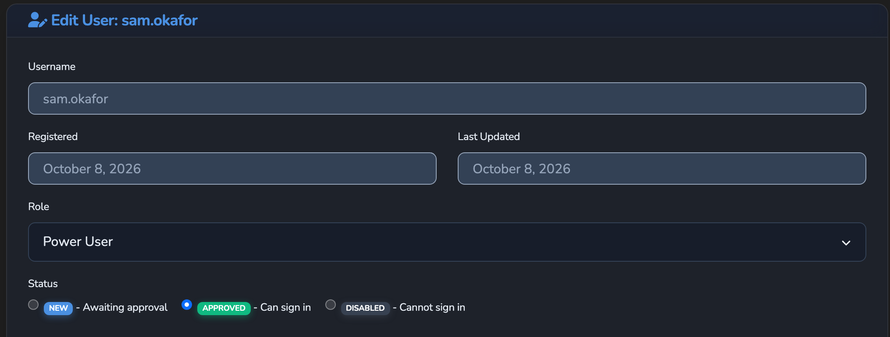

# RBAC

Role-based access control on the management API: the roles, the permission keys and their
default minimum roles, how the middleware enforces them, the permissions response the
dashboard reads, and how management access tokens narrow a role. For operator guidance,
use the hosted
[RBAC reference](https://docs.affinidi.com/products/affinidi-trust-fabric/agent-stream/reference/security/rbac/).

Implemented in [`src/rbac/mod.rs`](../src/rbac/mod.rs) (`RbacConfig`, `Feature`),
[`src/auth_manager/middleware.rs`](../src/auth_manager/middleware.rs) (enforcement), and
[`src/auth_manager/permissions.rs`](../src/auth_manager/permissions.rs) (the permissions
response). RBAC governs the management API only. Surface traffic is governed by source
authentication and policy (see [`SOURCE_AUTH.md`](SOURCE_AUTH.md) and
[`POLICY.md`](POLICY.md)).

## Roles

Three ordered roles, serialised in lowercase:

| Role | Holds |
| --- | --- |
| `administrator` | Every permission the configuration lists |
| `poweruser` | Permissions whose minimum role is `poweruser` or `user` |
| `user` | Permissions whose minimum role is `user` |

The first user registered on an appliance is an approved `administrator` and cannot be
deleted or demoted. Later passkey registrations start as `user` with status `New` and
need an administrator's approval (`users.approve`). A user who is not approved is refused
on every protected route, with a session or with an access token.



## Configuration

`RbacConfig.permissions` maps each permission key to its minimum role. The file is named
by `[config_files] rbac` in the bootstrap config (default `rbac.json`) and read once at
startup.

```json
{
  "permissions": {
    "mediators.edit": "administrator",
    "surfaces.capture": "administrator"
  }
}
```

- Entries in the file are merged over the built-in defaults, so a key the file omits
  keeps its default role. A file with no `permissions` key gets the defaults.
- A missing or unparseable file logs a warning, and the built-in defaults apply.
- A key that is in neither the file nor the defaults is denied to every role, including
  `administrator`.
- A role string other than `administrator`, `poweruser`, or `user` (case-insensitive)
  denies that key to every role, including `administrator`.

[`config/examples/rbac.example.json`](../config/examples/rbac.example.json) restates the
built-in defaults with the same roles, except that it omits `access_tokens.view`,
`access_tokens.edit`, `access_tokens.delete`, `policies.publish`, `terms.view`, and
`terms.edit`. Because the file is merged over the defaults, those keys keep their
`administrator` default when the example is used as is.

Entries in an existing file also override a default that has since become stricter. An
`rbac.json` copied from an example older than 0.1.18 sets `"logs.view": "user"`, which
keeps the appliance log readable by every user until that entry is removed or set to
`administrator`. The same holds for `"integrations.view": "user"`, which keeps every
integration readable by every user; the appliance logs a warning at startup while the file
grants `integrations.view` to `user` or `poweruser`.

## Permission keys

Defaults from `RbacConfig::default()`.

| Area | Key | Default minimum role |
| --- | --- | --- |
| Settings | `settings.view`, `settings.edit` | administrator |
| Users | `users.view`, `users.edit`, `users.approve`, `users.delete` | administrator |
| Teams | `teams.view`, `teams.edit`, `teams.delete` | administrator |
| Members | `members.view`, `members.edit`, `members.delete` | administrator |
| Enrolment | `enrolment.view`, `enrolment.edit` | administrator |
| Prompts | `prompts.view` | user |
| | `prompts.edit`, `prompts.delete` | administrator |
| LLM and IDE Surfaces | `pipes.view`, `pipes.edit`, `pipes.delete`, `pipes.execute` | user |
| | `pipes.pricing` (declared prices and cost override) | administrator |
| Model catalog | `llm_catalog.edit` (every catalog route, reads included) | administrator |
| Fabric surface records | `surfaces.view` | user |
| | `surfaces.edit`, `surfaces.delete` | administrator |
| | `surfaces.capture` (captured Surface traffic; see below) | poweruser |
| Gateways | `gateways.view` | user |
| | `gateways.edit`, `gateways.delete` | administrator |
| Mediators | `mediators.view` | user |
| | `mediators.edit`, `mediators.delete` | poweruser |
| Connection Points | `connection_points.view` | user |
| | `connection_points.edit`, `connection_points.delete` | poweruser |
| JWT verification strategies | `jwt_verification_strategies.view`, `.edit`, `.delete` | administrator |
| OAuth Identifiers | `oauth_identifiers.view`, `.edit`, `.delete` | administrator |
| Secrets | `secrets.view`, `secrets.edit`, `secrets.delete` | administrator |
| API keys | `api_keys.view`, `api_keys.edit`, `api_keys.delete` | administrator |
| Access tokens | `access_tokens.view`, `access_tokens.edit`, `access_tokens.delete` | administrator |
| Tenant ownership | `tenant_ownership.manage` | administrator |
| Certificates | `certificates.view`, `certificates.edit` | administrator |
| Vault identities | `vault_identities.edit` | administrator |
| Credential providers | `credential_providers.view`, `.edit`, `.delete` | administrator |
| Delegation vault | `delegation_vault.view`, `delegation_vault.delete` | administrator |
| Storage | `storage.admin` (backup, restore, export) | administrator |
| Identity | `identity.issue` (credential issuance and revocation) | administrator |
| | `identities.manage` (`did:webvh` identity management) | administrator |
| Configuration | `config.reload` | administrator |
| Policies | `policies.view`, `policies.edit`, `policies.delete`, `policies.publish` | administrator |
| Integrations | `integrations.view`, `integrations.edit`, `integrations.delete` | administrator |
| Terms | `terms.view`, `terms.edit` | administrator |
| Notifications | `notifications.view`, `.edit`, `.delete` | user |
| Metrics | `metrics.view` (aggregate, Surface, and stage metrics) | user |
| | `metrics.view_attributed` (per-Member and per-Team breakdowns) | administrator |
| Dashboard | `dashboard.view` (dashboard reads and live updates) | user |
| Logs | `logs.view` (application log download and the dashboard log tail) | administrator |
| Audit | `audit.view` (credential-delegation audit evidence) | administrator |
| Governance | `governance.view` | administrator |
| Drift | `drift.view`, `drift.manage` | administrator |
| Marketplace purchases | `payments.view`, `payments.edit`, `payments.delete`, `payments.retry` (marketplace support, not covered by this documentation; `payments.view` and `payments.retry` gate no route) | user |
| Unused | `trust_registries.view` (gates nothing) | user |

IDE Surfaces are LLM Surfaces of type `ide_catalog`, so they use the `pipes.*` keys; there
are no separate IDE keys. Every read of a Surface's configuration needs `pipes.view`
(`GET /v1/pipes`, `GET /v1/pipes/{id}`, `GET /v1/pipes/{id}/variants/{alias}/resolved`,
`GET /v1/pipes/{id}/ide-catalog/preview`, `GET /v1/pipes/{id}/ide-catalog/bootstrap`). A
Surface's budget usage (`GET /v1/pipes/{id}/budget`) is a metric, so it needs `metrics.view`
like `GET /v1/pipes-metrics`. The Surface template routes use the `pipes.*` keys too: `pipes.view` to list,
read and export (`GET /v1/pipe-templates`, `GET /v1/pipe-templates/{id}`,
`GET /v1/pipe-templates/{id}/export`), `pipes.edit` to create, import and update
(`POST /v1/pipe-templates`, `POST /v1/pipe-templates/import`, `PUT /v1/pipe-templates/{id}`),
and `pipes.delete` to delete (`DELETE /v1/pipe-templates/{id}`). Testing a saved Surface's
upstream connection (`POST /v1/pipes/{pipe_id}/test`) needs `pipes.execute`, because it
sends the saved key only to the saved endpoint. The pre-save connection test
(`POST /v1/pipes/test-llm-connection`) needs `pipes.edit` and refuses a stored-secret
reference, so it can test only a provider that needs no key.

`integrations.view` gates every read of integrations, including the Integrations tab of the
LLM Surface and IDE Surface editors and the integration pickers in the Surface builder
(usage alerts, Governance Record export, drift alerts) and the connection-point editors. A
user who can edit Surfaces (`pipes.edit`, `user` by default) but lacks `integrations.view`
sees "Integrations are managed by administrators." there instead of the list, and the
Surface keeps the integrations already chosen for it. Grant `integrations.view` to that
role in `rbac.json` for Surface authors who choose integrations. `integrations.edit` also
gates `POST /v1/integrations/test`, `POST /v1/integrations/{id}/trigger` and
`POST /v1/integrations/trigger-multiple`. Saving or testing an integration that sends a
stored secret to a new destination also needs `secrets.view`, and is refused for every
role while `secrets.reveal_values` is `false`, unless every secret it references is the
URL the integration's type delivers to and nothing else secret or routing goes with it (see
[`INTEGRATIONS.md`](INTEGRATIONS.md#secrets-in-integration-configuration)). Why a trigger's
delivery failed, for any integration, and why a test refused a referenced URL, is answered only to a caller holding `secrets.view` while `secrets.reveal_values` is
`true`; anyone else gets a fixed message ([`INTEGRATIONS.md`](INTEGRATIONS.md#publishers) lists which reasons the appliance
log keeps). Integration URLs are accepted only as
secret references, so creating a webhook, Slack or Redis integration needs
`integrations.edit` and `secrets.view`, plus `secrets.edit` to create the URL's secret
when none exists yet. The default roles are unchanged: administrators hold all three. See
[`INTEGRATIONS.md`](INTEGRATIONS.md#routes).

Choosing where a Surface sends a stored key (adding a key reference, or changing the
endpoint a referenced key goes to) also needs `secrets.view`; editors without it can
change everything else about a keyed Surface. See
[`PROVIDERS_AND_CREDENTIALS.md`](PROVIDERS_AND_CREDENTIALS.md#who-may-choose-where-a-stored-secret-is-sent).

`identities.manage` gates every `/v1/identities` management route, including
`GET /v1/identities/integrations` (its `PUT` needs `integrations.edit`). It is separate from
`identity.issue`, so granting credential issuance does not grant identity management.
DID resolution (`/v1/resolve`) and log serving (`/dids/`) are public. See
[`FABRIC.md`](FABRIC.md#identity-management).

`identity.issue` also gates `POST /v1/agents/{did}/revoke`, which revokes every credential
issued to a local agent identity. Agent identities are appliance-wide, so the route refuses an
access token narrowed to a tenant or to resources. See
[`POLICY.md`](POLICY.md#revoking-an-agent-identity).

`settings.edit` also gates the telemetry export configuration (`GET` and
`PUT /v1/metrics/config`, `POST /v1/metrics/test-connection`, `POST /v1/metrics/truncate`)
and log truncation (`POST /v1/logs/truncate`); there is no separate metrics or
log-maintenance key, and reading the log (`logs.view`) does not allow truncating it. See
[`OBSERVABILITY.md`](OBSERVABILITY.md).

Captured Surface traffic (request and response bodies) needs `surfaces.capture`: the
dashboard WebSocket's `payload_captured` updates, each Surface's `latest_payload` in
`GET /v1/dashboard/stats` and `GET /v1/dashboard/delta`, and `GET /v1/agents`. It spans every
tenant, so an access token narrowed to a tenant or to resources never receives it.

The dashboard's stats, delta, Surface metrics, UCP statistics, hierarchical metrics and system
metrics reads need `dashboard.view`, which every built-in role holds. An access token narrowed
to a tenant or to resources reads one Surface's metrics only for a Surface it owns, and is
refused the reads that span every tenant: stats, delta, hierarchical and system metrics.
See [`OBSERVABILITY.md`](OBSERVABILITY.md).

The connection-point inbox (`/v1/connection-points/{id}/messages*` and
`POST /v1/connection-points/{id}/use`) holds decrypted DIDComm messages, so reading it, the
unread count, marking a message read and recording a use need `connection_points.edit`, and
deleting a message needs `connection_points.delete`; `connection_points.view` does not reach
it. `connection_points.view` gates the Connection Point reads (list, by id, by gateway, and
metrics), none of which returns the connection secret; only the create response does. See
[`FABRIC.md`](FABRIC.md).

`policies.publish` is separate from `policies.edit` so that
fleet-wide enforcement can be granted apart from authoring (see
[`POLICY.md`](POLICY.md#change-control)).

## Enforcement

Protected management routes pass two layers:

1. **Session guard** (`require_session_auth`). Accepts a dashboard session (the
   `Authorization: Bearer` header or the `session_token` cookie) or a management access
   token. Missing or invalid credentials, or a user who is not approved, answer `401`.
   Outstanding Terms answer `403` `TERMS_ACCEPTANCE_REQUIRED`.
2. **Feature guard** (`require_feature`, applied per route with `RbacGuard::gate`). Loads
   the user and checks the route's `Feature`:

| Outcome | Status |
| --- | --- |
| No authenticated user on the request | `401` |
| The role lacks the feature, or the user no longer exists | `403` |
| The request used an access token whose scopes exclude the feature | `403` |
| The user store cannot be read | `500` |

Handlers that need a second permission check it with `RbacGuard::allows`, which applies
the same role and token-scope test. Production startup fails rather than mount the
privileged routers (secrets, API keys, certificates, vault identities, delegation vault,
credential providers, JWT verification strategies, OAuth Identifiers) without an RBAC
guard.

Some routes are gated by permission inside the handler rather than at the route. These
check the access token's scope list as well as the role, so a token narrowed to an
explicit allow-list is held to it exactly as a route-level gate would hold it. Teams,
members, prompts, member provisioning, spend report, governance, telemetry and drift all
call the shared `identity::handlers::authz::require_feature` (role and scope); never add
a module-local role-only check. The users handlers, and the extra `policies.publish`
check for updating a policy definition that an appliance-wide assignment references,
check role and scope inline.

### Surface ownership

The base role keeps `pipes.edit`, `pipes.delete` and `pipes.execute`: base users create,
change and run their own Surfaces, so taking those permissions away would leave only
administrators able to build anything. A per-Surface owner check instead stops one user
changing another user's Surface. `POST /v1/pipes` records the creating user (the session
user, or the user an access token is bound to) in `PipeConfig.owner_user_id` (a value in
the body is ignored), and an update keeps the stored owner and tenant whatever the body
says (`keep_stored_ownership` in
`src/identity/handlers/pipes.rs`). Update, delete, and variant create, update, delete and
promote answer `403` unless `PipeCaller::may_manage`
(`src/identity/handlers/pipe_caller.rs`) admits the caller: the owner, a user whose role
is `administrator`, or an access token whose tenant is the Surface's own tenant (tenant
isolation is the boundary between tenant tokens, as for prices). That override is fixed, not an RBAC permission key. A Surface with no
owner (created while authentication was off, or before ownership was recorded) can be
changed or deleted only by an administrator; no API assigns an owner afterwards. Requests
with no authenticated caller (authentication off) are not restricted. Listing a Surface as
a member of an IDE Surface's Catalogue needs the same check, and an access token may list only a
Surface inside its tenant and resource pattern, because a dispatched request skips the
member's own source authentication; a member the stored Catalogue already lists can be
kept. A member that does not exist and one the caller may not list both answer the same
`403`. Reads, listing, test
and execute stay shared across users.

## Access tokens and roles

A management access token is bound to a user. On a feature-gated route the token holds a
permission only when:

- the bound user's current role grants it, and
- the token has no scopes, or its `scopes` list contains that permission key.

Scopes therefore narrow a role and never widen it. Create and update refuse a scope that
is not a permission key, or that the issuer's or the bound user's role does not hold.
Resource patterns and tenant ownership limit which records a token can reach, not which
permissions it holds. See [`ACCESS_TOKENS.md`](ACCESS_TOKENS.md).

## Permissions response

`GET /v1/permissions` returns a flat JSON object: every permission key the dashboard reads,
mapped to a boolean for the caller.

```json
{
  "pipes.view": true,
  "pipes.edit": true,
  "secrets.view": false,
  "policies.publish": false,
  "metrics.view_attributed": false
}
```

There is no wrapper object and no `role` field. The key set comes from one list,
`permission_features`, so every key is present for every caller. Each value is the
caller's role tested against the configuration; it does not apply an access token's
scopes. An unknown user answers `404`.

`GET /v1/permissions/public` returns the same shape with every key `false`, for the
registration flow before anyone is signed in.

The dashboard hides or disables operations whose key is `false`. That is convenience only:
the route guard is authoritative, and adding a management feature needs both the route
guard and, when the dashboard uses it, an entry in `permission_features`.

## Related

- [`ACCESS_TOKENS.md`](ACCESS_TOKENS.md): management access tokens, scopes, and tenant
  ownership.
- [`POLICY.md`](POLICY.md): the `policies.*` permissions and change control.
- [`TERMS_AND_CONSENT.md`](TERMS_AND_CONSENT.md): the Terms gate on sessions and tokens.
- [`USAGE_LIMITS_AND_ATTRIBUTION.md`](USAGE_LIMITS_AND_ATTRIBUTION.md): attributed
  metrics behind `metrics.view_attributed`.
- [`CONFIGURATION_REFERENCE.md`](CONFIGURATION_REFERENCE.md): `[config_files]` and the
  bootstrap config.
- [`../CONTEXT.md`](../CONTEXT.md): the glossary.
