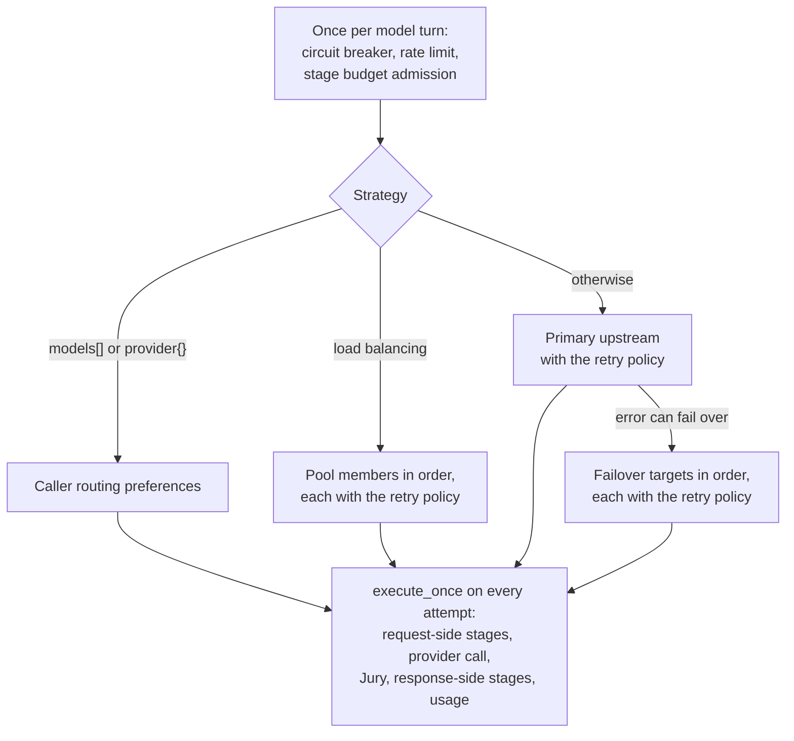
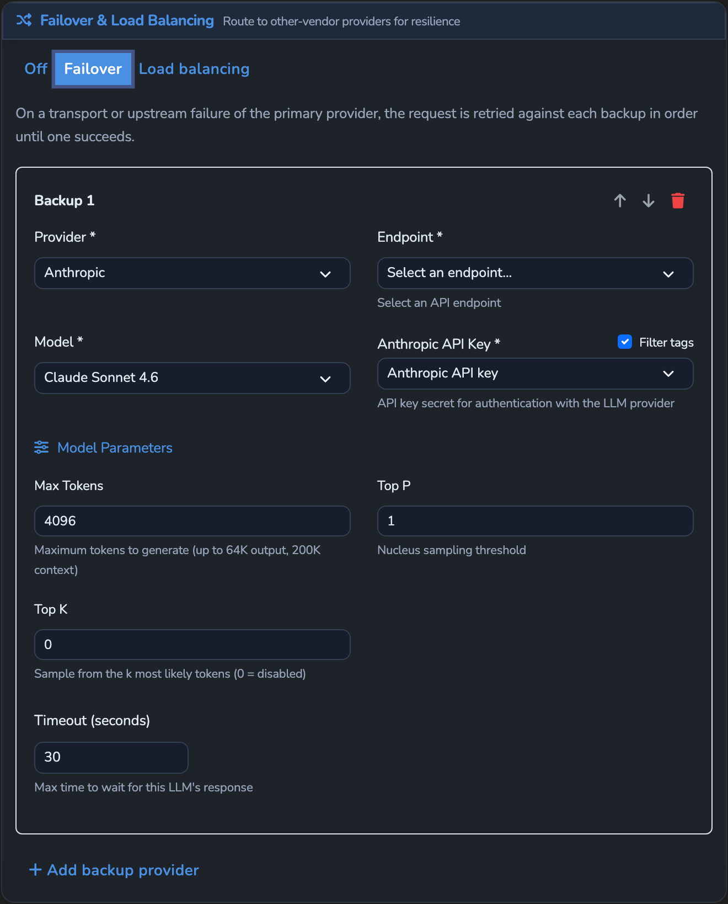
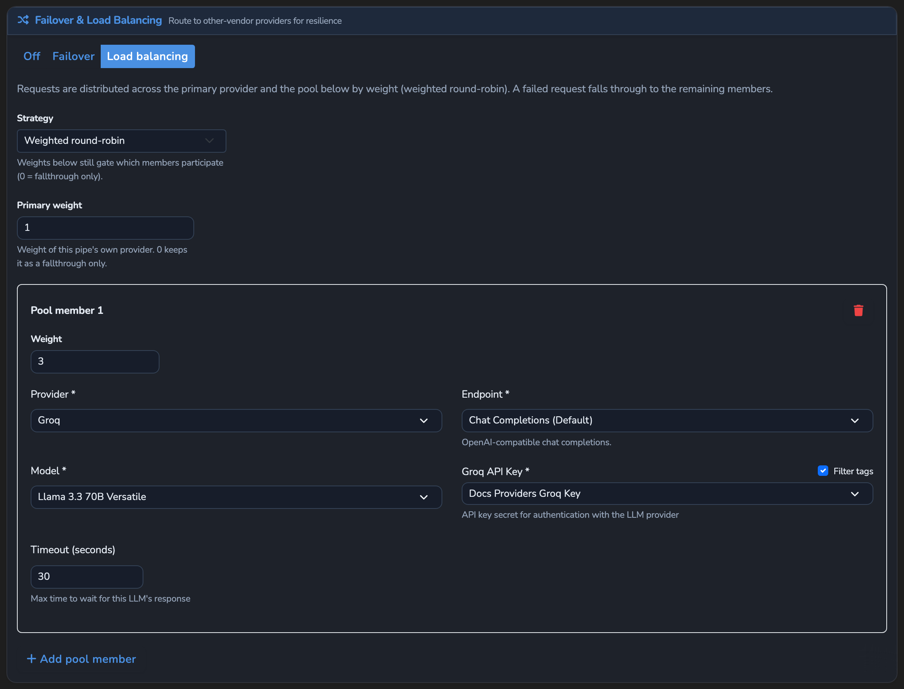
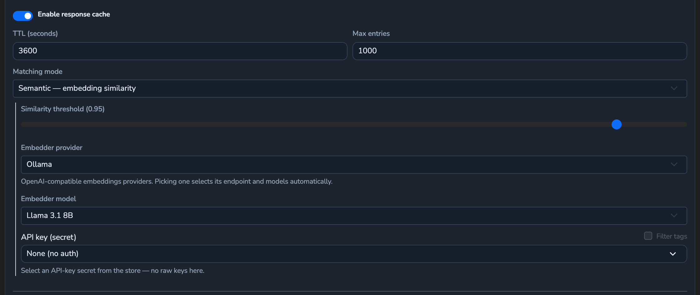

# Resilience and Caching

How an LLM Surface keeps model calls working when a provider fails or is slow, and how it
answers repeated requests without a provider call: retries, failover, load balancing, the
circuit breaker, the Surface rate limit, and the response cache. For the operator view,
see the hosted
[resilience and caching reference](https://docs.affinidi.com/products/affinidi-trust-fabric/agent-stream/reference/surfaces/resilience-and-caching/).

All resilience logic is in [`src/pipes/executor.rs`](../src/pipes/executor.rs); the
response cache is in [`src/pipes/response_cache.rs`](../src/pipes/response_cache.rs) and
the handler. Configuration is on `PipeConfig` in
[`src/pipes/config.rs`](../src/pipes/config.rs).


## Where each control runs

The handler looks up the response cache before handing the request to the executor. The
executor then runs one **model turn** (`execute_model_turn`):

1. Read the primary upstream's circuit breaker.
2. Check the Surface rate limit.
3. Admit platform-key stage spend against the caller's budget (`admit_platform_stages`).
4. Choose a strategy, in this order:
   - caller routing preferences (`models[]`, `provider{}`), when present (see
     [`INFERENCE_CONTROLS.md`](INFERENCE_CONTROLS.md#per-request-routing));
   - load balancing, when enabled with at least one target;
   - otherwise the primary upstream with retry, then failover.
5. Every attempt of every strategy runs `execute_once`.

`execute_once` is the whole request side and the call: Prompt Guard, Expert Witness,
Judge and Decider (or the Comparer or Summariser fan-out), request preparation, key source
and headers, budget admission, metering checks, the provider call, the Jury with Redrive,
the response Prompt Guard and Expert Witness, NER ID restore, and usage. So **each retry,
failover attempt, and load-balancing fallthrough re-runs every request-side stage**,
including the Judge, and each run is billed. Steps 1 to 3 run once per model turn, not per
attempt. With server tools, each tool-loop turn is a separate model turn. See
[`../ARCHITECTURE.md`](../ARCHITECTURE.md#executor).



The streaming path checks the circuit breaker and the rate limit and records the breaker
outcome, but has no retry, failover, load balancing, or caller routing.

## Retries

`retry_policy` (`RetryPolicy`):

| Key | Meaning |
| --- | --- |
| `max_retries` | Retries after the first attempt. Attempts are `max_retries + 1`. |
| `initial_backoff_ms` | Delay before the first retry. |
| `backoff_multiplier` | Growth factor per retry. |
| `max_backoff_ms` | Cap on any delay. |

The delay before retry `n` is `initial_backoff_ms × backoff_multiplier^(n-1)`, capped at
`max_backoff_ms`. Without `retry_policy` there is one attempt.

`execute_with_retry` stops at once, without retrying, when the provider refuses the
caller's own key (`caller_key_rejected`) or a budget refuses a platform-key call. Any other
error is retried. The final error is the last attempt's. Spend from failed attempts is
carried into the result and billed.

A Jury Redrive is separate: it re-calls the model inside one attempt when the Jury rejects
an answer, up to the Jury's own `max_retries` (see [`GUARDRAILS.md`](GUARDRAILS.md)).

## Failover

`failover` (`FailoverConfig`):

| Key | Default | Meaning |
| --- | --- | --- |
| `enabled` | `true` | Failover on. |
| `targets[]` | empty | Ordered backup upstreams, each `{ "llm": LLMTarget }`. |

An `LLMTarget` has `provider_type`, `model`, `endpoint_url`, `api_key_secret`,
`parameters`, `timeout_secs`, `capabilities`, `api_schema`, `headers`, and `pricing`.



```jsonc
"failover": {
  "enabled": true,
  "targets": [
    { "llm": { "provider_type": "anthropic", "model": "claude-haiku-4-5",
               "endpoint_url": "https://api.anthropic.com/v1/messages",
               "api_key_secret": "sec-anthropic", "api_schema": "anthropic" } }
  ]
}
```

Saving a Surface with failover enabled requires at least one target, and each target needs
`provider_type`, `model`, and `endpoint_url`. A relative endpoint is resolved against the
built-in provider's base URL; it is refused for a provider with no built-in base. The
resolved URL must pass the SSRF check (`validate_service_endpoint_url_blocking` in
[`src/url_validation.rs`](../src/url_validation.rs)).

`run_failover_if_needed` runs after the primary has used all its retries. If the primary
error can fail over, each target is tried in order, each with the Surface's retry policy,
until one succeeds.

**What fails over** (`moves_to_next_target`): an upstream error response, a timeout, a
request failure, exhausted retries, an invalid response, an open circuit breaker, and a
budget refusal of the target's platform key (the next target may run on an owned key).

**What does not:** a refusal by Prompt Guard, an Expert Witness, the Judge, or the Jury; the
Surface rate limit; the provider refusing the caller's own key; and a shared-credential
refusal. These are returned as they are. A non-eligible error on a backup is also final.

Each target runs on a copy of the Surface (`clone_with_failover_target`) that keeps the
guards, policy, and limits, uses the target's own headers and price, and has `failover`,
`load_balancing`, and `decider` cleared, so a backup never recurses or re-routes. A target
always uses its own stored key; the caller's key is offered only to the primary.

When every target fails, the request gets the first platform-key refusal if there was one,
otherwise the last target's error.

Metrics: `agent_stream_llm_failover_total`,
`agent_stream_llm_failover_backup_attempts_total`,
`agent_stream_llm_failover_suppressed_total` (failover configured but the error class is
not eligible), and `agent_stream_llm_failover_duration_seconds`.

## Load balancing

`load_balancing` (`LoadBalancingConfig`):

| Key | Default | Meaning |
| --- | --- | --- |
| `enabled` | `true` | Load balancing on. |
| `strategy` | `weighted` | `weighted`, `lowest_latency`, or `lowest_cost`. |
| `primary_weight` | `1` | Weight of the Surface's own upstream. |
| `targets[]` | empty | `{ "llm": LLMTarget, "weight": 1 }`. |

The pool is the Surface's own upstream (member 0) followed by the targets. When load
balancing is enabled with at least one target it takes precedence over `failover`, which is
then not used.



`select_start_member` picks the first member to try:

| Strategy | First member |
| --- | --- |
| `weighted` | Weighted round-robin: a per-executor counter modulo the total weight. Deterministic, not random. |
| `lowest_latency` | The member with the lowest moving-average latency (α = 1/8, from successful requests). A member with no sample yet is tried first. |
| `lowest_cost` | The member with the lowest price for 1,000 input plus 1,000 output tokens: its declared price, else the catalog. A member with no price is picked first only when no member has a price; after the first pick, the rest of the pool is tried in pool order. |

A member with weight `0` is never picked first by any strategy but stays in the pool as a
fallthrough. Ties go to the lowest index.

`run_load_balanced` tries the first member, then every other member in pool order. Each
attempt uses the Surface's retry policy. The same eligibility rules as failover decide
whether to move on, and the same final-error rule applies when the pool is exhausted.
Members other than the Surface's own upstream use their own stored keys.

Saving a Surface with load balancing enabled requires at least one target, a total weight
above zero, and well-formed targets.

## Circuit breaker

`circuit_breaker` (`CircuitBreakerConfig`):

| Key | Meaning |
| --- | --- |
| `failure_threshold` | Consecutive failures that open the breaker. |
| `timeout_seconds` | How long the breaker stays open before a trial. |
| `reset_timeout_seconds` | Accepted but not used. |

Without `circuit_breaker` there is no breaker.

The breaker tracks the Surface's own upstream:

- **Closed:** requests pass. A success resets the failure count; a failure adds one, and
  reaching `failure_threshold` opens the breaker.
- **Open:** requests are held off the primary until `timeout_seconds` has passed; the next
  request then moves the breaker to half-open.
- **Half-open:** requests pass. The first success closes the breaker; a failure opens it
  again.

Only provider-health failures count (`record_circuit_outcome`): the same error classes that
fail over. Guard refusals and the rate limit never change breaker state. The primary's
outcome is recorded before failover runs, so a backup's success cannot hide a failing
primary. With load balancing, the breaker records the outcome of the whole pool: a request
that any member serves counts as a success, and a request the whole pool fails with a
provider-health error counts as a failure.

When the breaker is open:

- with load balancing, the request is refused, since the breaker covers the whole pool;
- with failover, the primary is skipped and the targets are tried;
- with caller routing preferences, the primary candidate is dropped;
- otherwise the request is refused with `503`, type `circuit_breaker_error`, code
  `circuit_breaker_open`.

## Surface rate limit

`rate_limit` (`RateLimit`):

| Key | Default | Meaning |
| --- | --- | --- |
| `enabled` | `true` | Rate limit on. |
| `requests_per_minute` | required | Requests allowed per window. |
| `tokens_per_minute` | none | Estimated tokens allowed per window. |

`check_rate_limits` uses a fixed one-minute window that restarts on the first request after
it expires. A request over the limit is refused with `429`, type `rate_limit_error`, code
`rate_limit_exceeded`. The rate limit is checked once per model turn, so each server-tool
turn counts, and retries and failover do not.

Counters belong to the executor, so each Variant and inline routing target has its own.
An IDE Surface applies its own `requests_per_minute` at dispatch, and the member Surface
then applies its own.

Per-Member and per-Team rate and token caps are enforced by the Team gate, before the
executor; see [`USAGE_LIMITS_AND_ATTRIBUTION.md`](USAGE_LIMITS_AND_ATTRIBUTION.md).

## Executor state

Breaker state, rate-limit counters, the weighted round-robin counter, and latency averages
live in memory on the cached executor. There is one executor per Surface, Variant, and
upstream identity (see [`ROUTING.md`](ROUTING.md#choosing-the-variant)). Saving a Surface
discards its executors, which resets all of this state. Nothing is shared between
appliances.

## Response cache

The response cache serves a repeated request from a stored answer, with no provider call.
It is off by default.

### Configuration

`cache` (`CacheConfig`), overridable per Variant:

| Key | Default | Meaning |
| --- | --- | --- |
| `enabled` | `false` | Cache on. |
| `ttl_seconds` | `3600` | Lifetime of an entry. |
| `max_entries` | `1000` | Entries kept per scope; the oldest are evicted first. |
| `mode` | `exact` | `exact` or `semantic`. |
| `similarity_threshold` | `0.95` | Minimum cosine similarity for a semantic hit. |
| `embedder` | none | `{ endpoint_url, model, api_key_secret }`, an OpenAI-compatible embeddings endpoint. Required for `semantic`. |

```jsonc
"cache": {
  "enabled": true,
  "ttl_seconds": 3600,
  "max_entries": 1000,
  "mode": "semantic",
  "similarity_threshold": 0.95,
  "embedder": { "endpoint_url": "https://api.openai.com/v1/embeddings",
                "model": "text-embedding-3-small", "api_key_secret": "openai-key" }
}
```



Saving an enabled cache requires `ttl_seconds > 0` and `max_entries > 0`. Semantic mode
also requires a threshold in (0.0, 1.0] and an embedder with a model and an endpoint that
passes the SSRF check.

### Keys and scopes

An entry belongs to a **scope**: the Surface id, the Variant alias, and a digest of the
effective upstream (provider configuration, upstream headers, and declared price)
(`scope_key_for_target`). Requests resolved to different Variants or different upstreams
never share entries.

On a Surface with identity pass-through (`forward_caller_token`), the upstream answers as
the caller, so the scope also holds a SHA-256 digest of the token forwarded upstream
(`caller_scope`): callers never share an entry, and `max_entries` applies to each
caller's entries. A request with no token to forward does not use the cache. See
[`PROVIDERS_AND_CREDENTIALS.md`](PROVIDERS_AND_CREDENTIALS.md#identity-pass-through).
Saving a Surface with both `cache.enabled` and `forward_caller_token` is allowed: the
per-caller scope keeps callers apart, so Microsoft 365 Copilot Surfaces can cache. On such a
Surface memory is bounded by `max_entries` for each forwarded token seen within the TTL, not
for the Surface: a refreshed token starts a new scope, and the old one stays until its
entries expire.

- **Exact mode.** The key is the scope plus a SHA-256 of the request body with `stream`,
  `stream_options`, `user`, and `metadata` removed and object keys sorted (`build_key`).
- **Semantic mode.** The request's text (message text parts, or an embeddings `input`) is
  embedded (`extract_cache_text` in
  [`src/pipes/response_cache.rs`](../src/pipes/response_cache.rs), `embed_text` in
  [`src/pipes/cache_embedder.rs`](../src/pipes/cache_embedder.rs)). The lookup returns
  the live entry in the scope with the highest cosine similarity at or above the
  threshold. The embedder call has a 5-second timeout and an 8 MiB response cap, and its
  own breaker opens after 3 consecutive failures for 30 seconds. The endpoint is checked
  before each call (`validate_service_endpoint_url`), and the call goes through
  `http_client::with_service_endpoint_resolver`, which checks every resolved address at
  connect time: private addresses are allowed, loopback, unspecified, link-local and cloud
  metadata addresses are refused. That client follows no redirects and ignores `HTTP_PROXY`,
  `HTTPS_PROXY` and `NO_PROXY`. An embedding failure, or
  an embedder platform key past its budget, skips the semantic lookup and the request
  continues as a miss.

The key is computed on the OpenAI Chat body after Prompt expansion, document ingestion,
and the context-window guard, so the same request sent in different Client API dialects
shares an entry.

### What a hit skips

The lookup runs in the handler after the gates and before the streaming split (see
[`../ARCHITECTURE.md`](../ARCHITECTURE.md#full-order)). Everything before it has
already run: Variant selection, source auth, policy, the Team gate, usage limits, Prompt
expansion, document ingestion, modality gates, and the context-window guard.

A hit skips every later stage: the circuit breaker, rate limit, stage budget admission,
routing, load balancing, retry and failover, Prompt Guard, Expert Witness, Judge, Decider,
the provider call, the Jury, response guards, NER ID restore, the drift sample, spend,
events, and the Governance Record. It is converted to the caller's dialect and returned.

A hit still:

- counts as a request against the Member's and Teams' usage, at zero spend;
- records Surface activity and usage at zero spend and, when the Surface has metrics
  enabled, an execution record tagged as a cache hit with the avoided cost;
- returns `x-agent-stream-cache: hit`, `x-agent-stream-cache-saved-usd`, the original
  provider and model, and the original token counts in the usage headers. A miss returns
  `x-agent-stream-cache: miss`.

A streaming request that hits is answered as SSE: the stored answer is replayed as chunks
(`replay_completion_as_sse`) and re-encoded for the caller's dialect.

### What is stored

On the buffered path the final response is stored after a success, after the response
guards and NER ID restore have run, together with its tokens, cost, and provider and model.

On the streaming path the answer is rebuilt from the stream and stored only when:

- the upstream's answer arrived whole (whether or not the caller read to the end);
- the answer has text; and
- the request offers no `tools` and no legacy `functions`. The stream reassembles text only, so storing a
  tool-calling turn would lose its tool calls. Such a request can still be served from the
  cache.

The stored streaming answer is a single text message with `finish_reason: "stop"`.

### Eviction and statistics

Expired entries are removed when read and by a sweep every 300 seconds. When a scope holds
more than `max_entries`, the oldest are evicted. The cache is in memory and process-wide;
it is empty after a restart.

`GET /api/v1/cache/stats` (permission `metrics.view`) returns `hits`, `misses`,
`hit_rate`, `saved_cost_usd`, and `entries` since startup.

## Known limitations

- A retry re-runs every failed attempt that is not a caller-key or budget refusal,
  including one refused by Prompt Guard, an Expert Witness, or the Judge. Such a refusal
  repeats on each attempt, adding backoff delay and stage spend.
- On Access Point traffic the executor receives no token estimate, so `tokens_per_minute`
  does not limit it; only `requests_per_minute` does.
- With load balancing, an open circuit breaker refuses the request with `503`; the other
  pool members are not tried.
- The breaker lets every request through while half-open. `reset_timeout_seconds` has no
  effect.
- Executor state and the response cache are per process and are not shared between
  appliances.
- Editing a Surface does not clear its response-cache entries. A change to the upstream
  (provider, model, endpoint, headers, or declared price) starts a different scope; any other
  change, such as a guard, keeps serving existing entries until their TTL expires.
- The streaming path has no retry, failover, load balancing, or caller routing.

## Related

- [`ROUTING.md`](ROUTING.md): Variants, the Router, canary splits, and the Decider.
- [`INFERENCE_CONTROLS.md`](INFERENCE_CONTROLS.md): caller routing preferences and provider
  prompt caching.
- [`PROVIDERS_AND_CREDENTIALS.md`](PROVIDERS_AND_CREDENTIALS.md): upstream targets, key
  sources, and pricing.
- [`USAGE_LIMITS_AND_ATTRIBUTION.md`](USAGE_LIMITS_AND_ATTRIBUTION.md): budgets, Member and
  Team limits.
- [`GUARDRAILS.md`](GUARDRAILS.md): Jury and Redrive.
- [`OBSERVABILITY.md`](OBSERVABILITY.md): metrics and response headers.
- [`../ARCHITECTURE.md`](../ARCHITECTURE.md): pipeline order and invariants.
