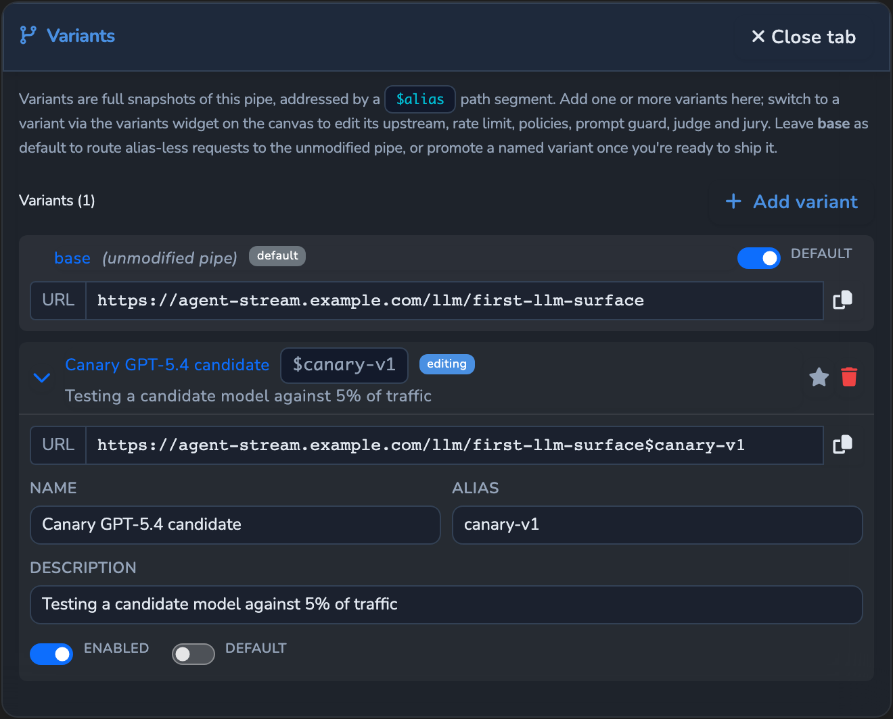
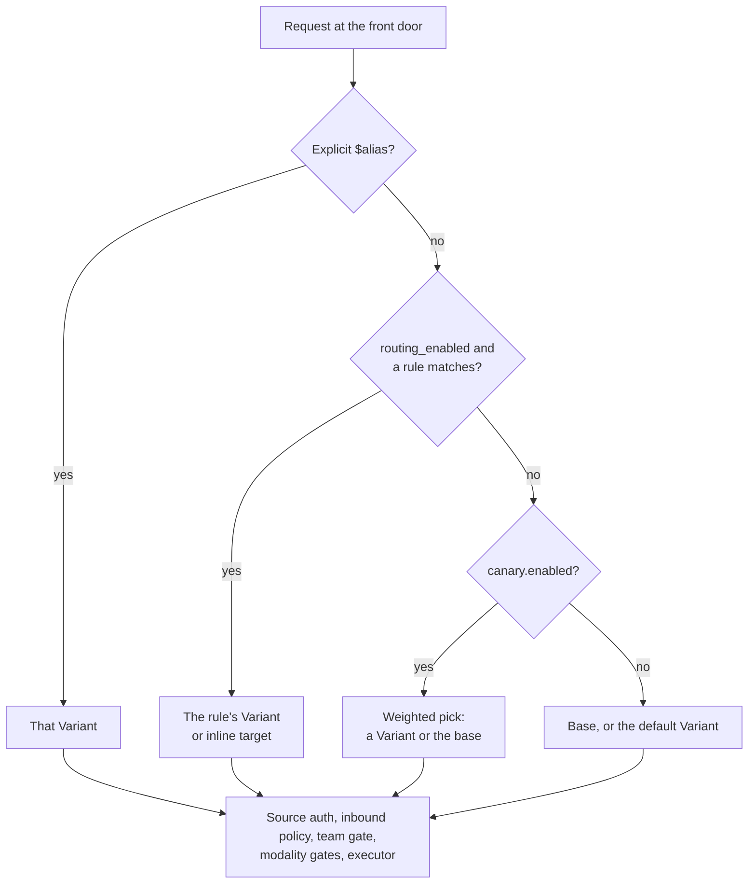
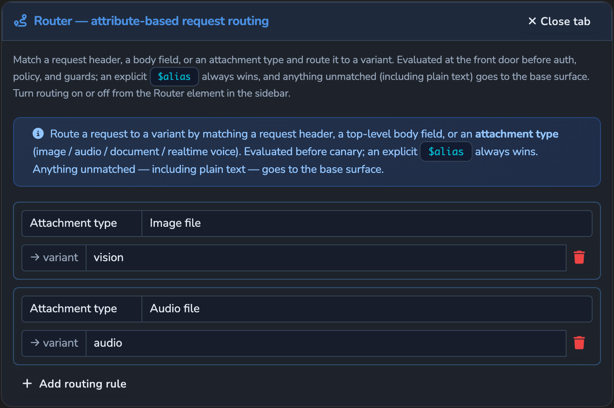
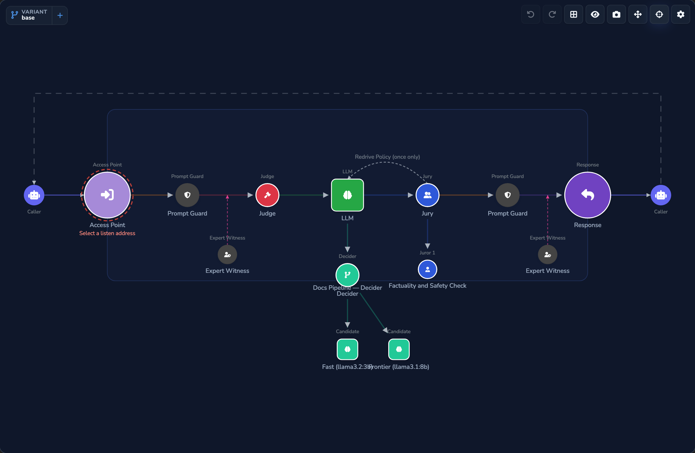

# Routing

How an LLM Surface decides which configuration and which model serve a request: Variants,
the Router (attribute-based routing rules), canary splits, and the Decider with its
Comparer and Summariser modes. For the operator view, see the hosted
[routing and variants reference](https://docs.affinidi.com/products/affinidi-trust-fabric/agent-stream/reference/surfaces/routing-and-variants/).

Two kinds of routing happen at different points in the pipeline:

| Kind | Where it runs | What it picks |
| --- | --- | --- |
| Variant selection: `$alias`, Router, canary split | Front door, before source auth | Which Surface configuration handles the request |
| Decider, Comparer, Summariser | Executor, after Prompt Guard and Expert Witness | Which model (or models) answer |

Failover, load balancing, and caller routing preferences (`models[]`, `provider{}`) are in
[`RESILIENCE_AND_CACHING.md`](RESILIENCE_AND_CACHING.md) and
[`INFERENCE_CONTROLS.md`](INFERENCE_CONTROLS.md#per-request-routing).

## Variants

A Variant is a named variation on a Surface, selected per request
([`src/pipes/pipe_variants.rs`](../src/pipes/pipe_variants.rs)). Each entry in
`variants[]` has an `id`, an `alias` matching `^[a-z0-9-]{1,32}$`, a `name`, a
`description`, `enabled`, and `overrides` (`PipeVariantOverrides`).



A Variant can override the upstream (`pipe_type`), `override_policy`, `prompt_guard`,
`judge`, `jury`, `expert_witnesses`, `rate_limit`, `circuit_breaker`, `retry_policy`,
`cost_tracking`, `usage_alerts`, `cache`, `source_auth`, `opa_policy`,
`forward_caller_token`, `upstream_headers`, `upstream_pricing`,
`request_timeout_seconds`, `realtime`, `audio_input`, `image_input`, and
`document_ingestion`. With `complete: false` (sparse) an unset field keeps the base value;
with `complete: true` the Variant is a full snapshot and an unset field clears the base
value. Routing settings (`routing_rules`, `routing_enabled`, `canary`) and resilience
pools (`failover`, `load_balancing`) live on the base only.

`resolve_variant` materialises the chosen Variant into a complete configuration before
the rest of the pipeline sees it:

| Situation | Result |
| --- | --- |
| No alias and no `default_variant_id` | The base Surface |
| No alias, `default_variant_id` set | That Variant |
| Alias names an enabled Variant | That Variant |
| Alias names no Variant | `404`, code `variant_not_found` |
| Alias names a disabled Variant | `503`, code `variant_disabled` |
| `default_variant_id` names no Variant | `500`, code `variant_misconfigured` |

A Surface with no Variants ignores any alias and serves the base.

`POST /api/v1/pipes/{pipe_id}/variants/{variant_id}/promote-to-default` (`pipes.edit`)
sets `default_variant_id` to that Variant and returns the saved Surface. It answers `404`
for an unknown Variant and `400` for a disabled one, since a disabled default would be
unreachable. The save passes the same tenancy and reference checks as any Surface edit.

A Variant that changes the provider type or the provider's origin is treated as another
upstream: the caller's own provider key is never sent to it, and it runs on its own stored
key, as a failover target does (`keeps_default_upstream`). See
[`PROVIDERS_AND_CREDENTIALS.md`](PROVIDERS_AND_CREDENTIALS.md).

## Choosing the Variant

`resolve_route_decision` in
[`src/pipes/handlers/http_handlers.rs`](../src/pipes/handlers/http_handlers.rs) applies
this precedence:

**explicit `$alias` > Router rule > canary split > base (or the default Variant)**



1. **Explicit alias.** The caller addresses `{prefix}/{route}${alias}/…`. An IDE Surface
   dispatch to a member Variant counts as explicit.
2. **Router rule.** When `routing_enabled` is true, the first matching rule in
   `routing_rules` picks a Variant or an inline provider target.
3. **Canary split.** When `canary.enabled` is true, a weighted random pick.
4. **Base.** The base Surface, or the Variant named by `default_variant_id`.

The Variant is resolved before source authentication, inbound policy, the team gate, the
modality gates, and the executor. The selected Variant's own source auth, policy, guards,
modality settings, cache, and limits are what the request meets. Each enabled Variant is
therefore a separately reachable entry point, and a Variant with weaker settings is
weaker in fact (see [`../ARCHITECTURE.md`](../ARCHITECTURE.md#invariants)).

Every decision increments `agent_stream_variant_routing_decisions_total`, labelled with
`variant` (the alias, `base`, or `unconfigured` for an alias the Surface does not define)
and `decision`: `explicit_alias`, `routing_rule`, `routing_rule_inline`, `canary`,
`canary_skipped_disabled`, `canary_skipped_no_weight`, `canary_skipped_base_split`,
`base_default`, `rejected_unknown`, `rejected_disabled`, or `rejected_misconfigured`.

Each resolved base, Variant, or inline target has its own executor, keyed by Surface,
alias, and a digest of the upstream (provider, headers, and declared price). Rate-limit
and circuit-breaker state and the response-cache scope follow that key.

## The Router

The Router chooses the upstream from attributes of the request, deterministically and
without calling a model. It is the way to send each modality on one Surface to a model
that can handle it.

### Configuration

Both keys are on the base `PipeConfig`
([`src/pipes/config.rs`](../src/pipes/config.rs)):

| Key | Default | Behaviour |
| --- | --- | --- |
| `routing_rules` | empty | Ordered `RoutingRule { match, target }`. The first match wins. |
| `routing_enabled` | `true` | When `false` the rules are kept but never evaluated. |

`match` (`RoutingMatch`, tagged by `kind`):

| `kind` | Fields | Matches when |
| --- | --- | --- |
| `header` | `name`, `equals` | The request header equals `equals` exactly. The header name is case-insensitive. |
| `body_field` | `field`, `equals` | A top-level string field of the JSON body equals `equals`. |
| `modality` | `has` | The request carries that modality: `text`, `image`, `audio`, `document`, or `realtime` (`ROUTING_MODALITIES`). |

The dashboard's Router panel labels a `modality` rule **Attachment type**.



Body modalities are detected once per request from type markers, without decoding
payloads (`RequestModalities::detect`, using `image_formats_present`,
`audio_formats_present`, and `document_types_present`). `text` means no media is
attached. `realtime` never matches a chat body; it is used only by the realtime path below.

`target` (`RoutingTarget`):

- `variant`: an alias to route to. Used when set.
- `llm`: an inline provider target, used when `variant` is unset. It replaces only the
  upstream on the resolved configuration (`clone_with_failover_target`), keeping guards,
  policy, and limits, and clears `failover`, `load_balancing`, and `decider` for that
  request. It runs on its own stored key; the caller's key is never sent to it.

Saving a Surface validates each rule (`RoutingRule::validate`): header and body rules need
non-empty values, a modality must be in the closed set, a `variant` must name a configured
Variant, and an inline `llm` target needs `provider_type`, `model`, and `endpoint_url`.

```jsonc
{
  "routing_rules": [
    { "match": { "kind": "header", "name": "X-Tier", "equals": "pro" },
      "target": { "variant": "pro" } },
    { "match": { "kind": "modality", "has": "image" },
      "target": { "variant": "vision" } },
    { "match": { "kind": "modality", "has": "realtime" },
      "target": { "variant": "voice" } }
  ]
}
```

### Realtime voice

A realtime WebSocket session (`{route}/v1/realtime`) is routed by its transport.
`select_realtime_variant` in [`src/pipes/realtime.rs`](../src/pipes/realtime.rs) picks the
Variant named by the first `modality: realtime` rule, when routing is enabled, and the
session reads its realtime, model, source-auth, policy, and governance settings from that
Variant. Without such a rule it uses the base or default Variant. A Variant that fails to
resolve closes the session with `realtime_variant_unavailable`.

One Surface can serve chat on its base and voice on a realtime Variant; the caller opens
the endpoint for the transport it wants. A voice Variant can carry no Judge, which cannot
guard live audio. See [`MODALITIES.md`](MODALITIES.md#realtime-voice).

## Canary splits

A canary split sends a percentage of traffic to Variants, to roll out a change and roll it
back.

`canary` on the base `PipeConfig` (`CanaryConfig`):

| Key | Default | Meaning |
| --- | --- | --- |
| `canary.enabled` | `false` | Master switch. |
| `canary.splits[]` | empty | Weighted targets. |
| `canary.splits[].variant` | none | The alias to route to. Empty or absent means the base Surface. |
| `canary.splits[].weight` | required | Relative weight. A target's share is `weight / sum of weights`. |

```jsonc
{
  "canary": {
    "enabled": true,
    "splits": [
      { "variant": "",     "weight": 90 },
      { "variant": "next", "weight": 10 }
    ]
  }
}
```

For each request that no explicit alias or Router rule has claimed, `CanaryConfig::decide`
draws a random number in `0..sum` and walks the splits. A disabled config, a zero total
weight, or a pick that lands on a base split serves the base (or default) Surface. Weights
need not sum to 100.

Saving a Surface with `canary.enabled: true` requires at least one split, a positive total
weight, and every named alias to be a configured Variant (`CanaryConfig::validate`).

**Rollback.** Setting `canary.enabled` to `false` stops the split at once. The splits and
the Variants are kept, so enabling it again restores the same percentages. A Surface edit
takes effect on the next request (see [`CONFIGURATION_RELOAD.md`](CONFIGURATION_RELOAD.md)).

The routing-decision metric above shows the split per Variant, and usage, cost, and
monitoring are attributed per Variant.

## Decider, Comparer, and Summariser

`decider` on `PipeConfig` (`DeciderConfig` in
[`src/pipes/judge_jury/config.rs`](../src/pipes/judge_jury/config.rs)) lets a Surface use
several Candidate models. The dashboard shows four modes; the code expresses them with
`strategy` and `mirror.mode`:

| Mode | Code | What it does |
| --- | --- | --- |
| LLM Direct (default) | `decider` absent or `enabled: false` | The Surface's own provider answers. |
| Decider | `strategy: "route"` | A router model picks one Candidate, which answers. |
| Comparer | `strategy: "mirror"`, `mirror.mode: "collect"` | Every Candidate answers; all answers are returned. |
| Summariser | `strategy: "mirror"`, `mirror.mode: "merge"` | Every Candidate answers; a merger model combines them into one answer. |

In code the Comparer and Summariser modes are called _mirror_, with the aggregation modes
`Collect` and `Merge`.



### Configuration

| Key | Meaning |
| --- | --- |
| `enabled` | Whether the Decider is active. |
| `strategy` | `route` (default) or `mirror`. |
| `llm` | The router model. Required for `route`. |
| `system_prompt` | Routing criteria. The Candidate menu is appended automatically. |
| `candidates[]` | `{ id, name, description, llm }`. Non-empty when enabled; ids unique. |
| `default_candidate_id` | The Candidate used when the router names no known id. Defaults to the first. Route only. |
| `mirror.mode` | `merge` (default) or `collect`. |
| `mirror.merger` | The merger model. Required for `merge`. |
| `mirror.merge_system_prompt` | Merge criteria. A built-in instruction is used when empty. |
| `disable_thinking`, `mirror.disable_thinking` | Turn off reasoning on a reasoning-capable router or merger. |

Comparer and Summariser allow at most ten Candidates (`MAX_MIRROR_CANDIDATES`). `DeciderConfig::validate`
enforces these rules when a Surface is saved.

### Decider (route)

The router model gets the request and a menu of Candidates and replies with JSON naming
one (`execute_decider` in
[`src/pipes/judge_jury/executor.rs`](../src/pipes/judge_jury/executor.rs)). An unknown or
unparsable choice falls back to `default_candidate_id`, then the first Candidate. The
chosen Candidate's model then serves the main call, and every response-side stage runs as
usual. The Decider and the Judge run in parallel on the buffered path and in sequence on
the streaming path. A Surface streams only when every Candidate's upstream has a streamed
format the gateway delivers (OpenAI, Anthropic, Microsoft 365 Copilot); with a Gemini or
Claude-on-Bedrock Candidate, a streaming request gets one buffered response.

### Comparer and Summariser (mirror)

The Judge runs first. The request then goes to every Candidate at once; no router runs.
Each Candidate is billed at its own price and recorded as a `mirror_candidate` stage. If
every Candidate fails the request fails with `502` (or with a budget refusal, if one
caused a failure); otherwise the survivors carry on.

- **Comparer (`collect`).** The response Prompt Guard and NER ID restoration run on each
  answer, then the response Expert Witnesses run on the combined text. The body is one
  assistant message listing each Candidate's answer, plus an `x_mirror` object with
  `mode: "collect"` and per-Candidate `id`, `name`, `provider`, `model`, `content`,
  `error`, tokens, cost, and latency. The Jury does not run.
- **Summariser (`merge`).** The answers are added to the request for the merger model,
  which then makes the main call. Its answer passes through the Jury and every
  response-side stage like any other.

Neither mode streams: a Surface with a Comparer or Summariser Decider is never streaming-eligible, and a
streaming request gets one buffered response.

### Keys and resilience

A Candidate, the router, and the merger each use their own stored key; the caller's own
provider key is offered only to the Surface's own provider. A failover, load-balancing, or
inline routing target runs without the Decider (`clone_with_failover_target` clears it).

Request-side guards run once before any Candidate is called, so every Candidate sees the
same masked input (see [`GUARDRAILS.md`](GUARDRAILS.md)). Governance Records carry each
Candidate's stage and the routing or merge decision (see
[`GOVERNANCE_RECORDS.md`](GOVERNANCE_RECORDS.md)).

## Known limitations

- A canary pick is made per request; there is no stickiness for a caller or a
  conversation.
- A Router header rule compares the value exactly, including case.
- A realtime session uses only a `modality: realtime` rule; it ignores explicit aliases
  and canary splits.
- A router-model call that fails fails the request; only an unknown or unparsable answer
  falls back to the default Candidate.
- The Comparer returns the combined answers in one assistant message; callers that need
  per-Candidate detail read `x_mirror`, which only the OpenAI Chat dialect carries.

## Related

- [`RESILIENCE_AND_CACHING.md`](RESILIENCE_AND_CACHING.md): failover, load balancing, and
  the response cache.
- [`INFERENCE_CONTROLS.md`](INFERENCE_CONTROLS.md): caller routing preferences.
- [`MODALITIES.md`](MODALITIES.md): modality gates and realtime voice.
- [`SOURCE_AUTH.md`](SOURCE_AUTH.md): per-Variant source authentication.
- [`GUARDRAILS.md`](GUARDRAILS.md): Judge, Jury, and response guards.
- [`OBSERVABILITY.md`](OBSERVABILITY.md): metrics.
- [`../ARCHITECTURE.md`](../ARCHITECTURE.md): pipeline order and invariants.
- [`../CONTEXT.md`](../CONTEXT.md): glossary.
