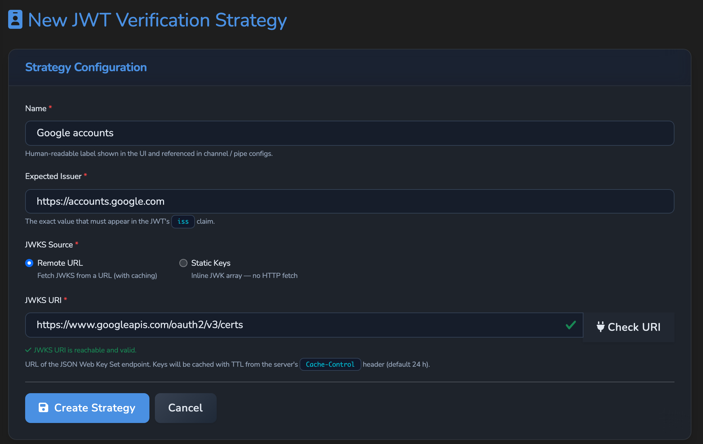
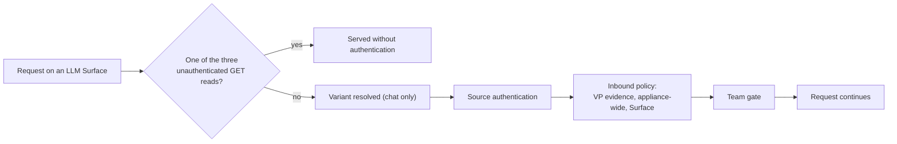

# Source Authentication

How Agent Stream authenticates an inbound caller on a Surface, which requests skip
that check, and the order of the gates every other request passes. For product
concepts and configuration walkthroughs, use the hosted
[source authentication reference](https://docs.affinidi.com/products/affinidi-trust-fabric/agent-stream/reference/security/source-authentication/).

Implemented in [`src/source_auth/`](../src/source_auth/), with the JWT verification
strategies in [`src/jwt_bearer/`](../src/jwt_bearer/), the API Key Provider in
[`src/api_keys/`](../src/api_keys/) and the certificate store in
[`src/certificates/`](../src/certificates/).

## Source authentication

Each method is a `SourceAuthConfig` variant
([`models.rs`](../src/source_auth/models.rs)), serialised with a `type` tag.

| Method | `type` | Validates |
| --- | --- | --- |
| JWT bearer | `jwt_bearer` | An inbound bearer token against a JWT verification strategy |
| API key | `api_key` | A key extracted from the request against a secret in the secrets store (the secret holds the valid keys, comma-separated) |
| API key provider | `api_key_provider` | A key extracted from the request against the managed API keys issued for an `agent_id` |
| mTLS | `mtls` | A TLS client certificate |

One `SourceAuthMiddleware` is built at startup and serves every Surface.

### Where it is configured

| Surface | Configured as | Notes |
| --- | --- | --- |
| LLM Surface, IDE Surface | `source_auth` on the surface config (`PipeConfig`) | One method. A surface variant can override it (`PipeVariantOverrides.source_auth`). |
| Fabric surfaces (A2A, MCP, DIDComm) | `access_point.caller_authentication.methods` | A list, but only the first entry is enforced. |

A Surface with no source authentication configured admits the caller with no identity.

### What a failure does

A missing or invalid credential refuses the request:

| Path | Refusal |
| --- | --- |
| LLM and IDE Surface HTTP routes | `401`, `authentication_error`, code `source_authentication_failed` |
| Realtime voice (`…/v1/realtime`) | The WebSocket is accepted and then closed with an OpenAI-style `error` event carrying the reason, so a browser can read it |
| Fabric receive path | `403` "Source authentication failed" (detail logged, not returned) |

A route that declares source authentication while the middleware failed to start is
refused rather than served unauthenticated: `crate::source_auth::source_auth_gate`
returns `Unavailable`, which answers HTTP `503` `source_authentication_unavailable`
on LLM and IDE Surfaces, a realtime rejection, or a fabric `503`.

The caller's credential is consumed at the front door. On the fabric path the header
the method reads (`SourceAuthConfig::credential_header_name`) is stripped before
forwarding. On an LLM Surface a value that is the front-door credential (the presented
header, or for `api_key` any key in its secret) is never sent upstream as the caller's
provider key (`SourceAuthMiddleware::is_front_door_credential`).

### JWT bearer

`JwtBearerAuthConfig` ([`jwt_bearer/models.rs`](../src/jwt_bearer/models.rs)) names a
`JwtVerificationStrategy` by id. The strategy holds the mandatory `expected_issuer` and
a JWKS source: `static` (inline keys) or `remote` (`jwks_uri`, cached per
`Cache-Control: max-age`). A token naming a `kid` the cached keys lack fetches the keys again,
at most once a minute for each strategy, so a rotated key is found at once but tokens with
made-up `kid` values cannot make every request fetch from the key server.

| Field | Default | Effect |
| --- | --- | --- |
| `audiences` | | The token's `aud` must match any entry. An empty list refuses every token unless `allow_missing_audience` is set, so a Surface or variant saved with neither is refused with `400`. |
| `allow_missing_audience` | `false` | Disables the audience check, only when `audiences` is empty. For issuers that emit no `aud`. |
| `token_header` | `Authorization` | Header the token is read from |
| `token_scheme` | `Bearer` | Prefix stripped before validation; empty means the header carries the raw token |

Accepted signing algorithms are asymmetric only: `RS256`, `RS384`, `RS512`, `ES256`,
`ES384`, `EdDSA` ([`validator.rs`](../src/jwt_bearer/validator.rs)).

Strategies are managed on the management API
([`src/jwt_bearer/router.rs`](../src/jwt_bearer/router.rs)):

| Route (under `/api`) | Purpose | Permission |
| --- | --- | --- |
| `GET /v1/jwt-verification-strategies` | List strategies | `jwt_verification_strategies.view` |
| `POST /v1/jwt-verification-strategies` | Create a strategy | `jwt_verification_strategies.edit` |
| `GET /v1/jwt-verification-strategies/{id}` | Read one | `jwt_verification_strategies.view` |
| `PUT /v1/jwt-verification-strategies/{id}` | Update one | `jwt_verification_strategies.edit` |
| `DELETE /v1/jwt-verification-strategies/{id}` | Delete one | `jwt_verification_strategies.delete` |
| `POST /v1/jwt-verification-strategies/validate-jwks-uri` | Fetch the JWKS at `uri` and answer `200` `{valid: true, key_count}`, or `400` `{valid: false, error}` | `jwt_verification_strategies.edit` and `.view` |

### API key

Both API key methods take a `CredentialExtraction`: `http_header { field }` (for
example `X-API-Key` or `Authorization`), `mcp_meta` (the MCP `_meta` object) or
`a2a_extension` (an A2A message extension). The last two parse the request body.

Managed API keys are created with `POST /api/v1/api-keys/{agent_id}`
([`src/api_keys/handlers.rs`](../src/api_keys/handlers.rs)). The `agent_id` names the
record the keys are issued for: an LLM or IDE Surface, or a Fabric surface
([`src/api_keys/parent.rs`](../src/api_keys/parent.rs)). The keys take that record's tenant;
when the id names both a Surface and a Fabric surface, the caller must be allowed both. A
deleted Surface is not a parent: deleting a Surface deletes its managed keys unless a Fabric
surface with the same id still holds them, so no other Surface's `api_key_provider` keeps
admitting a key nobody can revoke. An `api_key_provider` names that record as its `agent_id`
and is refused on save unless the record exists and the Surface may reference it. A Surface
may name itself, so its keys can be issued once it is saved.

A positive `expires_in_seconds` sets an absolute `expires_at`; omitting it, or a value of 0 or less,
creates a key that never expires. An expired key stops authenticating, as a revoked key
does. Rotation keeps the key's original lifetime measured from the moment of rotation, so a
key rotated near its expiry is never issued already expired, and a non-expiring key stays
non-expiring.

| Route | Purpose | Permission |
| --- | --- | --- |
| `GET /api/v1/api-keys` | List every key; a tenant or resource-scoped access token sees only the keys it can reach | `api_keys.view` |
| `GET /api/v1/api-keys/{agent_id}` | List the keys issued for that record | `api_keys.view` |
| `POST /api/v1/api-keys/{agent_id}` | Create a key | `api_keys.edit` |
| `GET /api/v1/api-keys/{agent_id}/{key_id}` | Read a key's metadata | `api_keys.view` |
| `POST /api/v1/api-keys/{agent_id}/{key_id}/revoke` | Revoke a key | `api_keys.edit` |
| `POST /api/v1/api-keys/{agent_id}/{key_id}/rotate` | Revoke a key and issue a replacement with a new id and secret | `api_keys.edit` |
| `DELETE /api/v1/api-keys/{agent_id}/{key_id}` | Delete a key permanently | `api_keys.delete` |

Revoke and rotate take a JSON body (`{}` is enough) with an optional `actor` recorded on the change (default `api`).

### mTLS

Two trust modes, in `MtlsTrust`:

| Mode | Behaviour |
| --- | --- |
| `pinned { certificate_ids }` | Accepts only those exact certificates, matched by SHA-256 fingerprint of the stored leaf DER. No chain verification. References certificates whose `kind == ClientLeaf`. |
| `ca { ca_certificate_ids, require_client_auth_eku, … }` | Verifies the presented leaf chains to one of the configured CAs (`kind == Ca`). `require_client_auth_eku` defaults to `true`. |

The principal is chosen by `identity_binding` (`MtlsIdentityBinding`): `fingerprint`,
`subject_cn`, `dns_san`, `uri_san` (SPIFFE IDs), `ip_san`, or `subject_rdn { oid }`.
Every binding except `fingerprint` fails when the certificate lacks the field.
`allowed_subjects` is an optional principal allow-list (supports `*`); empty admits any
principal that passes the trust check.

The certificate arrives from a directly terminated TLS handshake
(`tls.client_auth.direct`) or forwarded in a header from a proxy whose address is in
`tls.client_auth.trusted_proxies` (`tls.client_auth.forwarded_header`). A forwarded
header from any other peer is not trusted. `allow_forwarded` (default `true`) lets a
single surface refuse forwarded certificates.

The TLS listener's client-certificate trust for direct handshakes is built once at startup
from the active CA certificates (`kind == Ca`) in the certificate store
([`load_inbound_client_auth`](../src/source_auth/peer_cert/direct.rs)). A CA added later can
verify forwarded certificates as soon as it is stored and a Surface's CA trust lists it, but
direct handshakes trust it only after a restart. With `tls.client_auth.direct = "required"` and no CA in the store,
startup fails. With `"optional"` and no CA in the store, Agent Stream logs an error and the
listener starts without asking for client certificates, so direct mTLS stays off until a CA
is stored and the process restarts.

The certificate store is managed through
[`src/certificates/router.rs`](../src/certificates/router.rs):

| Route | Purpose | Permission |
| --- | --- | --- |
| `GET /api/v1/certificates` | List certificates | `certificates.view` |
| `POST /api/v1/certificates` | Store a certificate | `certificates.edit` |
| `GET /api/v1/certificates/{id}` | Read one | `certificates.view` |
| `PUT /api/v1/certificates/{id}` | Update one | `certificates.edit` |
| `DELETE /api/v1/certificates/{id}` | Delete one | `certificates.edit` |

`POST /api/v1/vault/identity/generate` (`vault_identities.edit`,
[`src/vault_identity/`](../src/vault_identity/)) creates a local `did:webvh` identity for a
vault item, stores it in the identity store, and answers `201` with its `did`. `item_type`
`apikey` or `cert` places the DID under that path segment; any other value, or none, uses
`vault`. `purpose` is optional. Without the `didwebvh` Cargo feature it answers `500`.

### Realtime voice

A browser cannot set an `Authorization` header on a WebSocket handshake, so the
realtime route also accepts the caller's token as a `Sec-WebSocket-Protocol`
subprotocol, `bearer.<token>` or `openai-insecure-api-key.<token>`
(`bearer_from_subprotocols` in [`src/pipes/realtime.rs`](../src/pipes/realtime.rs)).

## Public discovery reads

A request skips source authentication, this appliance's own Trust Fabric policy and the
surface policy only when it is a public discovery read, decided by
`crate::proxy::paths::is_public_request(method, path)`
([`src/proxy/paths.rs`](../src/proxy/paths.rs)):

- the method is `GET` or `HEAD`;
- the path, with any query or fragment and one trailing `/` removed, **ends with** a
  discovery document: `/agent.json`, `/agent-card.json`, `/.well-known/agent.json`,
  `/.well-known/agent-card.json`, `/.well-known/agent-card` or `/.well-known/ucp`;
- the path holds no `%`, `;`, `\`, control character, or `.` or `..` segment, so an
  encoded or normalised path such as `/admin/export%3F/agent.json` can never be read as
  `/admin/export`, and `.\t.`, which a URL parser turns into `..`, never reaches the
  target.

A path that only contains one of these names is not public, and any other method to a
discovery path is gated like any other request. No route serves a `/discovery` document,
so a path ending in one is gated like any other request too.

Only the fabric receive path serves public reads
([`src/gateways/connection_points/message_processor.rs`](../src/gateways/connection_points/message_processor.rs)).
The appliance-wide Trust Fabric policy still evaluates a public read; see
[`POLICY.md`](POLICY.md#fabric-receive). A public read is forwarded with no body and
without `X-HTTP-Method-Override`, `X-HTTP-Method` or `X-Method-Override`
(`forwarded_headers`), so it cannot be turned into a write upstream. On a surface that
declares source authentication it carries no upstream credentials, neither the target
credential nor delegated credentials, whatever identity its body claims
(`may_send_upstream_credentials`). Every fabric path is joined under the target endpoint
by `crate::proxy::handler::join_endpoint_path`, so a path such as
`@attacker.example/agent.json` can never change the target's host.

## The inbound gates on an LLM Surface

The LLM Surface data plane never applies the public discovery exemption: its `POST`
handler authenticates and runs policy on every path, so a chat body sent to
`{route}/agent.json` is gated like any other request. Three `GET` reads on the surface
router are served without authentication
([`src/pipes/handlers/http_handlers.rs`](../src/pipes/handlers/http_handlers.rs),
`handle_pipe_health`):

| Read | Returns |
| --- | --- |
| `{route}/.well-known/agent-stream` (`is_wellknown_ide_path` in [`src/pipes/streaming.rs`](../src/pipes/streaming.rs)) | The IDE Surface bootstrap document, which carries only public sign-in identifiers; see [`IDE_SURFACES.md`](IDE_SURFACES.md) |
| `{route}/health` | The Surface's id, name, and enabled state |
| `{route}/v1/models` on an LLM Surface (`serve_models_list`) | The model of the base Surface and of each Variant |

`/v1/models` on an IDE Surface is authenticated and filtered by policy
(`serve_ide_models`).

Chat, file upload and speech to text (`proxy_file_upload`), and the file and batch
`GET` passthrough (`proxy_api_get`) run the same gates in the same order:

1. Source authentication.
2. Inbound policy: VP evidence, then the appliance-wide policy, then the surface
   policy. Deny-overrides and fail-closed; see [`POLICY.md`](POLICY.md#order-of-evaluation).
3. The team gate.

Chat resolves the Variant before these gates, so a Variant's own source authentication
and policy apply to it. The upload and passthrough paths ignore `$alias` and use the base
Surface's configuration.

Realtime voice ([`src/pipes/realtime.rs`](../src/pipes/realtime.rs)) runs source
authentication, then the appliance-wide and surface policies at session open
(`evaluate_open_policy`, with `action: "connect"` and
`input.resource.modality = "audio_realtime"`), then the team gate. While a budget is in
scope, a session that would spend the platform key is refused.

A VP challenge request (`POST {route}/v1/vp-challenge`, `issue_vp_challenge` in
[`src/pipes/handlers/http_handlers.rs`](../src/pipes/handlers/http_handlers.rs)) runs source
authentication only, honouring a `$alias` Variant's own and, on an IDE Surface, the IDE
Surface's own; no policy or team gate. See
[`POLICY.md`](POLICY.md#getting-a-vp-challenge).

## The management API session gate

The session gate for the management API
([`src/auth_manager/middleware.rs`](../src/auth_manager/middleware.rs)) is separate
from source authentication. Its read-only public prefixes (DID documents, assets,
health, DID resolution) admit only `GET` and `HEAD`, so a write that shares one of
those prefixes is never public. Endpoints that authenticate on their own (sign-in
flows, DIDComm, onboarding, the test bootstrap) keep every method.

## Known limitations

- On a fabric surface, `caller_authentication.methods` accepts a list but only the first
  method is enforced.
- Realtime voice sessions get no VP evidence check and no Surface usage limits.
- mTLS `ca` trust accepts `check_crl` and `require_ocsp`, but neither is implemented:
  setting either to `true` makes authentication fail with an error.

## Related

- [`POLICY.md`](POLICY.md): the policy layers that run after source authentication, and
  `input.source_auth`.
- [`ACCESS_TOKENS.md`](ACCESS_TOKENS.md): management access tokens, a separate concern
  from data-plane source authentication.
- [`RBAC.md`](RBAC.md): management API permissions.
- [`IDE_SURFACES.md`](IDE_SURFACES.md): the public document an IDE client reads to learn
  how to sign in.
- [`MODALITIES.md`](MODALITIES.md): the realtime voice relay and its open-time checks.
- [`../ARCHITECTURE.md`](../ARCHITECTURE.md#front-door-and-gates): where source
  authentication sits in the request pipeline.
