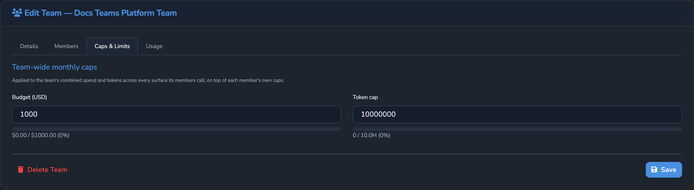
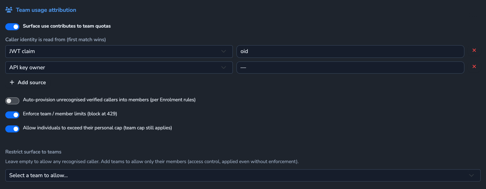
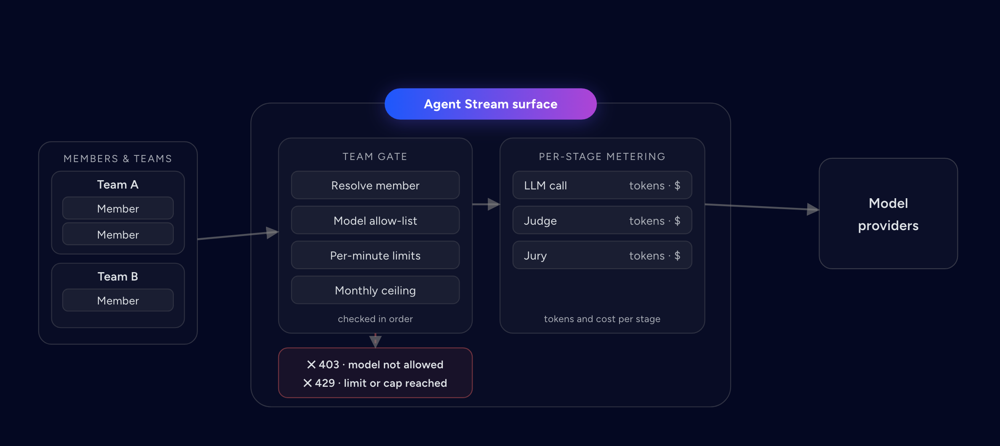
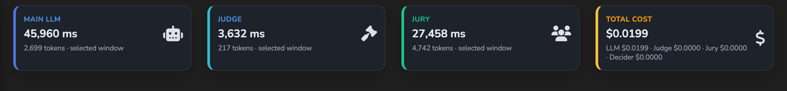

# Usage Limits and Attribution

Who a request is attributed to, and what caps its usage: Members, Teams, the team
gate, Member and Team budgets, Surface usage limits and rate limits, per-stage cost,
the spend report, breach alerts, and auto-provisioning. How a call's key source
decides whether it is billed is in
[PROVIDERS_AND_CREDENTIALS.md](PROVIDERS_AND_CREDENTIALS.md). Hosted documentation:
[Teams and attribution](https://docs.affinidi.com/products/affinidi-trust-fabric/agent-stream/concepts/teams-and-attribution/)
and [Cost and usage limits](https://docs.affinidi.com/products/affinidi-trust-fabric/agent-stream/reference/surfaces/cost-and-usage-limits/).

## Overview

| Control | Scope | Counts | Period | Enforced where |
| --- | --- | --- | --- | --- |
| Member budget | One Member, across every Surface and Team | Billed cost | Budget period (calendar month, or anchored) | Each platform-key model call |
| Team budget | All Members of a Team combined | Billed cost | UTC calendar month | Each platform-key model call |
| Member and Team token caps | As above | Every token, on any key | As above | Team gate |
| Member rate limits | One Member, across every Surface | Requests and tokens in a trailing 60 s | Rolling | Team gate |
| Member model allow-list | One Member | Requested `model` | None | Team gate, or standalone check |
| Surface usage limits | One Surface, cumulative, per stage, or per Juror | Catalog cost and tokens | UTC calendar month | Front door, before the request |
| Surface rate limit | One Surface | Requests and tokens per minute | Rolling | Executor, per attempt |
| Surface cost budget | One Surface, main-LLM stage | Catalog cost | UTC calendar month | Alerts only |

Billed cost is the part of a call's catalog-priced cost charged to the account:
nothing on the caller's own key or a key the customer stored, all of it on a platform
key. Catalog cost is the spend at the catalog price, whoever's key served it.

## Members

A **Member** is a registered caller identity that usage, limits, and spend are
attributed to (`Member` in [`src/members/types.rs`](../src/members/types.rs)).

| Field | Meaning |
| --- | --- |
| `id` | Server-assigned UUID. |
| `name`, `description` | Display name (falls back to the first identifier) and notes. |
| `status` | `enabled`, `disabled`, or `deleted`. A deleted Member is hidden and excluded from attribution but kept on disk so history stays attributable. |
| `identifiers` | How a request is matched to this Member; see below. At least one is required. |
| `monthly_budget_usd` | Member-wide budget, billed cost. |
| `monthly_token_cap` | Member-wide token cap. |
| `budget_period_anchor` | When set, the budget and token cap reset on the monthly anniversary of this instant instead of the 1st (UTC). |
| `requests_per_minute`, `tokens_per_minute` | Per-minute rate limits over a trailing 60 s window. |
| `allowed_models` | Model allow-list. Empty or absent allows any model. |
| `system`, `auto_provisioned` | Server-controlled flags for built-in and auto-provisioned Members. |

An identifier is `{"kind": "email", "email"}`, `{"kind": "subject", "subject"}`,
`{"kind": "api_key", "key_name"}`, or `{"kind": "custom", "value"}`. Values are
trimmed and matched case-insensitively. A Member can carry several, such as an Entra
`oid`, an email, and an mTLS SAN.

A budget or cap of `0` or less is no cap. A per-minute limit of `0` blocks all
traffic.

## Teams

A **Team** groups Members so their usage is aggregated and capped together (`Team`
in [`src/teams/types.rs`](../src/teams/types.rs)). It has `id`, `name`,
`description`, `status`, `members` (Member ids), and team-wide `monthly_budget_usd`
and `monthly_token_cap` across all its Members combined. Team caps always use the UTC
calendar month. Per-Member ceilings live on the Member, not the Team. Teams have no
per-minute limits.



### Built-in Members and Teams

The appliance seeds Members and Teams from two directories named under
`[storage_paths]` in `config.toml`: `default_members` and `default_teams`
([`config/examples/defaults/`](../config/examples/defaults/)). Each `*.json` file is
created only when no record with its id exists, so edits are never overwritten on
restart. System records can be disabled but never deleted.

| Id | Kind | Purpose |
| --- | --- | --- |
| `anonymous` | Member and Team | The fallback for a caller that matches no Member, and for a Member in no enabled Team. Disable the anonymous Member to admit recognised callers only; disable the anonymous Team to require explicit Team membership. |
| `sandbox` | Member and Team | Sandbox (Test) runs, so test usage stays separable from live traffic. |
| `drift-runner` | Member id | Replay-evaluation spend when no Member owns the Surface; see [LLM_DRIFT.md](LLM_DRIFT.md#cost). |

## Team attribution on a Surface

A Surface opts in with `team_attribution` (`TeamAttributionConfig` in
[`src/teams/attribution.rs`](../src/teams/attribution.rs)):

```jsonc
"team_attribution": {
  "enabled": true,
  "caller_identity_sources": [
    { "type": "jwt_claim", "claim": "oid" },
    { "type": "jwt_claim", "claim": "email" },
    { "type": "api_key" }
  ],
  "enforce": true,
  "allow_individual_overage": false,
  "allowed_teams": [],
  "auto_provision": false
}
```

| Field | Default | Meaning |
| --- | --- | --- |
| `enabled` | `false` | Attribute this Surface's usage to Members and Teams and run the team gate. |
| `caller_identity_sources` | `[]` | Where to find the caller's identifier, tried in order; the first non-empty value is used. At least one is required when enabled. |
| `enforce` | `false` | Enforce caps. When clear, usage is recorded for reporting but never blocks on caps. |
| `allow_individual_overage` | `false` | With `enforce`, waives the Member's own budget and token cap; Team caps still apply. |
| `allowed_teams` | `[]` | When non-empty, only callers in one of these Teams may use the Surface. Applies whether or not `enforce` is set. |
| `auto_provision` | `false` | Create a Member for an unrecognised, verified caller; see [Auto-provisioning](#auto-provisioning). |



Caller identity sources ([`src/teams/caller_identity.rs`](../src/teams/caller_identity.rs)):
`header` (`name`), `jwt_claim` (`claim`), `body_json_path` (`path`, an RFC 6901 JSON
Pointer), `mtls` (`binding`: `email_san` or `subject_cn` of the verified client
certificate), and `api_key` (the validated API key's name). A header or body path is set by the caller, so it is
spoofable unless a trusted proxy sets it, and is never used to auto-provision.

`team_attribution` is set on the base Surface and is not Variant-overridable.

## The team gate

The team gate runs at the front door, after source auth and inbound policy and
before Surface usage limits (`team_pre_check` in [`src/teams/gate.rs`](../src/teams/gate.rs)).
It does nothing when `team_attribution` is absent or disabled. Otherwise, in order:

1. **Resolve the Member.** Extract the caller's identifier and match it to a Member;
   if none matches, auto-provision one when the Surface allows it; otherwise use the
   anonymous Member.
2. **Resolve the Teams.** The Member's enabled Teams, or the anonymous Team when it
   has none and the anonymous Team is enabled.
3. **Access.** Refuse a disabled Member (`403 member_not_permitted`), a caller in no
   enabled Team (`403 team_required`), or a caller in none of `allowed_teams`
   (`403 team_not_permitted`).
4. **Model allow-list.** Refuse a requested `model` not in the Member's
   `allowed_models` (`403 model_not_allowed`). A request that omits `model` is never
   refused here.
5. **Per-Member rate limits** (only with `enforce`). Over `requests_per_minute` or
   `tokens_per_minute` in the trailing 60 s: `429 member_rate_limit_exceeded`.
6. **Token caps** (only with `enforce`). The Member's `monthly_token_cap` in its
   budget period (unless `allow_individual_overage`), then each Team's in the
   calendar month: `429 team_quota_exceeded`.
7. **Set the call budget** (only with `enforce`). The gate hands the request the
   Member's and Teams' budgets. It does not check spend; each platform-key call does,
   below.



The diagram's "Monthly ceiling" is the token-cap check (step 6); spend is admitted per
platform-key call, as described under [Budgets](#budgets).

Refusals use the error `type` `permission_error` (403), `rate_limit_error` (429), or
`api_error` (503), carry the code above, and are recorded as a `team_gate` block in
the Governance Record and a `pipe.error` event.

On a Surface that enforces, if the gate cannot resolve a Member (the Member or Team
store is missing, or no Member matches and the anonymous Member is not seeded), the
request is refused with `503 team_gate_unavailable` rather than run with no budget in
scope. A Surface that only tracks usage skips the gate in that case.

So per-Member rate limits, token caps, and budgets apply only on Surfaces whose
`team_attribution` has `enforce` set. Access checks and the model allow-list apply
whenever attribution is enabled.

### Model allow-list without attribution

On a Surface with no active team attribution, the live route still applies the model
allow-list of the Member that the source-auth identity (JWT subject, API-key name, or
mTLS principal) resolves to (`model_scope_allows`), refusing with
`403 model_not_allowed`. With no identity, no Member store, or no matching Member, the
request is allowed: the allow-list governs registered Members only, and source auth
and policy decide whether an unrecognised caller reaches the Surface.

## Budgets

Member and Team budgets count **billed cost** only, recorded after each request
against the Member's budget period and each Team's calendar month
([`src/teams/usage_tracker.rs`](../src/teams/usage_tracker.rs)). Token caps count
every token on any key.

A spent budget is checked at each model call that would bill it
([`src/teams/call_budget.rs`](../src/teams/call_budget.rs)), not at the team gate:

- A call on the caller's own key or a customer-stored key always runs.
- A call on a platform key is refused before it is sent while the Member's budget
  (unless `allow_individual_overage`) or any of its Teams' budgets is spent.
- The budget is read at the request's first platform-key call and that answer holds
  for the rest of the request, so a request that started spending runs to completion
  and records all of it.

What a refusal does depends on the call:

| Call | On refusal |
| --- | --- |
| The main upstream | `429 team_quota_exceeded` (`rate_limit_error`) |
| A failover, load-balancing, routed, Comparer or Summariser target | Skipped for the next target, which may run on an owned key |
| A Judge, Juror, Decider router, model PII detector, or Expert Witness | Refuses the request, even when the stage would let a request through on an outage |
| A semantic-cache or drift embedding | Skipped |

Every safety or decision stage that runs on a platform key is checked before the
request makes any call (stage budget admission), so a response-side Jury or witness
never refuses a request after the main call already ran on the customer's key. A
call that sends no credential is refused only when it is priced; a keyless model PII
detector, Expert Witness, or embedder is never refused.

While a budget is enforced, a platform-key call also runs only where Agent Stream
meters its spend; otherwise it is refused with `403` and a `*_not_metered` code. See
[PROVIDERS_AND_CREDENTIALS.md](PROVIDERS_AND_CREDENTIALS.md).

### Budget period

By default a Member's budget period is the UTC calendar month. With
`budget_period_anchor`, it resets on the monthly anniversary of that instant: a
Member anchored on the 27th resets on the 27th, and an anchor on the 31st resets on
the last day of shorter months ([`src/members/budget_period.rs`](../src/members/budget_period.rs)).
Moving the anchor later starts a fresh period at once.

| Route | Permission | Returns |
| --- | --- | --- |
| `GET /v1/members/{id}/usage` | `members.view` | The spend and tokens the gate enforces against, with `period_start` and `period_end` |
| `GET /v1/teams/{id}/usage` | `teams.view` | The Team's current-month usage |

## Surface usage limits

`usage_limits` on the Surface config caps one Surface's monthly spend or tokens
(`UsageLimit` in [`src/pipes/config.rs`](../src/pipes/config.rs)):

```jsonc
"usage_limits": [
  { "id": "surface-cap", "scope": "cumulative", "monthly_budget_usd": 500 },
  { "id": "judge-cap", "scope": "stage", "stage": "judge", "monthly_token_cap": 2000000 },
  { "id": "juror-0-cap", "scope": "stage", "stage": "jury", "juror_index": 0, "monthly_budget_usd": 20 }
]
```

| Field | Meaning |
| --- | --- |
| `id` | Required. |
| `enabled` | Default `true`. |
| `scope` | `cumulative` (every tracked stage, default) or `stage`. |
| `stage` | `llm`, `judge`, `jury`, or `decider`; required with `scope: stage`. |
| `juror_index` | With `stage: jury`, caps one Juror by its index in the full Juror list. |
| `monthly_budget_usd`, `monthly_token_cap` | At least one is required; a budget may not be negative. |

Usage is kept per Surface and scope key (`cumulative`, `stage:llm`, `stage:judge`,
`stage:jury`, `stage:decider`, `stage:juror:{index}`) in UTC calendar-month buckets
([`src/pipes/budget_tracker.rs`](../src/pipes/budget_tracker.rs)). It counts catalog
cost, whoever's key served the call. Before a request runs, the front door checks the
limits for every stage the Surface can execute (the LLM stage, an enabled Judge and
Decider, and each enabled Juror). When any has reached its cap, the request is
refused with `429` (`rate_limit_error`, `rate_limit_exceeded`) and recorded as a
`usage_limit` block. Usage limits are not Variant-overridable.

### Persistence across restart and promotion

The usage-limit buckets and the [Surface cost budget](#surface-cost-budget) counters
are held in memory. After each recorded call, each process writes what it has
recorded since it started to its own file, `storage_paths.surface_usage/usage.<id>.json`,
in the background. Member and Team buckets are written the same way under
`storage_paths.team_usage`. No file has more than one writer.

What an instance enforces is its own count plus the sum of every other file in the
directory: the files of the other instances in an Active/Standby group, and those of
earlier runs of this one. It reads the other files at startup, after each of its own
writes, and on promotion before `/api/v1/health` reports ready
([CONFIGURATION_RELOAD.md](CONFIGURATION_RELOAD.md#what-promotion-does)). Spend recorded
before a restart, a crash, or a failover therefore still counts, as long as its write
completed. Scheduled drift runs, which also record spend, run only on the Active
instance. A budget alert any instance raised this month is not raised again.

Only the current month (or budget period) counts. A stored month that has ended, or one
that has not started yet (a peer with a skewed clock, a hand-edited file), is ignored,
so monthly rollover is unchanged. A file nobody has written for 35 days is deleted.

A file that cannot be parsed, for example one truncated by a crash, is renamed to
`<name>.corrupt-<timestamp>`, logged as an error and not counted, so the spend it held
no longer counts. A file that cannot be read (a permission or storage error) is
logged as an error. During activation the instance keeps reporting `503` and retries
until the read succeeds. Once the instance is ready, it keeps the counts from the
last good read and tries again after its next write.

On upgrade, the single `storage_paths.team_usage/usage.json` an earlier release wrote
counts as one more file and is never written again. Surface spend recorded before the
upgrade was held only in memory, so it is not carried over.

### Surface rate limit

`rate_limit` (`{enabled, requests_per_minute, tokens_per_minute}`) caps the Surface's
requests and tokens per minute in the executor; over the limit returns `429`. It is
Variant-overridable. See [RESILIENCE_AND_CACHING.md](RESILIENCE_AND_CACHING.md).

### Surface cost budget

`cost_tracking` (`{enabled, input_price_per_1k, output_price_per_1k,
monthly_budget_usd, alert_threshold_percent}`) records the main-LLM stage's catalog
cost per UTC calendar month. With `enabled`, `monthly_budget_usd`, and
`alert_threshold_percent` all set, it raises `pipe.budget.threshold_reached` when
spend reaches the threshold percentage and `pipe.budget.exceeded` when it reaches the
budget, each at most once a month, for buffered, streamed, and blocked requests. A
cost that crosses both at once raises only `pipe.budget.exceeded`. It never blocks a
request; use a usage limit to block. The price fields override the catalog price for
the main call. The budget and threshold follow the Surface's current configuration on
every recorded call, so a budget changed mid-month applies at once. An alert already
raised this month is not raised again for the changed budget.

## Per-stage cost

Every model call's tokens and cost are counted per stage: `llm`, `judge`, `jury`,
`decider` (`StageUsage`). The usage time series keeps a Surface total
(`surface:{id}`), each stage (`surface:{id}:stage:{stage}`), each Member
(`member:{id}`, `member:{id}:surface:{id}`), and each Team (`team:{id}`)
([`src/telemetry/mod.rs`](../src/telemetry/mod.rs)). A blocked request records the
spend incurred before the block. `pipe.executed` and Governance Records carry
`usage_by_stage` and `currency`; see [OBSERVABILITY.md](OBSERVABILITY.md) and
[GOVERNANCE_RECORDS.md](GOVERNANCE_RECORDS.md#metrics).



## Spend report

`GET /v1/spend-report?from=&to=&scope=&format=` exports spend, tokens, and request
counts over any date range, including several months, rolled up by Team, Member, or
Surface ([`src/identity/handlers/spend_report.rs`](../src/identity/handlers/spend_report.rs)).
It reads the usage time series, so it reconciles with the usage dashboards. It
requires `metrics.view_attributed`.

| Parameter | Values | Default |
| --- | --- | --- |
| `from`, `to` | Unix seconds, `to >= from` | Required |
| `scope` | `all`, `team`, `member`, `surface` | `all` |
| `format` | `json`, `csv` | `json` |

The report enumerates every non-deleted Team, Member, or Surface in scope, sums each
one's `cost`, `billed_cost`, `tokens`, `requests`, and requests by key source over the
window in one batched read, drops entities with no activity, and sorts by spend.

```jsonc
{
  "from": 1704067200, "to": 1706745600, "scope": "all", "currency": "USD",
  "generated_at": "2026-07-17T12:00:00Z",
  "total_cost_usd": 1234.56, "total_catalog_cost_usd": 1234.56, "total_billed_cost_usd": 980.00,
  "total_tokens": 9876543, "total_requests": 4210,
  "total_requests_by_key_source": { "client": 300, "customer": 410, "platform": 3500 },
  "rows": [
    { "dimension": "team", "id": "...", "label": "Platform", "cost_usd": 812.30, "catalog_cost_usd": 812.30,
      "billed_cost_usd": 700.00, "tokens": 6120000, "requests": 2900,
      "requests_by_key_source": { "client": 100, "customer": 300, "platform": 2500 } }
  ]
}
```

`cost_usd` (alias `catalog_cost_usd`) is catalog cost; `billed_cost_usd` is the part
billed to the account. `requests_by_key_source` counts requests by the key their main
call sent; requests recorded before key sources were counted carry none, so it can
sum to less than `requests`.

The CSV form is a download (`Content-Disposition`) with RFC 4180 escaping and the
columns `dimension,id,label,cost_usd,tokens,requests,billed_cost_usd,requests_client,requests_customer,requests_platform`.

## Breach alerts

`usage_alerts` on a Surface fire integration events on cost, tokens, error rate, or
cost spikes ([`src/pipes/breach_alerts.rs`](../src/pipes/breach_alerts.rs)).
`usage_alerts_enabled` (default `true`) turns evaluation off without deleting the
alerts.

```jsonc
"usage_alerts": [
  { "alert_type": "cost_spike",      "threshold": 3.0,  "notification_channels": ["int-slack"] },
  { "alert_type": "cost_threshold",  "threshold": 0.50, "notification_channels": ["int-slack"] },
  { "alert_type": "token_threshold", "threshold": 8000, "notification_channels": ["int-slack"] },
  { "alert_type": "error_rate",      "threshold": 0.25, "notification_channels": ["int-slack"] }
]
```

| `alert_type` | Fires when | Threshold rule |
| --- | --- | --- |
| `cost_threshold` | One execution's cost (USD) exceeds the threshold | Positive, finite |
| `token_threshold` | One execution's total tokens exceed the threshold | Positive, finite |
| `error_rate` | The error rate over the last 5 minutes exceeds the threshold, with at least 5 samples | In `(0, 1]` |
| `cost_spike` | One execution's cost exceeds threshold × the rolling mean cost, with at least 5 baseline samples | Greater than `1` |

`notification_channels` are integration ids. A cost spike sends `pipe.cost_spike`;
the others send `pipe.usage_alert`. Templates can use `ALERT_TYPE`, `THRESHOLD`,
`OBSERVED`, `BASELINE`, and `MESSAGE`. Alerts are evaluated on live buffered and
streamed traffic, not on Sandbox runs. Detection state is an in-memory window per
Surface (at most 200 samples), so it is per instance and resets on restart.

## Auto-provisioning

When a Surface sets `team_attribution.auto_provision` and a verified caller (JWT,
mTLS, or API key) matches no Member, the appliance can create one on first sight
([`src/members/provisioning.rs`](../src/members/provisioning.rs)). The rules are
appliance-wide, managed through:

| Route | Permission |
| --- | --- |
| `GET /v1/member-provisioning` | `enrolment.view` |
| `PUT /v1/member-provisioning` | `enrolment.edit` |
| `POST /v1/member-provisioning/preview` | `enrolment.view` |

```jsonc
{
  "enabled": true,
  "identifier_rules": [
    { "source": { "type": "jwt_claim", "claim": "oid" } },
    { "source": { "type": "jwt_claim", "claim": "email" }, "as_kind": "email" }
  ],
  "name_claim": "name",
  "member_defaults": { "monthly_budget_usd": 25, "requests_per_minute": 60 },
  "team_rules": [
    { "when": { "type": "claim_contains", "claim": "groups", "contains": "engineering" },
      "team_id": "engineering" },
    { "team_id_template": "tenant-{{claim.tid}}", "ensure_team": true,
      "team_name_template": "Tenant {{claim.tid}}",
      "team_defaults": { "monthly_budget_usd": 500 } }
  ],
  "max_auto_provisioned_members": 1000,
  "creations_per_minute": 30
}
```

- **Identifiers** come only from the verified identity: `jwt_claim`, `jwt_subject`,
  `mtls_subject_cn`, `mtls_email_san`, or `api_key_name`. There is no header or body
  source, so a spoofable value can attribute usage but never create a Member. The new
  Member carries every identifier that resolves, so it is recognised under any of
  them next time. At least one rule is required when enabled.
- **Member defaults** set `monthly_budget_usd`, `monthly_token_cap`,
  `requests_per_minute`, `tokens_per_minute`, and `allowed_models` on the new Member.
- **Team rules** are evaluated top-down and a Member can match several. `when` is
  `claim_equals`, `claim_contains`, or `claim_present` against the JWT claims (a
  non-JWT caller never matches a claim predicate; a rule without `when` always
  applies). `team_id` names a fixed Team; `team_id_template` derives one from claims
  (slug-sanitised). With `ensure_team` a missing Team is created with
  `team_name_template` and `team_defaults`; without it, a rule naming a missing Team
  is skipped.
- **Guards**: `max_auto_provisioned_members` caps how many auto-provisioned Members
  may exist, and `creations_per_minute` caps creations across the appliance. Past
  either, the caller falls back to the anonymous Member.

First-sight creation runs under one lock, so concurrent first requests never create a
Member twice. A new Member is flagged `auto_provisioned`, and the request fires a
`member.auto_provisioned` event to the Surface's integrations, once per caller, with
`NEW_STATE` and the variables `MEMBER_ID`, `MEMBER_LABEL`, `MEMBER_IDENTIFIER`,
`TEAM_IDS`, and `TEAM_NAMES`.

## Management API

| Route | Permission |
| --- | --- |
| `GET /v1/members`, `GET /v1/members/{id}`, `GET /v1/members/{id}/usage` | `members.view` |
| `POST /v1/members`, `PUT /v1/members/{id}` | `members.edit` |
| `DELETE /v1/members/{id}` | `members.delete` |
| `GET /v1/teams`, `GET /v1/teams/{id}`, `GET /v1/teams/{id}/usage` | `teams.view` |
| `POST /v1/teams`, `PUT /v1/teams/{id}`, `POST /v1/teams/{id}/members`, `DELETE /v1/teams/{id}/members/{member_id}` | `teams.edit` |
| `DELETE /v1/teams/{id}` | `teams.delete` |
| `GET /v1/spend-report` | `metrics.view_attributed` |

All default to administrator. See [RBAC.md](RBAC.md).

## Known limitations

- Member rate-limit windows and breach-alert windows are per instance and reset on
  restart.
- Usage buckets are shared only through storage: an instance sees another's spend
  at startup, on promotion, and when it next records usage. Two instances serving
  at once can each spend up to a limit before seeing the other's spend, and both can
  raise the same budget alert.
- Spend is recorded after the upstream call returns, and written in the background.
  A crash or deploy loses calls still in flight and the last write if it had not
  completed.
- Teams have no per-minute rate limits.
- The spend report gives per-entity totals over the window, not per-day buckets; the
  telemetry series give the daily breakdown.
- Any appliance-wide holder of `metrics.view_attributed` can export every Team and Member
  row. A tenant-scoped or resource-scoped caller gets no Team or Member rows, only the
  Surface rows it can access.
- The Surface cost budget alerts but never blocks.

## Related

- [PROVIDERS_AND_CREDENTIALS.md](PROVIDERS_AND_CREDENTIALS.md): key sources, billed cost, metering refusals.
- [GUARDRAILS.md](GUARDRAILS.md): the stages a stage budget covers, and per-Juror limits.
- [SOURCE_AUTH.md](SOURCE_AUTH.md): the identities caller sources read.
- [LLM_DRIFT.md](LLM_DRIFT.md): how replay spend is attributed.
- [GOVERNANCE_RECORDS.md](GOVERNANCE_RECORDS.md): `team_gate`, `usage_limit`, and `metering` blocks.
- [OBSERVABILITY.md](OBSERVABILITY.md): usage telemetry and events.
- [INTEGRATIONS.md](INTEGRATIONS.md): alert and event targets.
- [RESILIENCE_AND_CACHING.md](RESILIENCE_AND_CACHING.md): the Surface rate limit.
- [RBAC.md](RBAC.md): permissions.
- [../ARCHITECTURE.md](../ARCHITECTURE.md): where the team gate and usage limits run.
