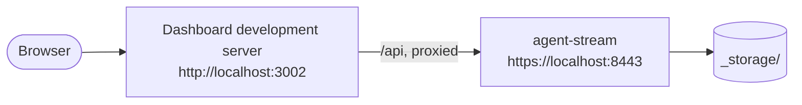
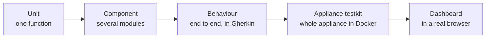

# Development Guide

This guide covers development workflows beyond the first source build. If you have not yet
run Agent Stream locally, complete [`GETTING_STARTED.md`](GETTING_STARTED.md) first.

## Workflow Overview

| Workflow       | Use it for                                                         | Entry point                     |
| -------------- | ------------------------------------------------------------------ | ------------------------------- |
| Native debug   | Backend plus frontend development server                           | `make run-debug`                |
| Native watch   | Rebuilding and restarting the backend after Rust changes           | `make run-watch`                |
| Native release | Testing an optimised binary with the built dashboard               | `make run-release`              |
| Named instance | Running isolated local configurations on separate ports            | `make run-debug x=<name>`       |
| Docker         | Building and running a local container image from this source tree | `make docker-run`               |
| VS Code        | Debugging the backend with CodeLLDB breakpoints                    | A launch configuration, then F5 |



`make run-debug` runs both processes. In `make run-release` there is no development server:
the binary serves the built dashboard itself, on the same origin as the API.

These workflows build locally. They do not depend on a published binary or container image.
The setup, run, and Docker scripts are bash and run on macOS and Linux: in-place `sed` edits go
through the `sedi` helper in [`scripts/_portable.sh`](../../scripts/_portable.sh), which handles
both GNU and BSD `sed`. On macOS, `make config-certs` also adds the development certificate to
the system keychain; on Linux it leaves the trust store unchanged.
[`GETTING_STARTED.md`](GETTING_STARTED.md#linux-native) covers the Linux build dependencies.

Run `make help` to list every available target with a short description.

## Native Development

The local environment is generated beneath `envs/local/`, with bootstrap configuration at:

```text
envs/local/config/config.toml
```

The run targets prepare certificates and configuration before launching the process. The
backup encryption key is read from `envs/backup_encryption_key`, which `make config-certs`
generates, and passed to the process as `AS_BACKUP_ENCRYPTION_KEY`. Override it with
`make run-debug AS_BACKUP_ENCRYPTION_KEY=<64 hex characters>`. The generated
`config.toml` enables encryption at rest with `key_source = "environment"`; the master key
is read from `envs/master_key`, which `make config-certs` also generates, and passed as
`AS_MASTER_KEY`. Keep that file: local storage cannot be read without it. An
existing `config.toml` without an `[encryption]` choice, including one that only says
`enabled = false`, is backed up to `config.toml.bak` and regenerated (only `auth_mode` is
carried over) when the environment has no `_storage` yet. When `_storage` already exists,
`allow_unencrypted = true` is added instead, because governance logs and multimedia written
unencrypted cannot be migrated.

### Debug Mode

```bash
make run-debug
```

`run-debug` builds the dashboard and the debug binary, then starts the backend and a frontend
development server. Frontend changes hot reload. Rust backend changes do not rebuild or
restart in this mode.

### Backend Watch Mode

```bash
make run-watch
```

`run-watch` uses `cargo watch` (installed by `make install-rust-deps`) to rebuild and restart
the backend on Rust source changes. It also runs the frontend development server, whose own
tooling handles frontend hot reload.

### Release Mode

```bash
make run-release
```

`run-release` builds the optimised binary and dashboard, prepares `envs/local/`, and serves the
built dashboard without a separate frontend development server.

### Run Options

`run-debug` and `run-watch` accept these variables; `run-release` accepts `tk`:

| Variable                               | Effect                                                                                                                        |
| -------------------------------------- | ----------------------------------------------------------------------------------------------------------------------------- |
| `x=<name>`                             | Run a named instance; see [Named Instances](#named-instances)                                                                 |
| `o=1`                                  | Open the browser again even if this environment has opened it before                                                          |
| `auth=saml AZURE_TENANT=<tenant-guid>` | Switch the environment to SAML sign-in ([`scripts/_saml-setup.sh`](../../scripts/_saml-setup.sh))                             |
| `auth=passkey`                         | Switch the environment back to passkey sign-in                                                                                |
| `tk=1`                                 | Start with `AS_TEST_MODE` and `AS_TEST_TOKEN` set, enabling the test-auth login the appliance testkit uses. Debug builds only |
| `RUST_LOG=<filter>`                    | Log filter, `debug` by default                                                                                                |

### Standalone Frontend

```bash
make www-dev
```

Use this when the backend is already running and you only need the dashboard development
server.

### Build And Configuration Targets

| Command                 | Purpose                                                                                     |
| ----------------------- | ------------------------------------------------------------------------------------------- |
| `make cargo-build`      | Build the debug binary after verifying local Rust dependencies                              |
| `make cargo-release`    | Build the optimised binary                                                                  |
| `make www`              | Build the dashboard                                                                         |
| `make www-rebuild`      | Remove the dashboard build, rebuild it, and refresh local configuration                     |
| `make config-certs`     | Prepare the local TLS certificates, backup encryption key and encryption-at-rest master key |
| `make config-debug`     | Prepare certificates, the dashboard build, and the local debug configuration                |
| `make config-debug-dev` | Prepare the local debug configuration without a static dashboard build                      |
| `make config-release`   | Prepare the release environment, including the optimised binary                             |

## Named Instances

Run isolated local instances by supplying `x`:

```bash
make run-debug x=peer-a
make run-watch x=peer-b
```

Each instance uses `envs/local-<name>/` and receives its own HTTP, HTTPS, outbound, and
frontend ports. The base ports are 8080, 8443, 9000, and 3002. A numeric name `N` adds `N` to
each; any other name adds a fixed offset between 100 and 999 derived from the name. The
assigned values are written to that instance's `instance.env` and printed at startup.

Use names that are stable across runs. If two names resolve to a conflicting port set,
preparation stops and asks you to choose another name or remove the conflicting environment.

To prepare a named instance without starting it:

```bash
make config-debug-x x=peer-a
```

For Fabric work between two local instances, `make mediator-up` starts a local DIDComm
mediator under `envs/mediator/` and `make mediator-down` stops it. It does not accept the
default `did:web` Connection Point DIDs of instances on `localhost`: pair them with
`did_method: "peer"`, or put the instances and the mediator behind public hostnames, and
register the mediator by its `did:webvh` DID. See
[`FABRIC.md`](../FABRIC.md#local-mediator).

## Docker

Docker builds an image from the current source tree (backend binary and dashboard) and runs
it, with no host Rust or Node.js toolchain. The user-facing steps (exporting the backup key,
`docker compose up`, the sample request, reset, and troubleshooting) are in
[`GETTING_STARTED.md`](GETTING_STARTED.md#docker-quickstart). This section covers what the
targets and scripts do.

### Preparing `envs/docker/`

```bash
make config-docker
```

`config-docker` runs `config-certs`, builds `agent-stream:local` from
[`Dockerfile`](../../Dockerfile) when its inputs changed, and runs
[`scripts/_prepare.sh`](../../scripts/_prepare.sh) for `envs/docker`. That script:

- generates `envs/docker/config/config.toml` by running the image with `--generate-bootstrap`
  and `--base-folder /app`, so the paths in it are container paths;
- turns on `[did_cache] allow_private_hosts` in that file, so DID resolution can reach a
  mediator on localhost;
- when `envs/docker/config/agent-stream.json` does not exist, copies it from
  [`config/examples/agent-stream.example.json`](../../config/examples/agent-stream.example.json)
  and resolves the `YOUR_DOMAIN` placeholders: the WebAuthn relying party and DID domain become
  `localhost` and the external origin `https://localhost:8443`;
- copies the certificates to `envs/docker/certs/`;
- on a fresh `envs/docker` only (no `_storage` directory yet), seeds `envs/docker/_storage/`
  from [`deploy/quickstart/seed/storage/`](../../deploy/quickstart/seed/), an LLM Surface at
  `/llm/quickstart` that targets the mock model server. Existing storage is never touched;
- creates `envs/docker/_backup_restore/`, where a dashboard restore stages its backup;
- on Linux, gives `_storage`, `_backup_restore`, and `certs` to uid/gid `10001` with `chown`,
  using `sudo` when not run as root. Docker Desktop on macOS maps ownership itself.

Both images (`Dockerfile` and [`Dockerfile.dev`](../../Dockerfile.dev)) run as the non-root
uid/gid `10001`.

### Docker Compose

[`docker-compose.yml`](../../docker-compose.yml) runs two services:

| Service        | Container               | Role                                                                                                                                                                                   |
| -------------- | ----------------------- | -------------------------------------------------------------------------------------------------------------------------------------------------------------------------------------- |
| `agent-stream` | `agent-stream-dev`      | Agent Stream from `agent-stream:local`, published on `127.0.0.1:8443` (HTTPS) and `127.0.0.1:8080` (HTTP) only                                                                         |
| `mock-llm`     | `agent-stream-mock-llm` | A mock OpenAI-protocol model server from [`tests/appliance/mock-llm/`](../../tests/appliance/mock-llm/), reachable only on the Compose network. Agent Stream starts once it is healthy |

Compose mounts `envs/docker/config` at `/app/config` and `envs/docker/certs` at `/app/certs`
read-only, and fails if either is missing rather than creating an empty directory.
`envs/docker/_storage` and `envs/docker/_backup_restore` are mounted read-write at
`/app/_storage` and `/app/_backup_restore`. Saving metrics or OpenTelemetry settings from the
dashboard writes `metrics.json` under `/app/config`, which the read-only mount refuses; edit
`envs/docker/config/metrics.json` instead.

`AS_BACKUP_ENCRYPTION_KEY` (64 hex characters) is required: every Compose command,
including `down`, stops until it is exported. `make config-certs` writes one to
`envs/backup_encryption_key`. `AS_MASTER_KEY`, the encryption-at-rest master key
the generated `config.toml` reads, is required the same way; `make config-certs` writes it to
`envs/master_key`.

The service restarts with `on-failure:3`. A dashboard backup restore exits with code 1 twice,
once after staging `backup.asbak` and once at the next start after applying it, so the
bounded policy carries the restore through while a configuration or permissions error stops
after three attempts. The container also has `no-new-privileges`, a health check on
`/api/v1/health`, and `host.docker.internal` mapped to the host gateway so a Surface can reach
a model server on the host.

### `make docker-run`

```bash
make docker-run
```

`docker-run` runs `config-docker`, then [`scripts/d-run.sh`](../../scripts/d-run.sh), which runs
the same pair of containers with `docker run` instead of Compose:

- creates the `agent-network` Docker network if absent;
- replaces any existing `agent-stream` and `agent-stream-mock-llm` containers;
- starts the mock model server on `agent-network` with the network alias `mock-llm`, not
  published to the host;
- runs `agent-stream` in the foreground, publishing the HTTP and HTTPS listener ports read from
  `envs/docker/config/agent-stream.json` (8080 and 8443 by default) on `127.0.0.1` only;
- mounts `envs/docker/config`, `certs`, `_storage`, and `_backup_restore`, and passes
  `AS_BACKUP_ENCRYPTION_KEY` and `AS_MASTER_KEY` (from the environment, or
  else `envs/backup_encryption_key` and `envs/master_key`), `RUST_LOG=info`, and the `AWS_*`
  credential variables;
- applies `DOCKER_CPUS` and `DOCKER_MEMORY`, 2 CPUs and `512m` by default;
- runs the container again when it exits with code 1 and a staged backup (`backup.asbak`, or
  a legacy `backup.tgwbak`) appeared or disappeared during that run, so a restore completes. Any other exit ends the
  script, and it gives up after three runs.

Stop it with `Ctrl-C`; the script removes both containers on exit.

| Command                         | Purpose                                                                                                                                                                                     |
| ------------------------------- | ------------------------------------------------------------------------------------------------------------------------------------------------------------------------------------------- |
| `make config-docker`            | Build `agent-stream:local` if needed and prepare `envs/docker/`                                                                                                                             |
| `make docker-build-local`       | Build `agent-stream:local` when source inputs changed                                                                                                                                       |
| `make docker-rebuild-local`     | Force a rebuild of `agent-stream:local`                                                                                                                                                     |
| `make docker-build-local-dev`   | Build `agent-stream:local-dev` from `Dockerfile.dev`, a debug build that compiles faster                                                                                                    |
| `make docker-rebuild-local-dev` | Force a rebuild of the debug image                                                                                                                                                          |
| `make docker-run`               | Prepare `envs/docker/` and run the release image through `d-run.sh`                                                                                                                         |
| `make docker-run-dev`           | Build the debug image, prepare `envs/docker/` with it, and run it through `d-run.sh`                                                                                                        |
| `make docker-shell`             | Start a container from `agent-stream:local` with a bash entrypoint and open a shell in it ([`scripts/d-shell.sh`](../../scripts/d-shell.sh)); the container is removed when the shell exits |
| `make docker-network`           | Create `agent-network` if absent                                                                                                                                                            |

[`scripts/d-build.sh`](../../scripts/d-build.sh) builds with `docker buildx` into the local image
store only, for the host platform. To start from a clean slate, remove `envs/docker` (with
`sudo` on Linux, where it belongs to uid `10001`) and run `make config-docker` again.

### Running An Agent Alongside It

Under `make docker-run`, containers on `agent-network` reach each other by container name, so
an agent or a supporting service needs no host port mapping:

```bash
docker run --network agent-network --name my-agent --env-file .env my-agent:local
docker run --network agent-network --name redis-service -d redis:latest
```

Use the container name as the hostname when configuring an upstream that should reach it.
Under Compose, add the service to `docker-compose.yml` instead and use its service name.

## VS Code Debugging

Install the CodeLLDB extension and add a launch configuration that builds and runs the
`agent-stream` binary against a prepared environment:

```json
{
  "type": "lldb",
  "request": "launch",
  "name": "agent-stream (envs/local)",
  "cargo": {
    "args": ["build", "--bin=agent-stream", "--package=agent-stream"],
    "filter": { "name": "agent-stream", "kind": "bin" }
  },
  "args": ["--config", "config.toml"],
  "cwd": "${workspaceFolder}/envs/local/config",
  "env": {
    "RUST_LOG": "debug",
    "AS_BACKUP_ENCRYPTION_KEY": "${env:AS_BACKUP_ENCRYPTION_KEY}",
    "AS_MASTER_KEY": "${env:AS_MASTER_KEY}"
  }
}
```

Run `make config-debug-dev` first so `envs/local/config/config.toml` exists, and export
`AS_BACKUP_ENCRYPTION_KEY=$(cat envs/backup_encryption_key)` and
`AS_MASTER_KEY=$(cat envs/master_key)` in the environment VS Code starts from, so the
launch configuration passes them through without committing the keys.
For a named instance, point `cwd` at `envs/local-<name>/config`. F5 builds and debugs the
backend only; run `make www-dev` when you also need the dashboard and the browser passkey flow.

## Shell Scripts

The make targets call the scripts in [`scripts/`](../../scripts/); use `make` rather than
calling them directly.

| Script                                                         | Role                                                                                                                                     |
| -------------------------------------------------------------- | ---------------------------------------------------------------------------------------------------------------------------------------- |
| `_env.sh`                                                      | Shared variables: environment directories, image tag, and default ports                                                                  |
| `_certs.sh`                                                    | Generates the local TLS certificates, backup encryption key and encryption-at-rest master key (`make config-certs`)                      |
| `_prepare.sh`                                                  | Prepares an environment directory: assigns ports, generates the bootstrap configuration, and writes the instance files (`make config-*`) |
| `_run-common.sh`                                               | Helpers shared by the local run scripts                                                                                                  |
| `_portable.sh`                                                 | Sourced helpers that smooth over BSD and GNU tool differences                                                                            |
| `_saml-setup.sh`, `_passkey-setup.sh`, `_swap-auth-storage.sh` | Switch an environment between SAML and passkey sign-in (`auth=`)                                                                         |
| `l-run-debug.sh`, `l-run-watch.sh`, `l-run-release.sh`         | Start the backend and, for debug and watch, the frontend development server                                                              |
| `l-run-ui-tests.sh`                                            | Starts a test-mode instance, runs the Playwright suite, and stops it (`make ui-test`)                                                    |
| `d-build.sh`, `d-run.sh`, `d-shell.sh`                         | Build, run, and open a shell in the local Docker image                                                                                   |
| `certs/`                                                       | Self-signed and mTLS test certificate generation (`make generate-cert`, `make trust-cert`)                                               |
| `mediator/`                                                    | Start and stop the local DIDComm mediator (`make mediator-up`, `make mediator-down`)                                                     |
| `setup-dynamodb.sh`                                            | Creates a DynamoDB table for configuration storage (`make setup-dynamodb`)                                                               |
| `bdd-gherkin.py`                                               | BDD inventory and lint; see [`../testing/bdd-gherkin-tool.md`](../testing/bdd-gherkin-tool.md)                                           |
| `checks.sh`                                                    | Runs `cargo fmt`, `cargo check`, Clippy (with fixes), build and tests in one go (Rust only); run it directly                             |
| `githooks/`                                                    | Frontend audit and lint hook scripts; run them directly. `make install-git-hooks` installs the separate pre-commit hooks                 |

## Tests And Quality Checks



[`TESTING.md`](TESTING.md) explains what belongs in each layer and how to run it. For a fast
inner loop:

```bash
make check
cargo test --bin agent-stream "<module name>"
```

`make ci` is the broad local preflight, and [`CONTRIBUTING.md`](../../CONTRIBUTING.md) lists the
checks expected before a pull request.

### Other Targets

`make help` lists every target. Those not covered elsewhere in these guides:

| Target                                            | What it does                                                                                                                                                                 |
| ------------------------------------------------- | ---------------------------------------------------------------------------------------------------------------------------------------------------------------------------- |
| `test-unit`, `test-policies`                      | Run `cargo test --lib`; the library target (`src/lib.rs`) is empty, so these run no tests. Use `make test test=<name>` or `cargo test --bin agent-stream "<module>"` instead |
| `pre-commit-rust`, `pre-commit-node`              | Format and lint with autofix; fail if any file changed                                                                                                                       |
| `pre-commit-rust-test`                            | Run the Rust test suite                                                                                                                                                      |
| `node-ci`, `cargo-build-ci`                       | Run the frontend checks, or build every Rust target and feature as CI does                                                                                                   |
| `npm-install`, `npm-build`                        | Install the dashboard dependencies, or build the dashboard                                                                                                                   |
| `fmt-www-all`, `npm-lint-www-all`                 | Format, or lint with autofix, Rust and every frontend app                                                                                                                    |
| `audit-www-all`, `audit-fix`, `audit-fix-www-all` | Audit Rust and every frontend app, or update dependencies to patched versions and audit again                                                                                |
| `verify-rust-deps`, `verify-xml-libs`             | Check the Rust toolchain dependencies, or that the XML libraries resolve to one Homebrew copy                                                                                |
| `full-setup`                                      | `install-deps` then `dev`                                                                                                                                                    |
| `clean-cargo`, `clean-www`                        | Remove Rust build output, or the dashboard build output and `node_modules`                                                                                                   |
| `make-client`                                     | Build the VS Code extension `.vsix` and copy it to `clients/vscode-agent-stream/versions/`                                                                                   |
| `docs-list`                                       | List the documentation files                                                                                                                                                 |
| `ngrok`                                           | Start an ngrok tunnel (default port 8440)                                                                                                                                    |

## Storage Export And Backup

Agent Stream has two archive types. They are not interchangeable.

| Archive                   | Purpose            | Contents and protection                                                                                            |
| ------------------------- | ------------------ | ------------------------------------------------------------------------------------------------------------------ |
| Storage export (`.asexp`) | Diagnostic sharing | Excludes sensitive directories, redacts the remaining data, then encrypts to a recipient's Ed25519 public key      |
| Backup (`backup.asbak`)   | Full restore       | The storage needed to restore the appliance, including sensitive records, encrypted with the backup encryption key |

A redacted export cannot restore an appliance, and a backup must not be treated as sanitised
support data. Backup, restore, and portable re-encryption are described in
[`ENCRYPTION_AT_REST.md`](../ENCRYPTION_AT_REST.md).

### Create A Redacted Export

The export ([`src/export/`](../../src/export/)) leaves out the `identities`, `secrets`,
`vc_keys`, `passkeys`, `apikeys`, `api_keys`, `access_tokens`, `certificates`, `sessions`,
`avatars`, `delegation_vault`, `multimedia_store`, `messages`, `members`, `enrolment`, `did`
and `did_cache` storage directories entirely, together with any backup copy named `<dir>.<suffix>`
(for example `passkeys.backup-2026-10-01`). It never follows a link.

It exports only the structured records it can redact: JSON files, and JSON Lines files record
by record. Every other file is left out: logs and other text, images and audio, `.enc`
ciphertext, certificates and other binaries. So is a JSON file that does not parse, and a
JSON Lines record that does not parse becomes `[REDACTED-UNPARSEABLE]`. Ask for logs
separately when they are needed.

In the JSON it exports, keys are compared lowercased with `-` read as `_`, and values are
replaced with `[REDACTED…]` placeholders:

- every value, at any depth, under a key that names a credential: any key containing
  `token`, `secret`, `password`, `passwd`, `private_key`, `privatekey`, `credential`,
  `authorization`, `cookie`, `verifier`, `api_key`, `apikey`, `session`, `header` or `jwt`.
  That covers an OAuth `refresh_token`, a `client_secret`, a mediator's `our_secrets`, an
  `X-API-Key` header and every value in a `headers` map (the header names, as its keys, are
  kept; in a list of `{name, value}` entries both are redacted);
- the private members (`d`, `p`, `q`, `dp`, `dq`, `qi`, `k`, `oth`) of any JSON Web Key;
- user content: `prompt`, `completion`, `messages`, `input`, `output`, `body`, `payload`,
  `message_body`, `sample_input`, `transcript` and the other captured-traffic fields;
- personal fields: any key containing `email`, `username` or `phone`, and `user_id`,
  `first_name`, `last_name`, `full_name`, `display_name`, `saml_id`, `subject`,
  `principal_key`, `caller_principal` and `created_by`;
- wallet fields and free-form integration `configuration` blocks.

Every other string, including each string in an array, has the emails, DIDs and IPv4
addresses inside it redacted, and a string that is a whole DID becomes `did:redacted:<hash>`,
so records can still be correlated. An object key that is a DID, an email or an address
becomes a hash in the same way. Other free text, such as an error message quoting an upstream
response, is exported with only those patterns removed. The ZIP is then encrypted to the
recipient's Ed25519 public key (X25519 key agreement, HKDF-SHA256, AES-256-GCM).

Generate an Ed25519 key pair for the recipient:

```bash
openssl genpkey -algorithm Ed25519 -out private.pem
openssl pkey -in private.pem -pubout -out public.pem
```

Stop the local instance, then export its storage from the repository root:

```bash
cargo run -- --config envs/local/config/config.toml --export-storage export.asexp
```

Paste the contents of `public.pem` when prompted, followed by an empty line. The dashboard's
Settings page offers the same export on its System tab.

Decrypt a received export with the corresponding private key:

```bash
cargo run -- --decrypt-export export.asexp --output export.zip
```

Paste the contents of `private.pem` when prompted, followed by an empty line. `--output`
defaults to `export.zip`. The result is the redacted storage tree. Exports saved earlier as `.atgx`
files decrypt the same way: the file is recognised by its content, not its extension.

## Related

- The hosted [Agent Stream documentation](https://docs.affinidi.com/products/affinidi-trust-fabric/agent-stream/) covers deployment, configuration, and operator workflows.
- [`GETTING_STARTED.md`](GETTING_STARTED.md): the first source build and login.
- [`TESTING.md`](TESTING.md): test layers and how to run them.
- [`MAKING_CHANGES.md`](MAKING_CHANGES.md): recipes for recurring changes.
- [`RELEASING.md`](RELEASING.md): versions, tags, and changelog fragments.
- [`../CONFIGURATION_RELOAD.md`](../CONFIGURATION_RELOAD.md): configuration reload behaviour.
- [`../FABRIC.md`](../FABRIC.md): Connection Points and appliance-to-appliance development.
- [`CONTRIBUTING.md`](../../CONTRIBUTING.md): contribution requirements.
