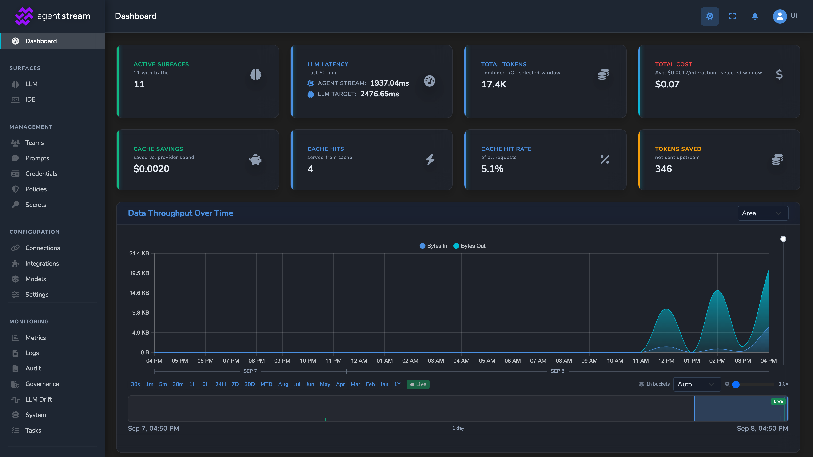

# Getting Started

This is the canonical first-run guide for Affinidi Agent Stream. It gets a working instance from this source tree without any private infrastructure. It is not the appliance deployment guide; use the hosted [Agent Stream Quickstart](https://docs.affinidi.com/products/affinidi-trust-fabric/agent-stream/get-started/) to deploy and configure the product. There are two paths:

- **[Docker quickstart](#docker-quickstart)**: needs only Docker. It builds the image, starts Agent Stream with a sample LLM Surface and a mock model server, and answers a chat completion with no provider account or API key. Use it to evaluate Agent Stream.
- **[Build from source](#build-from-source)**: builds the debug binary and runs the dashboard development server. Use it to change the code. macOS with Homebrew is the fully scripted path; on Debian/Ubuntu see [Linux (native)](#linux-native).

Login does not complete automatically on either path. You must follow the browser prompts and approve passkey registration with a supported authenticator.

## Docker Quickstart

### Prerequisites

| Requirement | Notes |
| --- | --- |
| Docker with Compose v2 | Docker Desktop on macOS or Windows, Docker Engine on Linux. Give the builder at least 12 GB of memory: compiling the image's Rust dependencies is killed at 8 GB. |
| `make`, `jq`, `openssl` | Used to generate the configuration and keys |
| A WebAuthn-capable browser and authenticator | Only for dashboard login, for example Chrome or Safari with Touch ID, or a security key |

No Rust or Node.js installation is needed: both builds run inside Docker.

### Build And Start

From the repository root:

```bash
make config-docker
export AS_BACKUP_ENCRYPTION_KEY=$(cat envs/backup_encryption_key)
export AS_MASTER_KEY=$(cat envs/master_key)
docker compose up
```

`make config-docker`:

1. generates a self-signed development certificate, a backup encryption key and an encryption-at-rest master key under `envs/` (on macOS it also adds the certificate to the system keychain, which asks for your password);
2. builds the `agent-stream:local` image from [`Dockerfile`](../../Dockerfile), which takes several minutes the first time;
3. writes the configuration to `envs/docker/config/` and the certificate to `envs/docker/certs/`, with the WebAuthn relying party set to `localhost` and encryption at rest enabled under the master key in `envs/master_key` (keep that file: the stored data cannot be read without it);
4. on the first run only, seeds `envs/docker/_storage/` with a sample LLM Surface at the route `/llm/quickstart` (from [`deploy/quickstart/seed/`](../../deploy/quickstart/seed/));
5. on Linux, gives `envs/docker/_storage/`, `envs/docker/_backup_restore/` and `envs/docker/certs/` to the container's non-root user (uid `10001`), which asks for your password. Docker Desktop on macOS maps ownership itself.

[`docker-compose.yml`](../../docker-compose.yml) then starts two containers: Agent Stream, published on `127.0.0.1` only, and `mock-llm`, a mock OpenAI-protocol model server from [`tests/appliance/mock-llm/`](../../tests/appliance/mock-llm/) that returns a fixed reply and calls no real model. The mock is reachable only from the Compose network.

### Send A Chat Completion

```bash
curl -k https://localhost:8443/llm/quickstart/v1/chat/completions \
  -H 'content-type: application/json' \
  -d '{"model":"mock-small","messages":[{"role":"user","content":"Hello"}]}'
```

The response is an OpenAI Chat Completions object with the mock's reply and a `usage` block. The same Surface also answers the Anthropic Messages API at `/llm/quickstart/v1/messages` and the OpenAI Responses API at `/llm/quickstart/v1/responses`.

The sample Surface has no caller authentication, so anything that can reach the port can call it. Compose publishes the port on loopback only. Add caller authentication to the Surface, or delete it, before exposing the port to other hosts.

### Open The Dashboard (Docker)

Open <https://localhost:8443/> and accept the self-signed certificate warning, then [register a passkey](#register-and-log-in). The first user to register becomes the Primary Administrator, and the **Quickstart (mock LLM)** Surface is listed with the other Surfaces.

Passkey login only works at the origin in `webauthn.external_origin` of `envs/docker/config/agent-stream.json`, which is `https://localhost:8443`. Opening `http://localhost:8080` or `127.0.0.1` fails origin validation.

### Connect A Real Provider

In the dashboard, create an LLM Surface for your provider and model. For a provider that needs a key, store the key as a secret and select it on the Surface; the key is never written into the Surface itself. LLM Surface routes live under `/llm/`, so a Surface with the route `/llm/my-model` answers at `https://localhost:8443/llm/my-model/v1/chat/completions`.

To use a model server on your machine, such as [Ollama](https://ollama.com), choose the Ollama provider and set the base URL to `http://host.docker.internal:11434` (no `/v1`). `localhost` inside the container is the container itself, and Agent Stream refuses loopback upstreams. The dashboard's connection test is stricter than live traffic and rejects private addresses, including `host.docker.internal`; save the Surface and send a request instead.

To remove the sample Surface, delete it in the dashboard, and stop the mock by removing the `mock-llm` service and the `depends_on` block from `docker-compose.yml`.

### Stop And Reset (Docker)

Press `Ctrl-C`, or run `docker compose down`. Storage persists in `envs/docker/_storage/`. To start again from a clean state with the sample Surface:

```bash
docker compose down
rm -rf envs/docker
make config-docker
```

On Linux, `envs/docker/_storage`, `envs/docker/_backup_restore` and `envs/docker/certs` belong to uid `10001`, so use `sudo rm -rf envs/docker`.

Restoring a backup from the dashboard stages it in `envs/docker/_backup_restore/` and restarts Agent Stream twice, once to stage it and once to apply it. Compose restarts the container on its own (`restart: on-failure:3`), and `make docker-run` runs it again; wait for the dashboard to come back.

### Other Docker Workflows

| Command | Use |
| --- | --- |
| `make docker-run` | Run the release image with `docker run` instead of Compose. It also starts the mock model server, publishes on `127.0.0.1` only, and runs Agent Stream again while a backup restore completes. |
| `make docker-run-dev` | Same with a debug build, which compiles faster |
| `make docker-shell` | Open a shell in a container built from the image |
| `make docker-rebuild-local` | Force a rebuild of `agent-stream:local` |

The image runs as the non-root uid/gid `10001` and reads its configuration from `/app/config`, which Compose mounts read-only. Saving metrics and OpenTelemetry settings from the dashboard writes `metrics.json` there, so it fails with a read-only mount; edit `envs/docker/config/metrics.json` and restart instead. All other runtime writes go to `/app/_storage`, and a dashboard backup restore stages its file in `/app/_backup_restore`; both are mounted from `envs/docker/`.

For anything beyond local evaluation, set `webauthn.rp_id`, `webauthn.external_origin`, and `did.domain` in `envs/docker/config/agent-stream.json` to your public host, set `[did_cache] allow_private_hosts = false` in `envs/docker/config/config.toml`, and replace the self-signed certificate.

## Build From Source

At the end of this path you will have:

- a locally built `agent-stream` process,
- the dashboard running through its frontend development server,
- a passkey registered and an authenticated dashboard session,
- readiness confirmed at `/api/v1/health`, and
- liveness confirmed at `/api/v1/alive`.

### Prerequisites

This path is written for macOS with [Homebrew](https://brew.sh). For a native Linux build, see [Linux (native)](#linux-native) below.

Install these before starting:

| Requirement | Notes |
| --- | --- |
| Git | Used to clone and work with the repository |
| Homebrew | Used by `make install-deps` |
| Rust `1.95.0` or newer | The minimum version is declared in [`Cargo.toml`](../../Cargo.toml) |
| Node.js and npm | Required to build and run the dashboard |
| A WebAuthn-capable browser and authenticator | For example, Safari or Chrome with Touch ID, or a compatible security key |

The dependency target installs the additional Rust tools, native packages, command-line tools, and Git hooks used by the repository.

### Build And Run

From the repository root, run:

```bash
make install-deps
make run-debug
```

`make install-deps` is a one-time macOS/Homebrew setup. `make run-debug` builds the dashboard and debug Rust binary, generates local certificates and keys, prepares the local environment, starts Agent Stream, and starts the frontend development server.

On macOS the certificate step adds the generated local certificate to the system keychain and asks for your password.

During initial configuration, the setup asks for a public URL for this instance. Press Enter to use localhost unless you are intentionally testing through a configured public tunnel.

The first build may take several minutes. Later builds are incremental.

Configuration generated by this workflow is stored under `envs/local/`. The bootstrap configuration is:

```text
envs/local/config/config.toml
```

A source build starts with no Surfaces. Create one in the dashboard as described in [Connect A Real Provider](#connect-a-real-provider); for a model server on your machine, use its LAN address rather than `localhost`.

### Linux (native)

On Linux, install the build dependencies with your package manager. On Debian/Ubuntu, install the [`Dockerfile`](../../Dockerfile) build dependencies plus `jq` and `xmlsec1`, which `make install-deps` installs on macOS:

```bash
sudo apt-get update
sudo apt-get install -y --no-install-recommends \
  build-essential cmake git jq libclang-dev libcurl4-openssl-dev libdbus-1-dev \
  libsasl2-2 libsasl2-dev libsasl2-modules libssl-dev libxml2-dev libxmlsec1-dev \
  pkg-config protobuf-compiler xmlsec1
```

Then install Rust `1.95.0` or newer via [rustup](https://rustup.rs) and Node.js 22 or newer with npm (the [`Dockerfile`](../../Dockerfile) builds with 22), and run `make run-debug`. The setup and run scripts are portable bash. On Linux the self-signed certificate is not added to the system trust store; accept the browser warning or use `curl -k`.

### Open The Dashboard

Read the URLs printed by `make run-debug`. The standard local values are:

```text
Backend:  https://localhost:8443
Frontend: http://localhost:3002
```

Open the printed **Frontend** URL. The script normally opens it for you, but you should still use the console output as the source of truth because named instances (`make run-debug x=<name>`) use different ports.

The frontend development server proxies `/api/**` requests to the local HTTPS backend. Backend certificate handling is therefore separate from the browser origin used for the dashboard.

### Register And Log In

The default local authentication mode is passkey authentication.

1. Open the dashboard URL (the printed frontend URL for a source build, <https://localhost:8443/> for Docker).
2. Start registration from the onboarding screen.
3. Follow the browser's passkey prompt.
4. Approve registration with Touch ID or another supported authenticator.
5. Continue into the management dashboard.

The browser interaction is required. Starting the process does not register a passkey or log you in automatically.



### Verify Readiness And Liveness

Use the backend URL printed by the run command (for Docker, `https://localhost:8443`). With the standard local ports:

```bash
curl -k https://localhost:8443/api/v1/health
curl -k https://localhost:8443/api/v1/alive
```

The local backend uses a self-signed certificate, so these examples use `-k`.

| Endpoint | Meaning | Expected result |
| --- | --- | --- |
| `GET /api/v1/health` | Readiness | HTTP `200` with `{"status":"OK"}` when Active and ready; HTTP `503` while starting, activating, or Standby |
| `GET /api/v1/alive` | Liveness | HTTP `200` while the process is alive, including in Standby mode |

The Compose healthcheck polls `/api/v1/health`.

### Stop Agent Stream

Press `Ctrl-C` in the terminal running `make run-debug`. The run script stops both the backend and frontend development server.

### Reset Local State

Use the narrowest reset target that matches what you want to remove:

| Command | Removes |
| --- | --- |
| `make clean-local-storage` | Local persisted data, including passkey and onboarding state |
| `make clean-envs-local` | Generated `envs/local/` configuration, certificates, and assigned ports |
| `make clean-artifacts` | Rust build artefacts, the dashboard build, and dashboard dependencies |
| `make clean-all` | Every generated `envs/` environment (including named instances) and all build artefacts |

To repeat first-time onboarding while keeping build artefacts, run:

```bash
make clean-local-storage
make run-debug
```

Cleanup targets delete local data. Review the command before running it if the environment contains work you need to retain.

## Troubleshooting

| Symptom | What to do |
| --- | --- |
| `docker compose` aborts with `set a 64-char hex key` | Export `AS_BACKUP_ENCRYPTION_KEY` as shown above. Compose requires it for every command, including `down`. |
| `docker compose` aborts with `set the master key` | Export `AS_MASTER_KEY` as shown above. Compose requires it for every command, including `down`. |
| Startup fails with `Encryption at rest is not configured` | The `config.toml` predates the required encryption choice. To keep an existing `envs/docker/_storage` readable, add `allow_unencrypted = true` under `[encryption]` in `envs/docker/config/config.toml` (`make config-docker` does this when `_storage` exists). For a fresh `_storage`, regenerate it with `make config-docker`. See [`ENCRYPTION_AT_REST.md`](../ENCRYPTION_AT_REST.md#choosing-encryption-or-plaintext). |
| `docker compose` reports `source path does not exist` | Run `make config-docker` first. |
| The image build is killed or runs out of memory | Give Docker at least 12 GB of memory. The release profile in the image already disables LTO to reduce memory use. |
| Storage writes or the TLS key are denied on Linux | `make config-docker` could not give `envs/docker/_storage`, `envs/docker/_backup_restore` and `envs/docker/certs` to the container user. Run `sudo chown -R 10001:10001 envs/docker/_storage envs/docker/_backup_restore envs/docker/certs`. Do not make them world-writable: they hold passkeys, secrets, and the TLS key. |
| The quickstart curl call returns `404` or `405` | The route is wrong (LLM Surface routes start with `/llm/`), or `envs/docker/_storage` existed before `make config-docker` ran, so the sample was not seeded. Reset as described in [Stop And Reset (Docker)](#stop-and-reset-docker). |
| The quickstart curl call returns a `5xx` upstream error | Check that the `mock-llm` container is running and healthy: `docker compose ps`. |
| `make install-deps` fails on Linux or Windows | This target is macOS/Homebrew-specific. On Linux, follow [Linux (native)](#linux-native). Windows is supported only through the Docker quickstart. |
| The first build appears idle | Rust and dashboard dependency compilation can take several minutes. Check the terminal for ongoing compiler output before interrupting it. |
| The setup waits after asking for a public URL | Press Enter for localhost unless you intentionally need a public tunnel. |
| The dashboard does not open | Open the printed frontend URL manually. Do not assume the default port when using a named instance. |
| Passkey registration does not prompt | Use a WebAuthn-capable browser and ensure Touch ID or another platform/security-key authenticator is available. |
| Passkey registration fails with an origin error | Open exactly the `external_origin` from `agent-stream.json`. |
| `/api/v1/health` returns `503` | The instance is not ready. Wait for startup to finish and inspect the server log. A Standby instance intentionally remains unready. |
| `curl` reports a certificate error | Use `curl -k` for the generated local development certificate. Do not use insecure certificate handling for production endpoints. |
| Startup reports an occupied port | Stop the process using that port, or run a named instance with `make run-debug x=<name>`, which uses its own ports. |
| Generated configuration is inconsistent | Run `make clean-envs-local`, then `make run-debug` to regenerate `envs/local/`. This also removes local certificates and port assignments. |

## Next Steps

- Deploy an appliance, create your first LLM Surface, and configure product features with the hosted [Agent Stream documentation](https://docs.affinidi.com/products/affinidi-trust-fabric/agent-stream/).
- Read the [project overview](../../README.md) for concepts, capabilities, and status.
- Use the [repository documentation index](../README.md) for implementation references.
- Use the [development guide](DEVELOPMENT.md) for Docker, debugging, named instances, scripts, and storage export, and [TESTING.md](TESTING.md) for the test layers.
- Run `make help` to list development, test, and Docker targets.
- Read [CONTRIBUTING.md](../../CONTRIBUTING.md) before proposing a change.
