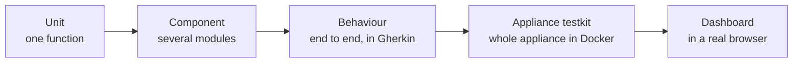

# Testing

The test layers, what belongs in each, and how to run them.

[`CONTRIBUTING.md`](../../CONTRIBUTING.md) states the requirement: cover changes with tests,
positive and negative cases, and assert returned values rather than the absence of an error.
This page says which layer to put them in.

## Layers

| Layer | Lives in | Covers | Needs |
| --- | --- | --- | --- |
| Unit | `#[cfg(test)] mod tests` inline in each module | One function or type in isolation | Nothing |
| Component | [`src/component_tests/`](../../src/component_tests/) | A flow across several modules | Nothing |
| Behaviour | [`tests/`](../../tests/), with Gherkin features under [`tests/features/`](../../tests/features/) | A described behaviour end to end, against a real `agent-stream` process, in the project's own vocabulary | A built binary |
| Appliance testkit | [`tests/appliance/`](../../tests/appliance/README.md) | The whole appliance: traffic, refusals, limits, enrolment, policy, drift, and usage reconciliation | Docker |
| Dashboard | [`ui-tests/`](../../ui-tests/README.md) for Playwright; Jest beside the dashboard source | The dashboard in a real browser, and its components and helpers | Playwright, or Node.js for Jest |

Over 300 source files carry inline test modules, there are 4 component-test files, 28
feature files, and 8 Playwright specs.



Left to right, each layer is slower and covers more at once.

## Choosing a layer

Work down this list and stop at the first one that fits.

| The change is | Test it as |
| --- | --- |
| A pure function, a parser, a validator, a wire-format conversion | Unit |
| A new configuration field with validation rules | Unit, positive and negative |
| A JSON shape the dashboard mirrors | Unit, asserting the serialised shape |
| Two or more modules agreeing on something, such as a pipeline stage calling a store | Component |
| A behaviour an operator would recognise and describe, such as "a caller over its budget is refused" | Behaviour |
| Metering, limits, or telemetry that must reconcile across many calls | Appliance testkit |
| A dashboard page, form, or interaction | Dashboard |

A change that adds a stage to the request pipeline usually needs two: a unit test for the
logic, and a behaviour scenario proving the stage runs in the right place and refuses with
the right status.

## Unit tests

Inline, in the module they cover. The crate's tests compile into the `agent-stream` binary's
test target, so filter by module path. Run `make config-test` once first: it generates the
certificates and backup key the tests need, and the make targets do this for you.

```bash
cargo test --bin agent-stream "<module path>"
cargo test --bin agent-stream pipes::prompt_guard::external
cargo test --bin agent-stream pipes::config::tests
cargo test --bin agent-stream policies::opa
```

For a compile check without running anything:

```bash
cargo test --no-run --bin agent-stream
```

## Component tests

[`src/component_tests/`](../../src/component_tests/) holds flows that cross module boundaries
but need no Docker, one file per flow: `didwebvh_e2e.rs`, `mtls.rs`, `pat_resource_scope.rs`, `web_fetch.rs`.
They are part of the binary's test target:

```bash
cargo test --bin agent-stream component_tests
```

## Behaviour tests

One Cucumber suite, `surface_bdd`, declared as a harness-free test target in
[`Cargo.toml`](../../Cargo.toml). Its entry point is
[`tests/surface_bdd.rs`](../../tests/surface_bdd.rs), the step definitions are in
`tests/surface_bdd/steps/`, and the shared harness is in `tests/bdd_support/`. Features live
under [`tests/features/surface/`](../../tests/features/surface/). Each scenario gets its own
temporary configuration and storage, a mock provider set, and its own `agent-stream` process.

```bash
make test-bdd
make lint-bdd-gherkin
```

`make test-bdd` runs `cargo test --test surface_bdd` with one scenario at a time unless
`BDD_MAX_CONCURRENT_SCENARIOS` is set. Run directly with `cargo test --test surface_bdd`, the
suite uses `BDD_MAX_CONCURRENT_SCENARIOS`, or else the available parallelism capped at 4.
`DEBUG=1` runs only scenarios tagged `@debug`, one at a time. `BDD_FEATURE_PATH` points it at a different feature directory.

`make lint-bdd-gherkin` compiles and self-tests [`scripts/bdd-gherkin.py`](../../scripts/bdd-gherkin.py),
then lints feature wording, tags, terminology, and step bindings. The script also produces a
step inventory, the quickest way to find an existing step before writing a new one.

Feature files use the vocabulary in [`CONTEXT.md`](../../CONTEXT.md). Before editing a
`.feature` file, a step, or the harness, read:

- [`../testing/bdd-gherkin.md`](../testing/bdd-gherkin.md): Agent Stream's file locations, terminology, and harness rules.
- [`../testing/bdd-gherkin-tool.md`](../testing/bdd-gherkin-tool.md): the inventory and lint tool.

## Appliance testkit

[`tests/appliance/`](../../tests/appliance/README.md) runs a disposable appliance, a mock OpenAI-protocol provider
with known token usage, and a runner that reconciles the appliance's recorded statistics
against its own ledger. It authenticates through the test-auth login, which exists only in
debug builds and only with `AS_TEST_MODE` and `AS_TEST_TOKEN` set.
`AS_TEST_USERNAME` and `AS_TEST_USER_ID` set the test-auth identity
(defaults `test-user` and `test-user-001`), and `AS_TEST_ALLOW_ROLE_OVERRIDE=true`
lets a test login choose its role.

```bash
make test-integration
```

`make test-integration` runs the self-contained mode (`tests/appliance/run.sh managed`) under Docker
Compose. To drive an instance you already run, start it with `tk=1` (see
[`DEVELOPMENT.md`](DEVELOPMENT.md#run-options)) and use one of:

| Command | Runs |
| --- | --- |
| `make testkit-smoke` | Small load, about 30 calls, no drills, one round |
| `make testkit` | Small load with every drill, one round |
| `make testkit-full` | Medium load with every drill, in an interactive loop |
| `make testkit-load` | Large load, no drills, one round |

Each takes `x=<name>` to target a named instance, and `h=p` (its public URL) or `h=<url>`.
Without either, they target `http://localhost:8080`.

## Dashboard tests

Frontend unit tests run with Jest beside the dashboard source:

```bash
make npm-test
```

Playwright specs are in [`ui-tests/specs/`](../../ui-tests/specs/):

```bash
make ui-test
make ui-test-headed
make ui-test-report
```

`make ui-test` builds what it needs, starts an instance in test mode from
`envs/local-tests/`, runs the suite, and stops the instance. The instance listens on the HTTP
port that [`scripts/_prepare.sh`](../../scripts/_prepare.sh) assigns to that named environment
(see [`DEVELOPMENT.md`](DEVELOPMENT.md#named-instances)), and that address is added to the
environment's `cors`, because the dashboard's WebSocket is accepted only from a listed origin.
Specs select elements only by `data-testid`; the naming convention is in
[`ui-tests/README.md`](../../ui-tests/README.md).

## Running everything

| Command | Runs |
| --- | --- |
| `make test` | Every Rust test target, including `surface_bdd`. `make test test=<filter>` narrows by name |
| `make test-bins` | The binary's unit and component tests |
| `make test-all` | Rust, frontend unit, and Playwright tests |
| `make test-junit` | Nextest with a JUnit report at `test-results.xml` |
| `make test-coverage` | Coverage at `coverage.xml` plus the JUnit report, failing below the coverage threshold |
| `make test-rust-ci` | Coverage, then `surface_bdd` under coverage with one scenario at a time |

Nextest cannot enumerate the Cucumber harness, so its `ci` profile
([`.config/nextest.toml`](../../.config/nextest.toml)) excludes `surface_bdd`, and
`make test-rust-ci` runs it separately. The coverage threshold is `COVERAGE_THRESHOLD`, 37%
line coverage by default.

### Local confidence suites

| Suite | Command | Runs |
| --- | --- | --- |
| Fast | `make confidence-fast` | Frontend install, lint, build, and unit tests; Rust format check, `cargo check`, Clippy, BDD lint, dependency audit, build, coverage tests, and the BDD scenarios |
| Full | `make confidence-full` | The fast suite plus `make test-integration` |

`make ci` runs the same checks as `make confidence-fast`. The `local`, `rust-local`, and
`node-local` targets are broader in places, but they apply fixes and use `npm install`, so
they do not reproduce a clean check.

## Before opening a pull request

Run the check-only targets; none of them modify files:

```bash
make fmt-check
make clippy-ci
make npm-lint-ci
make test
make license-check
make audit
```

`make lint` and `make clippy` apply Clippy and ESLint fixes; use them while developing, not as
the final check.

## Continuous integration

GitHub Actions runs on every pull request and every push to `main`.

| Workflow | Runs |
| --- | --- |
| [`checks.yml`](../../.github/workflows/checks.yml) | `cargo audit`, `cargo deny`, `rustfmt`, the Rust security scanner, and Clippy on the binary and BDD targets. It also runs daily against the latest advisory database |
| [`ci.yml`](../../.github/workflows/ci.yml) | Frontend format, lint, unit tests, and build; the docs link and Make-target check; BDD lint; changelog fragment validation; the binary's unit and component tests; coverage; the `surface_bdd` scenarios; and a smoke boot that waits for `GET /api/v1/health` |
| [`pr-title.yml`](../../.github/workflows/pr-title.yml) | The pull request title follows Conventional Commits |
| [`release-guards.yml`](../../.github/workflows/release-guards.yml) | Every workflow `toolchain:` pin matches `rust-version` in `Cargo.toml` |

Frontend and Rust jobs are skipped on a pull request that does not touch their files. The
appliance testkit and Playwright tests are not run in CI; run them before a release (see
[`RELEASING.md`](RELEASING.md)). The changelog job needs the pull request to add or change
its branch fragment, which `python3 .github/scripts/check_changelog_fragments.py` checks
locally, and `python3 .github/scripts/check_docs.py` runs the docs check.

## Related

- [`DEVELOPMENT.md`](DEVELOPMENT.md): running Agent Stream, Docker, and debugging.
- [`MAKING_CHANGES.md`](MAKING_CHANGES.md): which files and tests a recurring change touches.
- [`CONTRIBUTING.md`](../../CONTRIBUTING.md): what a contribution has to include.
- [`CONTEXT.md`](../../CONTEXT.md): the vocabulary feature files use.
- [`../testing/bdd-gherkin.md`](../testing/bdd-gherkin.md): the BDD guide.
